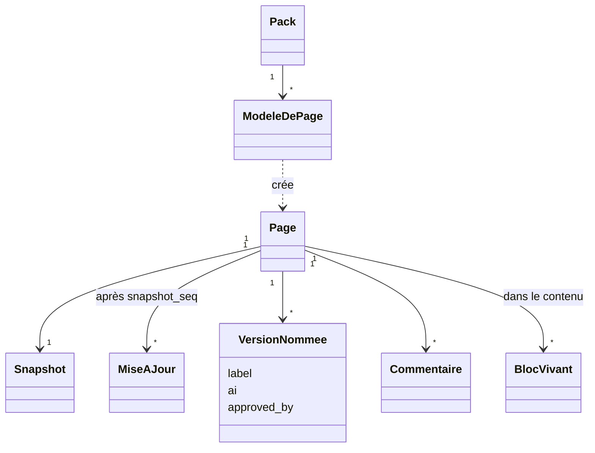
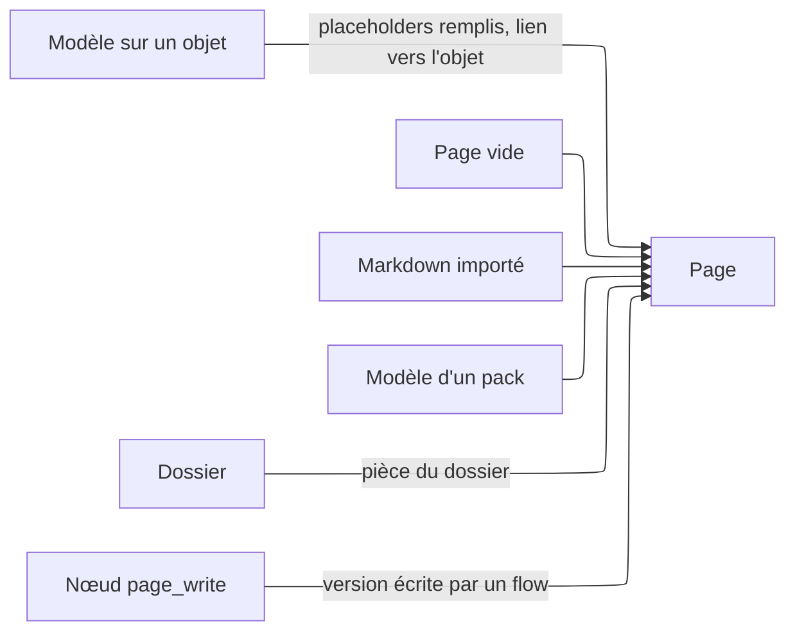
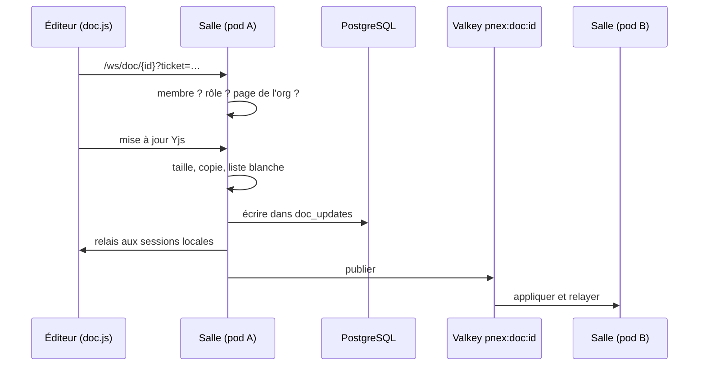
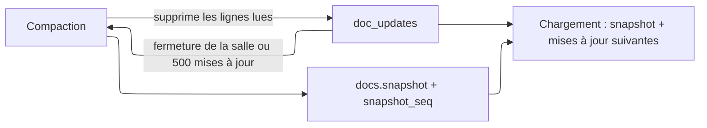
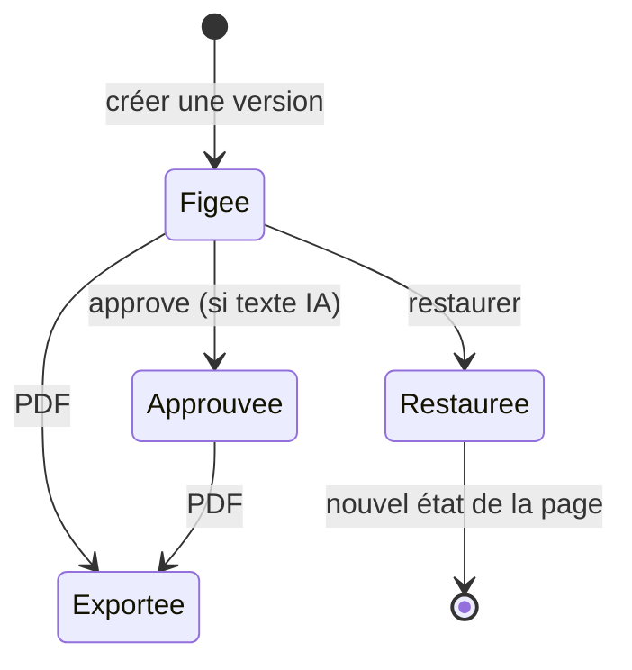
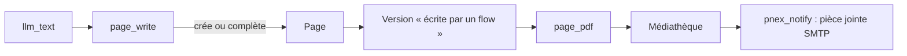

# Pages : documents collaboratifs reliés à l'ontologie

| | |
|---|---|
| **Statut** | L1 et le cœur de L2 sont codés : édition à plusieurs en temps réel, versions nommées, commentaires, import et export Markdown, modèles de packs, blocs vivants, PDF. Les lots L3 à L7 (mentions, tableaux, mesures, procédures, carte, médias) sont seulement proposés. |
| **Code** | `pnex_core::pages`, `services/pages/` (`room.rs`, `schema.rs`, `seed.rs`, `flow_write.rs`, `pdf.rs`), `controllers/docs.rs`, `controllers/doc_comments.rs`, `controllers/ws_doc.rs`, `js/doc.js`, `pages/docs/`, test e2e `e2e/tests/pages.spec.ts` |
| **Renvois** | Roadmap P2.17, décision #21. `ontology.md` (D176 types, D178 propriétés, D179 liens, D182 plages, D183 actions, D184 provenance, D185 requête, D186 explorateur, D187 tableau de bord de type, D188 permissions, D190 packs, D191), `media.md` (D21 médiathèque), `viz.md` (`pnexMap`, D34, D129 `SourceRef`), `analysis.md` (D825, D831, D832), `vision.md` (D209, D210), `crm.md` (D340), `cases.md` (K8), `doc-search.md`, `geo-layers.md`, `runtime.md` (D108 Valkey), `ai-assistant.md` §9 (D142–D145), `security.md` (R1–R20) |

## 1. Résumé

Une page est un document de l'org que plusieurs membres éditent en même temps. Elle remplace le Word de procédure, l'Excel de relevé et le compte rendu avec captures figées. Un bloc vivant affiche un calcul sur les données, refait à chaque lecture avec les droits du lecteur. Une version nommée fige la page, et l'export PDF part de cette version. Un flow peut aussi écrire une page et l'envoyer en PDF.

Hors périmètre : la parité avec un traitement de texte ou un tableur, le code exécutable dans une page, le HTML brut, la publication sur le web public, la mise en page `.docx` fidèle.

## 2. Concepts

| Terme | Définition |
|---|---|
| **Page** | Objet système de type `doc` (`KIND_DOC`) de l'org. Table `docs`. Elle a un titre, des étiquettes et un contenu Yjs. |
| **Contenu** | Arbre `y-prosemirror` sous la racine `prosemirror`. Seuls les nœuds et marques de `pnex_core::pages` sont admis. |
| **Mise à jour** | Modification Yjs envoyée par un éditeur. Le serveur la stocke dans `doc_updates`. |
| **Snapshot** | État compacté de la page (`docs.snapshot`, `snapshot_seq`). |
| **Version nommée** | État figé de la page, avec libellé, auteur, drapeau IA et approbation. Table `doc_versions`, jamais modifiée. |
| **Bloc vivant** | Nœud `live_block` : une requête SQL (`sql`) ou un calcul sur objets (`objects`), calculé à l'affichage (D831). |
| **Modèle de page** | Contenu Markdown fourni par un pack. Un modèle peut avoir un type d'objet comme sujet (D340). |
| **Commentaire** | Fil ancré sur une plage de texte par des positions relatives Yjs. Table `doc_comments`. |
| **Salle** | Copie en mémoire d'une page ouverte sur un pod, avec ses sessions websocket. |



## 3. Fonctionnement

### 3.1 Créer une page



`seed.rs` convertit un sous-ensemble de Markdown en arbre de page : titres, paragraphes, listes, citations, filets, blocs de code et liens. Les pages n'ont pas de nœud tableau : une ligne de tableau devient un paragraphe de cellules séparées par « · ». Un modèle sur un objet copie l'état de l'objet au moment de la création. Ensuite, la page s'édite librement.

### 3.2 Édition en temps réel (P2, P4)



L'éditeur demande un ticket à usage unique (`POST /api/v1/ws-ticket`) à chaque connexion. Le serveur applique la mise à jour sur une copie et la refuse si le résultat sort de la liste blanche. Il refuse aussi une mise à jour qui dépend d'un contenu absent. Le serveur écrit la mise à jour en base avant de la relayer. Un pod qui reçoit la mise à jour par Valkey l'applique et la relaie sans la stocker. Un rattrapage périodique depuis la base couvre un message perdu.

La présence (curseurs, qui regarde) passe par la salle, jamais par la base. Une session possède les identifiants de client qu'elle a annoncés en premier. À son départ, sa présence s'efface pour tous.

Un lecteur (viewer) rejoint la page en lecture seule : le serveur ignore ses mises à jour. Le rôle est relu à chaque battement (30 s). Codes de fermeture : 4001 ticket invalide, 4002 sans ticket, 4004 page absente, 4006 non membre, 4400 message illisible, 4413 trop grand, 4422 contenu refusé, 4429 trop de messages, 1011 non enregistré.

### 3.3 Stockage et compaction (P4, P5)



La compaction supprime seulement les mises à jour qu'elle a lues. L'historique continu (« la page au 3 mars ») n'existe donc pas : seules les versions nommées gardent un état passé.

### 3.4 Versions nommées (P5, D210)



Une version stocke l'état Yjs complet. Le client affiche une version en lecture seule, calcule le diff par blocs avec la version précédente et restaure une version. Restaurer écrit l'état ancien dans la page, comme une édition normale, puis crée une version qui le dit. Rien n'est effacé.

Une version qui contient du texte IA doit être approuvée par un humain avant de quitter la plateforme (D210). La première approbation est gardée. Le PDF d'une version IA non approuvée porte la mention « non relu ».

### 3.5 Bloc vivant et PDF (D831, D832)

Un bloc vivant porte un `bid`, une `source` (`sql` ou `objects`), sa requête et un titre. Il est calculé à l'affichage avec les droits du lecteur. À l'export PDF, il est calculé avec les droits de la personne qui exporte, puis daté. La route `/text` rend la page en Markdown : un bloc vivant y paraît seulement par son titre, jamais calculé.

Le PDF est en A4, rendu par la crate `pnex-pdf` (krilla). Un flow peut l'envoyer en pièce jointe d'e-mail (voir `notifications.md`, D209).

### 3.6 Page écrite par un flow (D209)



`page_write` envoie du Markdown (100 000 caractères au plus). Le serveur crée la page ou la complète, avec les mêmes contrôles qu'un éditeur. Les éditeurs ouverts voient l'ajout en direct. Le serveur fige ensuite une version marquée avec le flow et sa provenance IA.

### 3.7 Commentaires (P12)

Un commentaire s'ancre sur une plage de texte et survit aux éditions. Un fil a des réponses et peut être résolu puis rouvert. À chaque changement, le serveur prévient les éditeurs ouverts par un message dédié (`MSG_COMMENTS_CHANGED`). L'éditeur surligne les plages commentées.

## 4. Exigences

1. Le serveur doit refuser toute mise à jour dont le résultat contient une racine, un nœud, un attribut ou une marque hors de `pnex_core::pages`.
2. Un lien doit utiliser `http:`, `https:` ou `mailto:`. Sinon, le serveur le refuse (Markdown importé : le lien devient du texte).
3. Une mise à jour ne doit pas dépasser 2 Mio, et une page 8 Mio.
4. Une session ne doit pas dépasser 200 messages en rafale ni 50 messages/s en continu (SEC-28). Au-delà, le serveur ferme en 4429.
5. Le serveur doit écrire une mise à jour en base avant de la relayer.
6. Un viewer ne doit jamais modifier une page, ni par le websocket ni par l'API (R2). Un changement de rôle doit s'appliquer en 30 s au plus (SEC-29).
7. L'org d'une page doit venir du principal ou du ticket, jamais de la requête (R1).
8. Une version nommée ne doit jamais être modifiée.
9. Un PDF ne doit pas contenir de texte IA non approuvé sans la mention « non relu ».
10. Le test `doc_editor.rs` doit garder le schéma de `doc.js` égal à la liste blanche Rust. L'état produit par le vrai client (`yjs_client_state.b64`) doit passer le validateur.
11. Tout texte d'interface doit passer par `t!`. Le contenu d'une page est du texte libre, non traduit.

## 5. Décisions

Les décisions de ce document portent les numéros P1 à P16. Les numéros D renvoient au registre des autres documents.

| Pn | Titre | Décidé | État |
|---|---|---|---|
| P1 | La page est un type système | Type `doc` de l'ontologie, avec étiquettes (D218), liens et provenance. Une page peut être liée à un objet. | Codé. Pas d'onglet Pages sur la page d'un objet. |
| P2 | CRDT serveur et client | yrs côté serveur, Yjs côté client. Loro est écarté : 0,65 ms par import reçu et un bundle de 1,7 Mo. | Codé. |
| P3 | Éditeur ProseMirror en bundle IIFE | `js/doc.js` (`window.pnexDoc`), école `pnexMap`. Tiptap est écarté (collaboration liée à un cloud payant). | Codé. Le schéma est gardé par un test, pas généré. |
| P4 | WebSocket par page, fan-out Valkey | `/ws/doc/{id}`, protocole y-websocket, présence jamais en base. | Codé. Multi-pods réel non vérifié. |
| P5 | Versions | Versions nommées figées, diff, restauration. Historique continu avec rétention par org (D72). | Versions codées. Historique continu proposé. |
| P6 | Mentions `@` | Une mention est un `ResourceRef` résolu au rendu, avec un lien système `mentions` (D179, D184) et des rétroliens. | Proposé (L3). |
| P7 | Deux sortes de tableaux | (a) vue de collection : les lignes sont des objets (D185), édition par le service ontologique. (b) tableau local IronCalc : une formule lit, jamais n'écrit. | Proposé (L5). |
| P8 | Mesures | Valeur, unité, tolérance, opérateur. Une mesure publiée va seulement dans une série `*_manual`. | Proposé (L6). |
| P9 | Procédures et cycle de vie | Cycle brouillon → relecture → validée → obsolète. Procédure en étapes, avec action D183 proposée, jamais de commande device (D123, D128). | Proposé (L6). Le bon de travail GMAO est l'objet `work_order` (`ontology.md`). |
| P10 | Carte | Bloc `pnexMap`, live ou figé à une date, fond de carte de l'org. | Proposé (L4). |
| P11 | Médias, import, export | Import Markdown, export Markdown et PDF. Médias par la médiathèque (D21). Import `.docx`, `.csv`, `.xlsx`, `.geojson` par les extracteurs de `doc-search.md`. | Markdown et PDF codés. Le reste proposé (L4, L5). |
| P12 | Commentaires | Fils ancrés, résolus ou rouverts. | Codé. Notification des personnes mentionnées proposée. |
| P13 | Modèles et packs | Modèles fournis par les packs (D190), y compris par type d'objet (D340). | Codé. |
| P14 | Assistant IA | Lecture et rédaction par le service partagé avec l'UI. Jamais de validation, de signature ni d'action. | Proposé. L'assistant n'a pas d'outil de page. Les routes `docs_*` sont exposées en MCP. |
| P15 | Sécurité | Liste blanche du schéma, viewer en lecture seule, débit borné, aucun HTML utilisateur (R11–R13). | Codé. |
| P16 | i18n et accessibilité | `t!` partout, palette `/`, raccourcis Markdown. | Codé. Rendu tablette pour les procédures proposé. |

Choix tranchés de la décision #21 :

- L1 et L2 sont une exception au gel de la 0.2.0. L3 et la suite viennent après.
- Le tableau local est admis : une formule lit, jamais n'écrit ni n'exécute de code (`ontology.md` §3).
- Pas de page privée. Toute page est visible de l'org, et les ACL suivent D188.
- Une mesure publiée écrit seulement dans une série `*_manual`, jamais dans une série de device.
- La signature d'une version est une trace d'identité (qui, quand, version figée). La signature cryptographique va aux profils de sécurité.
- Le nom dans l'UI est « Pages ». « Documents » reste l'onglet des fichiers indexés (`doc-search.md`).

## 6. Interfaces

### 6.1 Routes

Permissions : `docs:read` (viewer) et `docs:write` (member).

```
GET    /api/v1/docs                         ?search&label&limit&offset
POST   /api/v1/docs                         {title, template? | markdown?}
GET    /api/v1/docs/{id}                    titre et horodatages
PATCH  /api/v1/docs/{id}                    renommer
DELETE /api/v1/docs/{id}                    supprime journal, versions, commentaires, étiquettes
GET    /api/v1/docs/{id}/text               Markdown du contenu courant
GET    /api/v1/docs/{id}/versions
POST   /api/v1/docs/{id}/versions           {label}
GET    /api/v1/docs/{id}/versions/{n}       état Yjs figé (base64)
POST   /api/v1/docs/{id}/versions/{n}/approve
GET    /api/v1/docs/{id}/versions/{n}/pdf
GET    /api/v1/docs/{id}/comments
POST   /api/v1/docs/{id}/comments
PATCH  /api/v1/docs/{id}/comments/{cid}
DELETE /api/v1/docs/{id}/comments/{cid}
POST   /api/v1/ontology/objects/{id}/pages  page depuis un modèle sur l'objet (D340)
POST   /api/v1/cases/{id}/pages             page dans un dossier (K8)
GET    /ws/doc/{id}?ticket=…                synchronisation et présence
```

### 6.2 Tables

| Table | Rôle |
|---|---|
| `docs` | une ligne par page, avec `snapshot` et `snapshot_seq` |
| `doc_updates` | journal des mises à jour Yjs après le snapshot |
| `doc_versions` | versions nommées, état figé, auteur, drapeau IA, approbation |
| `doc_version_exports` | PDF exportés d'une version |
| `doc_comments` | fils de commentaires ancrés |

Migration d'origine : `m20261011_000004_pages`.

### 6.3 Liste blanche du contenu

| Élément | Valeurs |
|---|---|
| Nœuds | `paragraph`, `heading`, `blockquote`, `horizontal_rule`, `code_block`, `hard_break`, `bullet_list`, `ordered_list`, `list_item`, `live_block` |
| Marques | `em`, `strong`, `code`, `link` (`href`, `title`) |
| Bornes | titre 255 car., commentaire 4000 car., mise à jour 2 Mio, page 8 Mio |

## 7. Reste à faire

Lots proposés, dans l'ordre :

| Lot | Contenu | Sortie vérifiable |
|---|---|---|
| L3 | Mentions `@`, puces vivantes, lien `mentions`, rétroliens, onglet Pages sur chaque objet, blocs graphe et widget | renommer un device met à jour la page |
| L4 | Médias par glisser-déposer, blocs image, vidéo, PDF et 360, bloc carte, import `.docx` et `.geojson`/`.gpx`/`.kml` | compte rendu d'incident complet dans PneX |
| L5 | Vues de collection (tableau, kanban), tableau local IronCalc, fonctions `PNEX.*`, import `.csv`/`.xlsx`, promotion en type | relevé de recette de 40 capteurs avec écarts |
| L6 | Cycle de vie de page, relecture, bloc procédure, mesures avec tolérance, actions D183 | mesure hors tolérance bloquante sur tablette |
| L7 | Outils de l'assistant, modèles du pack Maintenance | pack livré avec ses 3 modèles |

Autres points ouverts :

- Historique continu avec rétention par org : la compaction efface aujourd'hui le journal.
- Hors ligne mobile : les éditions survivent seulement tant que la page reste ouverte (pas de `y-indexeddb`).
- Index plein texte des pages : attend une colonne `doc_id` dans `text_chunks` de `doc-search.md`. La recherche globale (D69) ne trouve pas encore le contenu des pages.
- Notification des personnes mentionnées dans un commentaire.
- Vérification multi-pods réelle et test de convergence sous coupures réseau.
- Hors V1 : mode suggestion et branches, ACL par page et lien public (suit D188), vues calendrier et Gantt des collections (étude GMAO), diagrammes dessinés dans la page, export `.docx` fidèle.
