# Veille et vérification d'un réseau de partenaires

Décisions D300–D316, D402–D431. Liens : `ontology.md` (D176–D191, D190 packs, D368 réglages de pack), `pipelines.md` (D317–D322, D344 imports à étapes), `crm.md` (D343 socle `companies`), `web-presence.md` (D359–D366, sites des organisations), `browser-agents.md` (D254–D284, missions et agents), `agents.md` (D323–D328 règles de site), `cases.md` (dossiers, K20 événements), `proposals.md` (D371–D377), `iam.md` (comptes de service), `notifications.md`, `media.md` (versions), `pages.md` (PDF), `security.md` §6, `ai-assistant.md` §9.

## 1. Résumé

Un certificateur contrôle le réseau des organismes de formation qu'il habilite. PneX importe ce réseau, l'enrichit par des registres publics, parcourt les sites des partenaires et garde des preuves datées. Des règles comparent ce qui est publié à ce qui est déclaré et écrivent des écarts. Un dossier de veille par partenaire montre chaque vérification et son résultat. Le noyau donne seulement des primitives génériques. Le métier vit dans le pack `quali_watch` (D190, D316) et sert aussi d'autres veilles : usurpation de marque, faux RIB, appels d'offres.

PneX sert aussi de moteur à un SaaS tiers qui a sa propre interface (D300). Les opérateurs de ce SaaS enquêtent dans l'UI de PneX.

## 2. Concepts

- **Réseau** : les organisations reliées à une certification par un lien `accredited_for` ouvert, plus le certificateur (lien `holds`).
- **Import** (`object_imports`) : une source (fichier, URL, API) et un mapping YAML qui écrivent des objets et des liens.
- **Clé naturelle** : une propriété `unique` d'un type (`siren`, `siret`, `ref`). L'import fait l'upsert sur elle.
- **Crawl** : le parcours d'un site, borné à son origine (mission `crawl_site`).
- **Page pertinente** : une page qui répond au `match` du crawl.
- **Page observée** (`observed_page`) : l'objet du pack qui représente une page pertinente.
- **Preuve** : la capture, le HTML nettoyé, le texte et le manifeste d'une page, scellés dans une chaîne d'empreintes.
- **Règle** : une fonction Starlark du pack qui lit des faits et écrit des écarts. Code `ADM-01`, `WEB-02`…
- **Écart** (`finding`) : un constat daté. États : `proposed`, `to_validate`, `confirmed`, `reminding`, `fixed`, `closed`, `rejected`.
- **Procédure** et **relance** (`procedure`, `reminder`) : le plan gradué R1 à R4 envoyé à un partenaire.
- **Programme** (`syllabus`) : le programme de référence ou le programme d'un partenaire, découpé en **modules** (`module`).
- **Tableau croisé** : la comparaison des programmes compétence par compétence (`skill`), calculée, puis écrite en xlsx.
- **Vérification** : un passage consigné d'un contrôle sur un sujet (nœud `check_record`). Le lexique dit « Vérification » / « Check », jamais « contrôle » (= surface pilotable D123).
- **Dossier de veille** : un case qui porte une `watch_key` et reçoit les vérifications d'un partenaire.

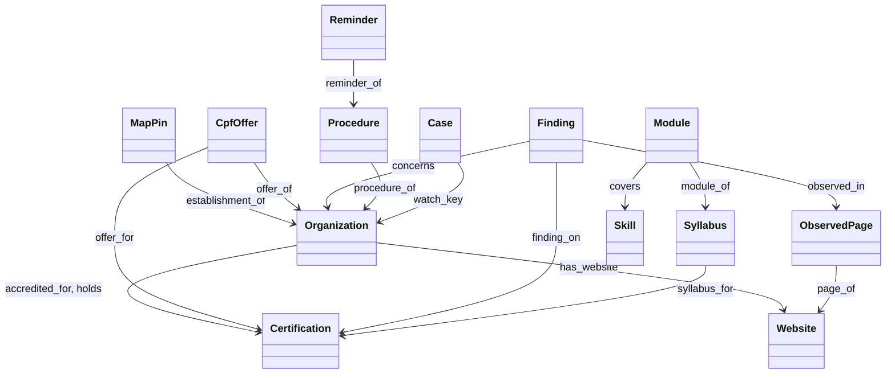

## 3. Fonctionnement

### 3.1 Vue d'ensemble

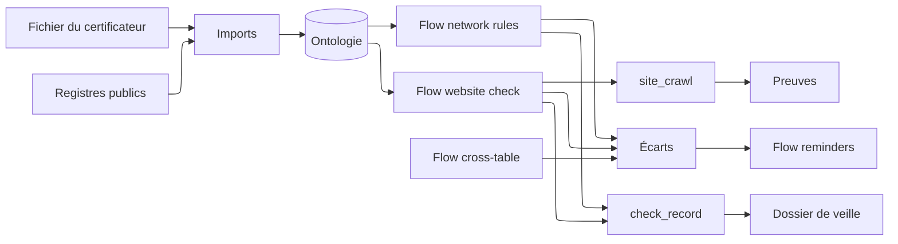

Le pack livre ses imports, ses fonctions et ses flows. Les flows arrivent en brouillon : l'humain les déploie (D123, D144, D316). Une règle ne réimplémente rien : elle lit l'ontologie par `ontology_query` et écrit par `object_upsert` et `link_upsert` (D312).

### 3.2 Imports déclaratifs

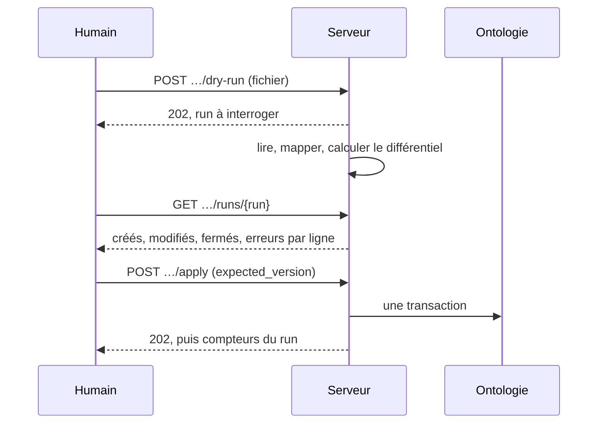

Un import lit un fichier envoyé (`xlsx`, `csv`, `json`), une URL `http(s)` (`csv`, `xml`, `json`, zip possible) ou une API JSON paginée (D301). Le mapping YAML ne contient aucun code : pas de Starlark, pas de gabarit. Il déclare les enregistrements, les types cibles, la clé naturelle, les propriétés avec des conversions fermées et les liens dérivés. Le langage complet et les `steps:` sont dans `pipelines.md`.

- **Mode `incremental`** : création et mise à jour.
- **Mode `snapshot`** : en plus, les objets et liens absents du lot sont fermés (`valid_to = now`), jamais supprimés.
- **Provenance** : `import:<import_id>@<run>` sur chaque fait écrit (D184).
- **Plafonds** : 250 000 lignes par run, 5 000 éléments par `each`, 500 000 objets planifiés par run (`import-source-too-large`), 200 Mo décompressés.

Une source API **par objet** (`per_object`) interroge un registre une fois par objet connu, les moins récents d'abord. Elle est incompatible avec `snapshot`. Trois filtres la bornent au réseau :

- `linked: [accredited_for, holds]` : seuls les objets qui ont un lien ouvert de ces types passent (D403).
- `setting: { key: quali_watch.certifications, property: code }` : seuls les objets liés à une certification suivie passent (D422).
- `only` : un filtre de propriété, combinable avec les deux autres.

Un réglage vide, inconnu ou d'un pack absent ne filtre rien.

Un run planifié part à 03:00 UTC du jour de récurrence, avec le rôle actuel de l'auteur (D303). Le serveur refuse le run sans rien écrire sur un schéma inattendu (`import-schema-changed`) ou sur une chute de plus de 30 % des lignes en `snapshot` (`import-suspicious-drop`). Le refus est notifié à l'org. Un run `snapshot` avec des lignes en erreur ne ferme rien.

Un `map_pin` sans coordonnées n'est pas créé. La ligne passe en avertissement (`location: required`) et le run continue (D406).

`PUT /ontology/imports/{id}` garde `source_url`, `recurrence` et `max_pages` quand ils sont omis. `null` les efface.

### 3.3 Imports livrés par un pack

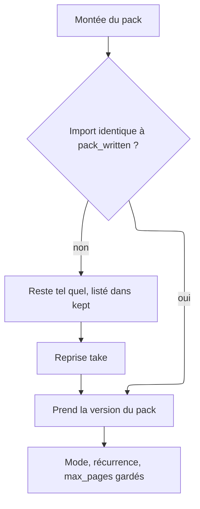

Le pack possède le mapping, la source et l'URL. Le mode, la récurrence et `max_pages` sont des réglages de l'org : le pack ne les remplace jamais (D424). `object_imports.pack_written` garde ce que le pack a écrit (`written`) et la version de l'org remplacée (`replaced`). `differs` dit ce qui change (`source`, `source_url`, `mapping.<clé>`) et sert d'aperçu à la reprise.

### 3.4 Organisations, établissements, hiérarchies

Le pack `companies` décrit une entreprise de tout pays. `companies_fr` ajoute les clés et le registre français (D304, amendé par D343) :

- une unité légale est une `organization` étendue (`siren` unique, `nda`, `qualiopi`, `qualiopi_categories`, `qualiopi_updated`).
- un établissement est un `map_pin` (`siret` unique), relié par `establishment_of`.
- un dirigeant est une `person` ou une `organization`, reliée par le lien temporel `manages`.

Aucun type « entreprise » n'existe : `organization` porte déjà `owns`, `employs` et l'outillage des dossiers. Les données des dirigeants sont minimisées : nom, prénoms, rôle, dates de mandat, jamais de date de naissance complète ni d'adresse.

Un pack étend un type d'un pack requis, direct ou non, ou un type système par `extends:` (D306). Il ajoute seulement des propriétés optionnelles. Une collision de clé refuse l'installation. La fiche objet groupe les propriétés par pack.

Une hiérarchie est une vue d'arbre calculée sur des liens, pas du containment (D305). D180 reste vrai : le containment a un seul parent. Un pack déclare une liste ordonnée de liens avec leur sens. Le pack `quali_watch` déclare `network` : `accredited_for` inverse, `has_website`, `page_of` inverse. L'onglet **Hiérarchie** montre l'arbre à une date T, 6 niveaux et 500 nœuds au plus. Un nœud à plusieurs parents apparaît sous chacun.

### 3.5 Registres du réseau

| Import du pack | Source | Écrit |
|---|---|---|
| Partner network (sheet) | fichier du certificateur, `snapshot` | partenaires, `accredited_for` |
| France Compétences · certifiers, sheets, partners, skill blocks, RS sheets (XML) | open data, nuit | certifications, `number`, compétences, habilitations |
| Company register · network (SIRENE) | API par SIREN, réseau seulement | unité légale, établissements, dirigeants |
| DGEFP · training organizations (network) | API par SIREN (D404) | `nda`, `qualiopi*` |
| CPF catalogue · RS / RNCP certifications | export par certification (D405) | `cpf_offer`, `offer_of`, `offer_for` |

DGEFP ne modifie pas un organisme absent de sa liste : une absence ne prouve rien (D404). Le catalogue CPF crée une `organization` inconnue de l'org : c'est l'organisme non habilité de CPF-01 (D405). Une offre retirée garde son ancien `seen_on`. Le filtre de lignes d'une étape suit le réglage `certifiers` (`rows_filter.setting`, D425).

### 3.6 Crawl d'un site

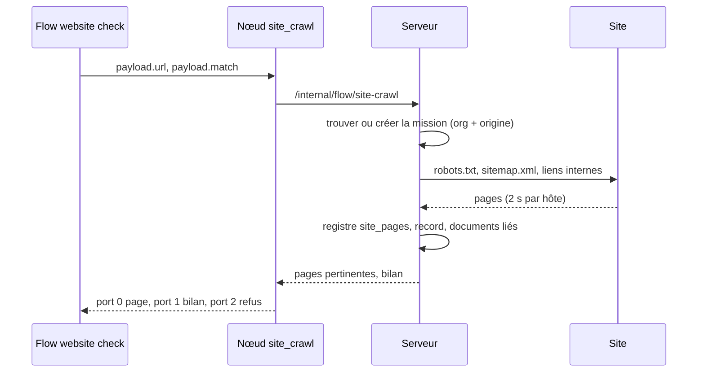

La mission `crawl_site` vise un site `web:site:<hôte>`. La découverte reste dans l'origine déclarée (D307, amende D254). Le client serveur s'identifie (`PNEX-Crawler/<version>`), lit `robots.txt`, puis `sitemap.xml`, puis les liens internes en largeur. Plafonds : 200 pages par défaut (2 000 au plus), profondeur 5, 5 Mo par page, une requête par hôte toutes les 2 s (plancher compilé). Un agent navigateur peut suivre le même parcours au rythme D258, pour un site rendu en JavaScript.

Le nœud `site_crawl` lance le crawl depuis un flow (D407). Le serveur tient une mission par site, marquée `flow:<id>`, que le balai horaire saute. Un appel attend 30 min au plus.

- **Entrée** : `msg.payload.url` et `msg.payload.match`, 50 motifs au plus (`word`, `phrase`, `regex`).
- **Config** : `max_pages`, `exclude`, `proofs`, `record` (type `observed_page`, `proof_link`, `document_link`).
- **Port 0** : une page pertinente nouvelle ou modifiée, `{url, title, text, page_id, object_id, changed}`, texte limité à 50 000 caractères.
- **Port 1** : le bilan `{url, pages, relevant, truncated, blocked}`, lu par COL-01.
- **Port 2** : le refus, `msg.error = {code, args}`, codes `site-crawl-*`.

Un site est parcouru seulement s'il a un lien `has_website` ouvert. Un candidat moyen reste une proposition (D376).

Les documents liés par une page pertinente (PDF, DOCX) deviennent des médias de l'org (D421). Le crawl en lit 5 par page et 50 par crawl, 20 Mo au plus chacun, sur le même site et au même rythme. Un fichier coupé n'est pas gardé. Chaque adresse donne un média `document`, une version par SHA-256. Le lien `has_document` (page observée → média) porte `url`, `first_seen`, `seen_on` et `sha256`.

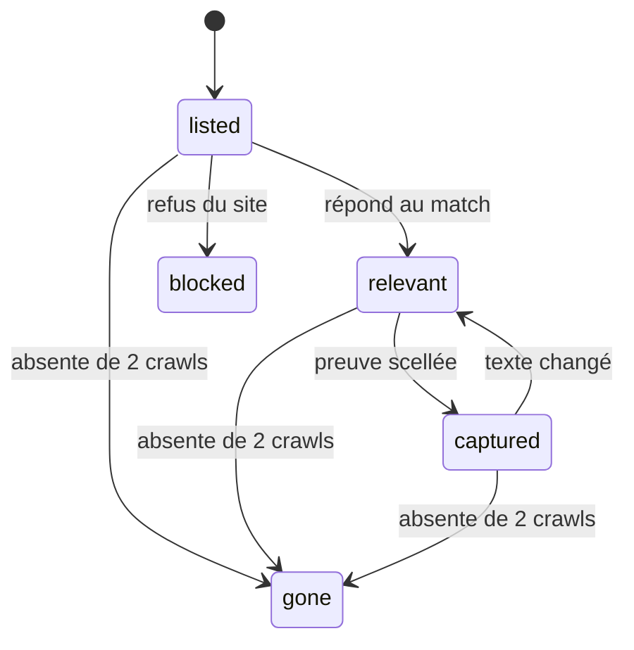

Le registre `site_pages` est unique par org et URL normalisée (D309). Il garde le titre, les dates, l'empreinte du texte, l'état et la dernière preuve. Il reste au noyau sans type système. Une page `gone` prouve souvent une correction.

### 3.7 Preuve

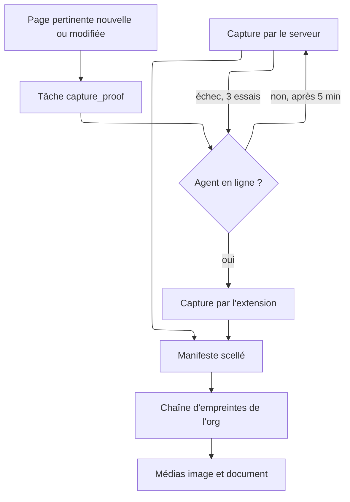

Le crawl ne prend pas les preuves lui-même (D308). Le serveur crée une tâche `capture_proof` par page, refusée à la création manuelle. Sans agent en ligne, la tâche attend avec le code `ext-no-agent`. Après 5 min, le serveur la prend avec le navigateur de l'org, sinon celui de la plateforme (D408). L'agent reste préféré : il voit la page comme un humain.

Une preuve contient quatre parties (D310, amende L1 de D261) :

1. une capture PNG pleine page, 20 000 px de haut au plus (la fenêtre seule si le moteur serveur ne sait pas `captureBeyondViewport`, et le manifeste le dit).
2. le HTML du DOM rendu, nettoyé par l'agent et par le serveur, servi en téléchargement seulement.
3. le texte lisible, indexé.
4. le manifeste JSON : URL demandée et finale, code HTTP, en-têtes utiles, exécutant, `captured_at` à l'horloge du serveur, SHA-256 de chaque partie.

Le manifeste porte aussi le SHA-256 du manifeste précédent de l'org. Une modification a posteriori casse la chaîne. `GET /api/v1/extension/proofs/verify` la vérifie. Une preuve serveur porte `agent = server:<moteur>` et `executor = server`, dans la même chaîne.

### 3.8 Écarts et règles

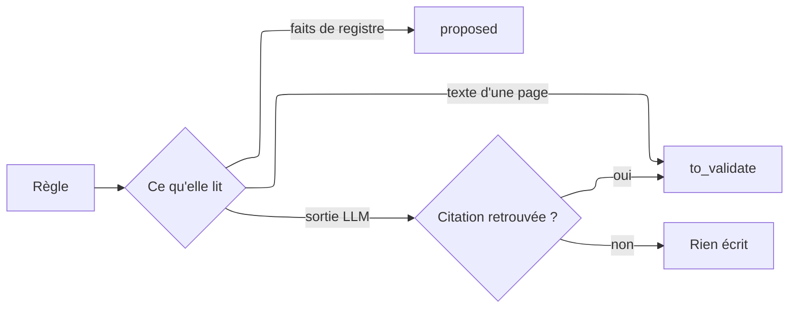

Une règle sur des faits de registre (SIRENE, DGEFP, France Compétences, CPF) écrit l'écart `proposed` (D409). Une règle qui lit le texte d'une page écrit `to_validate`, même si elle est déterministe : une page se lit mal. L'extrait est cité mot pour mot et la fonction du pack le retrouve dans le texte. L'écart porte `rule_version`. Avec `skip_existing`, un écart revu par un humain n'est jamais réécrit.

La clé d'un écart vaut `<règle>:<siren>:<code certification>[:<suite>]`, tronquée à 255 caractères. Le SIREN est toujours le deuxième segment : une application rattache l'écart par `split(":")[1]`.

| Règles | Clé |
|---|---|
| ADM-01, REG-01, REG-02 | `<règle>:<siren>:<code>` |
| ADM-01 de `qw_rule_adm_01` (hors réseau) | `<règle>:<siren>`, l'id de l'objet à défaut |
| ADM-02 | `<règle>:<siren>` |
| CPF-01, CPF-02, CPF-03 | `<règle>:<siren>:<code>:<id_action>` (SIREN de l'offre) |
| WEB-01 à WEB-04, WEB-08 | `<règle>:<siren>:<code>:<page>` |
| WEB-05 | `<règle>:<siren>:promesse:<page>` |
| WEB-06 | `<règle>:<siren>:qualiopi-<catégorie>:<page>` |
| COL-01 | `<règle>:<siren>:<url du site>` |

`<page>` est l'id de la page observée, sinon son URL. Un partenaire sans SIREN donne un segment vide et se rattache par `concerns`. Un écart se relie par `concerns`, `finding_on` et `observed_in`. Un écart n'est pas une proposition (`proposals`) : il suit son propre cycle.

Le pack lit quatre réglages (D368) : `certifications` (codes suivis, vide = tous ceux d'un certificateur de l'org), `disabled_rules`, `tolerance_hours` et `whole_site` (toutes les pages pertinentes, pas seulement celles qui citent un code suivi).

Catalogue (D410). Les règles livrées sont toutes déterministes et marchent sans fournisseur LLM.

| Code | Constat | Nature | Gravité | Livrée |
|---|---|---|---|---|
| ADM-01 | partenaire cessé encore habilité | registre | critique | oui |
| ADM-02 | Qualiopi absent ou sans « actions de formation » | registre | critique | oui |
| CPF-01 | offre CPF d'un organisme non habilité | registre | critique | oui |
| CPF-02 | offre CPF hors périmètre (habilité « évaluation ») | registre | majeur | oui |
| CPF-03 | offre CPF après la fin d'habilitation | registre | critique | oui |
| REG-01 | habilitation connue hors open data | registre | info | oui (sens inverse : V2) |
| REG-02 | habilitation inactive, partenaire encore actif | registre | critique | oui |
| COL-01 | site injoignable, bloqué ou sans page pertinente | collecte | info | oui |
| WEB-01 | intitulé inexact près du code | texte | majeur | texte (LLM : V2) |
| WEB-02 | code absent ou faux près de l'intitulé | texte | majeur | oui |
| WEB-03 | certificateur non cité | texte | majeur | texte (LLM : V2) |
| WEB-04 | « éligible CPF » sans éligibilité | texte | critique | oui |
| WEB-05 | promesse interdite | texte | critique | lexique (LLM : V2) |
| WEB-06 | Qualiopi affiché hors catégorie certifiée | texte | mineur | texte (vision : V2) |
| WEB-08 | code du client cité sans habilitation active | texte | critique | oui |
| NOM-01, WEB-07, LIEU-01, CPF-04 | nom, modalités, lieu, prix ou durée | texte, LLM, géo | mineur à majeur | V2 |
| PROG-00 à PROG-04 | tableau croisé (§3.9) | calcul | info à majeur | oui |

WEB-06 exige une mention explicite d'une catégorie (« bilan de compétences », « VAE », « CFA », « alternance »…). « apprentissage » seul ne suffit pas. Le contrôle des noms (D411) compare le nom du registre, celui de France Compétences et celui du site, normalisés par `fold` sans forme juridique. Un écart de nom est toujours `to_validate`.

### 3.9 Tableau croisé des programmes

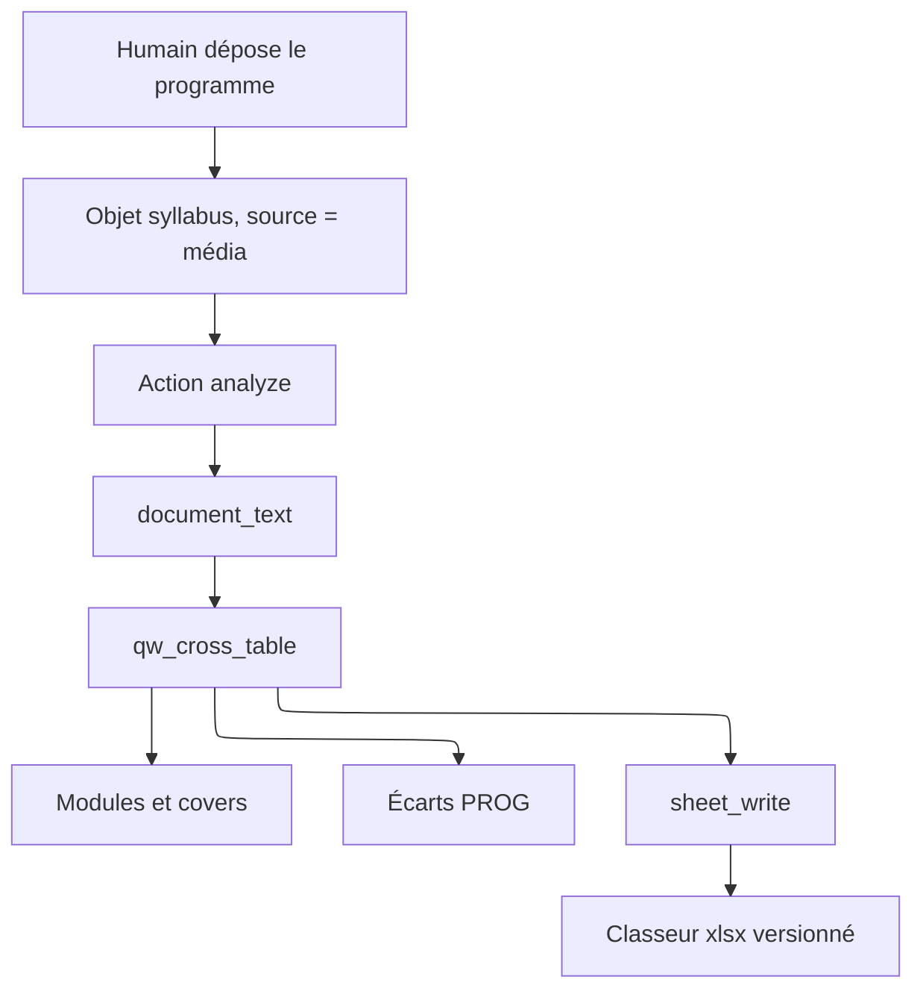

Un humain dépose un PDF texte, un DOCX ou un texte dans la médiathèque (D415). Il crée l'objet `syllabus` (`role` = `reference` ou `partner`), puis lance l'action **Analyser** (`analyze`). Le flow « Quali-Watch · cross-table » lit l'objet visé par `ontology_query` avec le filtre `id eq`. Le programme peut aussi venir d'un document lié par une page observée.

Le nœud `document_text` lit la dernière version d'un média `document` de l'org, 200 000 caractères au plus (D416). Il accepte l'id du média ou celui de son objet. Un scan sans texte échoue en `document-text-no-text`.

`qw_cross_table` calcule tout avant d'écrire, car un flow ne relit pas ce qu'il écrit dans le même passage. Il découpe le texte en modules sur une liste fermée de titres (« Chapitre NN : … », « Module N – … », fin en « (Cn) » ou « (n h) ») (D417). Puis il rattache chaque module à une compétence (D418) :

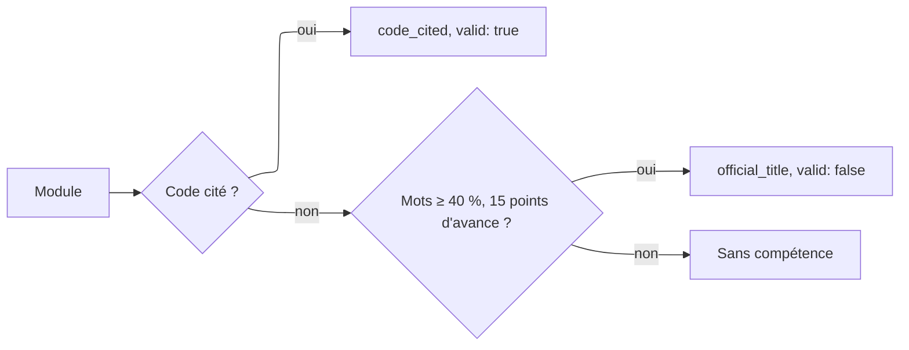

La comparaison par les mots porte sur le programme de référence de la compétence, sinon sur son libellé, mots normalisés, préfixe de 5 lettres. Un rattachement `valid: false` reste « à valider » et compte quand même comme couverture.

Règles PROG (D419) :

| Code | Calcul | État |
|---|---|---|
| PROG-00 | heures illisibles d'un module ou d'une compétence | info, `to_validate` |
| PROG-01 | compétence sans module du partenaire | `to_validate` |
| PROG-02 | heures du partenaire < heures de référence − `tolerance_hours` (défaut 0, Q-N7) | `proposed` si tous les rattachements sont `valid`, sinon `to_validate` |
| PROG-03 | module sans compétence | info, `to_validate` |
| PROG-04 | format, heures synchrones ou de préparation ≠ référence | `proposed` |

Le test d'acceptation sur le pilote fictif RS0101 × OF EXEMPLE retrouve la lecture humaine : PROG-02 sur C2, C3 et C4, PROG-03 sur le chapitre 5, aucun PROG-01.

Le nœud `sheet_write` écrit un classeur xlsx sans formule, en texte en ligne, avec 4 styles (D420). Il n'ajoute aucune dépendance. Chaque écriture donne une version d'un média `table` par flow, nœud et nom de fichier.

### 3.10 Relances graduées

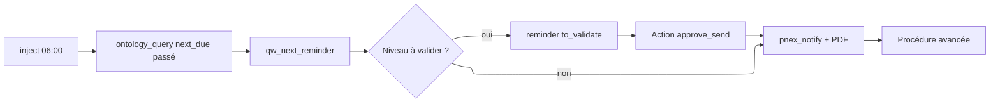

Le noyau n'a pas de moteur de relance (D314). La procédure porte `level` (R1 à R4, `removal_proposed`) et `next_due`. Le nœud `pnex_notify` envoie au destinataire tiré du message (`to_field`) sur un canal SMTP marqué `dynamic_recipients` (D313). Garde-fous :

- contenu = modèle seulement (D52).
- un destinataire, plus un `cc`.
- 200 envois par jour et par canal, 3 par jour et par destinataire, comptés dans `notify_dynamic_sends` (adresse hachée).
- activation du canal par un propriétaire ou un admin, porte de deploy sinon.
- expéditeur = le SMTP de l'org.

Le canal `webhook` peut signer en `hmac` (D315) : `x-pnex-timestamp` et `x-pnex-signature: sha256=<HMAC(secret, timestamp + "." + corps)>`. Le récepteur refuse un message de plus de 5 min.

### 3.11 Vérifications et dossiers de veille

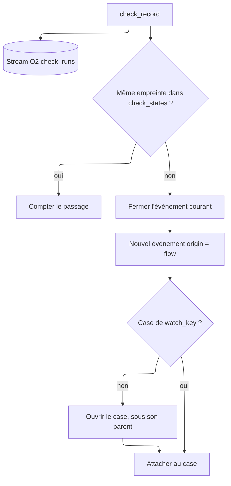

Le nœud `check_record` consigne un passage (D426). Le message porte le contrôle, le sujet, la portée, les règles avec leur résultat (`ok`, `finding`, `unknown`), les objets et la clé du case. Le serveur prend la provenance `flow:<id>@<version>` dans la version déployée. Il vérifie chaque identifiant dans l'org du nœud et refuse un identifiant inconnu. Le résultat du passage est le pire de ses règles. Le budget d'écriture est celui d'`object_upsert` : 600 écritures par minute et par org.

L'empreinte hache le contrôle, le sujet, la portée et les règles triées (D427). Elle seule décide d'un changement. Un passage identique met seulement à jour `check_states`. Un changement ferme l'événement courant et en ouvre un, période ouverte, dans une transaction sous verrou. `check_states` est un état de travail, exception consignée à K1 : un objet coûterait une version par passage. Une montée de version de règle change l'empreinte et se voit donc dans la chronologie.

`EVENT_ORIGINS` contient `flow`, écrit seulement par `check_record` (D428). Le type `case` porte `watch_key` (unique) et `watch_state` (le pire des derniers résultats) (D429). Le pack donne la clé `qw:<certification>:<siren>`, sous le parent `qw:<certification>`. Un case archivé n'est jamais rouvert. Un écart `rejected` ou `closed` sort de l'état global au passage suivant.

`GET /api/v1/cases/{id}/workspace` rend `checks`, lu dans `check_states` (D430). Le panneau **Vérifications** les montre au-dessus de la frise.

Branchements (D431) :

- `qw_network_rules` et `qw_web_rules` émettent leurs passages sur une seconde sortie (`quali_watch.network`, `quali_watch.website`).
- un site injoignable donne `unknown` (`site-unreachable`), pas un écart.
- un écart écrit dans le même run se cite par sa clé (`finding_ref`).
- un import consigne `import:<nom>` pour les objets mis à jour qui sont le sujet d'un case de veille.
- un run sans `case` rejoint le case de veille que le sujet a déjà, sinon il est seulement compté.

### 3.12 SaaS tiers

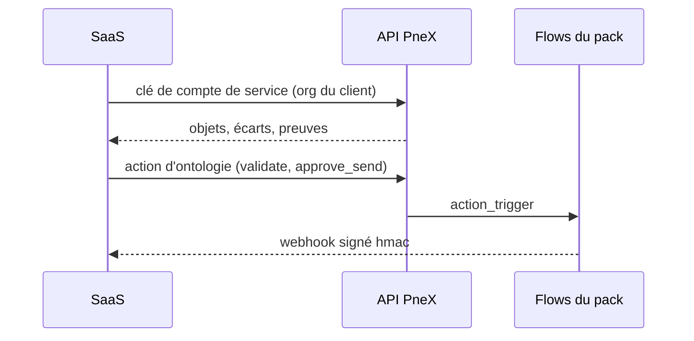

Un client du SaaS est une org PneX (D300). Le SaaS garde une clé de compte de service par org, côté serveur seulement. Il écrit par actions d'ontologie (D183), pour que la règle reste dans un flow PneX. Les opérateurs sont membres de chaque org client et leur accès est tracé (D294). Aujourd'hui, un compte de service lit seulement : l'écriture bornée aux types d'un pack n'est pas livrée (§7).

## 4. Exigences

1. Le noyau ne doit contenir aucune clé propre à la formation ou au CPF (D190, D441). Le métier vit dans le pack.
2. Un import doit refuser son run sans rien écrire sur un schéma changé ou une chute suspecte.
3. Un import `snapshot` doit fermer les absents, jamais les supprimer.
4. L'assistant peut proposer l'aperçu d'un import. Il ne doit jamais l'appliquer.
5. Un crawl ne doit suivre aucun lien ni aucune redirection hors de l'origine déclarée.
6. Le crawl serveur doit lire `robots.txt` et respecter 2 s par hôte.
7. Le HTML d'une preuve ne doit jamais être servi en `text/html` sur l'origine de l'app (R11–R13).
8. Toute URL d'import, de crawl ou de preuve serveur doit passer la garde de sortie (R8).
9. Les parseurs xlsx, XML et zip doivent traiter leur entrée comme hostile : bombe zip, entités externes, profondeur.
10. Un écart issu d'un texte de page ou d'un LLM doit être `to_validate`, avec son extrait mot pour mot.
11. Une citation LLM introuvable dans le texte ne doit rien écrire (D316).
12. Un nœud de flow doit lire sa configuration et son org dans la version déployée (R1).
13. Un flow ne doit écrire sur aucun type système natif.
14. Un passage sans changement ne doit écrire aucun objet.
15. Un compte de service ne doit jamais recevoir `iam:*`, suppression, deploy ou action physique.

## 5. Décisions

| # | Décision | Choix actuel |
|---|---|---|
| D300 | PneX moteur d'un SaaS tiers | une org par client, clé de compte de service côté serveur, écriture bornée aux types d'un pack (non livrée), gestes métier par actions |
| D301 | Imports déclaratifs | `object_imports`, fichier / URL / API, mapping YAML sans code, `incremental` / `snapshot`, aperçu puis application |
| D302 | Clé naturelle | `PropertyDef.unique`, contrôlée par le service ; 409 `ontology-unique-duplicates` sur des doublons existants |
| D303 | Synchronisations planifiées | récurrence, journal `object_import_runs`, refus sans écriture |
| D304 | Pack `companies_fr` | `organization` étendue, établissement = `map_pin`, dirigeants par `manages`, données minimisées ; socle passé à `companies` (D343) |
| D305 | Hiérarchie | vue d'arbre sur des liens déclarés par le pack, multi-parents, datée ; D180 inchangé |
| D306 | Extension de type | `extends:` vers un type requis ou système, propriétés optionnelles seulement |
| D307 | Mission `crawl_site` | découverte bornée à l'origine (amende D254), serveur par défaut, agent pour le JavaScript, pertinence par `match` |
| D308 | Déclenchement de la preuve | page pertinente nouvelle ou modifiée → tâche `capture_proof` |
| D309 | Registre `site_pages` | unique par org × URL, `gone` après 2 absences, au noyau sans type système |
| D310 | Preuve horodatée | capture + HTML nettoyé + texte + manifeste, chaîne d'empreintes ; amende L1 de D261 |
| D311 | Diff de versions | diff par paragraphes, `GET /media/{id}/versions/diff`, bouton « Comparer » |
| D312 | Nœuds ontologie | `ontology_query`, `object_upsert`, `link_upsert` ; config déployée, provenance du flow, 600 écritures par minute |
| D313 | Destinataire tiré du message | `to_field` sur canal `dynamic_recipients`, modèle seul, plafonds, adresse hachée |
| D314 | Relances graduées | patron de pack (procédure + flow cron), validation humaine par niveau |
| D315 | Webhook signé | mode `hmac` horodaté |
| D316 | Règles d'un pack | Starlark et LLM dans le pack, constat LLM `to_validate` ; amende D190 (un pack livre fonctions et flows) |
| D402 | `ontology_query` parcourt le réseau | `traverse` (3 sauts) et `with_links` (200 liens par ligne et par type) |
| D403 | Enrichissement borné | `per_object.linked` |
| D404 | DGEFP | NDA et Qualiopi par SIREN, une absence ne modifie rien |
| D405 | Catalogue CPF | imports RS et RNCP par certification, `cpf_offer` |
| D406 | Établissement sans coordonnées | avertissement ; géocodage à l'import non livré |
| D407 | Nœud `site_crawl` | le crawl D307 lancé par un flow, une mission par site |
| D408 | Preuve serveur | après 5 min sans agent, même chaîne, 3 essais |
| D409 | États des écarts | registre `proposed`, texte ou LLM `to_validate`, clé stable, `skip_existing` |
| D410 | Catalogue des règles | livré par le pack, réglages `certifications` et `disabled_rules` |
| D411 | Contrôle des noms | trois noms normalisés par `fold` ; NOM-01 en V2 |
| D412 | Géographie | géocodage des sièges, score de site, LIEU-01, carte du réseau : non livrés |
| D413 | Collecte des programmes sur le site | V2, par règle de navigation et `llm_extract` |
| D414 | Flows livrés et ordre de déploiement | voir §6 |
| D415 | Dépôt d'un programme | objet `syllabus`, `source`, action `analyze` |
| D416 | Nœud `document_text` | texte d'un média ; OCR par modèle de l'org décidé, non livré |
| D417 | Découpage en modules | titres en liste fermée, une seule fonction `qw_cross_table` |
| D418 | Rattachements `covers` | code cité, puis mots (40 %), puis LLM (non livré) |
| D419 | Règles PROG | PROG-00 à PROG-04, tolérance 0 par défaut (Q-N7) |
| D420 | Nœud `sheet_write` | xlsx versionné, sans formule, sans dépendance |
| D421 | Documents d'une page | médias reliés par `has_document`, une version par SHA-256 |
| D422 | Imports suivent `certifications` | `per_object.setting` |
| D423 | Requêtes suivent le réglage | filtre `in` sur `$setting.<pack>.<réglage>` |
| D424 | Imports d'un pack suivent ses mises à jour | `pack_written`, `kept`, `differs`, reprise `take` |
| D425 | Filtre de lignes par réglage | `rows_filter.setting` |
| D426 | Nœud `check_record` | un passage consigné dans `check_runs` |
| D427 | Repli au changement | `check_states`, empreinte, événement ouvert puis fermé |
| D428 | Origine `flow` | `EVENT_ORIGINS` gagne `flow` |
| D429 | Dossiers de veille | `watch_key`, `watch_state`, ouverts par le serveur sans doublon |
| D430 | Synthèse | `checks` dans l'espace de travail, panneau Vérifications |
| D431 | Branchements | fonctions de règles, imports en fin de run |

## 6. Interfaces

Routes (sous `/api/v1`) :

| Route | Effet |
|---|---|
| `GET`/`POST /ontology/imports`, `GET`/`PUT`/`DELETE …/{id}` | imports |
| `POST …/{id}/dry-run`, `POST …/{id}/apply`, `GET`/`POST …/{id}/runs` | aperçu, application, runs |
| `GET /extension/missions/{id}/pages` | registre `site_pages` d'une mission |
| `GET /extension/proofs/verify` | vérifier la chaîne d'empreintes |
| `GET /media/{id}/versions/diff?from=n&to=m` | diff de deux versions |
| `GET /cases/{id}/workspace` | `checks` d'un dossier de veille |

Routes internes du runtime : `/internal/flow/ontology/{query,upsert,link,check}`, `/internal/flow/site-crawl`, `/internal/flow/document-text`, `/internal/flow/sheet-write`, `/internal/notify/recipient`.

Flows du pack et ordre de déploiement (D414) :

1. Lancez les imports SIRENE, DGEFP, puis CPF RS et RNCP.
2. Déployez « Quali-Watch · network rules » (chaque jour, 05:30). Ne déployez pas aussi « rule ADM-01 ».
3. Déployez « Web presence · find websites » (`web-presence.md`).
4. Déployez « Quali-Watch · website check » (dimanche, 02:00).
5. Déployez « Quali-Watch · reminders » (chaque jour, 06:00) après la validation des écarts.

« Quali-Watch · cross-table » part de l'action Analyser.

- **Packs** : `crates/pnex-backend/packs/{companies,companies_fr,quali_watch}.yaml`.
- **Noyau** : `pnex_core::{import_read, text_diff, office, site_crawl}`, `ontology::{import, flow, check}`.
- **Backend** : `services/ontology/{imports, hierarchy, flow_nodes}`, `services/ontology/cases/watch.rs`, `services/{crawl, proofs, site_crawl, office, notify_recipients}`.
- **Tables** : `object_imports`, `object_import_runs`, `site_pages`, `notify_dynamic_sends`, `object_imports.pack_written` (000052), `check_states` (000062). Stream O2 `check_runs`.
- **Tests** : `tests/partner_watch.rs`, `tests/site_crawl.rs`, `pnex-node-starlark/tests/pack_rules.rs`, `e2e/tests/partner-watch.spec.ts`.

## 7. Reste à faire

- **D300** : écriture d'un compte de service bornée aux types d'un pack (`SERVICE_WRITES` contient seulement `market-decisions:write`).
- **D406** : `location.geocode` dans un mapping. Il faut faire passer la configuration et le coffre jusqu'aux imports.
- **D412** : score de site par géocodage (`web_presence`), LIEU-01, saut `establishment_of` dans la hiérarchie `network`.
- **D416** : OCR par un modèle de l'org (famille `paddleocr`). Vérifier d'abord la licence et le poids du modèle.
- **D417** : une nouvelle version du programme à chaque dépôt. Aujourd'hui, une nouvelle analyse met à jour les modules de même rang.
- **D418** : rattachement par LLM. Action `valider_rattachement` : aujourd'hui, on édite l'attribut `valid` du lien `covers`.
- **D421** : fermer le lien d'un document que la page ne lie plus. « En faire le programme » en un geste.
- **D431** : vérification `web_presence.site` du flow « find websites ». Il faut regrouper un fan-out.
- **Règles V2** : NOM-01, WEB-07, LIEU-01, CPF-04, branches LLM de WEB-01, WEB-03 et WEB-05, vision de WEB-06, sens inverse de REG-01.
- **Preuve** : horodatage qualifié RFC 3161 (Q-PW2), insertion automatique de la capture dans le PDF de constat, capture pleine page de l'extension jamais exercée sur un vrai site.
- **Route `check_runs`** : historique brut des passages, à ouvrir si le besoin se confirme (lecture `Org`, MCP).

Raccourcis connus :

- unicité contrôlée par le service : deux écritures concurrentes de la même clé peuvent passer (les imports sont sérialisés par org).
- compteur de 600 écritures par minute tenu par pod.
- un seul site par partenaire, 200 liens joints par ligne.
- heures d'un module sur deux compétences comptées pour chacune.
- titre d'événement de forme machine, non traduit.
- un passage du site va dans le dernier case de veille du partenaire.
- ADM-02 revu reste `finding` dans l'état global.

Choix de Shan (défaut tenu) :

- **Q-PW1** : ferme d'agents de l'opérateur partagée entre orgs, ou un agent par org sur les machines de l'opérateur. La preuve serveur (D408) couvre déjà une org sans agent.
- **Q-PW2** : horodatage RFC 3161 sur chaque preuve ou à la demande.
- **Q-PW5** : diff visuel des captures en plus du diff de texte.
- **Q-N2** : objets `compliance_rule` éditables par le client. Défaut : réglage `disabled_rules`.
- **Q-N5** : fréquence du crawl. Défaut : chaque semaine, dans le cron du flow.
- **Q-N9** : un case par partenaire sous un case par certification (défaut), ou un case par partenaire.
- **Q-N10** : passages sans changement dans la frise. Défaut : rien, comptés dans le panneau.
- **Q-N11** : imports dans le case. Défaut : seulement quand ils changent quelque chose.
- **Q-N12** : un écart `to_validate` compte comme `finding` (défaut) ou comme `unknown`.
