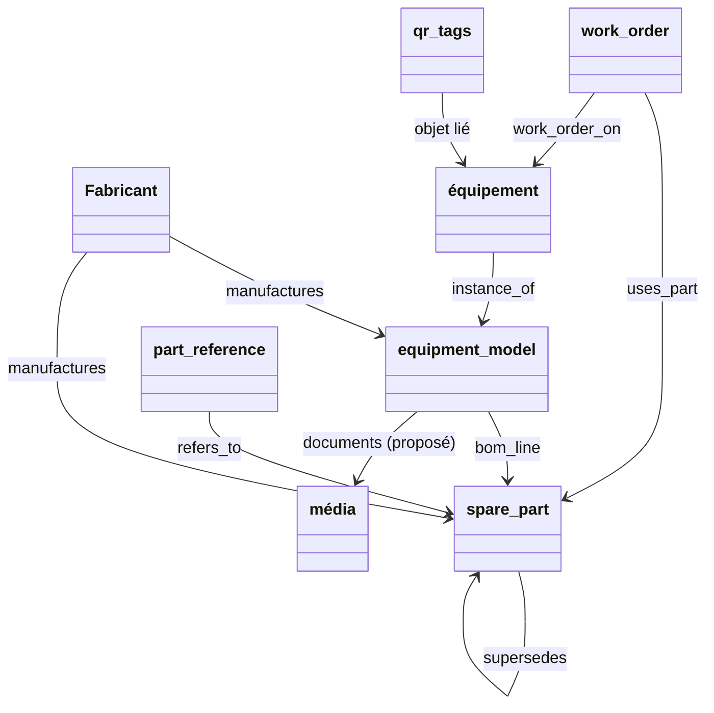
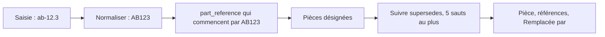
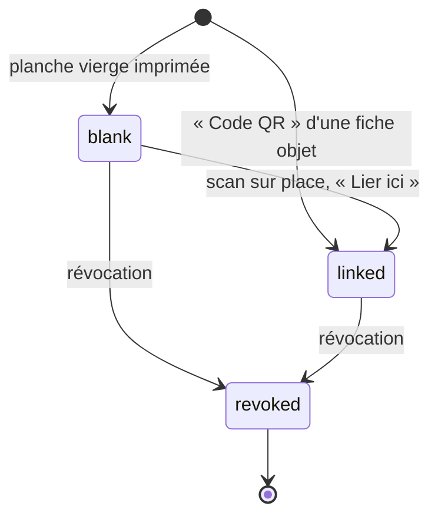
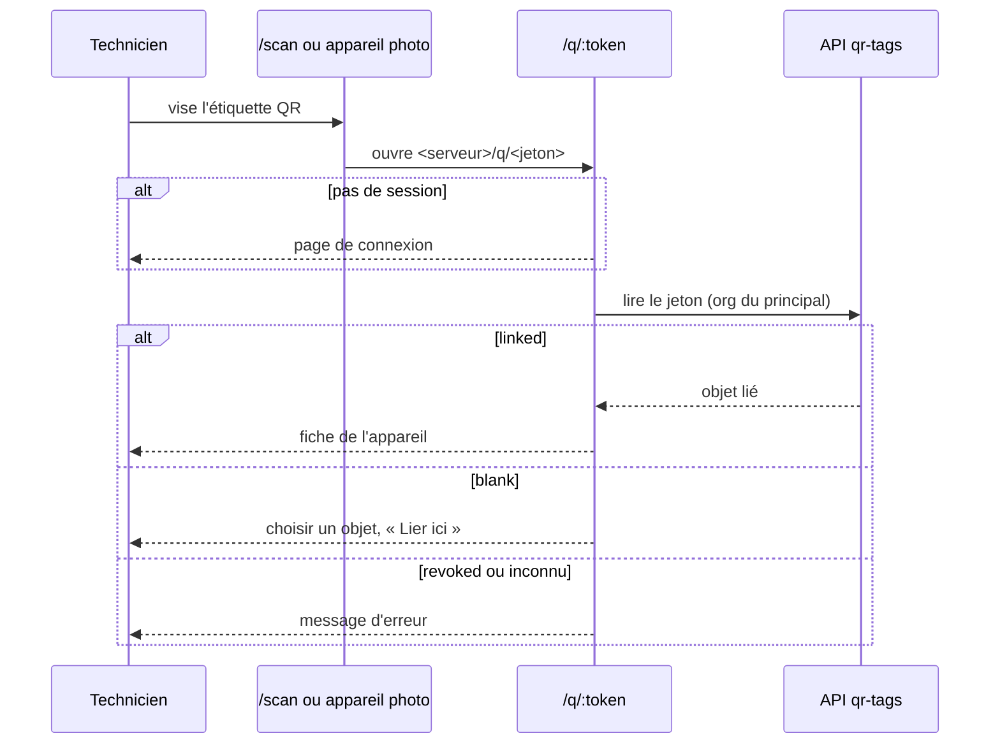
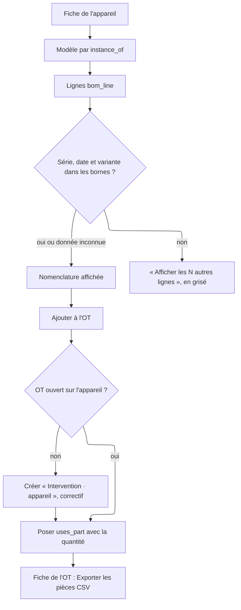
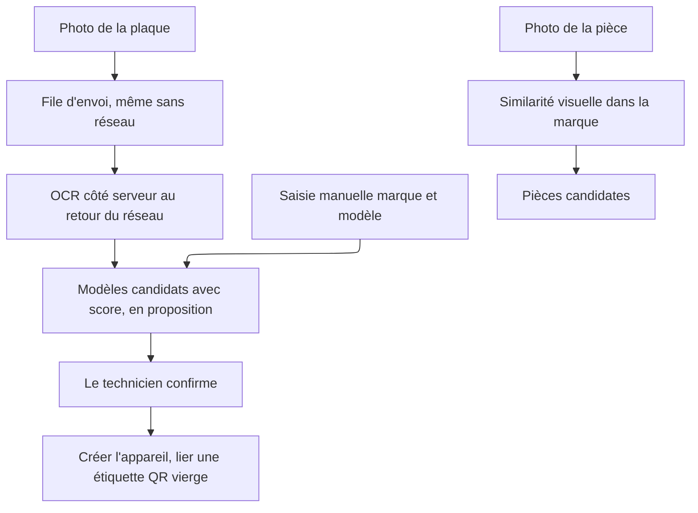
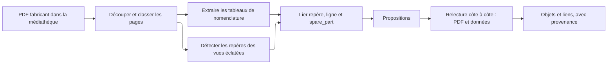
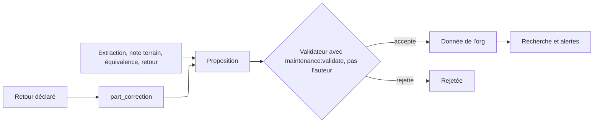
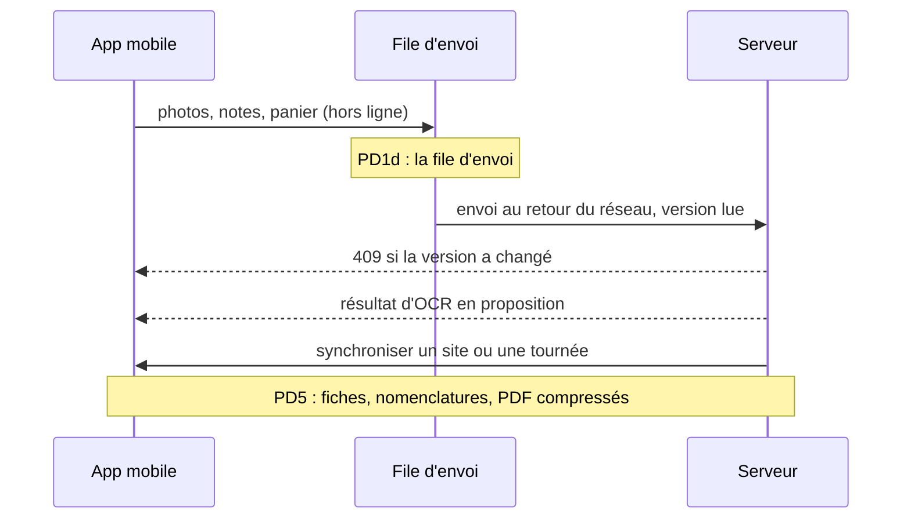

# Pièces et documentation (D960–D971)

| | |
|---|---|
| **Statut** | PRD validé le 2026-11-17. **Codé** : lots PD0, PD1a, PD1b, PD1c. **Proposé** : PD1d, PD2 à PD5, module prix (D969). |
| **Roadmap** | P2.39 |
| **Renvois** | `ontology.md` annexe C (GMAO générique : `spare_part`, `work_order`, stock, fournisseurs), `pages.md` (L1–L2, procédures L6), `vision.md` (annotations D147, D219), `doc-search.md`, `proposals.md` (D371–D377), `security.md` (R1, R8, R11–R13), `iam.md`, `ai-assistant.md` §9 |

## 1. Résumé

Ce module aide une équipe de maintenance à trouver la bonne pièce et sa documentation. Il sert deux personnes : le chiffreur au bureau et le technicien sur le terrain. Un appareil identifié par une étiquette QR doit donner sa pièce et sa documentation en moins de 10 secondes. Un appareil inconnu doit rester trouvable en moins d'une minute, par photo de plaque, photo de pièce ou recherche texte.

Le module sert tout corps de métier (froid, CVC, cuisines, électricité, ascenseurs, production). Le moteur ne contient aucun type ni aucune règle d'un métier : tout vit dans le pack `maintenance` (garde `tests/engine_genericity.rs`).

Hors périmètre : la recherche dans le catalogue d'un distributeur, l'aspiration de sites tiers, le devis et la facturation. Le module produit un panier de pièces, exportable. La GMAO reste celle de l'annexe C de `ontology.md`.

## 2. Concepts

| Terme | Définition | Porté par |
|---|---|---|
| **Fabricant** | Société qui fabrique un modèle ou une pièce. | `organization`, lien `manufactures` (pack `maintenance_partners`) |
| **Modèle d'appareil** | Marque, modèle, famille, variantes. Il porte la nomenclature et la documentation. | type `equipment_model` |
| **Appareil** | Tout équipement existant de l'org (machine, pompe, compresseur…). Ce n'est pas un nouveau type. | lien `instance_of` → `equipment_model`, propriétés `serial`, `manufactured_on`, `variant` |
| **Pièce** | Pièce détachée de l'annexe C, avec famille et caractéristiques. `part_number` est la référence interne de l'org. | type `spare_part` |
| **Référence** | Une écriture de la référence d'une pièce, de nature origine, distributeur ou ancienne. Une pièce a N références. | type `part_reference`, lien `refers_to` |
| **Remplacement** | Une pièce remplace une autre pièce depuis une date. | lien `supersedes` |
| **Équivalence** | Deux pièces interchangeables, avec ou sans conditions. | liens `equivalent_to`, `compatible_with` |
| **Nomenclature** | Liste des pièces d'un modèle. Chaque ligne porte repère, quantité, plage de séries, plage de dates et variante facultative. | lien `bom_line` |
| **Document technique** | Média de la médiathèque (PDF, image) : vue éclatée, nomenclature, schéma, notice. | lien `documents` (proposé) |
| **Ancre** | Page, zone ou repère dans un document technique. | calque d'annotations (D147, D219) |
| **Étiquette QR** | Code imprimé qui porte une adresse courte vers un jeton stable. Elle sert à tout objet. | table noyau `qr_tags` |
| **Panier** | Les pièces d'une intervention, remontées au chiffreur. | `work_order` (ordre de travail, OT) et liens `uses_part` |
| **Correction** | Une erreur de référence constatée (modèle, plage de séries, référence fausse et bonne). | type `part_correction` |
| **Note terrain** | Page ou commentaire sur une pièce, un modèle ou un appareil. Elle entre en proposition. | proposé (PD1d) |

## 3. Fonctionnement

### 3.1 Recherche par référence (codé, PD0)

L'écran `/parts` (menu Opérer, « Pièces détachées ») a un seul champ. La normalisation garde les lettres et les chiffres, en majuscules. L'écran affiche l'écriture normalisée sous le champ. La fiche d'une pièce est la fiche objet générique. Le bouton d'ajout ouvre les imports.

La normalisation est une option générique du moteur : `normalize: reference` sur une propriété texte. Le moteur l'applique à toute écriture : formulaire, import, flow, assistant. Il refuse une valeur sans lettre ni chiffre. Le filtre `starts_with` d'`ontology_query` compare la valeur stockée.

### 3.2 Cycle de vie d'une étiquette QR (codé, PD1a)

Une planche vierge compte de 1 à 120 étiquettes QR (40 par page A4). Le jeton a 26 caractères base32, tirés au hasard. Une étiquette QR d'objet se crée au premier usage. L'adresse imprimée est `<serveur>/q/<jeton>`, sur l'adresse du serveur de l'app. La planche `/qr-sheet` s'affiche hors de la coquille, et seul son contenu s'imprime.

### 3.3 Scan d'une étiquette QR (codé, PD1a et PD1c)

Le scanner `/scan` (menu Opérer) utilise la caméra arrière et le `BarcodeDetector` du navigateur ou de la vue web de l'app. Un code qui n'est pas une étiquette QR PneX est signalé. Sans lecteur de codes, ou si la caméra est refusée, un message renvoie vers l'appareil photo du téléphone. Un jeton d'une autre org répond « inconnu » (404) : la réponse ne révèle jamais son existence (R1).

### 3.4 Nomenclature d'un appareil et panier (codé, PD1b)

La comparaison des numéros de série est naturelle : `S900` vient avant `S1000`. Une donnée inconnue de l'appareil garde la ligne. Un OT ouvert est demandé, planifié, en cours ou en attente. Le nouvel OT reçoit le lien `work_order_on`. Le chiffreur reçoit le panier par l'OT.

### 3.5 Appareil inconnu (proposé, PD1d et PD4)

L'OCR utilise un modèle local du serveur. Le LLM de l'org peut affiner le résultat s'il est configuré (D119). Aucun modèle ne tourne sur le mobile. Le modèle d'embeddings d'image se choisit en PD4, sur les photos du pilote : ONNX, côté serveur, licence permissive.

### 3.6 Ingestion des documents (proposé, PD3)

L'extraction passe par les pipelines et les flows de PneX (`pipelines.md`), jamais par un traitement à côté. Tout ce qui est extrait entre en proposition, jamais en fait. Chaque donnée garde sa provenance : document, page, date d'import, validateur (D184).

### 3.7 Validation et apprentissage (proposé, PD1d et PD5)

La permission `maintenance:validate` appartient par défaut au rôle éditeur. Une org peut la limiter à ses référents par un rôle personnalisé. Le serveur refuse qu'un auteur valide sa propre proposition. Les indicateurs par pièce et par modèle comptent les retours, les corrections et la confiance de la nomenclature. La confiance est la part des lignes validées par une personne, avec le nombre de retours sur 12 mois.

### 3.8 Hors ligne (proposé, PD1d et PD5)

## 4. Exigences

1. Une référence ancienne, tapée avec séparateurs, doit mener à la pièce actuelle en moins de 300 ms sur 100 000 pièces. **Mesuré** : 258 ms (build de débogage, deux requêtes HTTP, meilleur de trois, test ignoré par défaut `tests/maintenance_parts.rs::an_old_reference_finds_the_current_part_among_100000`).
2. Une recherche par image doit répondre en moins de 3 s (proposé).
3. Le champ de recherche doit accepter une référence exacte, partielle, sans séparateurs ou ancienne (codé). Le texte libre français ou anglais et le numéro de série sont proposés.
4. Une référence remplacée doit renvoyer la pièce actuelle et sa chaîne `supersedes` (codé).
5. Une ligne de nomenclature doit être bornée par série, date et variante facultative, sans modèle enfant (Q-PD4, codé).
6. Du scan à la fiche pièce, le parcours doit prendre moins de 10 s sur mobile (codé, non mesuré sur téléphone réel).
7. Un jeton QR ne doit porter aucune donnée en clair et ne doit pas être énumérable (codé).
8. Un jeton d'une autre org doit répondre 404, comme un jeton inconnu (codé, `tests/qr_tags.rs`).
9. Le panier doit s'exporter en CSV `part_number,part,quantity` (Q-PD5, codé). Un PDF viendra seulement si le pilote le demande.
10. Le visualiseur PDF doit s'ouvrir à la page et à la zone de l'ancre, sans téléchargement (proposé, PD2).
11. Toucher un repère d'une vue éclatée doit ouvrir la pièce, et la fiche pièce doit surligner son repère (proposé, PD2).
12. Une procédure de montage doit être une page Pages liée au modèle et à la pièce (proposé, PD2). Le pas à pas vient avec Pages L6.
13. Une procédure doit commencer par un bloc sécurité fourni par le pack métier (proposé).
14. Le mode « mains sales » doit offrir de gros boutons et une navigation par étapes, sans lecture à voix haute (proposé).
15. Tout ce qui est extrait ou proposé doit entrer en proposition (proposé).
16. Un PDF fabricant ne doit jamais être republié. Une vue éclatée protégée se cite par un lien vers sa source.
17. Une photo terrain doit être floutée ou validée avant tout partage hors de l'org (proposé).
18. L'assistant doit lire pièces, nomenclatures et remplacements. Il écrit le panier et les corrections en proposition seulement, par le service partagé avec l'UI (proposé, `ai-assistant.md` §9.3).

## 5. Décisions

| Dn | Titre | Décidé | État |
|---|---|---|---|
| D960 | Tout sur l'ontologie | Objets et liens du pack `maintenance`, sans table métier. Seuls `qr_tags` et l'index des références sont du noyau. Pas de pack `parts_docs` (Q-PD9). | codé |
| D961 | Recherche hybride | Lexicale et vectorielle dans PostgreSQL (pgvector), sur l'index de `doc-search.md`. Les références normalisées ont un filtre exact et préfixe. Les règles de préfixe fabricant vivent en YAML dans le pack. | partiel : normalisation et préfixe codés |
| D962 | Jeton QR stable | Un QR porte une adresse courte vers un jeton de `qr_tags`, pour tout objet. | codé |
| D963 | Planches vierges | Planches vierges associées sur place, planches liées pour une sélection (lot C-QR1 de l'annexe C). | codé |
| D964 | Scan sans droit | Une page minimale, sans donnée client, hors de l'origine de l'app (R11–R13). Avant elle : connexion ou 403. | connexion ou 403 codés, page publique proposée |
| D965 | Ingestion par PneX | Extraction par pipelines et flows, résultat en proposition. | proposé (PD3) |
| D966 | Provenance | Chaque donnée garde document, page, date d'import et validateur. | proposé |
| D967 | Base privée par org | Pas de base commune entre orgs (Q-PD2). Une base commune demanderait son propre PRD. | règle |
| D968 | Hors ligne | Synchroniser les appareils d'un site ou d'une tournée. File d'envoi en PD1d, consultation en PD5. | proposé |
| D969 | Prix à part | Module séparé, branché sur le panier, à la demande, par un agent navigateur. | proposé (PRD séparé) |
| D970 | Document privé | Un document importé reste privé à son org. | règle |
| D971 | Page publique sûre | Une page QR publique ne contient aucune donnée client. | proposé avec D964 |

D969 en détail : le prix se lit avec le compte du client, rangé dans le coffre de secrets. Le cache des prix est court et privé à l'org. La comparaison passe par le lien `supplies` de l'annexe C. Le module ne doit jamais aspirer un catalogue en tâche de fond. Il respecte un rythme limité et la garde de sortie R8.

## 6. Interfaces

**Pack** `maintenance` 1.8.0 : types `equipment_model`, `part_reference`, `part_correction`. Liens `instance_of`, `refers_to`, `supersedes`, `equivalent_to`, `compatible_with`, `bom_line`. Propriétés `manufactured_on` et `variant` sur les équipements. `spare_part` gagne famille et caractéristiques. Les champs texte `manufacturer`, `model` et `manufacturer_ref` ont disparu au profit des liens. **Pack** `maintenance_partners` 1.1.0 : lien `manufactures`.

**Imports** (D301, fichier CSV de l'org, aperçu avant écriture) :

| Import | Colonnes |
|---|---|
| Parts lists (CSV) | `model, model_name, position, part_number, part_name, reference, quantity, serial_from, serial_to, date_from, date_to, variant` |
| Part supersessions (CSV) | `old_part_number, new_part_number, since` |

**Routes** (`controllers/qr_tags.rs`, migration 000158) :

| Route | Effet | Permission | MCP |
|---|---|---|---|
| `GET /api/v1/qr-tags` | liste filtrable par objet, état, jetons | `qr-tags:read` (lecteur) | exposé |
| `POST /api/v1/qr-tags/sheets` | planche vierge de 1 à 120 | `qr-tags:write` (membre) | exposé |
| `POST /api/v1/qr-tags/objects/{id}` | étiquette QR d'un objet, créée au premier usage | `qr-tags:write` | exposé |
| `GET /api/v1/qr-tags/{token}` | lire un jeton | `qr-tags:read` | exposé |
| `POST /api/v1/qr-tags/{token}/link` | lier une étiquette QR vierge | `qr-tags:write` | exposé |
| `POST /api/v1/qr-tags/{token}/revoke` | révoquer | `qr-tags:write` | exclu (destructif) |

Codes d'erreur : `qr-tag-not-found`, `qr-tag-not-blank`.

**Écrans** : `/parts`, `/scan`, `/qr-tags` (« Étiquettes QR », menu Opérer), `/q/:token`, `/qr-sheet` (hors coquille), section « Nomenclature (modèle) » de la fiche d'un appareil, « Code QR » sur toute fiche objet, export CSV sur la fiche d'un OT. Fiches de l'assistant : `assistant-kb/maintenance-parts.md`, `assistant-kb/qr-tags.md`.

## 7. Reste à faire

| Lot | Contenu | Critère de sortie | État |
|---|---|---|---|
| PD0 | Pack, imports CSV, recherche par référence, fiche pièce | Exigence 1 | codé |
| PD1a | Étiquettes QR, planches, liaison, `/q/:token` | — | codé |
| PD1b, PD1c | Nomenclature filtrée, panier = OT, export CSV, scanner | Exigence 6 | codé |
| PD1d | File d'envoi hors ligne (photos, notes), notes terrain en proposition, `maintenance:validate` | — | à faire, avec le rattachement d'un média à un objet |
| PD2 | Visualiseur PDF ancré, vue éclatée à repères saisis à la main, procédures en pages Pages, lien `documents` | Le technicien trouve la procédure sans quitter PneX | proposé |
| PD3 | Extraction des nomenclatures et des repères, écran de relecture | 50 repères relus en moins de 10 min | proposé |
| PD4 | OCR de plaque côté serveur, recherche par photo de pièce | Plaque reconnue dans plus de 80 % des cas d'un jeu de test | proposé |
| PD5 | Corrections, consultation hors ligne | Une correction validée apparaît dans la recherche et les alertes | proposé |

PD1 recoupe les lots C-QR1 et C-QR2 de l'annexe C : ils se font une fois.

Écarts connus du code :
- Les règles de préfixe fabricant en YAML (D961) ne sont pas codées. La normalisation retire seulement séparateurs et casse.
- Le filtre de préfixe lit les références de l'org sans index dédié. Un index d'expression viendra si une base réelle le demande.
- Les écrans `/parts` et nomenclature nomment les clés du pack (exceptions D441 consignées dans `tests/engine_genericity.rs`). Une recherche par référence déclarée par le pack lèverait l'exception.
- L'écran `/parts` lit les liens de chaque pièce trouvée, 20 par page (`shortcut:` dans `pages/parts.rs`).
- Le scanner n'a pas été essayé sur un téléphone réel ni dans l'APK. L'e2e Linux vérifie seulement le message de repli.
- La page publique d'un scan sans droit (D964, D971) et son hôte séparé restent à faire.

Questions et choix de Shan :
- Les sources de nomenclatures, la liste des fabricants et le pilote se choisissent avec le pilote, hors dépôt.
- Critères de succès à mesurer chez le pilote : temps de recherche du chiffreur divisé par 5, retours pour mauvaise référence divisés par 2, plus de 70 % des interventions démarrées par un scan après 6 mois.
- Un modèle d'OCR embarqué sur le mobile viendra seulement si le pilote montre que l'attente gêne.
- Liaisons futures : Studio 360 (local technique avec repères vers les appareils), capteurs (panne vers pièce probable).
