# Pipelines : ingestion, tables versionnées, connecteurs (D317–D358, D569–D578, D791–D797, D934–D1000)

## 1. Résumé

Un pipeline fait entrer des données externes dans PneX. Il lit une source (fichier, page web, API, base, appels poussés), transforme les lignes et les écrit dans une table versionnée, dans l'ontologie ou dans des propositions. Le moteur connaît des transports et des formats, jamais une source : une source nouvelle est un fichier YAML d'un pack, pas une release. Les pipelines servent à l'ingestion. Faire et défaire les liens déduits reste à un flow ou à un humain (D998, `operational-platform.md` §3). Ce document est pour les auteurs de packs, les développeurs du moteur et les relecteurs de sécurité.

## 2. Concepts

- **Pipeline (du moteur)** : document YAML d'un pack, `packs/<pack>/pipelines/<clé>.yaml`. Il porte `key`, `hosts`, `steps`, `schedule` et `tests` (D934).
- **Étape** : une opération fermée d'un pipeline du moteur : `enumerate`, `fetch`, `browse`, `extract`, `unpack`, `read`, `sql`, `call`, `model`, `write` (D936).
- **Table de travail** : résultat nommé d'une étape (`as`), lu par l'étape suivante (`from`, `for_each`). Elle vit le temps de l'exécution (D935).
- **Élément** : une ligne d'une énumération suivie (`track: true`). Son état est gardé entre deux exécutions (D937).
- **Table** : lignes versionnées par transactions, fichiers Parquet sur S3 et catalogue PostgreSQL. Le nom technique est `datasets` (D569, lexique Q-P7).
- **Pipeline de transformation** : document de `/api/v1/pipelines`. Ses traitements SQL lisent des tables et en écrivent (D571).
- **Traitement** : une requête SQL d'un pipeline de transformation, de ses tables lues à sa table écrite.
- **Import** : un `object_import`. Il applique un mapping D301 à une table ou à un fichier et écrit objets et liens dans l'ontologie (synchro, D577).
- **Exécution enchaînée** : une cible et ce dont elle dépend, exécutés dans l'ordre (`data_builds`, D575).
- **Connecteur** : accès enregistré à une base, une API REST ou un point d'arrivée d'appels signés. Ses identifiants restent au coffre (D791).
- **Webhook** : connecteur qui reçoit les appels signés d'un autre système (D795).
- **Requête nommée** : un `SELECT` à paramètres typés, livré par un pack et joué par `/analysis` (D948).
- **Sonde** : lecture d'un pipeline jusqu'à une étape, sur un élément, sans écriture (D944).
- **Zone de transit** : préfixe S3 `org_{id}/staging/…` des fichiers bruts d'un import à étapes (D318).

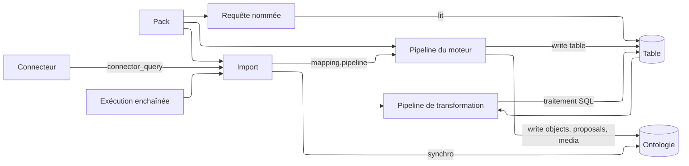

## 3. Fonctionnement

### 3.1 Vue d'ensemble

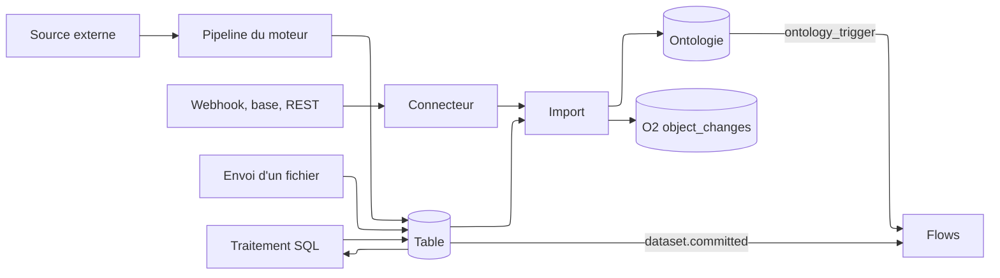

Trois couches se partagent le travail (D998) :

| Couche | Fait | Ne fait pas |
|---|---|---|
| Pipeline | Ingère en volume, sur un horaire, stocke le brut, calcule des ensembles | Ne décide pas d'un lien déduit sans une ligne au tableau des écarts de D998 |
| Ontologie | Porte les entités, leurs liens et les éditions humaines | Ne stocke pas chaque ligne d'une source (D570) |
| Flow | Réagit à un événement, rapproche, propose, relance une collecte | Ne transporte ni ne transforme de volume |

Une ligne n'est pas forcément un objet. Une entité utile aux écrans, aux droits ou aux liens monte dans l'ontologie. Le reste reste dans une table, lue en SQL (D570).

### 3.2 Deux zones de confiance

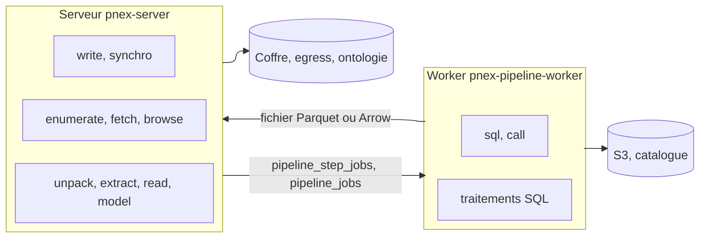

Le serveur va chercher et écrit. Il a l'egress, le coffre et l'ontologie. Le worker calcule. Il n'a ni secret, ni table métier, ni réseau externe (D573, D943). Un run passe de l'un à l'autre par une file PostgreSQL. Le runtime de flows ne transporte aucun octet : il exécute du code utilisateur multi-org (D317).

Le worker a son propre rôle PostgreSQL (`pnex_pipeline_worker`), limité au catalogue et aux files. Le chart `pnex-deploy` lui donne une `NetworkPolicy` vers PostgreSQL, S3 et DNS seulement. Ses identifiants S3 sont limités à `org_*/datasets/*` (SEC-61). L'isolation entre orgs repose sur la session SQL, qui n'enregistre que les tables du job (D572).

**Attention :** `unpack`, `extract` et `read` tournent encore dans le serveur, en tâche bloquante, pas dans le worker. Le §7 garde cet écart.

### 3.3 Exécution d'un pipeline du moteur

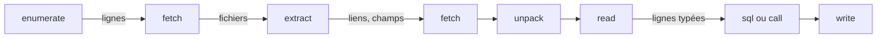

Chaque étape lit une table de travail et en écrit une. Une colonne `file` porte une clé de fichier, jamais des octets. Un corps de plus de 4 Mo passe sur disque (`blob.rs`). Un `read` CSV est lu en flux. Les lignes typées vont dans un fichier Arrow IPC, relu par lots par `write`.

Le moteur garde un journal par étape : lignes, octets, première adresse, code d'erreur. L'historique d'un import affiche ce journal (`ingest_steps`).

Un import peut désigner un pipeline (`mapping.pipeline: <pack>/<clé>`). Le run remplit alors la table de l'import par le moteur (écriture `replace: true`), puis la synchro D577 écrit l'ontologie. Tous les imports des packs passent par ce chemin. Les étapes d'import de D317–D321 restent seulement pour les imports qu'une org écrit (§3.13).

**Lecteurs de format (D939)** : `csv`, `json`, `xml`, `html`, `ical`, `lines`, `binary`, `xlsx`. Une colonne déclare son type, son format de date, son fuseau et son échelle. Le fuseau est un nom IANA, heure d'été comprise. Les conversions de fuseau se font dans le pipeline seulement : à la lecture (`timezone`) ou en SQL (`local_to_utc`, `utc_to_local`, `pnex-pipeline-worker/src/tz.rs`). Une heure vécue deux fois est lue comme la première. Ajouter un format change le moteur. Ajouter une source ne le change jamais.

**Starlark (D940)** : `call` passe des lignes à une fonction de la section `pipeline_functions:` du pack. Elle tourne dans le worker, 5 min et 200 000 lignes au plus, sans réseau, secret ni fichier. La validation signale chaque `call`. Un `call` qui revient deux fois pour le même format doit devenir un lecteur.

**Extraction par modèle** : l'étape `model` demande au fournisseur d'IA de l'org les champs d'un extracteur du pack. Elle garde seulement une valeur dont la citation est dans le texte. Elle lit 50 documents par org et par jour au plus (`markets-research.md` D841, D845).

### 3.4 État par élément et cadence

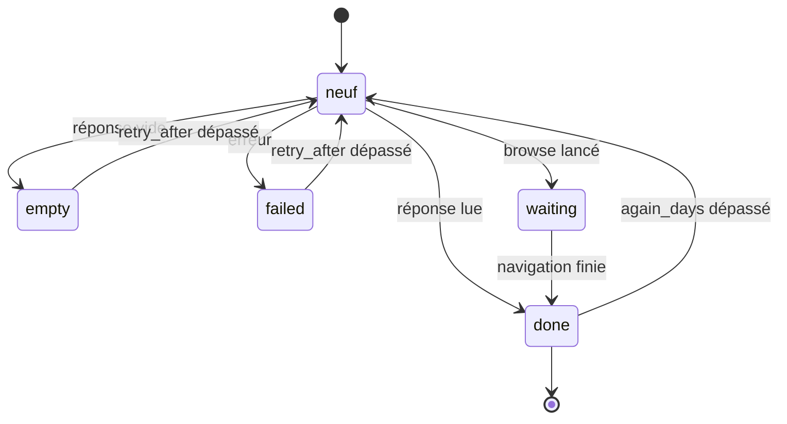

Une étape `enumerate` peut déclarer `track: true`. Chaque ligne a alors un état par pipeline et par clé, dans `pipeline_items` (D937). Un run prend d'abord les lignes jamais lues, puis celles à redemander. Une étape aval déclare ce que vaut une réponse vide : `empty: settled` ou `empty: retry`. `closed_only` écarte une période pas encore close.

Une ligne `done` n'est jamais reprise : c'est la collecte unique. Avec `again_days: N`, elle redevient à prendre N jours après sa lecture : c'est la collecte périodique (D1000). L'écriture `objects` retrouve alors l'objet par sa clé et le met à jour, sans doublon.

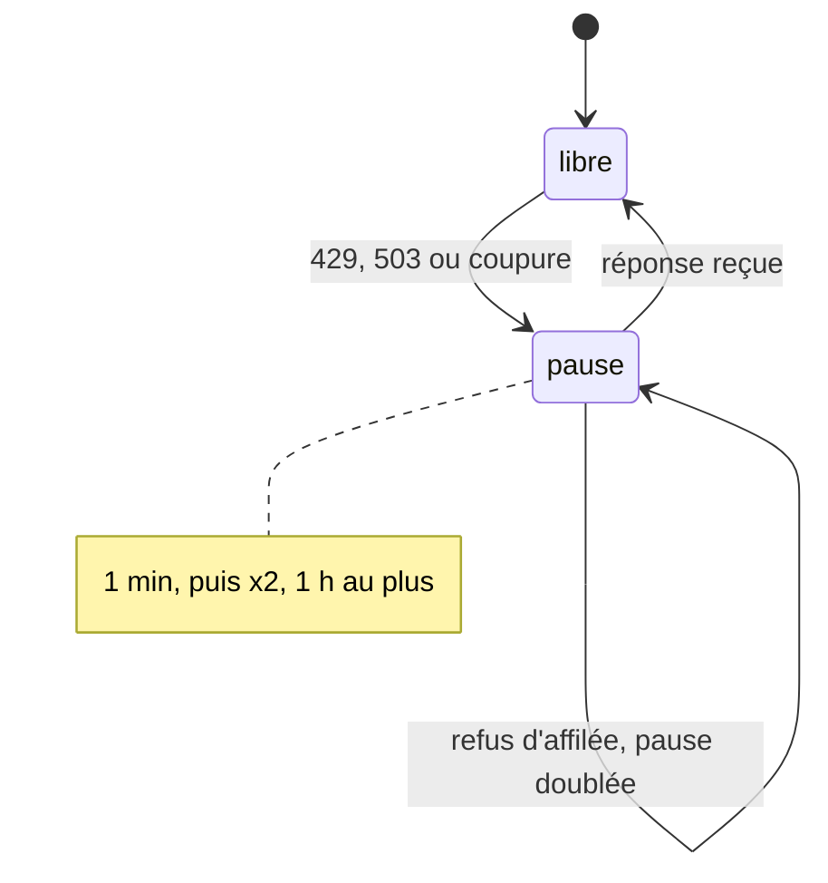

`fetch` et `browse` portent `every` (un appel par durée) et `pause` (D938). La cadence se compte par hôte, pour tous les orgs. Un `429`, un `503` ou une coupure sur une ligne suivie arrête la passe. La ligne n'est pas marquée et les suivantes attendent la passe d'après. Pendant la pause, une requête vers cet hôte est refusée sans partir (`throttled`). Les `5xx` sont relancés avec attente, `Retry-After` respecté.

### 3.5 Navigation et lignes redemandées

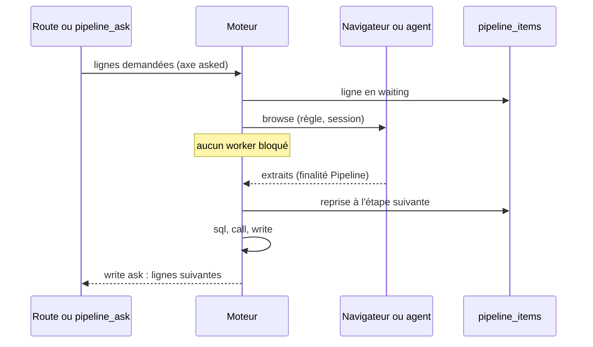

Une étape `browse` met la ligne en `waiting` et rend la main (D995). La fin de la navigation reprend le run à l'étape suivante. `browse` suit directement l'`enumerate`, sinon refus `browse_position`. Un redémarrage du serveur ne perd rien : la navigation finie retrouve sa ligne en base. Une navigation trop longue fait échouer la ligne, jamais le run. `keep: false` efface les extraits dès la reprise.

Une étape `write: { ask: {} }` redemande au même pipeline les lignes d'une table (D997). Elles partent une fois le run fini, dans l'agent du même membre. Refus `ask_without_asked` si le document n'énumère pas un axe `asked` suivi. Les lignes demandées explicitement sont toutes prises, sauf si l'énumération déclare `per_run`.

**Recherche d'une personne (D999)** : le pipeline `prospecting_b2b/person_match_linkedin` collecte seulement. Il garde les profils dont la carte nomme la personne (minimisation) et écrit un document de lot tamponné `match_to_score`. Trois flows du pack font le reste :

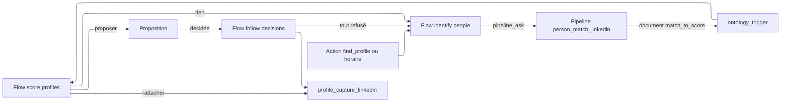

`ontology_trigger` publie les objets créés ou modifiés, les liens ouverts ou fermés et les propositions décidées sur `pnex:onto:v1:{org}`, depuis le journal des changements. La publication est au mieux, sans rejeu. Le message nomme l'objet, jamais ses propriétés. `pipeline_ask` relit la configuration déployée, plafonne par jour (`per_day`) et refuse un objet sous opposition (D341). Il utilise l'agent de celui qui a déployé le flow, ou un agent commun (D550).

Les captures de profil (D333) et la liste d'employés (D779) sont aussi des pipelines du pack `prospecting_b2b` (`profile_capture_<réseau>`, `people_capture_linkedin`), écrits par `write: media` (D996). Les relations du membre sont lues par `my_connections_linkedin`, une page par ligne demandée. Les relations d'un contact (D976) sont lues par `connections_capture_linkedin` : la route donne la sélection d'organisations, la fonction `linkedin_contact_connections` garde seulement les personnes de cette sélection, et les cartes brutes sont effacées (`keep: false`).

### 3.6 Synchro vers l'ontologie

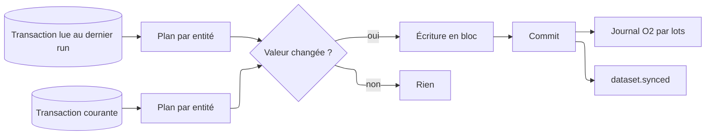

La synchro compare deux transactions de la table : celle du dernier run appliqué et la nouvelle (D577). Elle compare des **entités planifiées**, pas des lignes (Q-P8). `plan_row` et `diff::Planned` produisent les objets et liens planifiés par clé d'entité. Une ligne retirée ne ferme donc pas une organisation qu'une ligne sœur porte encore.

Seul ce qui change va vers l'ontologie. Une édition humaine survit tant que la source ne change pas cette valeur (Q-P6). Sans référence valable (mapping modifié, version purgée), la comparaison se fait à l'état courant et le run s'arrête à un aperçu. C'est le seul chemin qui écrase une édition. Un aperçu dont la table a bougé est refusé (`import-run-stale`).

L'écriture passe par `objects::create_many_with`, `update_many_with` et leurs équivalents pour les liens (D347). Les contrôles sont ceux du chemin unitaire, faits par lots de 5 000 lignes. Une entrée `create: false` laissée de côté faute d'objet est notée (`skipped_keys`) et replanifiée au run suivant.

Le journal des changements part après le commit (D350). Une transaction annulée ne journalise rien (`changes::deferred`, `changes::flush`). Le writer O2 envoie par lots de 1 000 documents ou 1 s, dans une file bornée à 100 000. Le flux `object_changes` garde `history_retention_days`, 3 650 jours par défaut, réglé par l'admin plateforme (Q-P1).

Contrôles d'un import : forme changée, chute suspecte, snapshot avec erreurs (D303), et `max_closures_pct`, 20 % par défaut (D322). Une source publique livre `invalid: skip` sur sa clé et ses textes libres : une valeur sale ne doit pas refuser tout le run.

### 3.7 Tables versionnées et traitements SQL

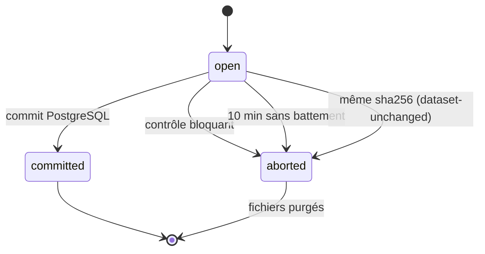

Une table est une suite de transactions `snapshot`, `append` ou `delete` (D569). La vue courante part du dernier `snapshot` commité, puis applique les transactions suivantes. Lire « au temps T » calcule la même vue à T (`as_of`). Une transaction ouverte ou annulée reste invisible. Un traitement déclare `retain_days` (1 à 3 650, 90 par défaut) : une version remplacée reste lisible ce temps. La dernière version n'est jamais purgée.

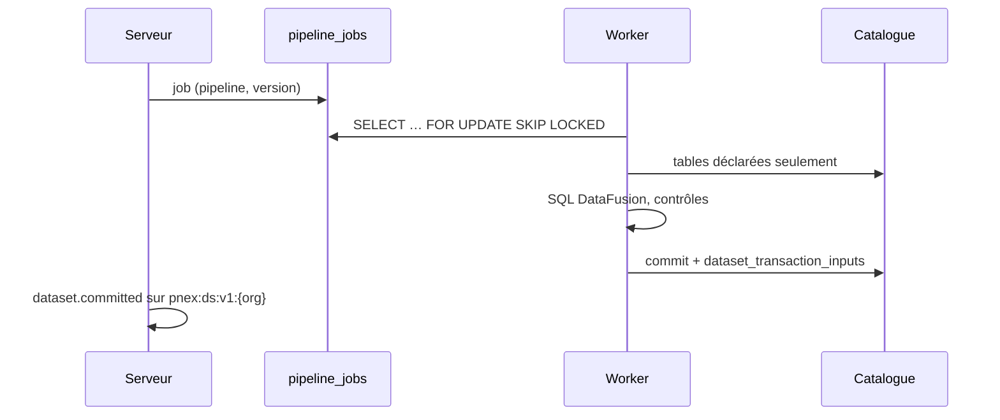

Le SQL d'un traitement est une entrée hostile (D572). Une session par exécution n'enregistre que les tables déclarées en entrée. Le moteur refuse DDL, DML et instructions de session sur le plan logique. Les fonctions sont en liste blanche, conversions D301 comprises. La mémoire est bornée, avec débordement disque, délai et plafond d'octets.

Le lignage est écrit par l'exécution, jamais déclaré à la main (D574). `dataset_transaction_inputs` donne l'amont et l'aval, la péremption et le saut : mêmes entrées et même version, rien à recalculer.

Contrôles au commit (D576) : `min_rows`, `max_rows`, `unique`, `max_empty_pct`, `max_drop_pct`, `same_columns`. Un contrôle qui échoue annule la transaction. L'aval garde sa dernière version valide. La fraîcheur (`max_age_hours`) est vérifiée par un balayage du serveur.

### 3.8 Réglages du moteur SQL

La mesure OP1.0 a retenu DataFusion contre Polars (Q-O1). DataFusion refuse sur le plan logique, et Polars lit un fichier arbitraire depuis le SQL. Les réglages qui en découlent sont dans `crates/pnex-pipeline-worker/src/engine.rs` :

| Réglage | Raison |
|---|---|
| Jamais d'inférence de schéma | Bug d'`object_store` 0.13 : coupe dans un champ entre guillemets. Le schéma vient du catalogue |
| `FairSpillPool` | Le pool par défaut donne tout au premier opérateur |
| `prefer_hash_join=true` par défaut | Ne trie pas le grand côté face à un petit |
| Repli en jointure par fusion, une fois | Une table de hachage ne déborde jamais. Si elle dépasse le pool, le traitement repart trié, avec la moitié du pool |
| Pod de 4 Go au moins, pool à 75 % | Le moteur alloue aussi hors de son pool |
| `emptyDir` vidé à chaque job | Un job tué laisse ses fichiers de débordement |

Un dépassement d'agrégat finit en `pipeline-memory-exceeded`. DataFusion met en minuscules les noms sans guillemets : le SQL doit citer une colonne à casse mixte (`"Numero_Fiche"`). L'exception `deny.toml` sur `quick-xml` (RUSTSEC-2026-0194, -0195) part avec la montée vers `object_store` 0.14.

### 3.9 Exécutions enchaînées et événements

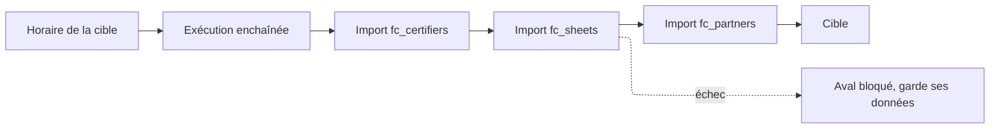

On planifie une cible (D575). L'exécution enchaînée remonte les dépendances : une table écrite d'un côté, lue de l'autre, ou un `after:` déclaré dans le mapping d'un import. Elle exécute tout amont exécutable, dans l'ordre. Un cycle est refusé. Une entrée en échec bloque l'aval. Une étape à la fois par exécution enchaînée, 12 h au plus (`build-timeout`). L'état vit dans PostgreSQL : un autre pod la reprend. Un run d'import perdu avec son pod repart une fois.

Les droits sont revérifiés à chaque déclenchement, sur le rôle géré de la personne qui a posé l'horaire. Sinon l'horaire échoue (`build-author-forbidden`).

Les pipelines du moteur ne passent pas par ces exécutions enchaînées. Un balayage par minute lance chaque pipeline d'un pack installé quand son `schedule` est échu (`pipeline_engine::store::sweep`). Un seul run de pipeline à la fois par org (verrou `PIPELINE_RUN`).

Les flows reçoivent `dataset.committed` et `dataset.synced` par le nœud `dataset_trigger` (D578). Le serveur les publie depuis une marque en base (`published_at`). Un flow ne lance ni n'écrit jamais une table.

### 3.10 Connecteurs

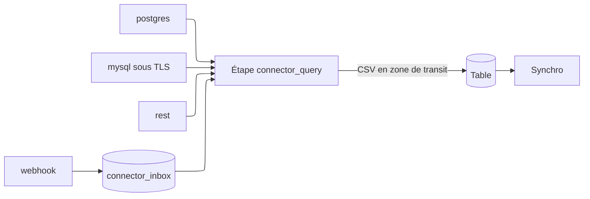

Un connecteur a un nom, une sorte, une cible et ses identifiants au coffre (D791). Les sortes sont `postgres`, `mysql`, `rest` et `webhook`. Tous lisent seulement. L'import porte la requête. Le résultat suit le chemin de tout fichier : table, synchro, planification, événements.

- **SQL** : session en lecture seule, une seule instruction préparée d'abord, délai et plafond d'octets (500 Mo par défaut, 2 Go au plus). MySQL exige TLS (D792).
- **REST** : authentification `none`, `bearer`, `header`, `basic` ou `oauth2_client_credentials`. Pagination `page`, `offset`, `cursor` ou `link`. `GET` seulement. Un hôte qui change en cours de pagination est refusé (D793).
- **Incrémental** : `cursor` nomme une colonne ou un champ. La dernière valeur avance seulement après le commit de la table. `full_every` relance une lecture complète, qui voit les suppressions (D794).

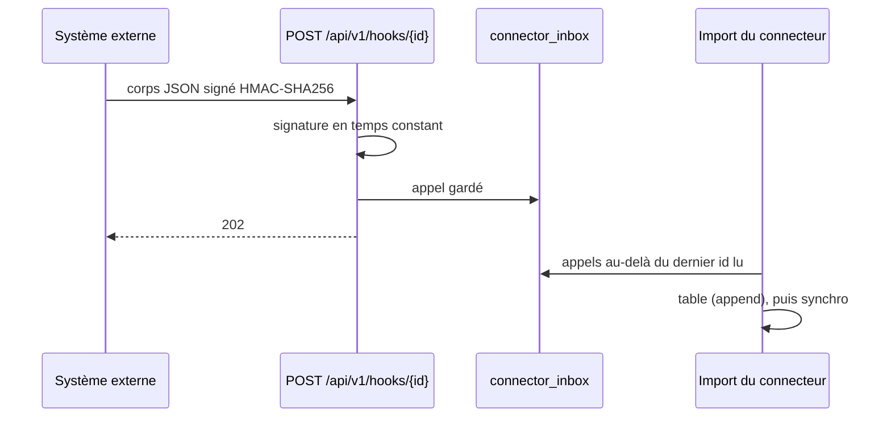

Un appel inconnu, sans secret, mal signé ou périmé reçoit le même `401 hook-signature-invalid` (D795). Un corps fait 1 Mio au plus. Une boîte garde 100 000 appels non lus sur 7 jours, sinon `503 hook-inbox-full`. Le limiteur commun compte 600 appels par minute et par adresse cliente.

Une adresse privée reste refusée, même sous la politique `lan`, sauf hôte listé pour l'org par l'admin plateforme. La boucle locale et les métadonnées cloud restent refusées même listées (Q-P2). Aucun stockage cloud externe : un fichier entre par l'envoi en parties, `pnex dataset load` ou une URL (D796).

### 3.11 Effacement dans les tables

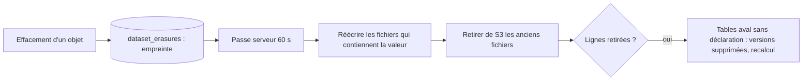

Une ligne de table n'a aucun lien avec un objet sans déclaration. `PUT /datasets/{id}/identity` dit quelle colonne identifie quel type d'objet. Le mapping d'un import pose cette déclaration quand la colonne garde sa forme. La file garde seulement l'empreinte de la valeur (sha256 de la forme pliée), et la garde après la passe. Tout chargement ultérieur écarte donc la personne. Une table aval recalculée répond 410 jusqu'au recalcul. Le worker ne prend aucun run d'une org qui a un effacement en attente.

### 3.12 Envoi par parties

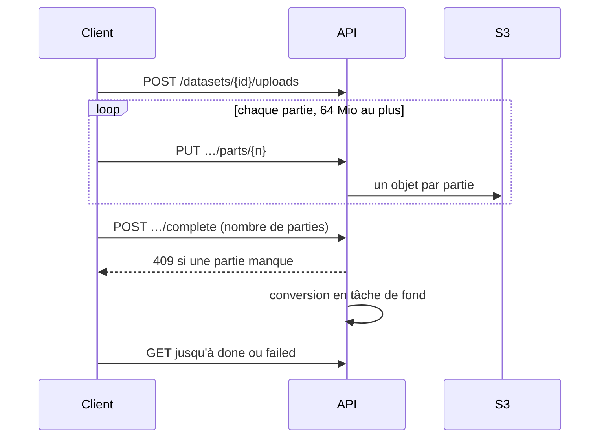

Un proxy limite une requête à 100 Mo et coupe une réponse lente. Un fichier entre donc en parties : 1 000 parties et 5 Gio au plus, dans n'importe quel ordre. L'interface et `pnex dataset load` envoient des parties de 32 Mio. Les parties sont retirées à la fin, réussie ou non. Inachevées, elles partent après 24 h. Une conversion perdue avec son pod repart après 10 min sans battement, trois fois au plus (`dataset-upload-lost`). Les médias utilisent le même mécanisme (`media.md`).

### 3.13 Imports à étapes et arrêt propre

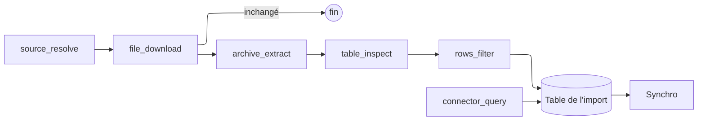

Un import qu'une org écrit peut encore porter `steps:` (D344). Le serveur les exécute (`services/ingest/pipeline.rs`) et journalise chaque étape dans `ingest_steps`. `source_resolve` lit une URL fixe ou un jeu data.gouv.fr. `file_download` écrit en zone de transit, sha256 au vol, et saute un fichier inchangé (`skip_if_unchanged`). `archive_extract` ouvre zip, tar et gz, sans rar. `table_inspect` profile les colonnes. `rows_filter` filtre avant le plafond, `in_objects` + `only` pour une longue liste.

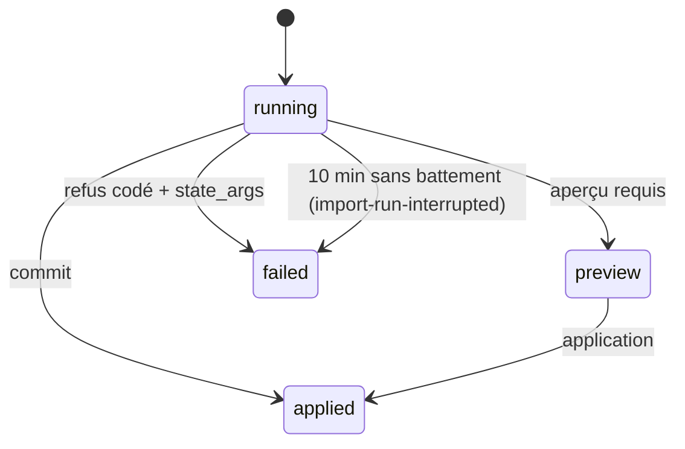

Un run bat toutes les 30 s (`heartbeat_at`). Seul le battement fait foi, jamais le démarrage d'un pod. Sur SIGTERM, le pod ne lance plus de run (`503 import-server-stopping`). Les runs en cours ont `PNEX_SHUTDOWN_GRACE_SECS` (270 s par défaut) pour finir. `terminationGracePeriodSeconds` vaut 300 pour l'API et le flow-worker. Un refus garde ses arguments dans `state_args`, et l'historique rend le message avec ses chiffres. Un bail de singleton porte la version de son porteur : la page Système passe en `degraded` si deux versions tournent.

### 3.14 Veille : pack `watch`

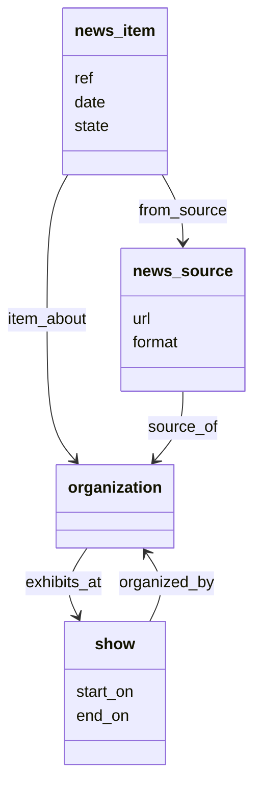

Le pack `watch` est neutre (D972). Il ne livre aucun thème, source, salon ni société suivie. Les flows de l'org décident ce qui compte. Un rapprochement certain lie directement. Un rapprochement douteux passe par une proposition (`link_upsert propose: true`). `state` est la décision humaine : un flow peut écarter, seule une personne retient. L'application lit ces données par `POST /api/v1/ontology/query`, sans route dédiée (D974).

Un pipeline peut déclarer `object_hosts` : des adresses tenues par les objets de l'org, ici `news_source.url` (D975). `fetch` joint leurs hôtes en plus des `hosts` du document. Les pipelines livrés sont `watch/rss` (RSS 2.0, Atom) et `watch/sitemap`.

**Danger :** n'envoyez jamais une clé du coffre ou un jeton vers un hôte d'`object_hosts`. Un membre choisit cette adresse (SEC-89, R9).

## 4. Exigences

### 4.1 Moteur et données

1. Le moteur ne doit contenir aucun hôte ni nom de source en littéral hors test. `tests/engine_genericity.rs` gèle l'existant dans `HOST_DEBT` (D951).
2. Un pipeline livré doit porter `tests:`. Un seul test Rust rejoue tous les pipelines livrés, sans réseau (D945).
3. Un fichier d'exemple de test doit faire 64 Ko au plus.
4. Un pipeline doit lister ses `hosts`. Une valeur venue d'une ligne ne doit jamais changer l'hôte (D942).
5. Une écriture `proposals` doit rester une proposition, jamais une écriture directe (D941).
6. Un intermédiaire doit être une table de travail. Une colonne ne doit jamais porter d'octets (D935).
7. Un run qui casse doit relire sa tranche : un curseur avance après le commit seulement (D794, D937).
8. Un traitement SQL ne doit lire que les tables déclarées en entrée (D572).
9. Le journal d'une écriture d'ontologie doit partir après le commit (D350).
10. Une édition humaine doit survivre tant que la source ne change pas cette valeur (D577).
11. Un contrôle bloquant doit annuler la transaction et laisser l'aval sur sa dernière version valide (D576).
12. Une décision d'organisation dans un pipeline doit avoir sa ligne au tableau des écarts de D998.

### 4.2 Sécurité (grille `security.md` §6)

1. L'org doit venir du principal, du pipeline, du job ou du connecteur. Jamais d'une ligne ni d'un paramètre (R1).
2. Chaque route doit avoir sa permission au registre IAM et son test 403 : `pipelines:read|write|run`, `datasets:read|write`, `connectors:read|write|use|test|delete` (R2).
3. Un run doit écrire avec le rôle de l'auteur, revérifié au début de chaque run (D303). `connectors:use` est revérifié sur l'auteur de l'import.
4. Un secret ne doit jamais apparaître dans un document, une table de travail, un journal, une sonde, une réponse ni une erreur (R4, R16). Un document d'org nomme un connecteur, jamais une clé du coffre. Un connecteur déplacé (hôte ou port) doit redemander son mot de passe.
5. Chaque adresse appelée doit passer l'egress (R8). Une redirection ne doit jamais sortir des hôtes déclarés. Un proxy (`fetch.proxy`) refusé par l'egress fait échouer l'appel, sans repli direct.
6. Une entrée hostile doit rester bornée : octets, entrées d'archive (10 000), taille décompressée, profondeur XML et JSON (128), `for_each`, `binary` et `lzma`.
7. Starlark doit tourner dans le worker, sans réseau ni environnement (R5, R6).
8. Une page lue ne doit jamais être rendue sur l'origine de l'application. La sonde rend du texte (R11–R13).
9. `browse` doit suivre D254–D258 et D789 : pas de connexion, pas de formulaire hors champ de recherche. Un `fetch` en `POST` de formulaire ne renvoie que les champs lus sur la page du même hôte.
10. Une table doit se protéger en entier, par permission d'org, tant qu'OP3 (droits par ligne) n'est pas livré. Une synchro vers un type à colonnes sensibles (D442) exige le même niveau d'accès sur la table.
11. Le MCP doit garder `EXCLUDED` le lancement, l'écriture en masse, tout connecteur (motif secret) et la route webhook (entrant machine).
12. L'assistant peut proposer un mapping ou un SQL sur la version lue. Il ne doit jamais lancer un run ni toucher un connecteur.

## 5. Décisions

### D317 — Un nœud `ingest`, une étape par nœud
Nœud de flow retiré par D359 (`web-presence.md`). Les étapes vivent dans les `steps:` d'un import (D344), puis dans le moteur (D936).

### D318 — Zone de transit S3, journal `ingest_steps`
Zone de transit `org_{id}/staging/…`, sha256 au vol, quota 2 Go par org, brut gardé `keep_raw_days` (30 jours), purge horaire. Gardé.

### D319 — `archive_extract`
Zip, tar, tar.gz, gz, sans rar. 10 000 entrées, 200 Mo décompressés, chemin hors du dossier refusé (`ingest-unsafe-path`). Repris par `unpack` (D936).

### D320 — `table_inspect`
Format, encodage, séparateur, remplissage et exemples par colonne. `expected_columns` absente = `import-schema-changed`. Repris par la sonde (D944).

### D321 — `rows_filter`
`equals`, `in`, `in_objects` + `only`, avant le plafond. `FILTER_VALUES_MAX` reste à 1 000. Repris par `sql` (D936).

### D322 — `ontology_import`
Absorbé : c'est la fin de tout import. `max_closures_pct` (20 %) protège tout import snapshot (`ingest-suspicious-closures`).

### D344 — Le pipeline est un import étendu
`steps:` dans le YAML d'un import. Remplacée par D571 puis par D934. Reste pour les imports qu'une org écrit.

### D345 — Exécution par un worker de jobs, file Postgres
File `import_jobs` jamais codée. Remplacée par `pipeline_jobs` (D573) et les exécutions enchaînées (D575).

### D346 — Reprise par étape
Non codée. La reprise relance ce qui n'a pas de transaction valide (D573).

### D347 — Écriture en bloc
Codée : `create_many_with`, `update_many_with`, lots de 5 000 lignes, `ROWS_MAX` à 250 000.

### D348 — L'aperçu est le même calcul, sans commit
Remplacée par D577 : le delta est l'aperçu. Aperçu périmé = `import-run-stale`.

### D349 — Ne rien refaire si la source n'a pas changé
`skip_if_unchanged` par sha256. `ETag` et `Last-Modified` non codés.

### D350 — Journal de provenance après le commit, par lots
Codée : `changes::deferred` et `flush`, lots O2 de 1 000, `history_retention_days` à 3 650 jours.

### D351 — Upload : zip, mapping à l'upload, carto
Proposée : écran de correspondance prérempli et conversion `geocode`. Aucune trace dans le code (§7).

### D352 — Sources connectées, identifiants au coffre
Remplacée par D791 : ressource `connectors`. Liste d'hôtes privés par org, posée par l'admin plateforme (Q-P2).

### D353 — Transformations : le mapping d'abord, un moteur SQL plus tard
Levée par D557 (`operational-platform.md`) : DataFusion retenu par la mesure de D572.

### D354 — Mapping versionné, migration par rejeu
Non codée pour les imports (ni `rekey` ni versions de mapping). Les pipelines de transformation ont leurs versions, avec auteur.

### D355 — Studio du pipeline
Amendée par §6.3 : studio `/pipelines/:id` en graphe SVG en lecture seule, coquille D222, tiroir Versions D221.

### D356 — Événement `import.applied` vers les flows
Remplacée par D578 : `dataset.committed`, `dataset.synced` et `dataset_trigger`.

### D357 — Ce qu'on garde de D317–D322
D317 retiré, D318 gardé, D319–D321 repris par les étapes du moteur, D322 absorbé.

### D358 — Lexique dédié
Pipeline, Traitement, Exécution, Connecteur et Table sont dans `design-system.md` §7. Origine, Correspondance, Aperçu et Rejeu n'y sont pas.

### D569 — Table versionnée par transactions
Parquet sur S3, catalogue `datasets`, `dataset_transactions`, `dataset_files`. Pas d'`update`. Catalogue maison plutôt qu'Iceberg.

### D570 — Une ligne n'est pas forcément un objet
Une entité utile monte dans l'ontologie, le reste demeure dans une table lue en SQL.

### D571 — Le pipeline devient le contenant, l'import sa dernière étape
Remplace D344. La forme du document est remplacée par D934. `/api/v1/pipelines` garde ce document pour les traitements SQL.

### D572 — Moteur : DataFusion, SQL seul
SQL hostile : session limitée, refus sur le plan logique, liste blanche, mémoire bornée (§3.8).

### D573 — Deux jobs, deux zones de confiance
Serveur pour les origines et la synchro, `pnex-pipeline-worker` pour le calcul, sans secret ni réseau externe.

### D574 — Lignage écrit par l'exécution
`dataset_transaction_inputs` donne amont, aval, péremption et saut. Pas de lignage par colonne.

### D575 — Ordonnanceur à dépendances
On planifie une cible. L'amont périmé est recalculé dans l'ordre, un cycle est refusé.

### D576 — Contrôles au commit
Un contrôle bloquant annule la transaction. L'aval garde sa dernière version valide.

### D577 — Synchro ontologie : delta par propriété
Delta entre deux transactions, par entité planifiée (Q-P8). Une édition survit tant que la source ne change pas.

### D578 — Batch, puis incrémental ; les flows reçoivent un événement
`snapshot` à chaque run. Pas de streaming. `dataset.committed` et `dataset_trigger` remplacent D356.

### D791 — Un cadre, quatre sortes, lecture seule
`postgres`, `mysql`, `rest`, `webhook`. Aucune écriture chez le tiers avant OP9 (D563).

### D792 — MySQL sous TLS seulement
TLS obligatoire. L'exception `RUSTSEC-2023-0071` de `deny.toml` porte ce motif.

### D793 — REST générique déclaratif
Authentification, pagination et colonnes en YAML. Aucun connecteur par éditeur.

### D794 — Incrémental par colonne curseur
Curseur avancé après le commit. `full_every` relance une lecture complète.

### D795 — Webhooks entrants vers une table
HMAC-SHA256, boîte `connector_inbox`, `202` immédiat, lecture par l'import du connecteur. PneX génère le secret, ou l'utilisateur colle celui que le service impose (choix de Shan, 2026-11-20).

### D796 — Pas de stockage cloud externe
Seul le S3 de PneX. Aucun identifiant de compartiment tiers.

### D797 — Hors OP2
Écriture retour, tables virtuelles, réplication logique, Elasticsearch, SFTP, OAuth2 avec consentement.

### D934 — Un seul document : le pipeline
Toute ingestion est un pipeline YAML. Bornée par D998 : pas de lien déduit dans un pipeline sans ligne d'écart.

### D935 — Tout intermédiaire est une table de travail
Une table de travail vit le temps du run, dans la zone de transit, sous le quota de l'org.

### D936 — Étapes fermées
`enumerate`, `fetch`, `browse`, `extract`, `unpack`, `read`, `sql`, `call`, `write`. `model` s'y ajoute (D841). Remplace les étapes de D317–D321.

### D937 — État par élément, un seul registre
`track: true`, `pipeline_items`, états `done`, `empty`, `failed`, `waiting`, `retry_after`.

### D938 — Cadence par hôte
`every` et `pause` par hôte. Un refus arrête la passe et met l'hôte en pause. Amendée par D975 (`object_hosts`).

### D939 — Des lecteurs de format, jamais de fournisseur
`csv`, `json`, `xml`, `html`, `ical`, `lines`, `binary`, `xlsx`. Fuseau IANA, conversions dans le pipeline seulement.

### D940 — Starlark en dernier recours
`call` dans le worker, sans réseau ni secret. Un `call` répété devient un lecteur.

### D941 — Cibles d'écriture
`table`, `objects`, `time_ranges`, `proposals`, `media`, `ask`. La cible `series` n'est pas codée. Les champs du mapping par source sont supprimés.

### D942 — Hôtes déclarés, secrets par connecteur
`hosts` obligatoires, egress par adresse. Un pipeline de pack peut nommer une clé du coffre, envoyée à ses seuls hôtes.

### D943 — Deux zones de confiance, inchangées
Le serveur va chercher, le worker calcule (§3.2).

### D944 — Une sonde sur toute étape
Lecture jusqu'à une étape, sans écriture. Le journal des étapes est codé, la sonde n'a pas de route.

### D945 — Tests en YAML
`tests:` avec `given` et `expect`, rejoués sans réseau. Un pipeline livré sans test échoue.

### D946 — Un ordonnanceur
Les balayages par domaine disparaissent. Les pipelines des packs ont encore leur balayage par minute (§3.9).

### D947 — Un pack est un dossier
`packs/<pack>.yaml`, `packs/<pack>/pipelines/`, `packs/<pack>/fixtures/`. Requêtes et fonctions restent dans le YAML du pack.

### D948 — Requêtes nommées
`queries:` d'un pack, jouées par `POST /analysis/named/{pack}/{key}` sous les droits de l'appelant.

### D949 — Méthodes d'analyse génériques
Mesure autour d'événements et chaînes candidates vont vers `/analysis`. Les séances anormales sont un `sql`.

### D950 — Sources poussées
Un terminal ou un modèle externe qui envoie des lignes est un webhook (D795). Les routes `/mt5/*` sont gardées (choix de Shan).

### D951 — La garde voit les fournisseurs
`engine_genericity` refuse un hôte public en littéral. La dette `HOST_DEBT` doit être vide à la fin de PE9.

### D952 — Remise à zéro
Tables des anciens chargeurs supprimées et rechargées par les pipelines. Routes retirées = `feat(api)!`.

### D953 — Décisions remplacées
D317–D322, D344, D571 (forme), D540, D780 (format séparé), D807–D809, D889, D847–D849 (routes MT5).

### D972 — Un pack neutre : actualités, sources, salons
Types `news_item`, `news_source`, `show`. Aucun thème ni source livré.

### D973 — La prospection et le CRM s'appuient dessus
La presse GDELT écrit des `news_item`. `crm` 4.0.0 étend `show` et supprime les chiffres de salon.

### D974 — Lecture : la requête d'ontologie, pas de route dédiée
`POST /api/v1/ontology/query`. Route dédiée seulement si une mesure le demande.

### D975 — Les hôtes des sources de l'org
`object_hosts` ouvre les hôtes des objets de l'org, jamais pour un secret.

### D995 — Une étape `browse` met le run en pause
Ligne en `waiting`, reprise par la fin de la navigation, aucun worker bloqué.

### D996 — Les finalités deviennent des étapes génériques
Captures, liste d'employés, recherche et relations deviennent des pipelines. Amendée par D998 : score et rattachement vont aux flows.

### D997 — Une ligne peut redemander le pipeline (`write: ask`)
Lignes redemandées après le run, dans l'agent du même membre. Selon D998, un flow décide de la suite.

### D999 — Collecte en pipeline, tout le reste en flows
Nœuds `ontology_trigger` et `pipeline_ask`. Le pipeline collecte, trois flows du pack scorent, rattachent ou relancent.

### D1000 — Lire une fois, ou relire tous les N jours
`again_days: N` sur une énumération suivie, 1 au moins.

## 6. Interfaces

### 6.1 Document d'un pipeline du moteur

```yaml
key: histdata_m1
hosts: [www.histdata.com]
schedule: 5m
steps:
  - enumerate:
      as: parts
      track: true
      cross:
        - { setting: markets.histdata_pairs, as: pair }
        - { periods: year, from_setting: markets.histdata_from, closed_only: true, as: year }
  - fetch:   { for_each: parts, url: "https://www.histdata.com/…/{{pair}}/{{year}}", every: 5m, as: page }
  - extract: { from: page, form: "#file_down", as: form }
  - fetch:   { for_each: form, method: post, url: "https://www.histdata.com/get.php", form: "{{form}}", empty: settled, as: zip }
  - unpack:  { from: zip, entries: ["*.csv"], as: csv }
  - read:
      from: csv
      format: csv
      header: false
      delimiter: ";"
      columns:
        - { name: ts, type: timestamp, format: "%Y%m%d %H%M%S", timezone: America/New_York }
      as: bars
  - write: { from: bars, table: { name: histdata_m1 } }
tests:
  - given:
      "https://www.histdata.com/…/XAUUSD/2015": fixtures/page.html
    expect: { columns: [pair, ts, open, high, low, close], rows: 3 }
```

| Champ | Rôle |
|---|---|
| `requires` | Réglages qui doivent être remplis, sinon le run ne lit rien |
| `object_hosts` | Adresses des objets de l'org dont les hôtes sont joignables (D975) |
| `large` | Gros fichiers, seulement si un admin a fixé le quota de l'org (SEC-82) |
| `enumerate.per_run` | Lignes prises par passage, 10 par défaut. Sans `per_run`, toutes les lignes demandées passent |
| `fetch.secret` | Clé du coffre (paramètre, en-tête ou jeton OAuth2), pipeline de pack seulement |
| `fetch.proxy` | Clé du coffre qui porte l'URL d'un proxy. Interdit avec `stream` |
| `fetch.stream`, `fetch.parts` | Fichier lu à mesure, en parties jointes, suivi d'un `unpack` tar et d'un `read` |
| `fetch.pages` | Numéro de page jusqu'à une page vide, `max` au plus |
| `write.table.key` | Colonnes qui nomment une ligne : une ligne déjà vue est écartée |
| `write.table.checks` | Contrôles de D576 sur les lignes à écrire. Un contrôle en échec n'écrit rien (`pipeline-check-failed`). `max_drop_pct` exige `replace` |
| `write.table.retain_days` | Jours de lecture d'une version remplacée par `as_of`, de 1 à 3 650. Le run écrit aussi le lignage des tables lues par ses étapes `sql` (D574) |
| `sql.columns` | Colonnes d'une table absente, lue vide |

### 6.2 Routes

| Route | Effet |
|---|---|
| `GET/POST /api/v1/pipelines`, `…/{id}`, `…/{id}/versions` | Pipelines de transformation et leurs versions |
| `POST /api/v1/pipelines/validate` | Valide un document |
| `GET/POST /api/v1/pipelines/{id}/runs` | Exécutions |
| `PUT /api/v1/pipelines/{id}/schedule` | Horaire d'une cible |
| `GET/POST /api/v1/data-builds`, `…/plan` | Exécutions enchaînées |
| `/api/v1/datasets…` | Tables, transactions, échantillon, profil, fraîcheur, identité, lignage, envoi par parties |
| `/api/v1/ontology/imports…` | Imports, runs (avec `steps`), aperçu, application |
| `/api/v1/connectors…`, `POST …/{id}/secret`, `POST …/{id}/test` | Connecteurs |
| `POST /api/v1/hooks/{id}` | Entrée d'un webhook (`Public`, signature) |
| `GET /api/v1/analysis/named`, `POST …/{pack}/{key}` | Requêtes nommées |
| `PUT /api/v1/system/orgs/{org_id}/connector-hosts` | Hôtes privés d'une org (admin plateforme) |
| `PUT /api/v1/system/retention/history` | Rétention de `object_changes` (admin plateforme) |

### 6.3 Écrans

`/pipelines` a quatre onglets : Pipelines, Tables, Exécutions enchaînées, Connecteurs. `/pipelines/:id` est le studio d'un pipeline de transformation : graphe SVG en colonnes, en lecture seule, un nœud par table. La colonne de droite montre le traitement, la scène montre l'échantillon et le profil de colonnes. `/pipelines/tables/:id` montre une table. L'onglet Imports de l'ontologie reste : il porte l'historique, les étapes et l'aperçu des imports. Pas de lecteur commun D220, pas de « Reprendre au traitement N ».

## 7. Reste à faire

**Lots du moteur non finis :**

- PE5.5 (choix de Shan, 2026-11-20) : la page « Sites web » reste. Elle garde l'édition visuelle, les captures d'écran du run et la description des actions sur la page. Seul le stockage change : une règle devient un pipeline avec `browse`, après D934. `/site-recipes` disparaît alors, pas l'UI.
- PE8 : mesure autour d'événements et chaînes candidates dans `/analysis`, note de séance en règle.
- PE9 : `HOST_DEBT` à vider (5 lignes), lexique (Étape, Table de travail, Sonde, Requête nommée), fiches de l'assistant.
- D934 (choix de Shan, 2026-11-21) : une seule sorte de pipeline. `/api/v1/pipelines` doit servir le pipeline du moteur écrit par l'org, versionné, ses `tests:` joués avant l'enregistrement. Il peut lire tout hôte public, derrière la garde R8, la cadence D938 et le quota de l'org. Plan :
  2. Stockage et routes : le pipeline d'org remplace le document D571 dans `pipelines`. Le planificateur lance aussi les pipelines d'org.
  3. Migration des données : un traitement D571 devient une étape `sql` suivie d'un `write`.
  4. Studio `/pipelines/:id` : éditeur YAML, tests et graphe des tables.
  5. Retrait du code D571, contrat, MCP, IAM, fiches de l'assistant.
- D946 : les pipelines des packs restent hors des exécutions enchaînées. `after` d'un pipeline du moteur n'est pas appliqué.
- D941 : cible `series` non codée.
- D944 : la sonde n'a pas de route.

**Écarts connus du moteur :**

- `unpack`, `extract` et `read` tournent dans le serveur, pas dans le worker (D943).
- Cadence et pause par processus, pas pour la plateforme (D938).
- Une seule énumération suivie, en première étape.
- XML et JSON lus en mémoire, 64 Mo au plus.
- Un événement archivé par un membre peut être recréé au run suivant : clé d'unicité sur les archivés, générique.
- Un import (sans contexte d'application) ne peut ni naviguer ni écrire de documents (`step_unsupported`).
- Les lignes passent au bac à sable Starlark en JSON : une table large de 200 000 lignes peut dépasser 64 Mo.
- Pas de fonctions JSON ni de tableaux dans la liste blanche du worker.
- Marchés de prédiction : formes des réponses non vérifiées en réel (hôtes bloqués depuis la France).
- LinkedIn : lecture du titre par heuristique, relations plafonnées à 1 000 personnes, état « je suis en relation » (D977) non posé par la collecte.
- Non vérifié : `read` + `sql` sans `call` pour un JSON très imbriqué, coût de `browse` depuis l'ordonnanceur, débit de `write objects` face à `PLANNED_MAX`, graine stable du tirage d'instants.

**Imports et tables :**

- D345, D346, D348, D351, D354 non codées. Statut de D351 (zip à plusieurs fichiers à l'upload) à vérifier dans `import_read`.
- Pas de transaction `delete`. Quota de 20 Go en constante, pas par tier.
- Un client arrêté recommence son envoi depuis le début.
- Une étape à la fois par exécution enchaînée.
- `object_imports` : retrait de la table une fois les origines migrées (choix de Shan).
- `fc_rs_xml` : vérifier qu'il passe par la table et protège les éditions depuis son portage en pipeline.
- Chart `pipelineWorker`, `NetworkPolicy` et `images.yml` jamais essayés sur un cluster.
- Retirer à la main les anciens horaires des imports France Compétences de l'org 4 sur dev.pnex.io.
- Jointure réelle 44,5 M × 38 M à mesurer sur dev.

**Effacement (à trancher par Shan avant de promettre un effacement complet) :**

- Un fichier sans déclaration ni lignage garde la personne.
- Une table supprimée perd ses empreintes : recréée et rechargée, la personne revient.
- Une colonne convertie (`digits`, `left`, `concat`) n'est pas déclarée.
- Un titre déclaré retire les homonymes.

**Connecteurs :**

- TLS sans vérification du certificat (SEC-64) : `sslrootcert` par connecteur à la première demande.
- Elasticsearch : attendre un besoin réel.
- Q-CN2 : un `POST` en lecture (API de recherche), drapeau à ouvrir au premier besoin.
- Q-PE2 : un pipeline d'org peut-il appeler `browse` avec une session d'agent ? Proposition : oui, aux conditions de D782.
- Jeton OAuth2 non rafraîchi pendant un run. Erreur de statut REST sans le code HTTP dans `args`.
