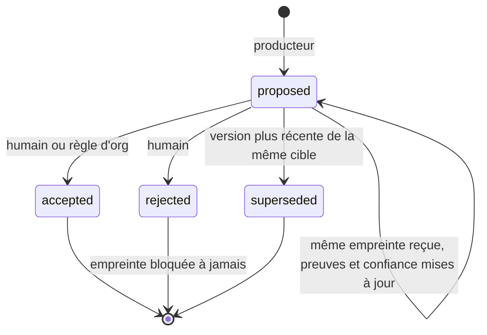
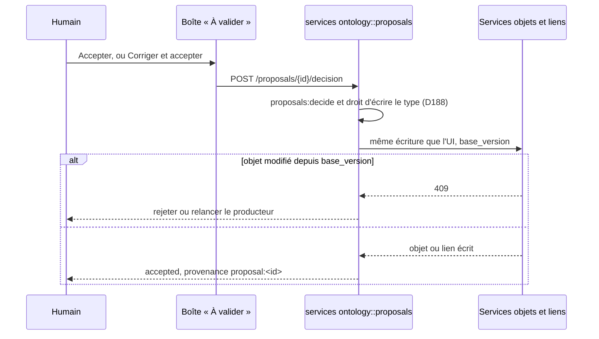
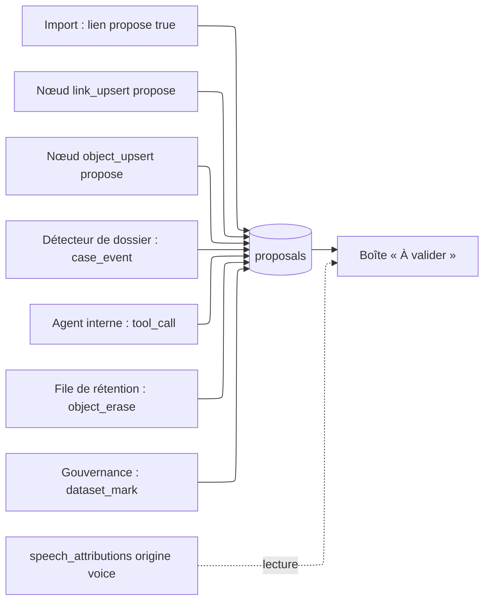
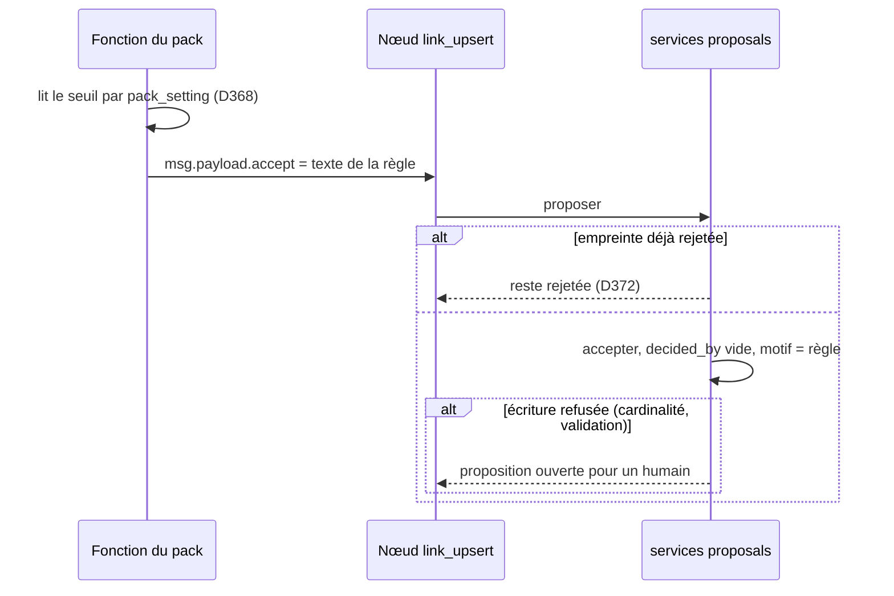

# Propositions et décisions (D367, D371–D377)

| | |
|---|---|
| **Statut** | Codé : lots P0 à P4. Reste : acceptation automatique pour `object_upsert` et les imports, proposition d'objet dans un mapping. |
| **Décision mère** | D367 (`ontology.md` §11) : la proposition est un objet du noyau. |
| **Renvois** | `ontology.md` (D176–D191, provenance D184, packs D190, réglages D368), `cases.md` (détections), `media.md` (D275 voix), `operational-platform.md` (D563, D998), `agents.md` (porte de validation), `crm.md` (D445), `governance.md` (D804) |

## 1. Résumé

Une proposition est une écriture que la plateforme ne fait pas seule, parce qu'elle n'est pas sûre que la donnée soit vraie. Une machine la produit : import, flow, détecteur, modèle, agent. Un humain l'accepte ou la rejette depuis une seule boîte, « À valider ». Accepter écrit par les mêmes services que l'UI. Chaque décision reste dans un journal complet, et une valeur rejetée ne revient jamais.

Un lien déduit passe par une proposition, posée par un flow ou un humain. Un pipeline de collecte ne fige jamais un lien déduit (D998).

## 2. Concepts

| Terme | Définition |
|---|---|
| **Proposition** | Écriture en attente d'un humain, dans la table `proposals`. |
| **Producteur** | Ce qui crée la proposition : import, nœud de flow, détecteur, modèle, agent, assistant. Son `origin` le nomme. |
| **Empreinte** | Clé calculée par le producteur (type, extrémités, clé, valeurs). Elle est unique par org. |
| **Décision** | Acceptation ou rejet, avec qui, quand et le motif. |
| **Règle d'org** | Seuil qui accepte une proposition sans humain (D377). |
| **Statut de tri** | Choix métier sur une donnée vraie (signal retenu ou écarté). Ce n'est pas une proposition. |

Exemples de propositions : un lien de groupe tiré de Wikidata, le site web d'une organisation, une société retrouvée par son nom, la voix d'une personne, un événement détecté, une extraction par LLM. Un constat d'écart d'une règle déterministe est un fait daté, et son suivi est un workflow (Q-P1).

```mermaid
classDiagram
  class Producteur {
    origin
  }
  class Proposition {
    kind
    fingerprint
    status
    confidence
  }
  class Decision {
    decided_by
    reason
  }
  class Ecriture["objet ou lien écrit"]
  Producteur --> Proposition : propose
  Proposition --> Decision : 0..1
  Decision --> Ecriture : applied, provenance proposal:id
```

## 3. Fonctionnement

### 3.1 Cycle de vie d'une proposition



Une nouvelle valeur (une autre mère, un autre site) fait une autre empreinte. Accepter et rejeter sont idempotents. Une décision contraire à une décision passée répond `proposal-decided` (409).

### 3.2 Accepter



L'écriture se fait sous l'utilisateur qui décide. L'origine machine reste lisible sur la proposition. « Corriger et accepter » remplace les valeurs proposées, et la correction reste sur la décision (Q-P5). Un rejet peut porter un motif de 500 caractères au plus.

### 3.3 Producteurs



Le pack ne déclare plus d'état `to_validate`. Il déclare qui propose.

- **Import** : une entrée de lien d'un mapping peut porter `propose: true`. Le diff l'indique. L'écriture crée la proposition dans la même transaction. Premier cas : les liens Wikidata de `companies_fr`.
- **`link_upsert`** : l'option `propose` garde `msg.payload.confidence` et `evidence`. La réponse est `{proposed, proposal_id}`. Premier cas : le flow de présence web écrit à partir de 80 et propose de 40 à 79.
- **`object_upsert`** : l'option `propose` crée `object_create` pour un objet absent. Pour un objet présent, elle crée `object_update` avec les seules propriétés et le titre qui diffèrent, sur `base_version`. Si rien ne diffère, rien n'est proposé. La réponse est l'objet tel qu'il est (`null` s'il n'existe pas) et `msg.proposed = true`.
- **Dossiers** : une détection est une proposition `case_event`. `target_id` est le dossier. L'empreinte est `case_event|<dossier>|<key>`, donc un recalcul ne repropose rien. Accepter crée l'événement. Les routes du dossier passent par la décision commune.
- **Voix** : la boîte lit `speech_attributions` d'origine `voice` (`kind = voice_span`) en lecture seule. La décision reste dans la relecture du média, et la décision commune répond 404 (Q-P3).
- **Autres kinds** : `tool_call` (écriture d'un agent interne, `agents.md` D785, porte D563), `object_erase` (effacement de données personnelles, `crm.md` D445), `dataset_mark` (marquage d'une Table, `governance.md` D804). Une règle d'org ne les accepte jamais.

### 3.4 Acceptation automatique (D377)



L'UI affiche « Automatique : <règle> », par exemple `web_presence.confirm_threshold >= 80 (score 92)`. Le code du flow peut déjà écrire sans proposer : `accept` n'ouvre donc aucun droit nouveau.

## 4. Exigences

1. Une empreinte rejetée ne doit jamais produire une nouvelle proposition ouverte.
2. Accepter doit écrire par les services de l'UI, avec les mêmes validations, cardinalités et 409.
3. L'écriture acceptée doit porter la provenance `proposal:<id>` (D184).
4. Décider doit exiger `proposals:decide` et le droit d'écrire le type visé. Un test vérifie le 403 (R2).
5. L'org doit venir du principal ou du nœud déployé (R1).
6. `decided_by` doit s'afficher par le nom, jamais par l'e-mail (R4).
7. Une preuve citée doit s'afficher en texte, jamais en HTML (R11).
8. L'assistant et le MCP ne doivent jamais décider. La lecture leur est ouverte.
9. Une acceptation automatique doit rester écrite comme proposition `accepted`, avec la règle citée.
10. Une source déclarée fiable (registre officiel) doit écrire directement, sans proposition.

## 5. Décisions

### D367 — La proposition est un objet du noyau

Une table commune au noyau remplace les états « à valider » propres à chaque module.

### D371 — Une table `proposals` au noyau

Champs : `org_id`, `kind` (liste fermée, §6), `target`, `diff`, `base_version`, `evidence` (preuves D310), `refs`, `origin`, `confidence` (0 à 100, facultatif), `fingerprint`, `status`, décision, `applied`, dates.

### D372 — Une empreinte, jamais reproposé

Une proposition rejetée bloque son empreinte à jamais. Une version plus récente de la même cible remplace une proposition ouverte (`superseded`).

### D373 — Accepter = écrire par le service partagé

Accepter applique la différence par les services de l'UI, sous l'utilisateur qui décide. Une mise à jour dont l'objet a bougé est refusée.

### D374 — Une boîte « À valider », une permission

Une page commune et deux permissions : `proposals:read` (lecteur) et `proposals:decide` (membre). Assistant et MCP lisent seulement. Amendée par D563 (`operational-platform.md`) : un agent validateur désigné peut décider une proposition `tool_call` (`agents.md`).

### D375 — Les producteurs disent « proposer » au lieu d'« écrire »

Mappings et nœuds `link_upsert` / `object_upsert` portent `propose`. Le pack déclare qui propose.

### D376 — Migration des packs existants

Les liens en attente (`subsidiary_of` Wikidata, `has_website` proposés) sont devenus des propositions, et leurs attributs d'état ont disparu (migration 000047).

### D377 — Acceptation automatique : une règle d'org, tracée

Au-dessus d'un seuil du pack, surchargeable par l'org (D368), une proposition est acceptée sans humain. Codé pour `link_upsert` seulement.

## 6. Interfaces

| Route | Effet | Permission | MCP |
|---|---|---|---|
| `GET /api/v1/proposals` | liste, filtres `status`, `origin` (préfixe), objet | `proposals:read` | exposé |
| `GET /api/v1/proposals/{id}` | une proposition | `proposals:read` | exposé |
| `POST /api/v1/proposals/{id}/decision` | `decision` (`accept` / `reject`), `reason`, `values` | `proposals:decide` | exclu (sign-off) |

- **Kinds** : `object_create`, `object_update`, `link_create`, `link_update`, `link_close`, `case_event`, `voice_span` (lu, jamais stocké), `object_erase`, `tool_call`, `dataset_mark`.
- **Statuts** : `proposed`, `accepted`, `rejected`, `superseded`.
- **Origines** : `import:<id>@<run>`, `flow:<id>@<version>:<node>`, `detector:<clé>`, `llm:<modèle>`, `agent:<id>`, `assistant`.
- **Code d'erreur** : `proposal-decided`.
- **Code** : `pnex_core::ontology::proposal`, `services/ontology/proposals.rs`, `controllers/proposals.rs`, migrations 000046 (table), 000047 (D376), 000049 (détections des dossiers).
- **UI** : page « À valider » (`/proposals`, menu Connaissance, filtre par statut, origine passée par l'adresse), section des propositions ouvertes en tête de la page d'un objet. Fiche `assistant-kb/proposals.md`. Lexique : « Proposition » (`design-system.md` §7).
- **Tests** : `tests/proposals.rs`, `ontology` `case_detections_are_proposed_and_reviewed_by_a_human`, `media_review` `voice_proposals_respect_what_people_decided`, `partner_watch`.

## 7. Reste à faire

- Acceptation automatique (D377) pour `object_upsert` et pour les imports.
- Entrée d'objet d'un mapping qui propose : à faire quand un cas réel le demande.
- La boîte n'a pas de décision en lot ni de filtre par type. L'API filtre par objet, l'UI ne l'expose pas.
- Choix de Shan : les défauts appliqués restent à confirmer.
  - **Q-P1** : un statut de tri reste une propriété métier, pas une proposition. Défaut appliqué.
  - **Q-P2** : les données communautaires (Wikidata) entrent en propositions. Défaut appliqué.
  - **Q-P4** : une proposition sans réponse n'expire pas. Défaut appliqué, sans filtre d'ancienneté dans la boîte.
  - **Q-P5** : « Corriger et accepter » vaut pour les propriétés. Défaut appliqué.
