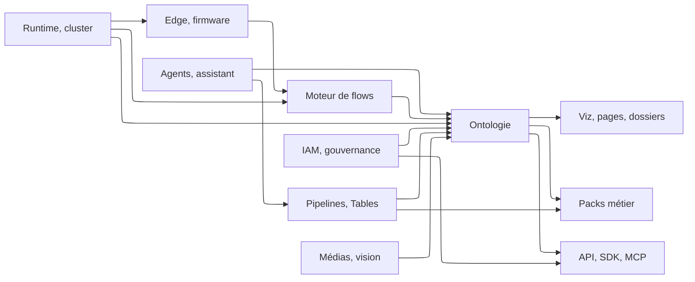
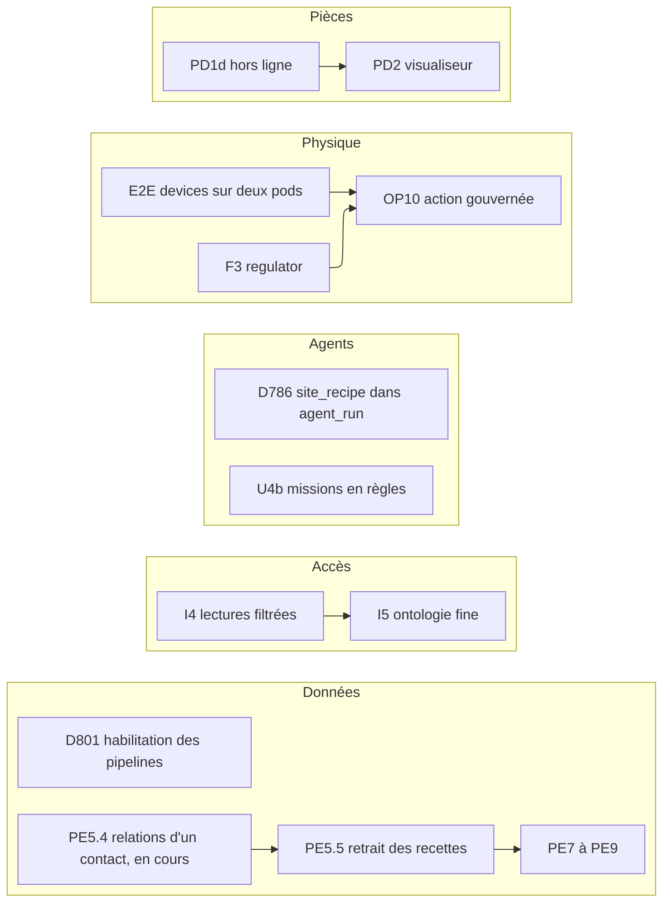
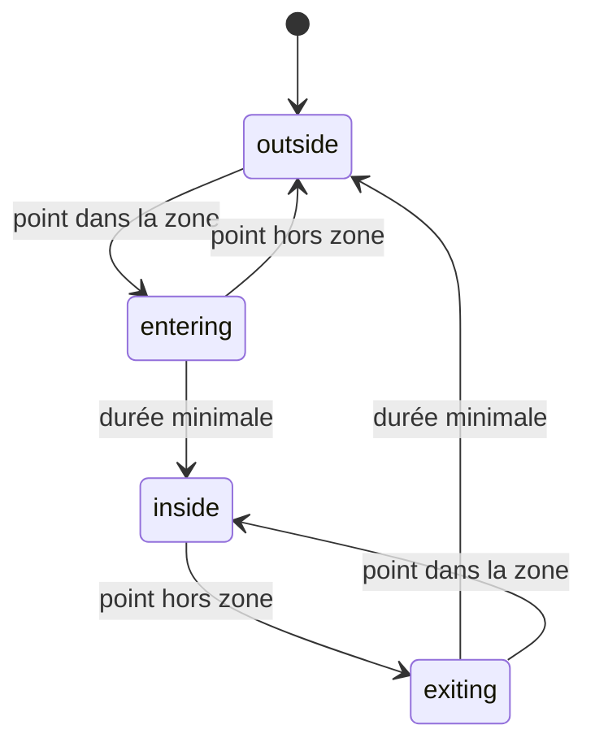

# Roadmap produit

| | |
|---|---|
| **Statut** | Vue de pilotage, revue le 2026-11-20. Les docs de domaine font foi pour le détail. |
| **Numérotation** | Entrées **P0.1…P2.39** (§2), registre des décisions produit **#1…#27** (§4). Le code et les docs citent ces numéros. |

## Résumé

Cette page dit ce qui vient ensuite, domaine par domaine. Elle ne raconte pas le livré : git le garde. Chaque domaine a son doc avec une section « Reste à faire ». La roadmap donne une ligne d'état par domaine, renvoie au doc et nomme les prochains lots. Elle s'adresse à Shan et aux sessions qui choisissent le travail suivant.

PneX est une plateforme de données sur un socle IoT. La donnée reliée est le cœur : ontologie, séries, médias, documents, pages, géo, dossiers. Le socle IoT garde la même ambition : contrôle, M2M, firmware, OTA, identité device, sécurité. Depuis le 2026-11-03, le périmètre couvre toute capacité civile d'une plateforme opérationnelle ontologique (`operational-platform.md`, D551–D568).

## Concepts

- **Entrée P** : un chantier de la roadmap. P0 = consolider le livré, P1 = finir un tronc, P2 = chantier à spec écrite, P3 = horizon sans engagement.
- **Lot** : une tranche livrable d'un chantier, nommée par son doc (OP1, PE5.4, I4, PD1d…).
- **Doc de domaine** : le doc d'architecture qui possède un domaine. Sa section « Reste à faire » fait foi.
- **Décision produit (#n)** : un arbitrage de périmètre ou d'ordre, tenu au §4. Les décisions techniques sont des Dn dans les docs de domaine.

Domaines et dépendances principales :

## Fonctionnement

### Méthode de tri

- Une fonctionnalité est finie quand elle passe un E2E réel : navigateur headless pour le web, banc matériel pour le firmware. Livré ne veut pas dire fini.
- Consolider passe avant étendre. Depuis le 2026-11-03, la robustesse et les tests passent avant toute nouvelle fonctionnalité.
- À priorité égale, un chantier qui relie des données existantes passe avant un pilier isolé.
- Le choix de l'ordre global revient à Shan (§5).

### Prochains lots

Le diagramme montre les lots en cours ou décidés et leurs dépendances connues. Un lot hors du diagramme attend un choix de Shan.

PE5.4 est le seul lot en cours au 2026-11-20 (`pipelines.md`). D786, D801 et les gardes de gouvernance sont décidés et restent à coder. OP10 dépend aussi d'OP9, livré.

## Exigences

1. Un nouveau chantier doit recevoir un numéro P et une ligne au §1 dans le même commit que son doc.
2. Un état écrit ici doit renvoyer au doc de domaine. En cas d'écart, le doc de domaine fait foi et la ligne d'ici est corrigée.
3. Une entrée P ne doit jamais être renumérotée. Une entrée close garde sa ligne au §2.
4. Une décision produit nouvelle doit prendre le numéro suivant du §4.
5. Seul un flow déployé par l'humain doit agir sur le physique (D123), jusqu'à la livraison d'OP10 (D564). L'assistant ne commande jamais un device.
6. La frontière de sécurité doit rester l'org, puis la plateforme (D130).

## 1. État par domaine

| Domaine | État | Doc | Prochains lots | P |
|---|---|---|---|---|
| Plateforme opérationnelle | OP1 en grande partie livré. OP2, OP3, OP5, OP9 livrés. | `operational-platform.md` §11 | OP4, OP6–OP8, OP10–OP15 selon la demande client | P2.36 |
| Ontologie | Noyau 0.2.0 livré (D176–D191), actions D183, D367, D368. | `ontology.md` | Éditeur d'actions, mesures 100 k objets, D369, calendrier GMAO (compteurs, équipes, `.ics`), annexe C | P2.14, P2.20 |
| Pipelines, Tables, connecteurs | Moteur codé (D934–D953), connecteurs OP2 livrés. | `pipelines.md` | PE5.4 (en cours), PE5.5, PE7, PE8, PE9, D941, D944 | — |
| Gouvernance | G1–G7 livrés (D798–D806). | `governance.md` | D801, détection et unicité des marquages (à coder), SAML à la demande | — |
| IAM | I0–I3 livrés, I6 en lecture seule, I7 partiel. | `iam.md` §16 | I4, I5, I2, simulateur d'accès (I7) | P2.25 |
| Sécurité | Coffre (D110–D119), profil V1 (D153–D158), audit du 2026-11-06 corrigé. | `security.md` §11 | Clé APK release (SEC-10), V2 profil `industrial` | P0.2, P2.37 |
| API, SDK, MCP, CLI | Contrat OpenAPI, MCP, CLI `pnex`, SDK d'applications livrés. | `api.md`, `external-apps.md` | Ensembles fermés en enum, filtrage MCP par tag, flux SSE des changements, D440 | — |
| Runtime, cluster | Cluster D106–D108 validé sur dev.pnex.io, PostgreSQL seul (#19), S3 seul (#25). | `runtime.md` | Digests d'images, purge O2 durable, histoire du graphe, PG 19 (M0–M5) | P0.3 |
| Moteur de flows | Codé, palette par catégories (D109). | `flow-engine.md` §7 | Mise en sommeil des flows, `LAST_VALUES` en Valkey, groupes de nœuds | P1.7, P2.11, P2.21 |
| Edge, agent, M2M | Agent edge livré (D95–D99), TLS et OTA signée. | `edge.md` §7 | F3 `regulator`, agent Windows et macOS, POC M2M zenoh-pico | P1.3, P3 |
| Firmware | Générique et IDE custom livrés (D87–D94), banc du 2026-10-14 vert. | `firmware.md` §7 | Sandbox D91 réelle, E2E BME280, banc HIL | P0.1, P2.10 |
| Notifications | Codé, sept canaux, journal O2 (D86). | `notifications.md` | Webhooks entrants, push natif (reportés) | P2.9 |
| Viz, Studio, dashboards | Carte, dashboards, surfaces (D123–D141) livrés. | `viz.md` §7 | Maquette 3D, préchargement des panoramas, REP-2 | P2.4, P2.6, P2.12 |
| Design system | Lexique D218–D224, mode sombre. | `design-system.md` §11 | `EditorShell` sur 7 éditeurs, tiroir de versions commun, `Badge` | P1.8 |
| Médias, flux, appels | Lots 0–6 de l'ingestion (D159–D175), enregistreur R1. | `media.md` §7 | Essais réels (O81), sélecteur de profil, appels R2–R4 | P2.5, P2.13, P2.30 |
| Vision | Caméra (D73–D86), Studio M1–M5 (D192–D210). | `vision.md` §7 | Essais caméra réelle, INT8 sur Pi 5, anomalie multi-séries | P2.3, P2.8, P2.15 |
| Géo | Phase F et phase A livrées. | `geo-layers.md` §7 | Phases B–E, nœuds `geo_geocode` et `geo_route` | P2.16 |
| Pages | L1, cœur de L2, PDF. | `pages.md` §7 | L3 → L7 | P2.17 |
| Recherche documentaire | P1 codée. | `doc-search.md` §7 | P2 (pgvector) → P5 | P2.18 |
| Dossiers | C0–C7, espace de travail, argent, chaînes causales. | `cases.md` §7 | Enquête média, navigation et argent | P2.19 |
| Création assistée | D225–D237, C1 livré. | `assisted-creation.md` | C2 → C7 | P2.22 |
| Assistant IA | Registre fermé d'outils (`ai-assistant.md` §4), D142–D145. | `ai-assistant.md` | Suit chaque fonctionnalité (D142) | — |
| Agents, environnements | D700–D720, U1–U5, porte OP9 livrés. | `agents.md` §7 | D786, U4b, D441, forge GitLab et Forgejo | P1.6, P2.7, P2.29 |
| Agents navigateur | v2 codée (L0–L5, D254–D284). | `browser-agents.md` §7 | Campagne de test réelle, publication, D268 | P2.1 |
| Analyse | AN1–AN3 livrés (D825–D832). | `analysis.md` | AN4, règle qui propose (D829) | P2.36 |
| Propositions | P0–P4 codés. | `proposals.md` | Acceptation automatique (D377) | — |
| CRM, comptes | Packs `crm`, `prospecting_b2b`, CRM1–CRM7, D341. | `crm.md` §7 | Registres étrangers, prospection | P2.27, P2.28, P2.31 |
| Présence web | W0–W4 codés (D359–D366). | `web-presence.md` | `address_proof`, captures en Vision Lab | — |
| Mail | M1–M3, M5 en partie, M6 codés (D453–D467, D518–D521). | `mail.md` §7 | M4 OAuth2, type `mail_message` | — |
| Partenaires | Veille et preuves codées (D300–D316, D402–D431). | `partners.md` §7 | D300 écriture bornée, règles V2 | P2.26 |
| Marchés | Packs `markets` et suivants codés (D523–D546 et suivantes). | `markets-research.md` §7 | MK0 (OpenFIGI, FIRDS), MK3c, ingestion de contenus L2–L8 | P2.35 |
| Marché du travail | LM0 et pack `labor_market_fr` (BMO, tension). Aucune source d'offres. | `labor-market.md` §7 | LM1, LM3 → LM5. LM2 bloqué. | — |
| Pièces et documentation | PD0, PD1a–PD1c codés (D960–D971). | `parts-docs.md` §7 | PD1d → PD5 | P2.39 |
| Chaîne de livraison | PRD proposé (D850–D866), rien de codé. | `software-delivery.md` §7 | SD0 → SD1 → SD3 → SD4 après Q-SD1 | P2.23, P2.24, P2.38 |
| Due diligence | PRD proposé (D468–D483), rien de codé. | `due-diligence.md` §7 | DD0 → DD2 | P2.32 |
| Recherche juridique | PRD proposé (D485–D505), rien de codé. | `legal-research.md` §7 | LR0, puis LR1 → LR5 | P2.33 |
| Analyse du discours | PRD proposé (DA1–DA10), rien de codé. | `discourse-analysis.md` §7 | Option A d'abord (choix de Shan) | — |
| App builder | AB0–AB5 codés, en pause depuis le 2026-11-02. | `app-builder.md` §7 | Rien sans l'accord de Shan | P2.34 |
| Hub de kits | Proposé, gelé jusqu'à OP12. | `hub.md` | P1 → P5 après OP12 | P3 |
| GPS | Rien de codé, pas de doc. | §3 | PRD de l'axe G | P2.2 |

## 2. Index des entrées

| P | Titre | État | Renvoi |
|---|---|---|---|
| P0.1 | Passe E2E matériel | Points 1–7 validés le 2026-10-14. Reste F3 (P1.3). | `firmware.md` §7 |
| P0.2 | Chiffrement des secrets de notifications | Clos par le coffre (D110–D119). | `security.md` |
| P0.3 | E2E du cluster multi-réplicas | Joué sur dev.pnex.io le 2026-10-14. Reste les points 5–6 de `flow-engine.md` §7. | `runtime.md` §3.6 |
| P1.1 | Organisations (D42) | Sites, fil d'Ariane, étiquettes livrés. Vue arbre dédiée non faite. | `viz.md` |
| P1.2 | Android distribuable | Plomberie livrée. Reste la clé de release (SEC-10). | `security.md` §11 |
| P1.3 | Firmware `regulator` (D20, D45, D46) | Non commencé, matériel requis. | `edge.md` §7 |
| P1.4 | Annotations ETL et device | Clos par D147. | `vision.md` |
| P1.5 | PRD des axes C, G, X | C = `vision.md`, X = `browser-agents.md`. G sans PRD. | §3 |
| P1.6 | Fabric de workers : PRD | Choix de Shan : garder, réduire ou abandonner. | `agents.md` §3.18 |
| P1.7 | Palette par catégories (D109) | Livré. | `flow-engine.md` |
| P1.8 | Clarté de l'UI (D218–D224) | En cours. | `design-system.md` §11 |
| P2.1 | Extension navigateur | v2 codée, campagne de test à mener. | `browser-agents.md` §7 |
| P2.2 | Axe G : GPS | Rien de codé. | §3 |
| P2.3 | Pilier ML et vision | tract en production, nœuds prédictifs livrés. ML classique (linfa) non codé. | `vision.md` §7 |
| P2.4 | Studio : suite | Maquette 3D, préchargement, vue initiale. | `viz.md` §7 |
| P2.5 | Take 360 : suite | Portrait 2 anneaux, 1080+, calibration par device. | `media.md` |
| P2.6 | Viz : décisions §9 | Tables dormantes supprimées (D120), diagramme thermo livré. Style de tuiles ouvert. | `viz.md` |
| P2.7 | Fabric de workers : MVP | Suit P1.6. | `agents.md` §7 |
| P2.8 | Caméra et vidéo (D73–D86) | Livré, chaîne validée sur banc. | `vision.md` |
| P2.9 | Journal des notifications (D86) | Livré. | `notifications.md` |
| P2.10 | IDE firmware (D87–D94) | Livré, désactivé par défaut. Sandbox D91 réelle à faire. | `firmware.md` §7 |
| P2.11 | Catalogue de nœuds par descripteurs | PRD à écrire (#10). | `flow-engine.md` |
| P2.12 | Dashboards Maison (D134–D141) | Livré. REP-2 ouvert. | `viz.md` §7 |
| P2.13 | Ingestion de flux média (D159–D175) | Lots 0–6 codés. Essais réels à faire. | `media.md` §7 |
| P2.14 | Noyau ontologique 0.2.0 (D176–D191) | Livré. | `ontology.md` |
| P2.15 | Media et Vision Studio (D192–D210) | Livré. | `vision.md` §7 |
| P2.16 | Couches géo et fournisseurs | Phases F et A livrées, B–E à faire. | `geo-layers.md` §7 |
| P2.17 | Pages | L1–L2 livrés, L3–L7 proposés. | `pages.md` §7 |
| P2.18 | Recherche documentaire | P1 livrée, P2–P5 proposées. | `doc-search.md` §7 |
| P2.19 | Dossiers | C0–C7 livrés. | `cases.md` §7 |
| P2.20 | Calendrier GMAO | Premier lot livré. | `ontology.md` annexe B |
| P2.21 | Éditeur de flows lisible | À cadrer. | `flow-engine.md` §7 |
| P2.22 | Création assistée (D225–D237) | C1 livré. | `assisted-creation.md` §7 |
| P2.23 | Observabilité IT (OTLP, Prometheus, syslog) | Rien de codé. Jointure prévue par SD8. | `software-delivery.md` |
| P2.24 | Sécurité logicielle et qualité | Repris par P2.38. | `software-delivery.md` |
| P2.25 | IAM (D285–D299) | I4, I5 à faire. | `iam.md` §16 |
| P2.26 | Veille de réseaux de partenaires | Codé, reste au §7 du doc. | `partners.md` §7 |
| P2.27 | Cartographie des comptes (D329–D343) | Livré, registres étrangers ouverts. | `crm.md` §7 |
| P2.28 | Outillage commercial (D367–D370) | Livré. | `crm.md` §7 |
| P2.29 | Agents autonomes (D378–D401) | Repris par D780–D790. | `agents.md` §7 |
| P2.30 | Appels et visios | R1 codé, R2–R4 en choix. | `media.md` §7 |
| P2.31 | Suivi commercial (D442–D452) | Livré. | `crm.md` |
| P2.32 | Due diligence | Rien de codé. | `due-diligence.md` §7 |
| P2.33 | Recherche juridique | Rien de codé. | `legal-research.md` §7 |
| P2.34 | Applications dans PneX (D506–D513) | Codé, en pause. | `app-builder.md` §7 |
| P2.35 | Recherche d'investissement | Codé en grande partie. | `markets-research.md` §7 |
| P2.36 | Plateforme opérationnelle (OP1–OP15) | Voir §1. | `operational-platform.md` §11 |
| P2.37 | Audit du 2026-11-06 | Constats corrigés le 2026-11-07 (SEC-67 à SEC-79). | `docs/journal/audit-2026-11-06.md` |
| P2.38 | Chaîne de livraison logicielle | PRD proposé. | `software-delivery.md` §7 |
| P2.39 | Pièces et documentation | PD0–PD1c codés. | `parts-docs.md` §7 |

**P3 — Horizons.** Rien n'y est engagé. Chaque entrée demande une décision explicite :

- **M2M** : POC zenoh-pico WiFi (M1), puis 6LoWPAN (M2) après un prototype MTU (`edge.md` §7).
- **iOS** : décision de phase (`runtime.md` §7).
- **Fabric de workers v2 et v3** : script d'installation, UI de parc, pools, compute managé (`agents.md` §3.18).
- **Abonnements live pour programmes tiers** : flux SSE des changements proposé (`external-apps.md` §7, #11).
- **Profils de sécurité V2 à V5** (D148–D152) : V4 (eFuses) après 1 à 2 ans de validation du firmware (#15).
- **Apache AGE** : projection graphe en lecture, si des parcours profonds sur des millions d'objets l'exigent (D589).
- **Hub de kits** : dégel à OP12 (#23).

## 3. Axe G : position GPS

Aucun doc ne possède cet axe. La contrainte est actée : aucune application mobile dédiée.

- **G1** : capacité firmware `gps` (module NMEA sur UART), télémétrie lat, lon, alt, vitesse et HDOP vers O2, device placé sur `/map` (D43).
- **G2** : API Geolocation du navigateur et de l'APK, POI à la position courante, géotag des captures Take 360.
- **Geofencing**, après G1 et G2 : le seul socle est D38 (`device_positions`). Une zone est un POI avec une géométrie. Les zones sont projetées en mémoire (R-tree ou H3) au déploiement.

Cycle de vie pressenti d'un couple (device, zone). L'état vit dans Valkey, car un device peut changer de pod :

Les événements `enter`, `exit` et `cross` partent vers un nœud de flow (`NodeDoc`, D142) et le nœud notify. Un point trop imprécis est ignoré (`gps_accuracy_m`, D38). PostGIS stocke les zones, jamais une requête SQL par point. Références à lire, sans copier de code : Tile38, Traccar, ThingsBoard, Home Assistant, OwnTracks, crates `geo`, `rstar`, `h3o`, `geozero`.

## 4. Décisions produit

Le code et les docs citent ces numéros. Une ligne close garde son numéro.

| # | Sujet | Statut |
|---|---|---|
| 1 | Tables dormantes de la viz | Tranché : supprimées par la migration de base (D120) |
| 2 | M2M M1 : engager le POC ou reporter | Ouvert (P3) |
| 3 | Quota Free `max_mixed_devices` | Ouvert : `firmware.md` §7 |
| 4 | UI arbre d'org contre banc matériel | Sans objet : les deux livrés |
| 5 | Axe C : stack, stockage et sources | Tranché : tout Rust, média `kind=model` (D81), ESP32-CAM, tract seul (#18) |
| 6 | Axe G : module GPS de référence et surface V1 | Ouvert : au PRD de l'axe G |
| 7 | Fine-tuning de détecteurs | Tranché : tête YOLOX réapprise en Rust (D204) |
| 8 | Fabric de workers : file, bail, archétype | Ouvert : `agents.md` §7 |
| 9 | Firmware custom : nœud, catalogue, sandbox | Nœud tranché (D146). Sandbox D91 ouverte : `firmware.md` §7 |
| 10 | Catalogue de nœuds : périmètre V1, descripteur | Ouvert : au PRD de P2.11 |
| 11 | API publique : transport live, jetons | Jetons tranchés par les comptes de service (I6). Transport live ouvert |
| 12 | Base de dev antérieure à D120 | Tranché : base détruite et recréée (O18) |
| 13 | Jeton device dans l'URL des WebSockets | Tranché : en-tête `Authorization` (D153) |
| 14 | Version firmware par rebuild | Tranché : 1 build = 1 version, OTA en lot manuelle (O22) |
| 15 | Profils de sécurité | V1 livrée (D153–D158). Socle V4 et statut CRA ouverts : `security.md` §11 |
| 16 | Flux média : runtime ASR, ordre | Lots codés, ordre média d'abord. Restes : `media.md` §7 |
| 17 | Ontologie 0.2.0 : périmètre, identité, actions | Tranché : identité UUID universelle, actions D183 livrées. Restes : `ontology.md` §9 |
| 18 | Media et Vision Studio | Tranché : poste de travail, tract seul, entraînement en Rust, détection vers `device_write` par D128 |
| 19 | SQLite à côté de PostgreSQL | Tranché : PostgreSQL seul |
| 20 | Couches géo : ordre, raster, OGC, plafonds | Ordre tranché (F, puis A–E). Reste : `geo-layers.md` §7 |
| 21 | Pages : CRDT, périmètre | Tranché : yrs, tableau local admis, pas de page privée, nom « Pages » |
| 22 | Recherche documentaire | Tranché : PostgreSQL sans base vectorielle dédiée, embeddings en tract. BM25 et rerank ouverts : `doc-search.md` §7 |
| 23 | Hub de kits | Tranché : kit = pack (D190), identité GitHub. Reste : `hub.md` §7 |
| 24 | Dossiers : nom, ACL, acteurs, horodatage | Ouvert : `cases.md` §7 |
| 25 | Stockage `fs` à côté de S3 | Tranché : S3 seul (RustFS ou compatible). Seul `S3Store` implémente `MediaStore` |
| 26 | Calendrier GMAO : vue, mode, horizon | Occurrence = plage D182. Reste : `ontology.md` annexe B11 |
| 27 | Plateforme opérationnelle : moteur, bureautique, pilote | Ouvert : `operational-platform.md` §10 |

Outils externes retenus, sans code : anydoc (extraction de documents, avec P2.18) et fframes (export vidéo d'un replay, après validation du rendu SVG serveur). Sidecars possibles : Stirling-PDF (cœur MIT seulement), navigateurs headless. Écartés : Typst (remplacé par krilla, D209), OmniParse, Reticulum (licence non OSI).

## 5. Reste à faire

Choix de Shan :

- Ordre global entre les prochains lots (§Fonctionnement) et les chantiers proposés : SD0, DD0, LR0, pages L3, doc-search P2.
- Fabric de workers (P1.6, P2.7) : garder, réduire ou abandonner.
- Axe G : écrire le PRD ou laisser en P3 (#6).
- Catalogue de nœuds par descripteurs (P2.11) : écrire le PRD (#10).
- Observabilité IT (P2.23) : PRD propre ou lot SD8 de `software-delivery.md`.
- Vue arbre dédiée de l'organisation (P1.1) : encore voulue, ou remplacée par `/sites` ?
- Style de tuiles configurable (P2.6) : encore voulu ?

À vérifier :

- P0.3 : `flow-engine.md` §7 garde « device physique sur deux pods non joué », alors que le déroulé du 2026-10-14 l'a validé avec une ESP32-CAM. Aligner l'un des deux.
- P2.5 (Take 360) n'a plus de section « Reste à faire » dans `media.md`.
