# Sécurité : menace, règles, registre, profils, coffre

## Résumé

Ce document fixe la sécurité de PneX comme une garde permanente (D130).
Il donne le modèle de menace, les règles invariantes R1–R23, la grille de revue et le registre des findings.
Il décrit aussi les profils de sécurité, du maker au souverain (D148–D158), et le coffre de secrets des orgs (D110–D119).
Toute modification de code passe la grille du §6 avant commit. Un finding va au registre du §7, même s'il n'est pas corrigé.

## 1. Concepts

- **Org** : la frontière de sécurité principale. La plateforme est la deuxième frontière.
- **Principal** : l'identité vérifiée de l'appelant (utilisateur, jeton device, clé d'accès). L'org vient toujours de lui.
- **Runtime de flows** : le process qui exécute le code utilisateur de plusieurs orgs. Il est non fiable.
- **Règle invariante (R-n)** : une règle opposable à toute modification. Un écart = refus, ou une ligne au registre.
- **Finding (SEC-n)** : un défaut de sécurité constaté. Il reste au registre après sa correction.
- **Profil de sécurité** : un niveau d'exigences (`open`, `industrial`, `critical`, `sovereign`).
- **Exigence (EX-n)** : une exigence d'un profil, rattachée à une vague (V1 à V5).
- **Coffre** : la table `org_secrets`. Une ligne = une valeur secrète chiffrée.
- **Référence de secret** : `{"secret_id": "…"}`, à la place d'une valeur dans une config.
- **Trousseau** : la liste des clés maîtresses du coffre, hors base (`PNEX_SECRETS_KEYS`).

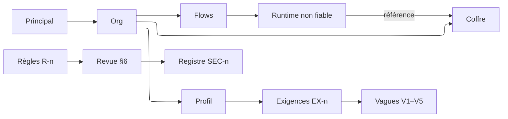

## 2. Modèle de menace

### Attaquants considérés

| Attaquant | Ce qu'il a | Ce qu'il ne doit jamais obtenir |
|---|---|---|
| **Visiteur anonyme** | Accès réseau à nginx (80/443), liens `/share/<token>` | Toute donnée hors tour publié partagé ; toute exécution de script sur l'origine de l'app |
| **Utilisateur inscrit quelconque** | Un compte Rauthy, donc **une org personnelle dont il est owner**. Il crée flows, fonctions JS/Starlark, médias, tours, canaux de notification | Données, devices, secrets, télémétrie d'**une autre org** ; secrets plateforme (env du serveur et du runtime, DB, clés du coffre) ; session d'un autre utilisateur |
| **Viewer d'une org** | Lecture de l'org | Toute écriture, tout déclenchement d'action (OTA, actionneur), tout identifiant de device |
| **Member d'une org** | Écriture (flows, médias, devices) | Valeurs des secrets du coffre (D117), administration de l'org |
| **Device ou agent edge compromis** | Son certificat, son jeton, sa clé partagée | Agir au nom d'un autre device ou d'une autre org |
| **Réseau local, MITM** | Trafic device ↔ serveur | Jetons et commandes (TLS mutuel et couche Noise, §8.3) |

« Member » n'est pas une barrière : tout inscrit devient owner de sa propre org.
Tout ce qu'un member peut faire, un attaquant anonyme qui s'inscrit le peut aussi.
La frontière qui compte est l'org, puis la plateforme.

### Frontières de confiance

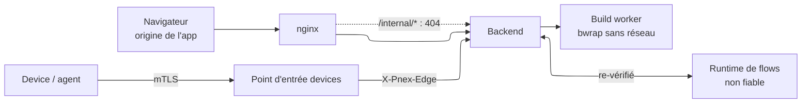

1. **nginx → backend** : la seule entrée publique. nginx ne route jamais `/internal/*` (R7).
2. **Backend ↔ runtime de flows** : le runtime exécute le code de plusieurs orgs dans un même process. Le backend re-vérifie tout ce que le runtime envoie.
3. **Backend ↔ build worker firmware** : le code C++ utilisateur compile sous bwrap, sans réseau, hôte en lecture seule.
4. **Navigateur** : le contenu utilisateur (étiquettes, médias, Markdown) est rendu sur l'origine de l'app, où vivent les jetons (`localStorage`).

## 3. Règles invariantes (opposables à toute modification)

### Locataire et rôles

- **R1 — L'org vient du principal, jamais de la requête.** `OrgContext` (JWT + `X-Org-Id` + appartenance vérifiée) ou le jeton device sont les seules sources de `org_id` et `device_id`. Toute requête par id filtre `OrgId = org.org.id`. Un accès cross-org reçoit un 404 uniforme.
- **R2 — Chaque opération déclare sa permission au registre IAM** (`pnex-api-contract/src/iam.rs`, garde `tests/iam.rs`). L'extracteur `OrgContext` l'applique avant le handler (403 `access-denied`, `iam.md` D291). Un endpoint sans entrée au registre fait échouer le test. Toute route d'écriture nouvelle porte un test « principal sans la permission → 403 ».
- **R3 — Le serveur tamponne les champs de locataire en dernier.** Aucune config utilisateur (nœud, graphe, payload) ne peut porter `pnex_org_id`, `pnex_o2_org`, `pnex_flow_id` ou un type `pnex-*` relu tel quel. La projection les écrase après tout le reste.
- **R4 — Les identifiants d'accès sortent seulement vers les rôles qui provisionnent.** Jeton device, clé partagée et code d'enrôlement exigent l'écriture au minimum. Ils ne figurent jamais dans un DTO de lecture générique.

### Code utilisateur (flows, fonctions, firmware)

- **R5 — Le registre de nœuds est une liste blanche explicite.** Le runtime enregistre seulement les nœuds PneX et les builtins sans effet hôte. Jamais `exec`, `file`, `file in`, `watch`, tcp/udp, ni un builtin non revu. Le `validate` du graphe rejette tout type hors liste, au save et au deploy.
- **R6 — Le code utilisateur ne voit aucun secret plateforme.** Le code JS/Starlark ne voit ni l'environnement du process (`env.get`), ni les fichiers, ni les jetons de service. Les identifiants des nœuds natifs passent par un canal Rust hors du sandbox.
- **R7 — Les routes `/internal/*` sont privées et scopées.** Le jeton de service est comparé en temps constant (`auth::service_token::matches`, échec fermé si vide). nginx ne les route pas. Le backend re-vérifie l'`org_id` fourni contre ce que le déploiement autorise. En mode cluster, un en-tête de fencing absent ferme l'accès.
- **R8 — Les requêtes sortantes vers un hôte choisi par l'utilisateur passent la garde d'egress** (http-fetch, webhooks, fournisseurs LLM, pipelines). La garde refuse loopback, link-local (169.254/16, fe80::/10), métadonnées cloud et noms de services internes. Elle re-vérifie chaque redirection.
- **R9 — Un secret du coffre est lié à sa destination.** Seuls les titulaires de `secrets:write` câblent un secret : le choisir, le changer de champ, ou changer l'origine (schéma, hôte, port ; mode TLS en SMTP) de son consommateur. Un member et l'assistant peuvent seulement garder un triplet (champ, secret, destination) que le même consommateur porte déjà. Tout le reste reçoit `secret-destination-locked` (403), y compris un flow dupliqué ou importé et un test-draft différent du canal enregistré. Garde : `services/secrets/binding.rs`.
- **R10 — Un processus enfant démarre avec `env_clear()` et une liste blanche.** Un secret ne passe jamais en argv. Le build firmware utilisateur tourne sous bwrap par défaut.

### Contenu servi au navigateur

- **R11 — Pas de HTML utilisateur sur l'origine de l'app.** Le texte passe par rsx (échappé) ou `textContent`. Les bibliothèques tierces tournent en mode échappement (`escapeHTML: true` pour pannellum). Jamais `innerHTML` ni `dangerous_inner_html` sur une donnée non assainie. Markdown : HTML brut supprimé et URLs limitées à `http(s):`, `mailto:` et relatives.
- **R12 — Les octets utilisateur servis ont un type autorisé et `nosniff`.** Le `Content-Type` vient d'une liste blanche par `kind`, jamais du client. Toute réponse de contenu utilisateur porte `X-Content-Type-Options: nosniff` et `Content-Security-Policy: sandbox; default-src 'none'`. Hors images, elle porte `Content-Disposition: attachment`.
- **R13 — Les données vers JS sont encodées en JSON, jamais par `format!` en `'{}'`.** wasm : `JsValue` ou `Reflect`. Natif : `serde_json::to_string` comme littéral JS.

### Crypto, secrets, stockage

- **R14 — Le chiffrement au repos passe par `Keyring::seal/open`** (XChaCha20-Poly1305, nonce aléatoire, AAD lié au domaine, au propriétaire et à la ligne). Pas de crypto maison.
- **R15 — L'aléa de sécurité vient d'un CSPRNG** (`rand::rng()`, `getrandom`), 128 bits au moins pour un jeton. Un code court est haché au repos, consommé une seule fois de façon atomique, avec un TTL.
- **R16 — Jamais de secret en clair** dans une réponse d'API, un journal, la file de jobs, `flows.json` ou le fil inter-pods. Seules des références UUID circulent, résolues au point d'usage.
- **R17 — Une seule `Validation` JWT** (`auth/jwks.rs` : RS256, `iss`, `aud`, `exp`, `kid`). Aucune autre construction.
- **R18 — Le serveur construit les clés de stockage** (ids + `sanitize_segment`). Un endpoint d'octets résout d'abord une ligne filtrée par org, puis lit sa `storage_key`. Il n'accepte jamais un chemin ou une clé reçus.
- **R19 — Le déploiement exige ses secrets** (`${VAR:?}` générés par `install.sh`). Les valeurs par défaut sont réservées au compose de dev. Le TLS est vérifié partout. Seule exception : le bootstrap de l'agent edge, épinglé par empreinte.
- **R20 — Une dépendance a une licence permissive et `cargo deny` reste vert.** Toute exception `deny.toml` porte sa justification. Les images livrées sont Chainguard (Wolfi) seulement (`glibc-dynamic`, `wolfi-base`). Un binaire tiers compilé hors cargo a sa source épinglée en sha256 (`ADD --checksum`).
- **R21 — Réservée** à l'ontologie fine.
- **R22 — Un compte de service n'a aucune permission `iam:*` ni plateforme** (`iam.md` D293). Un rôle personnalisé n'accorde ni ne retire `iam:*`. Le rôle géré admin n'est jamais attribué à un compte de service. Les extracteurs humains (`AuthUser`, `PlatformAdmin`) refusent toute clé d'accès.
- **R23 — Secret de clé d'accès** : 32 octets d'un CSPRNG, préfixe `pnex_sk_`, montré une seule fois, stocké en sha256 seulement. L'expiration est obligatoire (366 jours au plus). La révocation s'applique à l'appel suivant (`services/iam/service.rs`).

## 4. Bons motifs existants (à imiter)

- `OrgContext` : appartenance jamais mise en cache, 404 masqué.
- `auth::service_token::matches` : `subtle::ct_eq`, vide = refus.
- Coffre : AAD `domaine ‖ propriétaire ‖ org ‖ secret_id`, trousseau obligatoire au boot, rotation par `key_id` (§9).
- Enrôlement agent : code haché, `UPDATE … WHERE used_at IS NULL AND expires_at > now()` atomique, CA épinglée par empreinte.
- Builds firmware : `env_clear` + liste blanche, `wifi_secret_id` seul dans la file (test `queued_args_never_carry_the_wifi_password`).
- Tours publics : jeton de 122 bits, asset référencé par la version publiée et de l'org du tour.
- OAuth : PKCE S256 obligatoire, redirect URIs exactes côté Rauthy.
- Requêtes O2 : littéraux échappés, exécution avec les identifiants de l'org elle-même.

## 5. Garde dépendances

- `deny.toml` à la racine. `task security:deps` = job CI `deny`, bloquant : avis RustSec et sources (crates.io et `path =` seulement).
- Exceptions actuelles, sans correctif amont : `rsa` (Marvin, vérification de signature publique seulement), `bincode`, `smallstr`, `atomic-polyfill`, `derivative`, `fxhash`, `paste`, `pin-utils`, `proc-macro-error` (non maintenues, aucune vulnérabilité).
- Une nouvelle exception exige une justification d'inexploitabilité dans `deny.toml` et une ligne ici.

## 6. Revue de sécurité d'une modification (obligatoire)

Avant chaque commit qui touche du code, parcourez le diff avec cette grille.
Avant le merge d'une branche, lancez `/security-review`.

1. **Nouvelle route ?** Garde d'auth, permission au registre IAM (R2), org depuis le principal (R1), test sans la permission → 403, cross-org → 404.
2. **Nouvelle donnée renvoyée ?** Pas d'identifiant d'accès ni de secret (R4, R16).
3. **Nouveau nœud, type de flow ou champ de config ?** Liste blanche du runtime (R5), tampons de locataire écrasés (R3), pas d'accès à l'env (R6).
4. **Requête sortante ou URL utilisateur ?** R8, R9.
5. **Rendu de texte ou d'octets utilisateur ?** R11, R12, R13.
6. **SQL, requête O2, clé Valkey ou chemin de stockage construit avec une entrée ?** Paramètres liés, littéraux échappés, préfixe d'org d'abord, `sanitize_segment` (R18).
7. **Processus enfant, crypto, aléa, jeton ?** R10, R14, R15, R17.
8. **Nouvelle dépendance ?** Licence et `task security:deps` (R20).
9. **Config de déploiement ?** R7 (nginx), R19.

Un écart assumé va au §7 avec sa justification.
Un finding trouvé en route va au registre, même si la PR ne le corrige pas.

## 7. Registre des findings

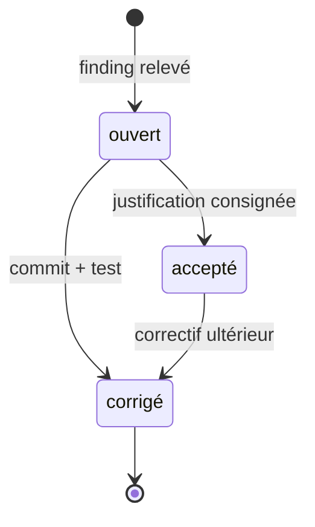

L'audit de base du 2026-10-04 a couvert six domaines : authz et locataire, surface device/WS/OTA, sandboxes et SSRF, fichiers et médias, crypto et déploiement, front et ponts JS.
Chaque finding a eu une vérification contradictoire. Le registre principal retient les findings à confiance ≥ 8/10.

Statuts : **ouvert**, **corrigé** (date ou commit), **accepté** (justification), **borné** (accepté avec limites).
Sévérité : HIGH = compromission inter-org, plateforme ou prise de compte. MEDIUM = escalade dans une org. LOW = défaut de cloisonnement sans impact exploitable démontré.

### Retenus

| # | Sév. | Finding | Règle | Statut |
|---|---|---|---|---|
| SEC-1 | HIGH | **RCE par le nœud `red` → `exec`** | R5 | corrigé (détail ci-dessous) |
| SEC-2 | HIGH | **Falsification de `pnex_org_id` par un nœud `red` `pnex-*`** | R3 | corrigé |
| SEC-3 | HIGH | **`env.get` des fonctions JS lit l'environnement du runtime** | R6 | corrigé (+ fork edgelinkd) |
| SEC-4 | HIGH* | **`/internal/*` exposé et `org_id` fourni par l'appelant** | R7 | corrigé pour l'exposition ; résiduel fermé par SEC-76 |
| SEC-5 | HIGH | **XSS stocké : médias servis avec le `Content-Type` du client** | R12 | corrigé |
| SEC-6 | HIGH | **XSS stocké : étiquettes pannellum sans `escapeHTML`** | R11 | corrigé |
| SEC-7 | MEDIUM | **Viewer : déploiement et annulation OTA** | R2 | corrigé |
| SEC-8 | MEDIUM | **Viewer : jetons et clés des devices, firmware avec PSK WiFi** | R4 | corrigé ; un member peut encore télécharger l'image qui porte le PSK (inhérent au provisioning, rattaché à SEC-W2) |
| SEC-9 | LOW | **Dashboard : id de contrôle d'une autre org accepté au save** | R1 | corrigé (18484ae) |
| SEC-10 | MEDIUM | **APK Android distribué « debuggable » : session lisible par USB** | R16 | accepté pour 0.1.0-beta.1 (sideload, testeurs connus) ; APK release non debuggable prêt (`task build:frontend:android:release`, job CI `android`) ; reste la clé de signature à créer et à poser en secrets GitHub |
| SEC-11 | MEDIUM | **Markdown de l'assistant : liens `javascript:` et images distantes** (ex-SEC-W1) | R11 | corrigé |
| SEC-12 | LOW | **Sauvegarde Android (auto-backup, transfert) avec le jeton de rafraîchissement** | R16 | corrigé |
| SEC-13 | LOW | **Assistant : widget libre re-lié au contrôle d'un flow déployé** | D144 | corrigé |
| SEC-14 | LOW | **URL d'un fournisseur LLM vers un hôte interne (SSRF aveugle)** | R8 | corrigé 2026-10-07 : résolveur filtrant `pnex_core::egress` (avec SEC-W3) |
| SEC-15 | LOW | **Image `pnex-builder-rs` : paquets Python vulnérables (7 HIGH, 0 CRITICAL)** | R20 | corrigé pour 0.1.0-beta.4 (11 sur 12) ; `ecdsa` accepté (pas de correctif amont) |
| SEC-16 | LOW | **Firmware : CA épinglée décodée dans un buffer fixe avant le contrôle de taille** | D70 | corrigé 2026-10-08 |
| SEC-17 | HIGH | **Frames device non authentifiées et sans anti-rejeu** (ChaCha20 seul, D8) | D8 | corrigé 2026-10-08 : lien Noise NNpsk0 (D156) serveur, agent et firmware, D8 supprimé ; TLS mutuel livré ensuite (D153, §8.3) |
| SEC-18 | MEDIUM | **OTA non authentifiée, pas d'anti-downgrade sur ESP32** | — | corrigé 2026-10-09 : image signée Ed25519 liée au device et à la version, clé publique compilée, anti-downgrade sur toutes les puces (`edge.md` §3.7) ; banc 8266 + C6 : OTA signée acceptée, downgrade refusé ; signature invalide testée sur hôte seulement ; signature hors builder = EX-B7 (V2) |
| SEC-19 | MEDIUM | **Firmware : clé de chiffrement vide = trafic en clair** | R16 | corrigé 2026-10-08 : sans clé valide le device ne se connecte pas (`pnex_crypto.cpp`, `pnex_transport.cpp`) |
| SEC-20 | LOW | **Secrets du device en clair dans le flash** (PSK WiFi, jeton, clé) | R16 | accepté jusqu'à V4 (EX-C1, EX-C3) : exige des eFuses, gelés avant la validation communautaire du firmware |
| SEC-21 | HIGH | **En-têtes de l'edge crus sans preuve d'origine** (`X-Forwarded-Proto`, `X-Client-Cert`) : le port du backend est joignable sans nginx, un client pouvait les forger | R7 | corrigé 2026-10-09 : secret partagé edge ↔ backend (`PNEX_EDGE_SECRET`, en-tête `X-Pnex-Edge`, temps constant) ; sans lui les en-têtes de l'edge sont ignorés ; vérifié en direct (close 4013) |
| SEC-22 | MEDIUM | **JWT dans l'URL des WebSockets navigateur** (`/ws/notify?token=`, `/ws/camera/live?token=`) : l'URL finit dans les journaux d'accès | R16 | corrigé 2026-10-09 : ticket à usage unique `POST /api/v1/ws-ticket` (60 s, lié à l'utilisateur et à l'org, consommé par `GETDEL` Valkey) ; ticket rejoué → 4001 (test) |
| SEC-23 | LOW | **Filtre d'egress : angles morts** (`pnex-core/src/egress.rs`) : IPv6 qui embarque une IPv4 (NAT64, 6to4) non jugée comme IPv4 ; en `lan`, noms `*.svc.cluster.local` et réseau d'infra joignables par `http_fetch` | R8 | corrigé 2026-10-15 : IPv4 embarquée jugée comme IPv4, `*.svc` et `*.cluster.local` refusés, `PNEX_EGRESS_DENY_CIDRS` pour le réseau d'infra (compose : `PNEX_NET_SUBNET` ; Helm : `api.egressDenyCidrs`, avertissement NOTES tant qu'il est vide) |
| SEC-24 | LOW | **Modèles audio : disque du cache d'extraction** (`services/media_ingest/asr`) : 4 Gio par modèle, mais aucune limite du nombre de modèles par org | — | ouvert (2026-10-10) ; piste : quota par org, purge LRU, taille d'upload dédiée |
| SEC-25 | LOW | **Binaires média hors veille CVE** (`deploy/docker/Dockerfile`, étages `ffmpeg` et `asr`) : ffmpeg et onnxruntime ne viennent pas de Wolfi et décodent des médias non fiables | R20 | atténué 2026-10-10 : ffmpeg réduit au protocole `pipe` et aux démuxeurs et décodeurs listés, process vidéo distinct, les deux confinés (seccomp sans socket, Landlock lecture seule, rlimits) ; reste : relever les versions épinglées à chaque release (scan d'image en CI) |
| SEC-26 | MEDIUM | **Clé de frame forgée dans un message de flow** (`pnex-node-camera/src/record.rs`, `pnex-node-vision/src/lib.rs`) : un nœud `function` pouvait faire lire une clé Valkey d'une autre org | R3 | corrigé 2026-10-10 : `camera::frame_key_in_org`, clé lue seulement si elle est une clé de frame de l'org tamponnée ; test `frame_keys_are_bound_to_their_org` |
| SEC-27 | LOW | **Secret d'accès d'un flux remis à son boîtier de capture** (`services/media_ingest/boxes.rs`, `/ws/media`) : un boîtier compromis livre les secrets des flux qu'il capte | R9, R16 | accepté 2026-10-10 avec garde-fous : secret envoyé seulement au boîtier désigné (org et device tirés de l'identité mTLS + Noise, R1), sur son lien chiffré, en mémoire seulement, jamais un secret de stockage ; déplacer un flux à secret exige `secrets:write` (`secret-destination-locked` sinon, test `media_box.rs`) ; seul un agent qui annonce `media_capture` capte |
| SEC-28 | LOW | **Pages : débit non borné par connexion** (`services/pages/room.rs`) | R2 | corrigé 2026-10-10 : seau à jetons par session (rafale 200, 50 messages/s), fermeture 4429 (`controllers/ws_doc.rs`) |
| SEC-90 | LOW | **Fil bloqué par un document hostile** (`services/doc_search.rs`) : extraction synchrone sur des octets utilisateur ; zip-bomb refusée, inflate et texte plafonnés, `spawn_blocking`, délai de 300 s ; le fil hors délai n'est pas annulable | — (disponibilité) | accepté 2026-10-10 (shortcut commenté dans le code) |
| SEC-29 | LOW | **Pages : rôle figé à l'ouverture du websocket** (`controllers/ws_doc.rs`) | R2 | corrigé 2026-10-15 : rôle relu à chaque battement (30 s) ; retiré → 4006, rétrogradé viewer → lecture seule |
| SEC-30 | MEDIUM | **Export COCO du Vision Lab en mémoire** (`services/lab.rs::export`) | — (disponibilité) | corrigé 2026-10-13 : 512 Mo d'images au plus, vérifié avant lecture → 413 `lab-export-too-large` |
| SEC-31 | MEDIUM | **Import de trames : segments chargés en bloc** (`services/lab.rs::import_recording`) | — (disponibilité) | corrigé 2026-10-13 : segments lus un par un, plafond 2 Gio par import |
| SEC-32 | MEDIUM | **Modèle de décision partagé sans quota par org** (`services/decide.rs`) | — (disponibilité) | corrigé 2026-10-13 : 20 000 décisions par jour et par org (Valkey) avant le sémaphore ; détail d'échec dans les journaux seulement |
| SEC-33 | LOW | **État des nœuds vision par source non borné** (`pnex-node-vision` : track, zone, caption) | — (disponibilité) | corrigé 2026-10-13 : 256 sources par nœud, 300 détections par trame ; `add_images` lit seulement des `image/*` ≤ 50 Mo |
| SEC-34 | LOW | **Routes `/internal/flow/ai/*` : org crue après jeton et fencing** (`controllers/internal_flow.rs`) | R7 | corrigé 2026-10-15 : chaque route exige un flow déployé de l'org qui contient un nœud du type appelant, sinon 403 `flow-ai-node-absent` |
| SEC-35 | MEDIUM | **Plages d'objet sans garde du type** (`controllers/time_ranges.rs`) : le `write_role` du type (D188) n'était pas vérifié | R2 | corrigé 2026-10-13 : même garde que l'objet, viewer et member → 403 `ontology-write-forbidden` |
| SEC-36 | MEDIUM | **PDF de page : un mot géant bloque le rendu** (`pnex-pdf`) | — (déni de service) | corrigé 2026-10-13 : essais bornés à 96 caractères, 1000 pages au plus, test « mot de 100 000 caractères » |
| SEC-37 | MEDIUM | **Vision Lab : une org monopolise l'entraînement** (`services/lab_train.rs`) | — (déni de service) | corrigé 2026-10-13 : un run en file ou en cours par org ; résiduel accepté : l'import vidéo du Lab (1 à la fois, ≤ 300 s) peut faire attendre les autres orgs |
| SEC-38 | LOW | **PDF de page sans CSP sandbox** (`controllers/docs.rs` `version_pdf`) | R12 | corrigé 2026-10-13 : `default-src 'none'; sandbox` |
| SEC-39 | LOW | **Pièce jointe : version courante de l'asset exporté** (`/internal/flow/media/{id}`) | R7 | accepté 2026-10-13 : même org, member déjà autorisé à envoyer ce fichier ; piste : mémoriser `media_version_id` dans `doc_version_exports`. L'approbation D210 est un contrôle de processus, pas une frontière |
| SEC-40 | LOW | **Récurrences : environ 90 plages par plan, sans plafond par org** (`services/ontology/recurrence.rs`) | — (déni de service) | accepté 2026-10-13 ; à traiter avec les quotas par profil |
| SEC-41 | LOW | **Déconnexion sans `id_token` : cookie SSO Rauthy possiblement conservé** (`state/session.rs::logout`) | — (session) | corrigé 2026-10-15 : `pnex.force_login`, le login suivant part avec `prompt=login` ; `/oauth2/sso` relaie seulement `login` (test `tenant_isolation.rs`) |
| SEC-42 | LOW | **zip < 9 : extraction sur disque non confinée** (RUSTSEC-2026-0367/0368/0369) | — | corrigé 2026-10-17 pour nos dépendances (zip 9) ; calamine 0.38 ne dépend plus de zip 8 (2026-11-03, corrige aussi RUSTSEC-2026-0436) ; l'exception `deny.toml` couvre seulement zip 2 dans le script de build de `sherpa-onnx-sys`, à retirer au passage de sherpa-onnx à zip 9 |
| SEC-43 | LOW | **Scan LAN déclenché par un viewer** (`GET /api/v1/edge/lan-scan?prefix=`) | R2 | corrigé 2026-10-17 : viewer → 403 `edge-write-forbidden` ; préfixe hors RFC 1918 → 400 `field-invalid` ; tests `tests/edge_refs.rs` |
| SEC-44 | LOW | **Agents navigateur : contrôle d'usage unique contournable** (`services/extension.rs::first_use`) : signature malléable rejouée dans la fenêtre de ±120 s | R15 | corrigé 2026-10-18 : clé sur `r` décodé ; test « rejouée telle quelle, avec espace, en `(r, n−s)` → 401 » |
| SEC-45 | LOW | **Agents navigateur : trames `seen` sans débit** (`controllers/ws_extension.rs`) | — (déni de service) | corrigé 2026-10-18 : 60 lots par minute et par lien ; plafonds d'org 20 agents, 200 missions (`extension-limit-reached`) ; registre plafonné à 500 000 posts par org (`ext-registry-full`) |
| SEC-46 | LOW | **Agents navigateur : `collect_page` sur x.com et youtube.com sans consentement par site** | R2 | accepté 2026-10-18 (décision utilisateur) : même org, l'agent est le compte de l'org |
| SEC-47 | LOW | **Tours publics : `share_token` stocké en clair** (`controllers/public_tours.rs`) : une fuite de la base donne tous les tours publiés | R16 | ouvert (2026-10-18, `iam.md`) |
| SEC-48 | LOW | **Historiques : auteur de version fourni par le client** (`flow_versions`, `dashboard_versions`, `tour_versions`, `annotation_layer_versions`) | R3 | ouvert (2026-10-19, correctif `iam.md` D299) |
| SEC-49 | LOW | **Imports d'ontologie : l'URL source est lue par tout membre** (`object_imports.source_url`) : une clé d'API dans l'URL serait visible de l'org | R4, R16 | accepté 2026-10-19 : sources livrées publiques ; aide « jamais de secret dans l'adresse » ; une source authentifiée prendra une référence du coffre |
| SEC-50 | LOW | **`/ws/extension` sans vérification de l'edge device (4013)** : l'agent navigateur passe par l'ingress public | R7 | accepté 2026-10-19 (décision utilisateur) : ticket à usage unique obtenu en HTTPS, puis poignée de main Noise NNpsk0 (D262) |
| SEC-51 | MEDIUM | **Requête d'ontologie = oracle des données masquées** (`services/ontology/query.rs`) : filtre, recherche ou tri sur une valeur masquée | R2 | corrigé 2026-10-26 : `query::run` reçoit la `Redaction` de l'appelant ; test `personal_data.rs` ; les flows lisent sans masque |
| SEC-52 | MEDIUM | **Effacement annulable et transfert forgeable** : coquille effacée modifiable (D446) ; `Authentication-Results` du message cru (D463) | R2 | corrigé 2026-10-26 : objet effacé en lecture seule (`ontology-erased` 409) ; PneX vérifie lui-même DKIM aligné sur `From:` (`services/mail/verify.rs`) |
| SEC-53 | MEDIUM | **Page générée depuis un objet = lecture sans masque** (`services/ontology/cases/pages.rs`) | R2 | corrigé 2026-10-27 : la page reçoit la `Redaction` de son auteur ; reste ouvert : un lecteur ultérieur voit ce que l'auteur voyait (`iam.md` I5) |
| SEC-54 | LOW | **Alertes zstd (RUSTSEC-2026-0391, -0398, -0403, -0410)** | R20 | corrigé 2026-10-27 au runtime ; exceptions du script de build de sherpa retirées le 2026-11-09 |
| SEC-55 | MEDIUM | **Écriture masquée = perte de données** (`controllers/ontology.rs`) : renvoyer une fiche masquée écrivait le masque | R2 | corrigé 2026-11-02 : `Redaction::keep_hidden`, `keep_hidden_attributes`, réponse masquée aussi ; test `personal_data.rs` |
| SEC-56 | HIGH | **Agent navigateur partagé par défaut** (`services/extension.rs`) : une mission sans agent désigné partait sur la session d'un collègue | — | corrigé 2026-11-02 (D550) : agent personnel par défaut, agent commun réservé aux admins (`extension:share`) |
| SEC-57 | LOW | **Balayage des documents de dépôts non équitable** (`services/markets/documents.rs`) : 20 dépôts au hasard par passage, toutes orgs confondues | — (équité) | ouvert : à répartir par org si plusieurs orgs utilisent le pack |
| SEC-58 | MEDIUM | **Élévation en éditant un import** : un run sans humain écrit avec le rôle de l'auteur (D303), qu'une édition ne changeait pas | R2 | corrigé (revue du 2026-11-04, `pipelines.md`) : une édition fait de l'éditeur l'auteur de l'import (`services/ontology/imports/mod.rs`) ; même règle pour les plannings de pipelines (test `data_builds.rs`) |
| SEC-59 | HIGH | **Valeurs effacées dans les diffs conservés** (`object_import_runs.diff`) | RGPD | corrigé (revue du 2026-11-04) : l'effacement vide les diffs en aperçu ou refusés (`services/ontology/erase.rs`) |
| SEC-60 | LOW | **Parties multipart orphelines** (`pnex-pipeline-worker`) : invisibles à la purge et à l'effacement | RGPD | corrigé 2026-11-05 : la purge annule tout upload de plus de 24 h (`S3Config::abort_stale_uploads`) ; jusqu'à 24 h, une partie peut contenir une personne effacée |
| SEC-61 | MEDIUM | **Cloisonnement du worker de pipelines** (chart `pnex-deploy`) | R1 | corrigé dans le chart 2026-11-06 : login dédié, `NetworkPolicy`, utilisateur RustFS limité à `org_*/datasets/*` et `org_*/pipeline-steps/*` (préfixe des étapes, ajouté le 2026-11-20 : sans lui, toute étape échouait en 403) ; jamais déployé sur un cluster ; reste : la frontière entre orgs sur `datasets/` vit dans le code du worker |
| SEC-62 | LOW | **Mémoire d'une recherche de chemin** (`services/ontology/graph.rs`, D589) : jusqu'à 200 000 liens en mémoire, sans limite de requêtes simultanées | — (disponibilité) | ouvert : à mesurer, puis à borner |
| SEC-63 | MEDIUM | **Un effacement laissait des données personnelles** (clés de piste et de contact, textes de mails, mails sortants ; retour possible par un flow) | R4 | corrigé (D610) ; reste : compte rendu et enregistrement d'un rendez-vous |
| SEC-64 | LOW | **Connecteur : certificat non vérifié** (`services/connectors.rs`, D352) : la connexion part vers l'adresse vérifiée par l'egress | R8 | accepté (`pipelines.md` §3.10) : `sslrootcert` par connecteur à la demande d'un client |
| SEC-65 | MEDIUM | **Le serveur jetait ses propres journaux** (`app.rs`, filtre de Loco sur `app_name()`) | — (détection) | corrigé 2026-11-05 : `app_name()` = `pnex_backend`, test de garde ; reste : erreurs Starlark et refus recopiés tels quels, à relire avant un envoi vers un outil externe |
| SEC-66 | MEDIUM | **Une org supprimée laissait ses journaux dans O2** (`controllers/orgs.rs`) | — (données personnelles) | corrigé 2026-11-05 : `purge_org_streams` supprime aussi les streams de logs ; orgs déjà supprimées non rattrapées |
| SEC-E1 | MEDIUM | **Pod de build d'image moins durci que D387** (`pnex-runner/src/k8s.rs`, D701) : BuildKit rootless exige seccomp et AppArmor `Unconfined` | D387 | accepté 2026-11-05 (cluster du client, ses propres Dockerfile, pas de gVisor ni de Kata par décision utilisateur) ; à revoir avant d'ouvrir le build à du code tiers |
| SEC-E2 | MEDIUM | **Pod de build et pod de scan sans `NetworkPolicy`** | R8 | corrigé 2026-11-05 : `k8s::job_policy` (DNS et internet public seulement, plus `PNEX_RUNNER_JOB_EGRESS`) ; reste : un `RUN` joint tout l'internet public (Q-E13) |
| SEC-E3 | LOW | **Digest et rapport déclarés par le pod** : un Dockerfile peut annoncer une autre image de la même org | R4, R16 | ouvert ; correctif : relire le digest dans le registre |
| SEC-E4 | MEDIUM | **Une `NetworkPolicy` s'applique après coup** : mesuré sur kind, un pod sort librement pendant le délai | R8 | corrigé 2026-11-06 : porte `egress-gate` avant tout conteneur du bac, des pods de build, de scan et de sonde |
| SEC-E5 | MEDIUM | **Le bac joint l'API Kubernetes de son nœud** (kind), en anonyme seulement | R8 | ouvert pour kind et tout plugin qui exempte ce trafic ; refusé sur le cluster de recette (microk8s, Calico, 2026-11-07) ; correctif par cluster : `--anonymous-auth=false` |
| SEC-E6 | MEDIUM | **Le runner Firecracker relit un disque écrit par l'invité** (`debugfs` côté hôte, D762) | R5 | ouvert : e2fsprogs tenu à jour ; à reprendre avant d'ouvrir E6 à du code tiers |
| SEC-E7 | MEDIUM | **La porte d'egress du bac s'ouvrait sans son outil de sonde** (`curl` absent) | R8 | corrigé 2026-11-07 : refus sans `curl`, test `the_egress_gate_never_opens_without_its_probe_tool` |

\* SEC-4 seul exige le jeton de service. Il amplifiait SEC-1 et SEC-3 en inter-org.

### Détail des findings de l'audit de base

**SEC-1 — RCE par le nœud `red` (confiance 9).** `FlowNodeKind::Red` acceptait tout `type_name`, et le runtime enregistrait tous les builtins, dont `exec` (`sh -c`).
Tout inscrit pouvait déployer inject → red:exec → debug et lire `/proc/<ppid>/environ` (`DATABASE_URL`, `PNEX_SECRETS_KEYS`, identifiants O2 root).
*Correctif* : le kind `red` est retiré (2026-10-14). Le registre du runtime se réduit aux builtins émis par la projection (`inject`, `debug`, `function`, `comment`, placeholders) et aux `pnex-*`.
Tests : `raw_red_kind_is_refused`, `tests/flows.rs`, `env_isolation.rs`.

**SEC-2 — Falsification du locataire (confiance 8).** Un `red` de type `pnex-device-write`, `pnex-device-read` ou `pnex-memory-*` gardait son `pnex_org_id`.
Il donnait la mémoire Valkey, la télémétrie et les devices d'une autre org. *Correctif* : celui de SEC-1, puis la projection re-tamponne depuis `meta` (R3).

**SEC-3 — Environnement du runtime lisible par le JS (confiance 9).** `Engine::with_json` copiait l'environnement du process dans le magasin d'env du sandbox.
`env.get("OPENOBSERVE_ROOT_PASSWORD")` donnait la télémétrie de toutes les orgs.
*Correctif* : le fork `vendor/edgelinkd` ne copie plus l'environnement. Test `env_isolation.rs`.

**SEC-4 — Routes internes (confiance 8).** nginx et l'ingress routaient `/internal/*`, et le handler prenait `org_id` du corps.
*Correctif* : `location /internal/ { return 404; }` (edge et pnex-deploy). Le middleware `auth::internal_guard` renvoie 404 à toute requête `/internal/*` qui porte un en-tête de proxy. Test `internal_via_public_proxy_404`.

**SEC-5 — XSS par médias (confiance 8).** Le serveur stockait `?content_type=` tel quel et servait les octets `inline`, sans `nosniff` ni CSP.
*Correctif* : `services::media::safe_content_type` à l'écriture et au service, `user_content_headers` (R12). Test `tours.rs`.

**SEC-6 — XSS par étiquettes pannellum (confiance 9).** pannellum faisait `innerHTML` des étiquettes sans `escapeHTML`, aussi sur la page publique `/share/:token`.
*Correctif* : `escapeHTML: true` sur les deux viewers. La garde `pnex-frontend/src/js_guard.rs` l'exige.

**SEC-7 — OTA sans garde de rôle (confiance 8).** `deploy` et `cancel` de `controllers/ota.rs` n'avaient pas de garde. *Correctif* : garde d'écriture (`device-write-forbidden`).

**SEC-8 — Identifiants device exposés aux viewers (confiance 8).** `device_token` sortait pour tout membre, et `GET /download/firmware/{id}` n'avait pas de garde.
*Correctif* : jeton absent sans droit d'écriture, téléchargement sous garde. Test `devices.rs::tenant_isolation_and_roles`.

**SEC-9 — Contrôle étranger dans un dashboard (D131).** Le save ne vérifiait pas que `options.control` était un contrôle de l'org. Écriture et lecture restaient filtrées.
*Correctif* : `services/surface_controls.rs` lie seulement un contrôle de l'org. Test `surface_declared_controls_are_provisioned_and_released`.

**SEC-10 — APK debuggable (confiance 9).** `run-as` lisait les jetons, et la WebView était inspectable. L'attaque exige le téléphone déverrouillé, débogage USB actif.
*Correctif* : variante release (`assembleRelease`, `debuggable false`). La variante debuggable reste réservée à l'APK e2e.

**SEC-15 — CVE Python de l'image builder.** `trivy` sur `pnex-builder-rs:0.1.0-beta.2` : 7 HIGH, toutes Python. Le worker n'expose aucun service HTTP.
*Correctif (beta.4)* : pip retiré après le pré-chauffage, `penv` installé avec `uv`, `starlette` ≥ 1.3.1. Trivy passe de 12 à 1.
*Accepté* : `ecdsa` 0.19.2 (CVE-2024-23342, Minerva), exigé par pioarduino, sans correctif amont. Le builder ne signe rien avec.

**SEC-16 — Débordement du buffer de CA dans le firmware.** `pnex_tls_init` décodait la CA dans `s_ca_pem[2048]` avant de comparer la longueur. L'entrée vient de l'opérateur.
*Correctif* : `cryptoB64DecodeBounded` calcule la taille avant d'écrire. Une CA trop grande est refusée en échec fermé. `PNEX_CA_PEM_MAX` = 4 096 sur ESP32, 2 048 sur ESP8266.
Le worker refuse au build une CA trop grande pour la puce (`build_ca_too_large`, test `device_ca_limit_matches_the_firmware_buffer`).

**SEC-17 à SEC-20 — Revue externe du firmware (2026-10-08).** Ces findings ont ouvert les profils de sécurité (§8).
SEC-17 : frame malléable et rejouable. SEC-18 : OTA vérifiée par un sha256 du même canal. SEC-19 : clé vide = clair. SEC-20 : secrets lisibles par `esptool read_flash`.

**Audit de release 0.1.0-beta.1 (2026-10-04)** : quatre audits du delta `c2d69ae..HEAD`, aucun HIGH, aucun contournement inter-org.
Il a relevé SEC-11 à SEC-14. Points sous le seuil restés ouverts :

- corps de réponse météo non borné, bannissement d'un fournisseur météo par volume ;
- `update_dashboard` : fenêtre de l'ordre de la ms, résiduel accepté (`ai-assistant.md` §10) ;
- `restore_version` d'un dashboard ne repasse pas la synchro des contrôles ;
- asset d'une visite publique servi à sa version courante ;
- magasin desktop `pnex-storage.json` en 0644 ;
- `\` non échappé dans deux ponts JS natifs (non exploitable, R13).

### Sous le seuil (confiance < 8)

| # | Conf. | Sujet | Statut |
|---|---|---|---|
| SEC-W1 | 7 | Markdown de l'assistant : liens `javascript:` | → SEC-11, corrigé |
| SEC-W2 | 7 | Member redirige un secret du coffre vers son hôte (test-draft, http-fetch avec `Ref`) | corrigé 2026-10-07 : R9 (`binding::check` dans `store_graph_secrets`, `notify::plan`, `store::save_single` pour le WiFi) ; tests `secrets.rs::members_keep_secrets_but_never_rewire_them` |
| SEC-W3 | 6 | SSRF http-fetch avec lecture de la réponse | corrigé 2026-10-07 : résolveur filtrant (SEC-14) ; test `http_fetch_refuses_loopback_under_the_lan_policy` |
| SEC-W4 | 4 | `version` non assainie dans `ota_artifact_key` | corrigé 2026-10-09 (`ota_key_sanitizes_every_segment`) |
| SEC-W5 | — | `email_verified` non exigé au rattachement de compte | corrigé 2026-10-09 : re-liaison seulement si `email_verified`, sinon 401 |
| SEC-W6 | — | Firmware `setInsecure` sans `PNEX_CA_CERT_FILE` | corrigé 2026-10-07 : build `wss` sans CA refusé (`build_no_ca`) |
| SEC-W7 | 5 | Le firmware imprime l'URL WebSocket avec le jeton sur le port série | corrigé 2026-10-07 : `token=***`, URL OTA sans sa requête |
| SEC-W8 | 5 | Fond de carte : la clé choisie par un admin est visible de tous les membres | accepté 2026-10-10 (clé de fond = clé navigateur) ; piste : secrets dédiés `geo/<nom>/` |

### Audit du dépôt du 2026-11-06

Détail et correctifs dans `docs/journal/audit-2026-11-06.md` (référence entre parenthèses). ✔ = relu dans le code à la main.

| # | Sév. | Finding | Règle | Statut |
|---|---|---|---|---|
| SEC-67 | HIGH | **Fonction JS déployée sans limite de temps ni de mémoire** ✔ (A1) | R5 | corrigé 2026-11-07 : 128 Mio, pile 1 Mio, 10 s par appel, espace d'adressage du runtime plafonné à 4 Gio ; test `function_budget.rs` |
| SEC-68 | HIGH | **Limite de tas Starlark contournée par une allocation unique** (A2) | R5 | corrigé 2026-11-07 : `__pnex_mul` refuse plus de 8 Mi éléments, `range` borné, `*=` refusé |
| SEC-69 | MEDIUM | **Renvoi d'une écriture de pin périmée** ✔ (A3) | D123 | corrigé 2026-11-07 : une écriture plus récente sur la même gpio remplace l'attente ; test `cmd_acks` |
| SEC-70 | HIGH | **SSRF par le proxy du nœud http-fetch** ✔ (A4) | R8 | corrigé 2026-11-07 : `egress::check_url` sur l'URL du proxy |
| SEC-71 | MEDIUM | **Exfiltration par injection : `try_site_recipe` en YAML libre** ✔ (A5) | D142 | corrigé 2026-11-07 : recette enregistrée seulement ; tour contaminé = écritures retenues jusqu'à la confirmation humaine (`ai-confirm-required`, `ai-confirm-stale`) |
| SEC-72 | MEDIUM | **Ajout de membre sans consentement + oracle d'existence d'email** ✔ (A6) | R1 | corrigé 2026-11-07 : invitation acceptée par l'invité (`org_invitations`, 14 jours), 202 identique |
| SEC-73 | MEDIUM | **Délimiteur `<data>` non échappé dans les sorties d'outils** ✔ (B3) | D142 | corrigé 2026-11-07 : `services::ai::untrusted_data` |
| SEC-74 | LOW | **Websockets caméra, notifications, docs sans permission IAM de lecture** (B4) | R2 | corrigé 2026-11-07 : `cameras:read`, `notify:read`, `docs:read`, 4006 sinon |
| SEC-75 | LOW | **Routes `orgs` en tests de rôle, hors moteur IAM** (B5) | R2 | corrigé 2026-11-07 : `OrgContext` partout, 403 `org-path-mismatch` |
| SEC-76 | MEDIUM | **Écriture device interne sans fence : `org_id` du corps cru** (B6) | R7 | corrigé 2026-11-07 : refus sans fence dès qu'un worker est inscrit ; device cible d'un `device_write` d'un flow déployé de l'org |
| SEC-77 | LOW | **Promotion admin plateforme sans `email_verified`** (C2) | R1 | corrigé 2026-11-07 |
| SEC-78 | LOW | **Contrôle de version non atomique de `update_notification_template`** (C5) | D144 | corrigé 2026-11-07 : `update_if_unchanged` |
| SEC-79 | LOW | **`authorize_tool` ouvert sur un outil hors registre IAM** (C6) | R2 | corrigé 2026-11-07 |
| SEC-80 | LOW | **`OrgContext` laisse passer une route absente du registre IAM** (`operation_of` → `None`) | R2 | corrigé 2026-11-20 : refus par défaut (403 `access-denied`). Seules les routes hors spec (`services::iam::off_spec` : `/_*`, `/ws/*`, `/internal/*`) passent sans entrée. Test `unregistered_org_route_is_refused` |
| SEC-81 | LOW | **AIS danois servi en HTTP clair, sans somme de contrôle** (`markets-research.md` §3.10) | R8 | accepté 2026-11-09 : hôte fixé, rien de l'org envoyé, décodage strict |
| SEC-82 | MEDIUM | **Chargements massifs déclenchables par tout inscrit** (MK22–MK24) | R2 | corrigé 2026-11-09 : `bulk_history` seulement avec un quota de tables fixé par un admin plateforme (D821) |
| SEC-83 | LOW | **Lectures non bornées d'un fichier massif** (ADS-B, gzip) | R8 | corrigé 2026-11-09 : 64 Mio avant et après décompression, ligne ≤ 64 Kio |
| SEC-84 | MEDIUM | **Boîte des terminaux MT5 sans plafond par org** | R2 | corrigé 2026-11-09 : 20 terminaux, 2 000 appels en attente, jeton haché |
| SEC-85 | MEDIUM | **Première écriture d'un compte de service** (`markets-research.md` D891) | R2, R1 | borné 2026-11-09 : `SERVICE_WRITES` = `market-decisions:write` seul, 2 000 décisions par jour, marquages D801 appliqués |
| SEC-86 | LOW | **Point-in-time et chaînes causales** (`GET /markets/chains`) | R1, R2, R4 | corrigé en revue 2026-11-09 : chaîne qui touche un objet masqué retirée entière ; la clé point-in-time ne fait que restreindre |
| SEC-87 | MEDIUM | **Effacement RGPD et historique des états** (D900, D913) | RGPD | corrigé 2026-11-10 (MK34) : l'effacement vide aussi `object_versions` et `link_versions` |
| SEC-88 | LOW | **Marchés de prédiction : API publiques et proxy d'org** | R8, R9, R1, R4 | borné 2026-11-10 : hôtes fixés, proxy lu au coffre et passé à `egress::check_url`, jamais d'appel direct de repli |
| SEC-89 | LOW | **Hôtes des sources d'une org dans un pipeline** (`pipelines.md` D975) | R8, R9, R1 | borné 2026-11-14 : garde egress, secrets seulement vers les `hosts` du document, un appel par seconde et par hôte ; reste : nombre de sources non plafonné |
| SEC-91 | MEDIUM | **Échec d'une étape `sql` du worker** (`pipelines.md` D934) | R4 | corrigé 2026-11-23 (bb3bc4b7) : l'erreur d'exécution citait la cellule fautive. Seule une erreur de plan, de SQL ou de schéma est citée. |
| SEC-92 | MEDIUM | **Navigation lancée par l'assistant sans confirmation** (`try_site_recipe`, PE5.5) | D123, D782 | corrigé 2026-11-23 (9ce5d1b1) : un outil `browse:use` est retenu comme une écriture. |
| SEC-93 | MEDIUM | **Rôle d'écriture d'une Table chargée par un membre** (`pipelines.md` D1050) : une étape `write objects` écrit avec le rôle de l'auteur de la version ; un membre qui charge la Table lue fait écrire un type réservé aux admins. La synchronisation d'un import de Table écrivait avec le rôle Member | R2 | corrigé 2026-11-25 : l'étape écrit avec le plus bas rôle entre l'auteur de la version et le dernier membre qui a chargé chaque Table lue (`dataset_transactions.created_by`). Un pack, le système ou un membre parti comptent comme Member. |
| SEC-94 | LOW | **Clé en en-tête suivie sur une redirection** (`pnex-node-http-fetch`, mode `auth.header`) : reqwest retire `Authorization` et les cookies quand une redirection change d'hôte, pas un en-tête libre comme `X-API-Key`. Une redirection ouverte sur l'hôte de destination envoie la clé ailleurs | R9 | ouvert : retirer l'en-tête de clé quand une redirection change d'origine, ou ne plus suivre ces redirections. |

## 8. Profils de sécurité

Les profils servent à la fois les makers et les clients les plus exigeants (D148).
Le profil `open` reste le défaut, pour toujours. Tout verrouillage est un choix explicite, par org et par device.
PneX n'est jamais le seul détenteur des clés d'un client durci (D150).
Argument produit : *« vos cartes restent les vôtres : reflashables à vie, et pourtant trafic et mises à jour authentifiés »*.

### 8.1 Les profils

| Profil | Public | Référentiels visés | IEC 62443 | Matériel admis | Irréversible |
|---|---|---|---|---|---|
| `open` | Makers, écoles, communauté, démos | CRA, ETSI EN 303 645 | ≈ SL1 | Toutes cartes (ESP8266 compris) | Non |
| `industrial` | PME, ETI, intégrateurs, bâtiment | IEC 62443-3-3 / 4-2, NIS2 des clients | SL2 | C3, S3, C6 pour le matériel ; ESP32 classique en logiciel seulement | Optionnel, par device |
| `critical` | OIV, OSE : énergie, eau, transport, pharma GxP | IEC 62443 SL3, guides ANSSI, FDA 21 CFR Part 11 | SL3 | C3, S3, C6 durcis ; filaire recommandé | Oui |
| `sovereign` | Défense, nucléaire | IEC 62443 SL4, homologation ANSSI, II 901 | SL4 | À définir | Oui |

Un ESP32 du commerce ne sera probablement pas accepté en `sovereign` : pas d'élément sécurisé certifié, sans-fil souvent interdit.
À ce niveau, le rôle réaliste de PneX est la supervision sur réseau isolé, avec des devices filaires ou des automates certifiés.
Les cibles SL sont indicatives. La correspondance exacte exige le texte de IEC 62443-4-2, à acquérir avant V3.

### 8.2 Mécanisme de flags

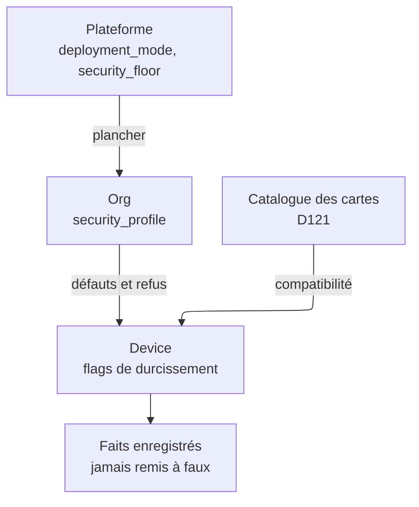

| Niveau | Réglage | Qui le change | Effet |
|---|---|---|---|
| Plateforme | `deployment_mode` (`saas`, `self_hosted`) ; `security_floor` | Admin plateforme (config) | Un déploiement `critical` refuse toute org sous le plancher |
| Org | `security_profile` | Monter : owner. Descendre : admin plateforme seul, tracé | Défauts et refus de l'org |
| Device | Flags de durcissement effectifs | Le build et le provisioning | Un flag matériel devient un fait daté, jamais remis à faux |

Seul `deployment_mode` existe dans le code (`pnex_core::DeploymentMode`). `security_floor`, `security_profile` et les flags par device arrivent en V2.

Règles du mécanisme :

1. Baisser le profil d'une org ne dé-durcit aucune carte. L'UI montre alors les devices plus durcis que le profil.
2. Le serveur refuse un flag matériel pour une carte incompatible (`hardening-board-unsupported`, à créer en V4).
3. Le catalogue des cartes (`pnex_core::catalog`, D121) déclare les durcissements de chaque carte. Les cartes HIL sont non durcissables.
4. Une suite de tests vérifie les refus attendus de chaque profil.

### 8.3 Identité et lien device (V1, lots L1–L6)

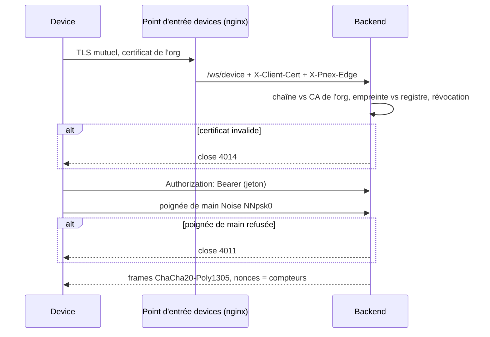

Le lien device a deux couches. Chacune a son rôle (D155) :

- **TLS mutuel (D153, D154)** : identité standard par X.509 et confidentialité persistante. `ws://` est refusé.
- **Couche Noise (D156)** : `Noise_NNpsk0_25519_ChaChaPoly_SHA256`, clé partagée de 256 bits mélangée dès le premier message. Elle apporte la confidentialité post-quantique et l'intégrité de bout en bout.

**Attention :** ne supprimez pas la couche Noise en la croyant redondante avec TLS. TLS échange ses clés en ECDHE, cassable par un ordinateur quantique.

Faits du lien :

- **PKI par org (L3)** : CA ECDSA P-256 par org, créée au premier build, clé au coffre. Au build : clé et certificat du device (CN = `device_id`, SAN = org, 10 ans). La clé privée vit seulement dans l'image. Registre `device_certificates` (empreinte SHA-256, série, révocation). Pas de CRL.
- **Vérification (L4)** : nginx `ssl_verify_client optional_no_ca` sur le point d'entrée devices. Il transmet `X-Client-Cert` et efface la valeur venue du client. Le backend croit ces en-têtes seulement avec `X-Pnex-Edge` (SEC-21).
- **Point d'entrée devices (D158)** : `PNEX_DEVICE_HOST` (chart : `deviceHost`), 4443 en LAN, `devices.` + hôte en cloud. Certificat serveur émis par la CA PneX de l'instance. 8883 est réservé à MQTT.
- **Firmware (L5)** : certificat et clé compilés (`PNEX_CLIENT_CERT/KEY`). ESP32 : `WiFiClientSecure`. ESP8266 : BearSSL `setClientECCert`.
- **Agent edge et déploiement (L6)** : certificat rustls émis à l'enrôlement. Compose et Helm portent le point d'entrée devices dédié.
- **Jeton (L2)** : en-tête `Authorization: Bearer` sur `/ws/device`, `/ws/camera` et le téléchargement OTA. Un jeton en URL est ignoré.
- **Pas de compatibilité (D157)** : le format D8 est supprimé partout. Un device non recompilé est refusé et doit être reflashé.
- **Rotation de CA d'org** : non outillée (CA 30 ans, certificats 10 ans). Une compromission impose une nouvelle CA, un rebuild et un flash de l'org (EX-A8, V3).

**Danger :** ne passez jamais en proxy un enregistrement DNS qui résout l'hôte devices. Le proxy termine le TLS, et le certificat client n'arrive plus à nginx.

### 8.4 Exigences

Colonnes : profil minimal (O = open, I = industrial, C = critical, S = sovereign, « opt » = optionnel).
Impact : **L** = logiciel réversible, **E** = eFuse irréversible, **P** = processus ou documentation.

**A. Protocole device ↔ serveur**

| ID | Exigence | Profil | Impact | Vague | État |
|---|---|---|---|---|---|
| EX-A1 | Frames chiffrées authentifiées (ChaCha20-Poly1305) | O | L | V1 | Fait (Noise, L1) |
| EX-A2 | Anti-rejeu par compteur dans les données authentifiées | O | L | V1 | Fait (Noise, L1) |
| EX-A3 | Plus de repli « clé vide = clair » | O | L | V1 | Fait (L1) |
| EX-A4 | Jeton hors de l'URL | O | L | V1 | Fait (L2) |
| EX-A5 | TLS obligatoire, `ws://` refusé | O | L | V1 | Fait (L2) : sans `X-Forwarded-Proto: https` de l'edge, close 4013 ; `ingestion.require_tls` |
| EX-A6 | Identité par device en X.509 + TLS mutuel | O (repli jeton, D157) | L | V1 | Fait (L3–L6), validé sur NodeMCU et C6 |
| EX-A7 | Certificats émis par l'autorité du client (BYOK, PKCS#11, HSM) | C | L | V3 | Absent |
| EX-A8 | Rotation des clés et certificats sans reflash USB | I | L | V3 | Rotation de CA = rebuild + OTA |
| EX-A9 | Crypto agile, algorithmes ANSSI, FIPS 140-3 en option | S | L | V5 | Absent |
| EX-A10 | Confidentialité post-quantique (couche Noise, D155) ; la clé partagée voyage dans l'image en TLS classique | O | L | V1 (couche), V3 (transport de la clé) | Couche faite ; transport absent |
| EX-A11 | TLS hybride ML-KEM jusqu'au device | C | L | Quand ESP-IDF le propose | Absent |

**B. OTA et cycle de vie du firmware**

| ID | Exigence | Profil | Impact | Vague | État |
|---|---|---|---|---|---|
| EX-B1 | Image signée Ed25519, clé publique embarquée, vérifiée avant bascule | O | L | V1 | Fait (SEC-18, `edge.md` §3.7) |
| EX-B2 | Anti-downgrade logiciel sur toutes les puces | O | L | V1 | Fait sans NVS : version signée comparée à l'image en cours |
| EX-B3 | Fenêtres de maintenance et approbation avant OTA | I | L | V2 | OTA immédiate |
| EX-B4 | Déploiement progressif, arrêt sur échec | I | L | V2 | OTA en lot manuelle |
| EX-B5 | Approbation à deux personnes (deploy, OTA, secret) | C | L | V3 | Absent |
| EX-B6 | Anti-rollback eFuse `secure_version` | C opt, S | E | V5 | Absent |
| EX-B7 | Signature de l'image hors du builder | I | L | V2 | Absent |
| EX-B8 | Fin de vie d'un device : effacement, révocation, trace | I | L+P | V3 | Suppression simple |

**C. Matériel**

| ID | Exigence | Profil | Impact | Vague | État |
|---|---|---|---|---|---|
| EX-C1 | NVS chiffré par HMAC (C3, S3, C6) | I opt | E | V4 | Secrets en clair (SEC-20) |
| EX-C2 | Secure Boot v2, clés hors puce + clé de secours | I opt, C | E | V4 | Absent |
| EX-C3 | Flash Encryption release, clé hors puce conservée | I opt, C | E | V4 | Absent (SEC-20) |
| EX-C4 | Secure Download Mode | avec EX-C3 | E | V4 | Absent |
| EX-C5 | JTAG désactivé | C | E | V4 | Absent |
| EX-C6 | Download UART désactivé (plus aucun reflash USB) | S seulement | E | V5 | Absent, volontairement réservé |
| EX-C7 | Élément sécurisé pour l'identité | S | matériel | V5 | Absent |
| EX-C8 | Détection d'ouverture du boîtier | S | matériel | V5 | Hors périmètre |

Prérequis de V4, à lever avant tout eFuse :

- passer à ESP-IDF (ou pioarduino) ou au firmware Rust, car l'Arduino précompilé bloque Secure Boot et Flash Encryption ;
- vérifier le flash navigateur (esptool-js) en Secure Download Mode, sinon seule l'app desktop reflashe ;
- vérifier l'écriture d'images pré-chiffrées sur ESP32 classique ;
- mesurer l'impact du chiffrement sur ESP32-CAM et la place des slots OTA ;
- accepter que seules les cartes neuves ou repassées en USB sont durcies (le bootloader ne se met pas à jour par OTA) ;
- tester la récupération de bout en bout sur 10 cartes sacrifiables au moins.

**D. Réseau et architecture**

| ID | Exigence | Profil | Impact | Vague | État |
|---|---|---|---|---|---|
| EX-D1 | Connexions sortantes seulement côté device | O | L | — | Fait |
| EX-D2 | Contrôle sans dépendance cloud | I | L | — | Fait (pnex-deploy) |
| EX-D3 | Fail-safe défini par sortie à la perte de communication | I | L | V2 | Partiel (cartes de régulation D20) |
| EX-D4 | Installation et mises à jour sans Internet | C | L | V3 | Builder hors ligne fait ; le reste absent |
| EX-D5 | Segmentation par zones et conduits (IEC 62443-3-2) | C | P | V3 | Absent |
| EX-D6 | Compatibilité diode réseau | S | L | V5 | Absent |
| EX-D7 | Transports filaires (Ethernet, RS-485, Modbus) | C opt, S | L+matériel | V5 | WiFi seulement |

**E. Serveur et plateforme**

| ID | Exigence | Profil | Impact | Vague | État |
|---|---|---|---|---|---|
| EX-E1 | Chiffrement au repos de la base et du stockage objet ; résidence | C | L+P | V3 | Coffre seulement (§9) |
| EX-E2 | Images conteneur durcies | I | L | V2 | Partiel |
| EX-E3 | Clés plateforme dans un HSM | C | L | V3 | Absent |
| EX-E4 | Sauvegarde testée des clés de devices | I | L+P | V3 | Absent, prérequis de toute carte durcie |

**F. Identité et accès**

| ID | Exigence | Profil | Impact | Vague | État |
|---|---|---|---|---|---|
| EX-F1 | MFA obligatoire, session bornée | I | L | V2 | Possible via Rauthy, non imposé |
| EX-F2 | Fédération AD / LDAP | I | L | V3 | Absent |
| EX-F3 | Accès « bris de glace » tracé | C | L+P | V3 | Absent |
| EX-F4 | Qui écrit un flow ≠ qui le déploie | C | L | V3 | Absent |

**G. Traçabilité**

| ID | Exigence | Profil | Impact | Vague | État |
|---|---|---|---|---|---|
| EX-G1 | Journal d'audit de toutes les actions | I | L | V2 | Partiel |
| EX-G2 | Export SIEM (syslog, CEF) | I | L | V2 | Absent |
| EX-G3 | Journal infalsifiable | C | L | V3 | Absent |
| EX-G4 | Piste d'audit FDA 21 CFR Part 11 | C opt | L | V3 | Absent |

**H. Chaîne d'approvisionnement**

| ID | Exigence | Profil | Impact | Vague | État |
|---|---|---|---|---|---|
| EX-H1 | SBOM CycloneDX à chaque release | O | L+P | V2 | `cargo deny` seulement |
| EX-H2 | Releases et images signées | O | L | V2 | Absent |
| EX-H3 | Builds reproductibles | C | L | V3 | Absent |
| EX-H4 | Dossier type pour questionnaire fournisseur | I | P | V2 | Ce document, interne seulement |
| EX-H5 | Pentest externe périodique | I | P | V3 | Absent |
| EX-H6 | Développement conforme IEC 62443-4-1 | C | P | V3 | Partiel (§6, §7) |
| EX-H7 | Certification de composant (62443-4-2, CSPN) | C opt, S | P | V5 | Absent |

**I. Vulnérabilités et réglementaire**

| ID | Exigence | Profil | Impact | Vague | État |
|---|---|---|---|---|---|
| EX-I1 | Politique de divulgation (`security.txt`) | O | P | V2 | Absent |
| EX-I2 | CRA : signalement ENISA (24 h, 72 h, rapport final), en vigueur depuis le 11/09/2026 | O | P | V2 | Absent, à qualifier juridiquement |
| EX-I3 | Durée de support de sécurité annoncée (≥ 5 ans) | O | P | V2 | Absent |
| EX-I4 | Directive radio (EN 18031) si PneX vend des cartes | — | P | — | Question ouverte (§11) |

**J. Sûreté de fonctionnement et pérennité**

| ID | Exigence | Profil | Impact | Vague | État |
|---|---|---|---|---|---|
| EX-J1 | Watchdog et état sûr au redémarrage | I | L | V2 | Partiel |
| EX-J2 | PneX n'est pas un système de sécurité IEC 61508 (pas de SIL) | tous | P | V2 | Non écrit |
| EX-J3 | Continuité si PneX disparaît (séquestre, self-hosted autonome) | C | P | V3 | Self-hosted fait ; séquestre absent |

### 8.5 Vagues

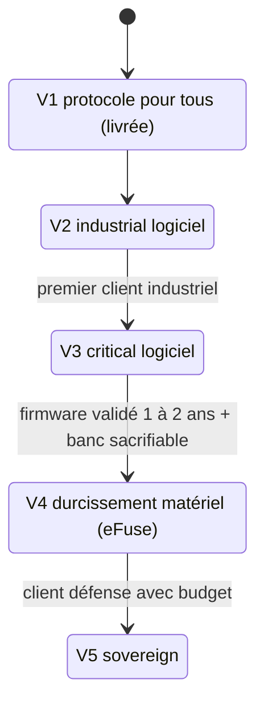

| Vague | Contenu |
|---|---|
| V1 | EX-A1–A6, A10 (couche), B1, B2. Livrée le 2026-10-09 |
| V2 | B3, B4, B7, D3, E2, F1, G1, G2, H1, H2, H4, I1–I3, J1, J2 ; mécanisme de flags (§8.2) |
| V3 | A7, A8, A10 (transport), B5, B8, D4, D5, E1, E3, E4, F2–F4, G3, G4, H3, H5, H6, J3 |
| V4 | C1–C5, après les prérequis du §8.4 C |
| V5 | A9, B6, C6–C8, D6, D7, H7 |

### 8.6 Garde-fous eFuse (non négociables)

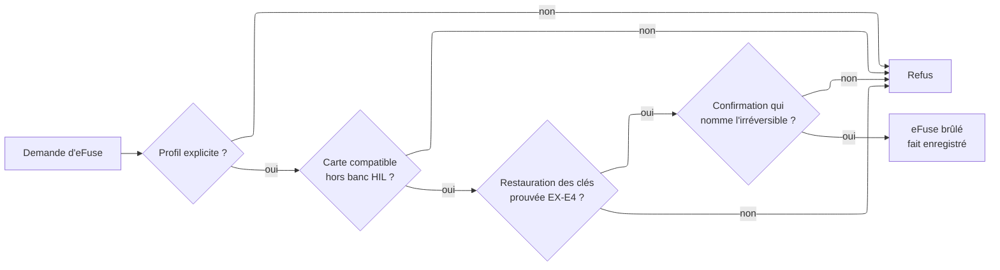

1. Aucun eFuse n'est brûlé par défaut, ni par un outil de test, ni « pour essayer » (D149).
2. Jamais sur une carte du banc HIL ni sur une carte de développement.
3. Un eFuse brûlé est un fait enregistré par device. Aucune action ne prétend l'annuler.
4. Le download UART n'est jamais désactivé hors `sovereign` (D151).
5. Le profil `open` ne perd jamais une capacité : flash navigateur, reflash libre, ESP8266.

## 9. Coffre de secrets

Le coffre garde tous les secrets d'une org en un seul endroit, chiffrés (D110).
Un consommateur (canal, nœud, WiFi, fournisseur LLM) porte une référence, jamais une valeur (D113).
Aucun rôle ne relit une valeur (D117).
Les secrets d'infrastructure (`DATABASE_URL`, clés S3, jetons de service, trousseau) restent hors du coffre, en env ou SOPS. Le coffre ne peut pas contenir sa propre clé.

### 9.1 Modèle

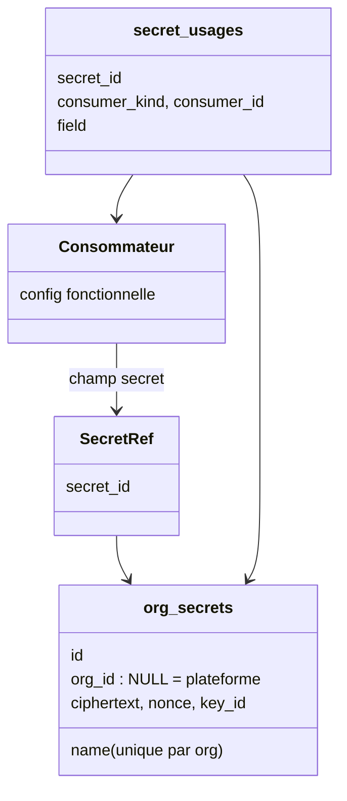

- Une ligne de `org_secrets` = une chaîne secrète. Les parties non secrètes (SSID, nom d'en-tête, utilisateur basic, URL de base) restent dans la config du consommateur (D110).
- Un secret n'a ni portée ni catégorie. La frontière est l'usage : le runtime résout un secret seulement s'il est référencé par un flow déployé de l'org (D111).
- Chiffrement XChaCha20-Poly1305, nonce aléatoire de 24 octets par écriture. L'AAD lie le texte chiffré au domaine (`pnex-secret-v1`), au propriétaire et à la ligne. Une ligne recopiée sur une autre org ou un autre secret ne se déchiffre pas (D112).
- Le trousseau est obligatoire au boot. Sans lui, le serveur refuse de démarrer (D112).
- `secret_usages` est réécrit à chaque sauvegarde d'un consommateur. Il sert la colonne « utilisé par » et le refus de suppression (409 `secret-in-use`, D114).
- Un **secret dédié** est créé par une saisie au lieu fonctionnel. Il porte un nom dérivé de son lieu et disparaît avec son consommateur s'il n'a plus d'usage.

Consommateurs actuels (`services/secrets/`) : canaux de notification, nœud http-fetch, WiFi, fournisseurs LLM, connecteurs, boîtes mail, flux média, fournisseurs géo, recherche web, points d'accès navigateur, registres d'images.

### 9.2 Saisie et choix d'un secret

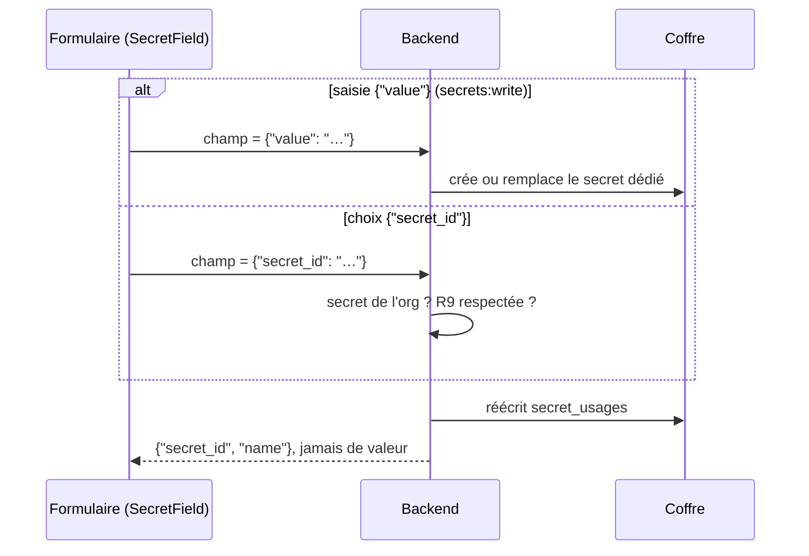

Le composant `SecretField` sert tous les formulaires. Il montre « défini · nom du secret » et les actions selon les droits.
La validation propre au consommateur (URL Slack, token Telegram) porte sur la valeur résolue côté serveur. Un test d'envoi résout en mémoire et n'écrit rien au coffre.

Règles par consommateur :

- **Canaux de notification (S4)** : secret dédié `notify/<canal>/<champ>`. Il suit le renommage du canal. Le snapshot du runtime porte seulement des références.
- **Nœud http-fetch (S5)** : `pnex_core::SecretSlot` (`Unset`, `Ref`, `Value`) pour `auth.password`, `auth.token`, `auth.value`, `proxy.password`. Secret dédié `flow/<flow_id>/<node_id>/<champ>`. Les usages couvrent la dernière version et la version déployée. Les secrets dédiés ne sont pas élagués à la sauvegarde, pour qu'un rollback retrouve ses secrets. L'éditeur adopte les références stockées (`adopt_stored_secrets`). Avec `url_from_msg`, `msg.url` remplace l'adresse seulement sur l'origine de `url` (schéma, hôte, port) : un secret ne part jamais vers un autre hôte que sa destination (R9).
- **WiFi (S6)** : `wifi_credentials.secret_id`, secret dédié `wifi/<ssid>/password`. Le job de build porte seulement `wifi_secret_id`. Le worker déchiffre au moment du build.
- **Fournisseurs LLM (S7)** : table `llm_providers` par org, secret dédié `llm/<nom>/api_key`, un seul défaut par org. Pas de LLM plateforme (D119). `POST …/{id}/test` fait un ping réel.
- **Assistant** : il ne saisit jamais de valeur. Il garde ou choisit une référence, sous R9.

### 9.3 Résolution par le runtime

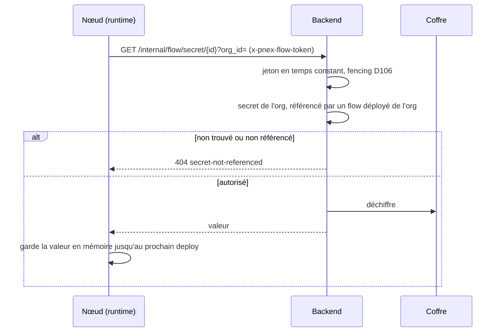

- `flows.json` et `ApplyOrg` portent seulement des `secret_id` (D115).
- Le nœud résout au premier envoi, pas à la construction. Le deploy applique le fragment avant de marquer le flow déployé en base. Le nœud réessaie brièvement un 404.
- Un canal désactivé coupe ses envois au premier envoi suivant, sans redeploy.
- La clé maîtresse ne va jamais au runtime. Les nœuds fonction (JS, Starlark) n'ont pas accès aux secrets.
- Changer une valeur ne déclenche rien en cascade (D118). Un flow prend la valeur au prochain deploy. Un firmware garde l'ancienne valeur jusqu'à son reflash, device par device. L'UI le signale à la sauvegarde.

### 9.4 Droits

| Permission | Plus bas rôle | Effet |
|---|---|---|
| `secrets:read` | Viewer | Liste des secrets, noms des secrets référencés |
| `secrets:usage` | Member | Garder une référence déjà câblée (R9) |
| `secrets:write` | Admin | Créer, renommer, remplacer une valeur, câbler un secret |
| `secrets:delete` | Admin | Supprimer un secret non utilisé |
| plateforme | Admin plateforme | Rechiffrement (`POST /api/v1/system/secrets/rekey`) |

Source : `crates/pnex-api-contract/src/iam.rs`. Une saisie de valeur sans `secrets:write` reçoit 403 `secret-write-forbidden`.

### 9.5 API

| Route | Effet |
|---|---|
| `GET /api/v1/secrets` | Nom, description, `updated_at/by`, usages. Jamais de valeur. Pagination et recherche |
| `POST /api/v1/secrets` | Crée un secret |
| `PUT /api/v1/secrets/{id}` | Nom, description, nouvelle valeur optionnelle |
| `DELETE /api/v1/secrets/{id}` | Supprime, 409 `secret-in-use` si utilisé |
| `GET /internal/flow/secret/{id}` | Résolution par le runtime (§9.3) |
| `POST /api/v1/system/secrets/rekey` | Rechiffrement : renvoie `rewritten`, `unreadable`, `skipped`, `remaining` |

Champ secret d'un formulaire : `{"secret_id": …}` (choix) ou `{"value": "…"}` (saisie). En lecture : `{"secret_id", "name"}`.
Codes d'erreur : `secret-not-found`, `secret-in-use`, `secret-not-referenced`, `secret-name-taken`, `secret-write-forbidden`, `secret-destination-locked`.

### 9.6 UI

- Page `/secrets` (réglages de l'org) : nom, utilisé par (liens vers le consommateur), modifié le, par. Actions : créer, renommer, remplacer la valeur, supprimer.
- Fournisseurs LLM : composant `LlmProviders`, dans le détail de l'org (`/orgs/current`).
- `/admin/status` : composant « Coffre de secrets » (clé d'écriture, nombre de clés, secrets stockés, secrets sous une ancienne clé) et bouton « Rechiffrer les secrets ». Le coffre est dégradé si une ligne est sous une clé absente.

### 9.7 Rotation et exploitation (S8)

Format : `PNEX_SECRETS_KEYS="<id>:<base64 de 32 octets>,…"`. La première entrée chiffre, les suivantes relisent seulement.
Un id fait au plus 32 caractères `[A-Za-z0-9_-]`. Pour générer une clé : `openssl rand -base64 32`. pnex-deploy la génère à l'installation.

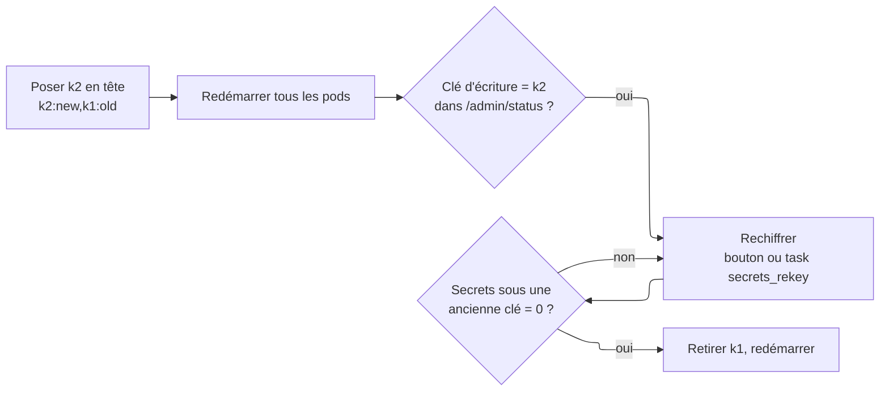

- Le rechiffrement (`services::secrets::rekey`) parcourt les lignes par lots de 200, sous le verrou consultatif `SECRETS_REKEY`. Un second lancement attend le premier.
- Un `UPDATE` conditionné sur l'ancien nonce et l'ancien `key_id` évite d'écraser un remplacement concurrent. Valeur, `updated_at` et `updated_by` ne changent pas.
- Une ligne illisible reste telle quelle. Son id est journalisé, jamais sa valeur.
- Le rechiffrement ne tourne jamais au boot. En rolling upgrade, un pod qui rechiffre trop tôt rendrait le coffre illisible pour les autres.
- Une rotation de clé ne change aucune valeur. Si une valeur a fuité, remplacez-la dans `/secrets`.

**Danger :** rangez le trousseau à part de la base, jamais dans le même dump. Une sauvegarde de la base sans le trousseau ne restitue aucun secret.

**Attention :** une clé perdue rend ses lignes illisibles pour toujours. Les consommateurs échouent proprement. Le remède est de ressaisir chaque valeur depuis l'UI.

## 10. Décisions

| # | Décision |
|---|---|
| D110 | Coffre unique `org_secrets` : une ligne = une valeur secrète, parties non secrètes dans la config du consommateur |
| D111 | Pas de portée ni de catégorie : la frontière est l'usage par un flow déployé de l'org |
| D112 | XChaCha20-Poly1305, AAD lié au propriétaire et à la ligne, trousseau en env obligatoire au boot |
| D113 | Références typées `{"secret_id"}`, jamais de templating ; composant unique `SecretField` |
| D114 | `secret_usages` : « utilisé par » et refus de suppression d'un secret utilisé |
| D115 | Le runtime reçoit des `secret_id` et les résout par `/internal/flow/secret/{id}` ; jamais la clé maîtresse |
| D116 | Fournisseurs LLM en CRUD, `PNEX_AI_*` retirés (partie plateforme remplacée par D119) |
| D117 | Aucun rôle ne relit une valeur ; seuls les admins câblent un secret (amendé par R9, SEC-W2) ; droits IAM au §9.4 |
| D118 | Changer une valeur ne déclenche rien en cascade : redeploy pour les flows, reflash un par un pour le WiFi |
| D119 | Pas de LLM plateforme : chaque org apporte son LLM, sans repli |
| D130 | Sécurité = garde permanente : règles §3, revue §6, `cargo deny` bloquant §5, registre unique §7 |
| D148 | Profils gradués `open`, `industrial`, `critical`, `sovereign` ; `open` reste le défaut |
| D149 | Rien d'irréversible par défaut ; eFuses gelés jusqu'à la fin de la phase communautaire (V4) |
| D150 | PneX ne détient jamais seul les clés d'un client durci |
| D151 | Le matériel reste réutilisable par son propriétaire ; anti-downgrade logiciel en `open` et `industrial` |
| D152 | Exigences tracées maintenant, implémentées par vagues ; SEC-17 à SEC-19 corrigés pour tous en V1 |
| D153 | Identité device = X.509 + TLS mutuel, une CA par org, révocation par registre ; Rauthy reste l'IdP des humains (D19) |
| D154 | TLS obligatoire, jeton hors de l'URL |
| D155 | La couche interne chiffrée reste sous TLS, pour la confidentialité post-quantique |
| D156 | Couche interne = Noise NNpsk0, une seule pile crypto avec le M2M |
| D157 | Aucune compatibilité avant release : D8 supprimé, reflash obligatoire ; repli jeton en `open` pour une carte en échec HIL |
| D158 | Point d'entrée devices dédié, jamais derrière un proxy TLS ; CA de l'instance ; 8883 réservé à MQTT |

## 11. Reste à faire

- **SEC-10** : créer la clé de signature de l'APK release et la poser en secrets GitHub.
- **SEC-17 à SEC-20** : SEC-20 attend V4 (eFuses, après la validation communautaire du firmware).
- **V2** : mécanisme de flags (`security_floor`, `security_profile`, flags par device) et exigences du profil `industrial`.
- **Rotation de CA d'org** : outillage absent (double CA de transition, OTA), EX-A8 en V3.
- **Questions de Shan, à trancher** :
  1. CRA : PneX est-il un produit avec éléments numériques mis sur le marché, ou un logiciel libre exempté ? Qui est fabricant quand l'utilisateur assemble sa carte ? Avis juridique avant V2.
  2. Directive radio : obligations si PneX vend un jour des cartes.
  3. Socle de V4 : migration ESP-IDF (C++) ou firmware Rust (esp-hal) ?
  4. `sovereign` : quel matériel (élément sécurisé, filaire, automates derrière passerelle) ? À trancher avec un client réel.
  5. Format d'export et de séquestre des clés (EX-E4, D150).
- **Coffre, hors périmètre** : chiffrement au repos des clés device et des tokens agent ; jeton d'ingestion O2 par org à la place du mot de passe root dans le runtime ; « révéler une valeur », coffre externe (Vault, KMS), clé par org (crypto-shredding).
