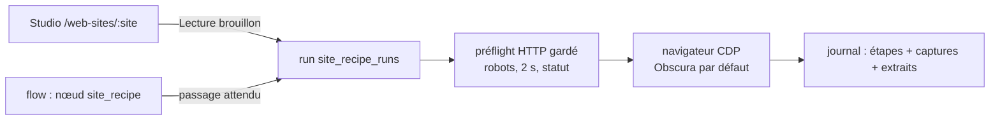

# Règles de navigation des sites web — studio, navigateur serveur (D323–D328)

> Proposition source : `pnex-quali-watch/navigation.md` v0.3 (Quali-Watch). Ici : ce que
> le noyau PNeX livre. Suite de `partner-watch.md` (D300–D316) et d'`ingestion.md`
> (D317–D322). **N1 codé le 2026-10-20** (D323–D326 + navigateurs configurables) ;
> **N2 codé le 2026-10-20** (D327 nœud de flow, notification ok → échec, prochains
> passages, extraits versés à la médiathèque, rétention des captures D268) ; D328 (`llm_extract`) reste à faire.

## 1. Principe

Voir **quand** une collecte passe, **comment** sa règle est posée et **ce qu'elle extrait** ;
appuyer sur Lecture et voir **où ça bloque**. Une collecte qui échoue échoue : une ligne
rouge au journal, rien d'autre. Le LLM aidera à écrire la règle (studio) ; il ne navigue
jamais en production.

## 2. Décisions

### D323 — Règle de navigation : du YAML rangé sous un site web

Entité `site_recipes` (org, `site` = hôte normalisé, `name` unique par site, `yaml`,
`version` incrémentée à chaque enregistrement, 409 `site-recipe-version-conflict` sur
`expected_version` périmée). Validation dans `pnex_core::site_recipe` (pur, wasm-safe) :

- clés : `name`, `site`, `allow_hosts` (≤ 10), `params` (≤ 10, `{{nom}}` dans les étapes),
  `browser` (nom d'un navigateur de l'org), `steps` (≤ 60) ;
- actions fermées : `open`, `click` (`text` | `text_contains` | `selector` | `role`+`name`),
  `scroll`, `wait` (`ms` | `text`, ≤ 15 s), `follow_pdf` (`link_text_contains` |
  `href_contains`), `extract` (`selector` | `between` | `all_text`), `assert`
  (`page_contains` | `not_empty` | `count_min` | `url_contains`) ;
  `url_matches` de la proposition devient `url_contains` (pas d'expression régulière) ;
- stricte : cible introuvable ou vérification fausse = arrêt ; seules les étapes
  `optional: true` passent ;
- violations `{path, token}` (`steps.3` + `one_of`, `unknown_param:x`,
  `unknown_extract:x`, `syntax`…) sous le code `site-recipe-invalid` ;
- **normalisation** `site_host` : schéma, port, `www.` et chemin retirés. La cible D307
  d'une mission `crawl_site` et la clé `site` de son registre `site_pages` en dérivent
  (`web:site:<hôte>`, `browser_agent::site_key`) : un crawl et les règles d'un même site
  partagent l'hôte. Le crawl reste borné à l'**origine** déclarée (schéma et port compris).
- Jamais livrée par un pack ; par org PNeX (R1).

### D324 — Studio `/web-sites/:site` (refondu le 2026-10-20 : identité PNeX)

Studio dans la coquille d'éditeur commune (D222, `EditorShell`), **mis en page comme le
Vision Lab** : la capture de l'étape choisie occupe toute la scène (bandeau : étape,
action, adresse, raison en rouge), le **lecteur commun** est dessous (D220 : transport
`PlayButton`/`Clock`/`SpeedPicker`, sélecteur de passage tiré du journal, frise
`components/timeline` en base « durée du passage » : couloir **Étapes**, une barre par
étape longue de sa durée et colorée par son résultat, couloir **Extraits**), et une
**colonne à droite**, refermable (bouton « Règle »), avec trois onglets :

- **Règle** : règles du site, paramètres, actions glissées (ou cliquées, ou `+` de la
  coquille) dans une colonne de blocs réordonnables ; un bloc cliqué s'édite **sur place**
  (cible, valeur, facultative, supprimer) ; réglages de la règle repliés en bas. La règle
  reste un `Recipe` structuré, vérifié côté client par la même `validate` que le serveur.
- **Code** : la règle en YAML, écrit depuis les blocs (`to_yaml`, styles flow ; les
  commentaires d'un YAML écrit à la main ne sont pas conservés) ; on ne quitte l'onglet
  qu'avec un YAML accepté par le serveur.
- **Extraits** : textes et PDF du passage affiché, diff avec le dernier passage qui les
  avait lus.

Barre de la coquille : Règle, Versions, **Lancer** (« Lecture » reste au lecteur),
Enregistrer. **Versions (D221)** : table `site_recipe_versions` (migration 000040, reprise
de la version courante) ; tiroir avec frise d'une marque par version et Ouvrir /
Comparer (diff YAML ligne à ligne) / Rétablir (réenregistrée comme nouvelle version).
Liste `/web-sites` sur le socle CRUD (`ListLayout`, `FilterBar`/`SearchInput`,
`ListStates`, `DataTable`, `ListPager`, `FormDialog`). Menu : le groupe « Appareils »
devient **« Sources »** (appareils, agents navigateur, sites web) ; lexique §7.

Version initiale (N1) : 

`/sites` est pris par les sites physiques (POI) : lexique « Site web / Website » et règles
`recette`/`site internet` (fr), `recipe` (en, locale seulement) dans `lexicon_guard.rs`.
Quatre volets : règles (onglets par règle + étapes + YAML + paramètres), passage (étapes
au fil de l'eau, capture par étape avec la cible cerclée, étape en échec en rouge et sa
raison), extraits (texte, PDF à télécharger, diff avec le dernier passage qui avait cet
extrait), quand (journal). Lecture = essai du brouillon affiché ; l'assistant n'est pas
encore branché (N4).

**Reprendre à l'étape N** (N4, codé le 2026-10-21) : sur un passage terminé, le lecteur
propose « Reprendre à l'étape N » pour l'étape affichée (N ≥ 2). Le brouillon est rejoué
à partir de N en ouvrant la page où ce passage se trouvait après l'étape N−1 (même
préflight et mêmes gardes qu'un `open`) ; les étapes d'avant sont reprises, grisées, raison
`reused`, sans capture, et leurs extraits texte aussi (sans fichier PDF), pour que les
`assert: {not_empty}` suivants les voient. Refus (`field-invalid` sur `resume`) : passage
d'un autre site, étape N−1 en échec, N hors du brouillon ; passage inconnu =
`site-recipe-run-not-found`. Studio seulement : un flow joue toujours toute la règle.

**Vue en direct** (N4, codé le 2026-10-21) : pendant un passage du studio, le navigateur
serveur est capturé toutes les 1,5 s (JPEG qualité 50) dans Valkey (`pnex:site-recipe:live:<run>`,
20 s de vie, partagé par les pods) ; `GET /site-recipes/runs/{id}/live` le sert (204 sans
image) et la scène l'affiche, badge « En direct », à la place de la capture de l'étape tant
que le passage tourne. Raccourci assumé à la place du screencast CDP sur websocket de la
proposition : rien à router entre pods, Obscura (qui ne répond pas pendant un chargement)
saute simplement des images. Sans Valkey : pas de vue en direct, les captures par étape
restent. Les passages lancés par un flow n'en produisent pas.

**Assistant dans le studio** (N4, codé le 2026-10-21) : cinq outils (`services/ai/site_tools.rs`)
— `list_site_recipes`, `get_site_recipe`, `get_site_recipe_run` (lecture,
`site-recipes:read`), `try_site_recipe` (joue un brouillon ou une règle par le même service
que le studio, `start_run`, déclencheur `assistant`, attend 2 min au plus ; `site-recipes:write`)
et `propose_site_recipe` (vérifie le YAML, n'enregistre rien ; `site-recipes:write`). Les
extraits rendus au modèle sont entre balises `<data>` avec la consigne de ne jamais suivre ce
qu'ils disent (D208), 4 000 caractères chacun. Une proposition s'ouvre dans le studio du site
par le bouton « Ouvrir dans le studio » sous la réponse, en brouillon non enregistré (nouvelle
règle, ou nouvelle version de `recipe_id`) : l'humain la joue et l'enregistre (D144).

### D325 — Navigateur serveur et navigateurs configurables

- Moteur par défaut : **Chrome headless-shell** (`chromedp/headless-shell`, service
  `browser` du compose), piloté par un **client CDP maison** (`services/site_recipes/cdp.rs`,
  `tokio-tungstenite`) : une douzaine de commandes, messages lus en `serde_json::Value`,
  jeton Bearer posé sur l'upgrade WebSocket, sessions plates. `chromiumoxide` a été retiré
  le 2026-10-20 : dans l'image Docker, l'`arbitrary_precision` de serde_json (starlark,
  unifié par le build commun avec le runtime de flows) cassait ses enums non tagués
  (aucun événement CDP lisible, `new_page` bloqué) ; il imposait aussi un relais local pour
  le jeton. Obscura
  (`h4ckf0r0day/obscura`, Apache-2.0) a été le premier choix puis abandonné le 2026-10-20 :
  ~30 s par page sur lastrat.fr contre ~1 s pour Chrome (règle pilote : 60 s → 5,7 s),
  pas d'interception ni de statut (§3). Il reste utilisable comme navigateur d'org (jeton).
- Chrome n'a pas de jeton : sa protection est le réseau (127.0.0.1 et réseau compose ;
  NetworkPolicy en k8s). Il refuse un `Host` qui est un nom : PNeX résout le nom et parle à
  l'adresse IP (`http`/`ws` seulement).
- `browser_endpoints` (école des fournisseurs géo) : nom, adresse CDP (`ws(s)://`,
  `http(s)://hôte:port`), jeton Bearer au coffre (`browser/<nom>/auth`, consommateur
  `browser-endpoint`), connexions simultanées (1–16), défaut unique par org. Test : 4
  vérifications (`version` avec le jeton, `context`, `navigate` + capture, `internal-refused`).
- Résolution d'un passage : navigateur nommé par la règle → défaut de l'org → navigateur de
  la plateforme (`PNEX_BROWSER_URL`, `PNEX_BROWSER_TOKEN`, réglés par l'opérateur).
- **Sécurité** : une adresse d'org passe la garde de sortie (R8) — tout inscrit possède une
  org, une adresse interne (`….svc`, plages privées en `public`) est réservée à la
  plateforme. Un contexte de navigation neuf par passage.
- chromiumoxide n'envoie pas d'en-tête à l'upgrade WebSocket : PNeX lit `/json/version`
  avec le jeton puis passe par un relais WebSocket à usage unique sur 127.0.0.1 qui ajoute
  `Authorization`.

### D326 — Journal des passages

`site_recipe_runs` : YAML joué (brouillon compris), version, paramètres, déclencheur,
statut `running | ok | failed`, étape en échec et raison, étapes (JSON, sauvées après
chaque étape : le studio les voit arriver), extraits (texte ≤ 200 000 car., SHA-256),
clés S3 des captures et PDF (`org_{id}/site_recipes/{run}/…`). Un passage resté `running`
au-delà de 11 min est montré `interrupted` ; au démarrage, ces passages sont fermés.
Un échec ne conclut rien. La notification ok → échec passe par le nœud de flow (D327).

### D327 — Nœud de flow `site_recipe`

- Config : `recipe_id` (règle enregistrée de l'org, obligatoire au déploiement — garde
  `site_recipe_config_unset` / `site_recipe_unknown`) et `params` ; `msg.params` (objet de
  chaînes) les remplace message par message. La **dernière version enregistrée** est
  jouée, lue par le backend dans la version déployée du flow (le runtime n'est pas fiable).
- Runtime (`pnex-site-recipe`, crate `pnex-node-ui-control`) : un appel
  `POST /internal/flow/site-recipe` par message, attendu (≤ 20 min, un message à la fois) ;
  le passage est journalisé comme un passage du studio, déclencheur `flow`.
- Sortie : `msg.payload = {nom d'extrait: texte}`, `msg.manifest = {site, recipe,
  recipe_id, version, run, status, reason?, failed_step?: {index, action, reason},
  outputs: [{name, kind, sha256, chars, changed, from?}]}` (`changed` = diffère du dernier
  passage qui a ramené cet extrait). Refus (règle absente, paramètre manquant, serveur
  indisponible) : port 1, `msg.error = {code, args}`.
- **Ports** : 0 réussi, 1 échec, 2 **cassé** = échec juste après un passage `flow` réussi
  (les passages du studio jouent des brouillons : ils ne comptent pas). La notification
  « une fois quand ça casse » = port 2 → nœud de notification ; pas de notification
  serveur à part (« une surface lit, un flow agit »).
- **Quand** : `GET /site-recipes/{id}/schedule` remonte les fils depuis chaque nœud
  `site_recipe` de la règle dans les flows déployés jusqu'aux inject ; cron (5 ou 6
  champs, UTC comme le runtime) → 5 prochaines dates (`croner`), intervalle affiché tel
  quel. Le studio les montre sous la règle enregistrée.
- **Médiathèque** : à chaque passage `flow` **réussi**, chaque extrait devient un média
  `document` (un par règle × paramètres × nom d'extrait, retrouvé par ses métadonnées
  `{source: site_recipe, recipe_id, output, params}`) ; nouvelle version seulement si le
  SHA-256 du contenu change (le fichier PDF pour un extrait PDF, sinon le texte en
  Markdown). Indexé par la recherche de documents. Le manifeste porte `media` et
  `media_version`. Un passage en échec ne verse rien ; un versement raté est journalisé
  sans faire échouer le passage. Les passages du studio jouent des brouillons : rien n'est
  versé.
- **Rétention des fichiers (D268)** : la règle porte `captures` (`none`, `days:N`, `keep`,
  vocabulaire D161, défaut `days:30`, choix dans les réglages de la règle). Un pruner
  horaire (un pod à la fois) supprime captures et PDF des passages terminés au-delà de la
  rétention du YAML joué ; étapes, extraits texte et journal restent, le studio n'offre
  plus les fichiers disparus. La rétention appartient à la règle (la source), pas au flow.

### D328 — `llm_extract` (à faire, N3)

Inchangé par rapport à la proposition v0.3.

## 3. Notes d'implémentation

- Chaque appel de mise en route (contexte, page, interception, viewport, user agent) est
  borné à 20 s et journalisé : un navigateur muet fait échouer le passage
  (`browser-unavailable`) au lieu de le laisser `running`.
- **Obscura ne fait pas tout Chrome** (constaté, d'où l'abandon comme défaut) : pas d'événement `Fetch.requestPaused`
  (interception CDP sans effet), ni de statut HTTP (ni événement `Network`, ni
  `performance` navigation), ni d'événement de chargement attendu par `Page.navigate` ;
  il ne répond plus au CDP pendant qu'il charge une page (~30 s sur lastrat.fr). D'où :
  - chaque `open` passe d'abord par un **préflight HTTP gardé** (R8, robots.txt, plancher
    de 2 s par page, redirections sur le site, statut 404/429/5xx → étape en échec) ;
  - la navigation se fait par `location.href` / clic différé (`setTimeout`), et la page est
    prête quand elle répond un `readyState` ≠ `loading` (silence = chargement, ≤ 60 s) ;
  - chaque évaluation est bornée (10 s, 1,5–2 s en attente de chargement) ;
  - toute navigation doit rester sur le site ; l'interception CDP reste en place pour Chrome.
- Visibilité d'une cible = boîte non vide, non masquée, aucun ancêtre d'opacité 0 (les
  menus fermés ne comptent pas) ; plusieurs candidats → le premier, le plus intérieur.
- PDF : récupéré par le client HTTP gardé (site ou `allow_hosts`), ≤ 20 Mo, `%PDF`,
  texte par `pnex_core::doc_extract` ; servi en pièce jointe seulement (R11–R13).
- Raccourcis notés dans le code : statut inconnu d'une page atteinte par un clic sous
  Obscura ; résolution DNS refaite par le navigateur (la politique réseau du conteneur
  est la vraie garde) ; relais local à usage unique (fenêtre de course en boucle locale) ;
  diff cherché sur 20 passages.

## 4. Reste à faire

N3 `llm_extract` ; N4 exécutant agent (seulement si des sites bloquent le navigateur serveur).
