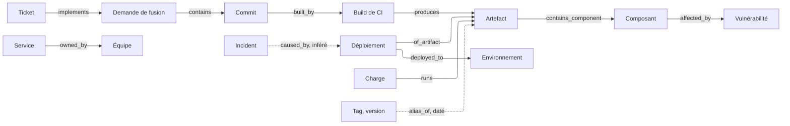
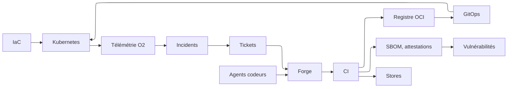
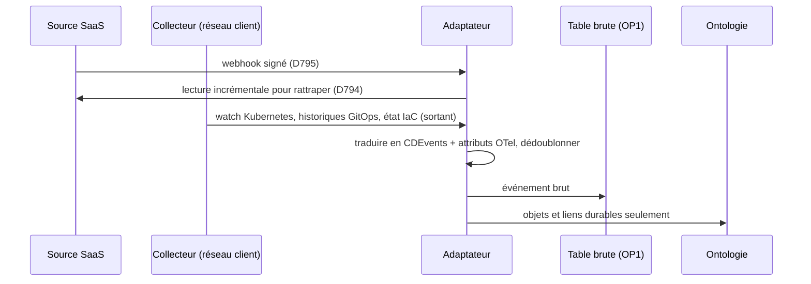
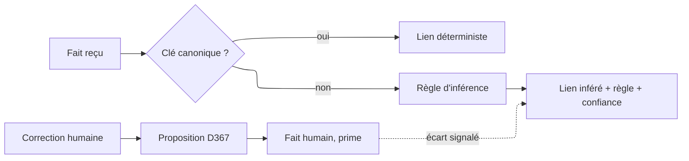
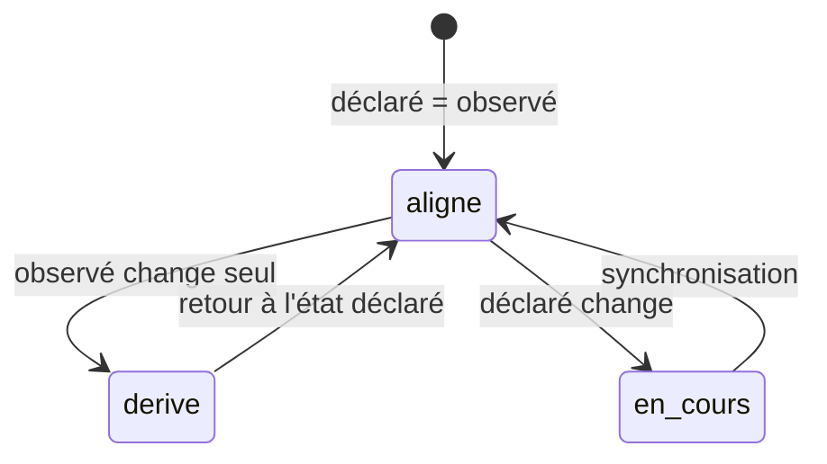

# Chaîne de livraison logicielle dans l'ontologie (D850–D879)

| | |
|---|---|
| **Statut** | **Proposé, rien n'est codé.** D850–D866 sont proposées et attendent Shan (§10). Existe déjà : les packs `software_supply` (D728) et `agent_ops`, les connecteurs OP2 (D791–D797), le runner (D764). |
| **Numérotation** | D850–D879 réservées (D850–D866 utilisées), lots SD0–SD9, questions Q-SD1–Q-SD8. |
| **Renvois** | `ontology.md` (D179 liens datés, D184 provenance, D190 packs), `pipelines.md` (OP1, OP2), `agents.md` (D708, D728, D764), `operational-platform.md` (OP3, OP5, OP9), `proposals.md` (D367), `cases.md`, `security.md`, `roadmap.md` P2.23, P2.24, P2.38 |

## 1. Résumé

Une organisation garde ses tickets, son code, ses builds, ses artefacts, ses déploiements et ses vulnérabilités dans une dizaine d'outils séparés. Savoir « quoi tourne où, issu de quoi, avec quel risque » demande une enquête. PneX doit lire ces outils sans les remplacer. Il recoupe leurs faits dans l'ontologie, avec leur historique. Une question comme « où est déployée cette CVE ? » devient une requête.

Aucun outil libre ne relie ticket, commit, artefact, déploiement, vulnérabilité et propriétaire avec l'historique. Les échecs connus sont les catalogues tenus à la main, les identités non résolues entre outils et les modèles en silos.

## 2. Concepts

| Terme | Définition |
|---|---|
| **Source** | Outil de la chaîne : gestionnaire de tickets, forge, CI, registre, outil GitOps, cluster, store, base de vulnérabilités. |
| **Identité canonique** | Clé stable d'un fait : SHA + URL du dépôt, digest d'artefact, identifiant de build de CI, (cluster, namespace, charge), clé de ticket, CVE. |
| **Alias daté** | Nom mobile qui pointe vers une identité pendant une période : tag git ou OCI, version, branche, nom de service. |
| **Build de CI** | Un passage d'une CI sur un commit. Ce n'est pas une exécution de pipeline PneX. |
| **Artefact** | Produit d'un build : image OCI, paquet, binaire, build mobile. Son identité est son digest. |
| **Déploiement** | Mise en place d'un artefact dans un environnement, à une date. |
| **État déclaré** | Ce que GitOps ou l'IaC demande pour un environnement. |
| **État observé** | Ce qui tourne réellement : pods, `imageID`, ressources du cloud. |
| **Dérive** | Écart daté entre état déclaré et état observé. |
| **Collecteur** | Programme installé dans le réseau du client, qui lit les sources internes et sort vers PneX. |
| **Baseline** | Contenu exact d'une release : exigences, code, tests, artefacts, SBOM. |

Tous les liens sont datés (D179) et portent leur provenance (D184).

## 3. Fonctionnement

### 3.1 Sources et liens à reconstruire

Chaque flèche est un lien à reconstruire. Le tableau donne la clé de jointure et l'endroit où elle manque.

| Lien | Clé de jointure | Où elle manque |
|---|---|---|
| Ticket → demande de fusion | Clé de ticket (`ABC-123`) | Souvent absente. Expression régulière sur branche, titre, corps. Une fusion écrasée garde seulement le titre : relever la clé à l'ouverture. |
| Demande de fusion → commit | SHA de tête, SHA de fusion, `vcs.change.id` | En CI, le SHA d'une demande désigne un commit de fusion synthétique jamais publié. |
| Commit → build | `cicd.pipeline.run.id`, `vcs.ref.head.revision` | Présent dans les webhooks de CI. |
| Build → artefact | Digest, purl | Maillon le plus faible : attestations SLSA, annotations OCI `revision`/`source`, CDEvents `artifact.packaged`. Un registre public n'envoie pas le digest. |
| Artefact → déploiement | Digest, `deployment.environment.name` | Les outils GitOps donnent une révision git. Résoudre tag → digest au moment du déploiement. |
| Déploiement → charge | `containerStatuses[].imageID`, labels `app.kubernetes.io/*` | Format du digest variable : normaliser en `sha256:`. |
| Charge → télémétrie | `service.name`, `service.version`, `k8s.*` | `service.version` souvent vide : enrichir depuis le pod. |
| Artefact → vulnérabilité | purl du SBOM, CVE, VEX | SBOM et VEX rattachés au digest par l'API referrers OCI. |
| Incident → déploiement | Service, environnement, fenêtre de temps | Corrélation temporelle, proposée comme fait inféré. |

### 3.2 Collecte

Un log, une métrique ou une étape de CI ne deviennent jamais des objets. Ils restent dans O2, et l'objet porte la clé qui y mène. Chaque adaptateur traite les pièges connus de sa source :

| Source | Piège | Traitement |
|---|---|---|
| Forge SaaS | `push` plafonné à 2048 commits, ou à 20 selon la forge | Rattrapage par l'API |
| Tickets SaaS | Webhooks enregistrés par API expirés après 30 jours | Renouvellement automatique |
| Registre public | Pas de digest dans le webhook | Résolution par l'API du registre |
| Argo CD | `status.history` limité à 10 entrées | Copie à chaque synchronisation |
| Kubernetes | Événements effacés après 1 h | Envoi continu vers O2 |
| NVD | 5 requêtes par 30 s sans clé | OSV d'abord, NVD en complément |
| Stores | Jetons courts (20 à 60 min) | Jetons du coffre, lecture seule |

### 3.3 Résolution d'identité

Les règles d'inférence sont : clé de ticket par expression régulière, tag → digest au déploiement, annotations OCI, incident → déploiement par fenêtre de temps, compte d'outil → personne par e-mail vérifié. Aucun fichier de correspondance n'est tenu à la main.

### 3.4 Déclaré contre observé

Chaque environnement garde ses deux états. Une dérive est un lien daté, avec début et fin. L'état d'un environnement peut être rejoué à une date passée.

## 4. Exigences

1. PneX ne doit jamais écrire vers une source, sauf D388 (branche et demande de fusion des agents codeurs).
2. Un tag, une version, une branche ou un nom de service doit être un alias daté, jamais une identité.
3. Un tag déplacé doit ouvrir une nouvelle période, sans fermer l'historique de l'ancienne.
4. Services, propriétaires et dépendances doivent être déduits des sources, jamais saisis dans un catalogue.
5. Un lien inféré doit porter sa règle et sa confiance.
6. Une correction humaine doit passer par une proposition et primer sur la déduction.
7. Chaque événement brut doit entrer dans une Table versionnée par source (OP1).
8. Le collecteur doit seulement sortir vers PneX, avec des droits en lecture seule sur le cluster.
9. Les fichiers de preuve (SBOM, VEX, SARIF, attestations, JUnit, lcov) doivent être lus sans exécution, avec une taille bornée.
10. Les métriques DORA et de traçabilité doivent être calculées depuis le graphe, à toute date.
11. Les jetons de source doivent rester au coffre (D113), en lecture seule, jamais dans un objet ni une sortie d'outil (R4, R16).
12. Chaque hôte de source doit passer la politique de sortie R8.
13. Les vulnérabilités non corrigées et les secrets détectés doivent porter un marquage (OP3, D188).
14. Les données personnelles (e-mails de commit, auteurs, tickets clients) doivent pouvoir être pseudonymisées (OP3, G5) et purgées (G6).
15. Les webhooks signés doivent être vérifiés comme D795.

## 5. Décisions

Toutes proposées le 2026-11-08, aucune tranchée.

### D850 — Ingérer, jamais remplacer ni réécrire (proposée)

PneX lit les sources par leurs API, webhooks et formats standard. Toute écriture vers elles reste une action gouvernée D563 (OP9).

### D851 — Des identités canoniques, tout le reste est un alias daté (proposée)

Tags, versions, branches et noms de service sont des liens D179 datés vers une identité.

### D852 — Déduire plutôt que déclarer : aucun catalogue tenu à la main (proposée)

Services et propriétaires viennent de CODEOWNERS, des auteurs, des labels Kubernetes, du rattachement GitOps et de l'astreinte.

### D853 — Observé contre déclaré, les deux gardés (proposée)

Deux états par environnement, la dérive est un fait daté (principe OpenGitOps appliqué à la lecture).

### D854 — Un pack `software_delivery`, `software_supply` élargi, `agent_ops` relié (proposée)

Le pack `software` de P2.24 est absorbé. Types et liens au §6.

### D855 — Les faits bruts dans des tables, les faits durables dans l'ontologie (proposée)

Même partage que D708. Logs, métriques et étapes restent dans O2 (P2.23), l'objet porte la clé de jointure.

### D856 — Résolution d'identité : déterministe d'abord, inférée ensuite, toujours prouvée (proposée)

Ordre du §3.3, provenance D184 sur chaque lien.

### D857 — CDEvents comme format pivot, un adaptateur par source (proposée)

Vocabulaire CDEvents enrichi des attributs OpenTelemetry (`vcs.*`, `cicd.*`). Idempotence par identifiant de livraison du webhook.

### D858 — Pousser quand la source pousse, tirer pour rattraper (proposée)

Webhooks signés (D795) pour le temps réel, lecture incrémentale (D794) pour l'amorçage et les trous.

### D859 — Un collecteur dans le réseau du client, sortant seulement (proposée)

Watch Kubernetes (list, watch, re-list sur 410), historiques Argo CD et Helm, état OpenTofu en JSON. Jamais de secret Kubernetes lu hors des releases Helm (Q-SD4).

### D860 — Formats standards pour les fichiers de preuve (proposée)

CycloneDX 1.x, SPDX 2.x/3.0, OpenVEX, CSAF 2.0, SARIF 2.1.0, in-toto/SLSA v1 (signature Sigstore), JUnit XML, lcov, Cobertura.

### D861 — Bases de vulnérabilités tenues par la plateforme (proposée)

OSV (export complet puis incrémental), KEV, EPSS, NVD en complément, derrière R8, avec un miroir importable pour les installations isolées.

### D862 — Tout est daté, rien n'est écrasé (proposée)

Tout état observé est un lien daté. Une baseline de release se produit à toute date (gestion de configuration, dossier technique du CRA).

### D863 — Métriques calculées depuis le graphe, pas déclarées (proposée)

Cinq métriques DORA, métriques Flow Framework, couverture de traçabilité, âge des dépendances : agrégats OP5 recalculables.

### D864 — Dix questions, dix vues prêtes (proposée)

Le pack livre dix vues : tourne où, vient d'où, même binaire, exposition à une CVE, traçabilité, incidents par déploiement, dérive, propriétaire, contenu d'une release, DORA. Une enquête peut partir de tout objet.

### D865 — Les agents IA codeurs dans le même graphe (proposée)

Une demande de fusion d'agent (D388, D775) devient un objet `change` relié à son `agent_run`. Un ticket peut lancer un agent (D398).

### D866 — Hors périmètre (proposée)

Pas d'écriture vers les sources, pas de remplacement de forge, de CI ou d'outil GitOps, pas de catalogue manuel, pas d'objet par ligne de log. PneX prépare le dossier CRA ou NIS2, l'humain le dépose.

## 6. Interfaces

Modèle proposé du pack `software_delivery` (D854). Rien n'existe dans `crates/pnex-backend/packs/` à ce jour.

| Couche | Types | Identité |
|---|---|---|
| Travail | `work_item`, `customer_ticket`, `requirement` (classe de criticité), `design_ref` | Clé dans la source |
| Code | `repository`, `branch`, `commit`, `change`, `review`, `git_tag` | URL canonique, SHA, numéro |
| Construction | `pipeline_run`, `test_run`, `quality_analysis`, `finding` (SARIF, `partialFingerprints`) | Identifiant de build, empreinte |
| Artefacts | `artifact` (remplace à terme `software_image`), `release`, `attestation`, `software_bom`, `software_component` | Digest, purl, version |
| Livraison | `environment`, `cluster`, `namespace`, `workload`, `deployment`, `gitops_app`, `iac_stack`, `iac_resource`, `store_release` | Nom + cluster, adresse IaC, piste du store |
| Exploitation | `service`, `team`, `incident`, `postmortem`, `action_item` | Clé du système d'incident |
| Risque | `software_vulnerability`, `vex_statement`, `license` | CVE, OSV, purl |
| Preuve | `document`, `evidence` (pratique SSDF, contrôle, dossier CRA) | URL, empreinte |

Liens : `implements`, `contains`, `reviewed_by`, `built_by`, `produces`, `attests`, `contains_component`, `affected_by`, `deployed_to`, `of_artifact`, `runs`, `declares`, `owned_by`, `caused_by`, `fixed_by`, `alias_of`, `opened_by_agent`. Les personnes sont le type personne de l'ontologie, avec un compte par outil.

Existant réutilisé : `crates/pnex-backend/packs/software_supply.yaml` (`software_image`, `software_bom`, `software_component`, `software_vulnerability`, `image_exposed_to`) et `crates/pnex-backend/packs/agent_ops.yaml` (`agent_run`).

## 7. Reste à faire

Lots proposés, dans l'ordre SD0 → SD1 → SD3 → SD4, puis selon Q-SD1 :

| Lot | Contenu | Preuve |
|---|---|---|
| SD0 | Pack `software_delivery`, alias datés, résolution d'identité | Rejouer un dépôt et ses tags à une date passée |
| SD1 | Forge : dépôts, commits, demandes de fusion, revues, tags | `pnex-rust` ingéré, demandes de fusion d'agents reliées à leurs runs |
| SD2 | Tickets, liens ticket ↔ changement, tickets support | Un ticket → sa demande de fusion → son déploiement |
| SD3 | CI, registres OCI, paquets, attestations, SBOM | « Même binaire que celui testé ? » répondu |
| SD4 | Collecteur D859, Kubernetes, GitOps, environnements | « Qu'est-ce qui tourne où » sur dev.pnex.io |
| SD5 | IaC, déclaré contre observé | Une dérive détectée et datée |
| SD6 | OSV, KEV, EPSS, NVD, VEX, SARIF, exposition par déploiement | « Où est déployée cette CVE » |
| SD7 | Stores mobiles et desktop | Version publiée reliée à son commit |
| SD8 | Jointure O2 (P2.23), incidents, `caused_by`, DORA | Un incident relié à son déploiement |
| SD9 | Dix vues, baseline, dossier CRA, assistant | Les dix questions répondues sur un vrai périmètre |

Questions pour Shan, à trancher avant tout lot :

- **Q-SD1** : premier public ? Ingénierie (DORA), sécurité (CVE, CRA) ou secteur régulé (traçabilité exigences → tests).
- **Q-SD2** : première forge et premier gestionnaire de tickets ? Les plus répandus, ou une forge qui porte aussi les tickets.
- **Q-SD3** : pack `software_delivery` à part (proposé) ou extension de `software_supply` ?
- **Q-SD4** : collecteur = rôle du runner (`pnex-runner collect`), de l'agent edge, ou binaire à part ?
- **Q-SD5** : stores dès le début ou après les déploiements serveur ?
- **Q-SD6** : exigences et risques saisis dans PneX, importés (ReqIF) ou lus dans les tickets ?
- **Q-SD7** : CDEvents interne seulement, ou exposé pour que les clients poussent leurs événements ?
- **Q-SD8** : PneX s'ingère-t-il lui-même comme premier client (`pnex-rust`, `pnex-deploy`, images, chart, dev.pnex.io) ?

Chiffres d'éditeurs et normes payantes de la recherche du 2026-11-08 : à vérifier avant toute citation publique. La liste des sources est dans l'historique git de ce fichier.
