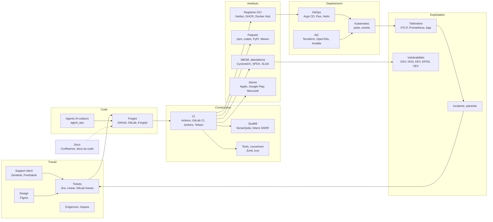

# Chaîne de livraison logicielle dans l'ontologie (D850–D879)

| | |
|---|---|
| Statut | **PRD proposé le 2026-11-08, rien d'implémenté.** Décisions D850–D866 **proposées**, à trancher par Shan (§10) ; plusieurs mois de travail en lots SD0–SD9 |
| Déclencheur | Démonstration D752 (agent codeur → demande de fusion) et constat de Shan : tickets, code, builds, artefacts, déploiements, scans, stores, infra et télémétrie vivent dans des outils séparés ; savoir « quoi tourne où, issu de quoi, avec quel risque » est un travail d'enquête |
| Repose sur | `ontology.md` (D176–D191, liens temporels D179, provenance D184, packs D190), `connectors.md` (D791–D797 : REST déclaratif, webhooks signés), `data-pipelines.md` (OP1), `agent-environments.md` (packs `agent_ops`, `software_supply`, D708), `roadmap.md` P2.23 (télémétrie) et P2.24 (sécurité et qualité du code), `operational-platform.md` (OP2, OP3, OP9, OP12), `cases.md` (enquêtes), `security.md` |
| Remplace | Le pack `software` esquissé en P2.24 de la roadmap (absorbé, §5) |
| Numérotation | **D850…D879** (D850–D866 utilisées), lots **SD0…SD9**, questions **Q-SD1…** |
| Sources | Trois recherches du 2026-11-08 (§12) ; chiffres d'éditeurs et articles de normes payantes signalés comme tels |

## 1. Le besoin en une phrase

Ingérer, sans les remplacer, tous les outils de la chaîne de livraison logicielle d'une
organisation, et recouper leurs faits dans l'ontologie avec leur historique, pour répondre
en une requête à ce qui demande aujourd'hui une enquête entre dix outils.

## 2. Constat

### 2.1 Chez les organisations (recherche du 2026-11-08, §12)

| Constat | Chiffre | Source |
|---|---|---|
| Outils pour le travail opérationnel courant | 7,4 en moyenne ; 75 % perdent 6 à 15 h par semaine à cet éparpillement | Enquête d'éditeur de portail, 2025 |
| Confiance dans les métadonnées centrales | 3 % leur font pleinement confiance ; 53 % les mettent à jour au mieux une fois par semaine | Même enquête |
| Temps perdu à chercher l'information | 50 % des développeurs perdent plus de 10 h par semaine | Atlassian, State of DevEx 2025 |
| Pannes causées par des changements | « environ 70 % » | Google, SRE book |
| Bruit des vulnérabilités | seules 18 % des CVE « critiques » de dépendances le restent une fois le contexte d'exécution connu | Datadog, State of DevSecOps 2026 |
| Catalogues tenus à la main | inventaires (CMDB) « complets » à 91 % mais en contradiction avec le réel pour 38 % des éléments | Éditeur d'outil de découverte |
| Preuves d'audit | 3 850 à 4 300 h par an, surtout de la collecte de preuves | Éditeurs d'outils de conformité |

Les questions qui coûtent le plus, d'après les livres et cadres de référence (§12.3) :

1. Qu'est-ce qui tourne exactement dans l'environnement X (digest, version), et depuis quand ?
2. De quel changement, quel commit, quel ticket vient-il ; qui l'a relu ; tests et scans étaient-ils verts ?
3. Est-ce le même binaire que celui qui a été testé, ou a-t-il été reconstruit ?
4. Sa provenance est-elle authentique ; une politique de déploiement a-t-elle été contournée ?
5. Où ce composant vulnérable est-il déployé ; quels services, équipes et clients sont touchés ?
6. Pour chaque exigence : y a-t-il du code et un test qui passe ? Du code sans exigence ?
7. Quels déploiements ont causé des incidents ; les cinq métriques DORA et les métriques de flux par produit.
8. L'état observé dérive-t-il de l'état déclaré (GitOps, Terraform) ?
9. Qui possède ce service ?
10. Que contenait cette release, pour un audit, le dossier technique du CRA ou une attestation SSDF ?

### 2.2 L'existant ne fait qu'une tranche

| Outil | Ce qu'il couvre | Ce qui manque |
|---|---|---|
| Apache DevLake (Apache-2.0) | Tickets, code, revue, CI/CD, qualité ; métriques DORA | Pas de runtime, de SBOM ni de CVE ; identités par heuristique e-mail + CSV corrigé à la main ; entrepôt de métriques, pas un graphe historisé |
| OpenSSF GUAC (Apache-2.0) | SBOM, SLSA, VEX, OSV, Scorecard en graphe | Ni tickets, ni propriétaires, ni environnements, ni déploiements |
| Backstage (Apache-2.0) | Catalogue (Component, API, Resource, System, Domain, Group) | Fichiers `catalog-info.yaml` tenus à la main, état courant seul, aucune vérité d'exécution |
| Portails de développeurs SaaS | Catalogue, cartes de score | Propriétaires ; pas de graphe historisé de la composition |
| Schémas SDLC commerciaux (50+ entités) | Tickets → déploiements | Une édition communautaire Apache-2.0 retirée en 2026 au profit du SaaS |
| Dependency-Track, DefectDojo, Grafeas | Composants et vulnérabilités ; constats | Pas de lien aux déploiements ni aux tickets |
| Cartography (CNCF), version-checker | Inventaire cloud et Kubernetes | Pas de chaîne de livraison |
| CMDB du marché | Éléments de configuration et relations | Obsolescence chronique : saisie manuelle, imports sans relations |

Aucun ne relie ticket → commit → artefact → déploiement → vulnérabilité → propriétaire, avec
l'historique. Les échecs récurrents : catalogues tenus à la main qui pourrissent, identités non
résolues entre outils, modèles en silos, et open-core retiré.

### 2.3 Dans PneX (2026-11-08)

| Brique | État | Rôle ici |
|---|---|---|
| Liens typés et temporels porteurs d'attributs (D179), provenance sur chaque fait (D184) | ✅ | L'historique et le « d'où vient ce fait » |
| Packs (D190) `software_supply` (image, SBOM, composant, vulnérabilité) et `agent_ops` | ✅ | Point de départ du modèle (§5) |
| Connecteurs OP2 : REST déclaratif, incrémental par curseur, webhooks signés vers une table (D791–D797) | ✅ codés | Collecte des sources SaaS (§6) |
| Datasets versionnés et lignage (OP1) | ✅ en grande partie | Tables brutes historisées sous chaque objet |
| Runner (D764) et agent edge | ✅ | Collecteur dans le réseau du client (§6.3) |
| OpenObserve (O2) | ✅ | Logs, métriques, traces ; P2.23 (protocoles) pas démarré |
| Enquêtes (cases), propositions (D367), recherche, assistant sur l'ontologie | ✅ | Usages (§8) |
| Pack `software` de P2.24, ingestion SARIF/SBOM/VEX, flux OSV/KEV/EPSS | ⬜ | Absorbés ici |

## 3. Topologie des systèmes

Chaque flèche est un **lien à reconstruire**. La recherche (§12.2) donne, pour chacune, la clé qui
le permet et l'endroit où elle manque en pratique :

| Lien | Clé de jointure | Où elle manque, et comment la retrouver |
|---|---|---|
| Ticket → branche, commit, demande de fusion | Clé de ticket (`ABC-123`) | Souvent absente : expression régulière sur branche, titre et corps de la demande, messages ; une fusion écrasée ne garde que le titre, donc relever la clé à l'ouverture de la demande |
| Demande de fusion → commit | SHA de tête + SHA de fusion, `vcs.change.id` | Piège : en CI, `GITHUB_SHA` d'une demande est un commit de fusion synthétique jamais publié |
| Commit → build | `cicd.pipeline.run.id` (+ tentative), `vcs.ref.head.revision` | Présent dans les webhooks de CI |
| Build → artefact | Digest, purl | **Maillon le plus faible** : sujets des attestations SLSA, annotations OCI `revision`/`source`, CDEvents `artifact.packaged` ; Docker Hub n'envoie pas le digest |
| Artefact → déploiement | Digest + `deployment.environment.name` | Argo CD et Flux donnent une révision git, Helm une version de chart ; résoudre tag → digest **au moment du déploiement** (les tags bougent) |
| Déploiement → charge en exécution | `containerStatuses[].imageID`, labels `app.kubernetes.io/*`, `tracking-id` Argo CD | Format du digest variable selon le runtime : normaliser en `sha256:` |
| Charge → télémétrie | `service.name`, `service.version`, `deployment.environment.name`, `k8s.*` | `service.version` souvent vide ou égal à un tag : enrichir depuis le pod |
| Artefact → vulnérabilité | purl du SBOM, CVE ; VEX par purl | SBOM et VEX rattachés au digest par l'API referrers OCI |
| Incident → déploiement | Service + environnement + fenêtre de temps | Corrélation temporelle, proposée comme fait inféré |
| Ticket client → défaut → correctif → livré chez ce client | Liens de tickets, version déployée par client ou par tenant | Aujourd'hui à la main ; la version d'un client vient de son environnement ou du store |

## 4. Principes (D850–D853)

### D850 — Ingérer, jamais remplacer ni réécrire (proposée)

PneX ne devient ni une forge, ni un gestionnaire de tickets, ni une CI, ni un outil GitOps. Il
lit leurs faits par leurs API, webhooks et formats standard, les historise et les recoupe.
L'écriture vers ces outils (commenter un ticket, bloquer un déploiement) reste une action
gouvernée D563 (OP9), hors de ce PRD, à l'exception de D388 (branche + demande de fusion des
agents codeurs) déjà en place.

### D851 — Des identités canoniques, tout le reste est un alias daté (proposée)

Identités stables : SHA de commit + URL canonique du dépôt ; digest d'artefact (purl dérivé) ;
identifiant de run de CI ; (cluster, namespace, charge) + nom d'environnement ; clé de ticket
dans son système ; CVE ou identifiant d'avis. Les **tags git et OCI, les versions, les branches
et les noms de service sont des alias datés** (lien D179 avec début et fin), jamais des
identités : un tag déplacé crée une nouvelle période, il n'écrase pas l'ancienne. C'est ce qui
permet de répondre à « qu'est-ce que `v2.3` désignait le 12 mars ? ».

### D852 — Déduire plutôt que déclarer : aucun catalogue tenu à la main (proposée)

Leçon de Backstage et des CMDB : un catalogue que les équipes doivent écrire pourrit. Services,
propriétaires et dépendances sont **déduits** des sources (CODEOWNERS, auteurs et relecteurs,
labels Kubernetes, rattachement Argo CD, astreinte). Une correction humaine reste possible ;
elle devient un fait de provenance « humaine » qui prime sur la déduction, et l'écart entre les
deux est signalé, jamais effacé.

### D853 — Observé contre déclaré, les deux gardés (proposée)

Pour chaque environnement, deux états : **déclaré** (commit GitOps, état Terraform, inventaire
Ansible) et **observé** (pods, `imageID`, ressources du cloud). La dérive est un fait daté, pas
une alerte perdue. Principe GitOps (OpenGitOps 1.0) appliqué à la lecture.

## 5. Modèle d'ontologie (D854–D856)

### D854 — Un pack `software_delivery`, `software_supply` élargi, `agent_ops` relié (proposée)

Le pack `software` de P2.24 est absorbé. Types proposés, par couche :

| Couche | Types | Identité |
|---|---|---|
| Travail | `work_item` (classe de flux : fonctionnalité, défaut, risque, dette ; Kersten), `customer_ticket`, `requirement` (avec classe de criticité : IEC 62304, ASIL, SIL, DAL), `design_ref` | Clé dans le système source |
| Code | `repository`, `branch`, `commit`, `change` (demande de fusion), `review`, `git_tag` | URL canonique, SHA, numéro |
| Construction | `pipeline_run`, `test_run`, `quality_analysis` (porte qualité), `finding` (SARIF, avec empreinte `partialFingerprints`) | Identifiant de run, empreinte |
| Artefacts | `artifact` (image OCI, paquet, binaire, build mobile ; remplace à terme `software_image`), `release` (version publiée), `attestation` (SLSA, signature), `software_bom`, `software_component` | Digest, purl, version |
| Livraison | `environment`, `cluster`, `namespace`, `workload`, `deployment`, `gitops_app`, `iac_stack`, `iac_resource`, `store_release` (Apple, Google Play, Microsoft) | Nom + cluster, adresse Terraform, identifiant de piste ou de build du store |
| Exploitation | `service` (déduit, D852), `team`, `incident`, `postmortem`, `action_item` | Clé du système d'incident |
| Risque | `software_vulnerability`, `vex_statement`, `license` | CVE, GHSA, OSV ; purl + statut |
| Preuve | `document` (spécification, ADR, runbook), `evidence` (pratique SSDF, contrôle, dossier CRA) | URL, empreinte |

Personnes : le type personne existant de l'ontologie, avec ses comptes par outil (§D856).
Liens principaux (tous datés, D179) : `implements` (change → work_item), `contains` (change →
commit), `reviewed_by`, `built_by` (commit → pipeline_run), `produces` (run → artifact),
`attests` (attestation → artifact), `contains_component`, `affected_by`, `deployed_to`
(deployment → environment), `of_artifact`, `runs` (workload → artifact, observé), `declares`
(iac_stack ou gitops_app → environnement, déclaré), `owned_by` (service → team), `caused_by`
(incident → deployment, inféré), `fixed_by` (incident ou ticket → change), `alias_of` (tag,
version → identité, D851), `opened_by_agent` (change → agent_run, `agent_ops`).

### D855 — Les faits bruts dans des tables, les faits durables dans l'ontologie (proposée)

Même partage que D708 : chaque événement brut (webhook, page d'API) entre dans un **dataset
versionné** (OP1) par source ; l'ontologie ne reçoit que les objets et liens durables. Un log,
une métrique, un point de télémétrie ou une étape de CI **ne sont pas des objets** : ils restent
dans O2 (P2.23), et l'objet porte la clé qui y mène (`service.name`, `service.version`,
environnement, identifiant de run).

### D856 — Résolution d'identité : déterministe d'abord, inférée ensuite, toujours prouvée (proposée)

1. **Déterministe** : clés de D851 (SHA, digest, purl, identifiant de run, adresse Terraform).
2. **Inférée** : clé de ticket par expression régulière, tag → digest au déploiement, annotations
   OCI, incident → déploiement par fenêtre de temps, compte d'outil → personne par e-mail
   vérifié. Le lien porte sa provenance « inférée », sa règle et sa confiance (D184).
3. **Humaine** : une correction passe par une proposition (D367) et prime ensuite.

Aucun fichier de correspondance tenu à la main (écueil DevLake).

## 6. Collecte (D857–D861)

### D857 — CDEvents comme format pivot, un adaptateur par source (proposée)

Chaque source est traduite en événements au vocabulaire **CDEvents** (dépôt, branche,
changement, build, artefact, environnement, service déployé, incident, ticket), enrichis des
attributs OpenTelemetry (`vcs.*`, `cicd.*`, `deployment.environment.name`). Une source qui
parle déjà CDEvents ou CloudEvents (Harbor, Tekton) arrive sans adaptateur. Idempotence par
identifiant de livraison (`X-GitHub-Delivery`, `X-Atlassian-Webhook-Identifier`…).

### D858 — Pousser quand la source pousse, tirer pour rattraper (proposée)

Webhooks signés (D795) pour le temps réel ; lecture incrémentale (D794) pour l'amorçage, les
trous et les sources sans webhook. Pièges relevés, traités par l'adaptateur :

| Source | Piège | Traitement |
|---|---|---|
| GitHub | `push` plafonné à 2048 commits ; rien au-delà de 3 tags poussés d'un coup | Rattrapage par l'API |
| GitLab | `push` garde 20 commits | Rattrapage par `total_commits_count` puis API |
| Jira Cloud | Webhooks enregistrés par API expirés après 30 jours | Renouvellement automatique |
| Docker Hub | Pas de digest dans le webhook | Résolution par l'API du registre |
| Argo CD | `status.history` limité à 10 entrées | Copie à chaque synchronisation |
| Kubernetes | Événements effacés après 1 h | Flux continu vers O2 |
| NVD | 5 requêtes par 30 s sans clé | Miroir OSV d'abord, NVD en complément |
| Stores | Jetons courts (Apple 20 min, Microsoft 60 min) ; soumission Microsoft figée si modifiée à la main | Jetons du coffre, lecture seule |

### D859 — Un collecteur dans le réseau du client, sortant seulement (proposée)

Kubernetes, Argo CD, Helm, Terraform et Ansible sont rarement joignables depuis PneX. Un
collecteur s'installe à côté d'eux et **sort** vers PneX, comme le runner (D764) ou l'agent edge :
watch Kubernetes (list puis watch, signets, re-list sur 410), copie des historiques Argo CD et
Helm, état et plan Terraform en JSON (`terraform show -json`), callback Ansible. Droits en
lecture seule sur le cluster, jamais de secret Kubernetes lu hors des releases Helm (Q-SD4).

### D860 — Formats standards pour les fichiers de preuve (proposée)

Ingestion sans exécution, tailles bornées : SBOM CycloneDX 1.x et SPDX 2.x/3.0 ; VEX (OpenVEX,
CycloneDX, CSAF 2.0) ; SARIF 2.1.0 ; attestations in-toto/SLSA v1 (vérification de signature
Sigstore) ; JUnit XML ; lcov et Cobertura. Récupération par l'API referrers OCI quand la
preuve est rattachée au digest.

### D861 — Flux de vulnérabilités tenus par la plateforme (proposée)

OSV (export complet + `modified_id.csv` incrémental), catalogue KEV de la CISA, EPSS quotidien,
NVD en complément, au travers du filtre de sortie (R8), avec un **miroir importable** pour les
installations isolées (P2.24). Le croisement « composant vulnérable × déployé où » est ce qui
réduit le bruit (§2.1).

## 7. Historique et calculs (D862–D863)

### D862 — Tout est daté, rien n'est écrasé (proposée)

Chaque état observé est un lien avec début et fin ; une version, un tag ou une dérive ont une
période. On peut rejouer l'état d'un environnement à une date, et produire une **baseline**
(contenu exact d'une release : exigences, code, tests, artefacts, SBOM) comme le demandent la
gestion de configuration (IEEE 828, ASPICE SUP.8, à vérifier sur les textes) et le dossier
technique du CRA.

### D863 — Métriques calculées depuis le graphe, pas déclarées (proposée)

Les cinq métriques DORA (délai de changement, fréquence de déploiement, temps de rétablissement,
taux d'échec, taux de reprise), les métriques de flux (vélocité, charge, temps, distribution par
classe de flux), la couverture de traçabilité (exigence sans test, code sans exigence) et l'âge
des dépendances. Elles sont des agrégats (OP5) sur les objets, recalculables à toute date.

## 8. Usages (D864–D865)

### D864 — Dix questions, dix vues prêtes (proposée)

Les questions du §2.1 deviennent des requêtes et des pages livrées avec le pack : « tourne où »,
« vient d'où », « même binaire ? », « exposition à une CVE », « couverture de traçabilité »,
« incidents par déploiement », « dérive », « propriétaire », « contenu d'une release »,
« tableau DORA ». Une enquête (cases) peut partir de n'importe quel objet : « qu'est-ce qui a
changé ? » à côté d'un incident renvoie les déploiements, demandes de fusion et tickets de la
fenêtre.

### D865 — Les agents IA codeurs dans le même graphe (proposée)

Une demande de fusion ouverte par un agent (D388, D775) devient un objet `change` relié à son
`agent_run` (`opened_by_agent`) : on mesure ce que les agents livrent, ce qui est fusionné, ce qui
casse. Un ticket peut déclencher un agent (D398) et le correctif revient au ticket par la même
chaîne. L'assistant répond aux dix questions par les outils de lecture de l'ontologie.

## 9. Sécurité (grille `security.md` §6) et limites (D866)

- **Jetons** : lecture seule, portée minimale (un dépôt, un projet), au coffre (D113), jamais
  dans un objet ni une sortie d'outil (R4, R16).
- **Egress** : chaque hôte de source passe la politique R8 ; le collecteur D859 ne fait que sortir.
- **Données sensibles** : vulnérabilités non corrigées, constats et secrets détectés sont des
  données sensibles → marquages et droits par objet (OP3, D188), ou une org dédiée.
- **Données personnelles** : e-mails de commit, auteurs de tickets, tickets clients →
  pseudonymisation possible (OP3, `pseudonym()` de G5), purge (G6).
- **Fichiers non fiables** : SBOM, SARIF, plans Terraform viennent de tiers → parseurs sans
  exécution, tailles bornées, `cargo deny` sur chaque dépendance de décodage.
- **Signatures** : webhooks HMAC (GitHub, Forgejo, Linear, SonarQube, Flux) vérifiés, comme D795.

### D866 — Hors périmètre (proposée)

Pas d'écriture vers les outils sources (OP9) ; pas de remplacement de forge, de CI ou d'outil
GitOps ; pas de catalogue tenu à la main ; pas d'objet par ligne de log ou par étape ; pas de
dépôt des déclarations CRA ou NIS2 auprès des autorités (PneX prépare le dossier et la
chronologie, l'humain dépose).

## 10. Questions ouvertes (à trancher par Shan)

- **Q-SD1** — Premier public : l'équipe d'ingénierie d'une entreprise logicielle (DORA, qualité),
  l'équipe sécurité (CVE, CRA), ou un secteur régulé (médical, automobile, ferroviaire :
  traçabilité exigences → tests) ? Le choix ordonne les lots.
- **Q-SD2** — Première forge et premier gestionnaire de tickets : GitHub + Jira (le plus
  répandu), ou GitLab (forge et tickets d'un seul tenant) ?
- **Q-SD3** — Un pack `software_delivery` à part ou une extension de `software_supply` ? Le PRD
  propose un pack à part qui dépend de `software_supply`.
- **Q-SD4** — Collecteur dans le cluster du client : rôle supplémentaire du runner (`pnex-runner
  collect`), de l'agent edge, ou binaire à part ?
- **Q-SD5** — Les stores mobiles et desktop dès le début, ou après les déploiements serveur ?
- **Q-SD6** — Exigences et risques (secteurs régulés) : saisies dans PneX, importées
  (ReqIF, outils ALM), ou seulement lues dans les tickets ?
- **Q-SD7** — CDEvents comme format pivot (D857) : interne seulement, ou aussi exposé pour que
  les clients poussent leurs propres événements ?
- **Q-SD8** — Le CRA s'applique au code de PneX lui-même : PneX s'ingère-t-il lui-même comme
  premier client (dogfooding : `pnex-rust`, `pnex-deploy`, images, chart, dev.pnex.io) ?

## 11. Lots

| Lot | Contenu | Preuve |
|---|---|---|
| **SD0** | Pack `software_delivery` (types et liens D854), alias datés (D851), résolution d'identité (D856) | Rejouer un dépôt réel et ses tags à une date passée |
| **SD1** | Forge : dépôts, branches, commits, demandes de fusion, revues, tags (webhooks + rattrapage) | Le dépôt `pnex-rust` ingéré, demandes de fusion des agents reliées à leurs runs |
| **SD2** | Tickets : Jira, puis Linear ou GitLab Issues ; liens ticket ↔ changement ; tickets support | Un ticket → sa demande de fusion → son déploiement |
| **SD3** | CI et artefacts : runs, tests, registres OCI (digest), paquets, attestations SLSA, SBOM par l'API referrers | « Même binaire que celui testé ? » répondu |
| **SD4** | Déploiement : collecteur D859, Kubernetes observé, Argo CD et Flux, Helm, environnements | « Qu'est-ce qui tourne où, depuis quand » sur dev.pnex.io |
| **SD5** | IaC : Terraform/OpenTofu (état, plan), Ansible ; déclaré contre observé, dérive | Une dérive détectée et datée |
| **SD6** | Risque : flux OSV, KEV, EPSS, NVD ; VEX ; SARIF ; SonarQube ; exposition par déploiement | « Où est déployée cette CVE », bruit réduit au déployé |
| **SD7** | Stores : Apple, Google Play, Microsoft ; versions par piste | Version publiée par store reliée à son commit |
| **SD8** | Télémétrie et incidents : jointure O2 (P2.23), incidents, postmortems, `caused_by` inféré, DORA | Un incident relié au déploiement qui l'a causé |
| **SD9** | Usages : dix vues (D864), enquêtes, baseline de release, dossier CRA, assistant, métriques de flux | Les dix questions répondues sur un vrai périmètre |

Ordre proposé : SD0 → SD1 → SD3 → SD4 (la chaîne code → binaire → prod d'abord), puis SD2, SD6,
SD8, SD5, SD7, SD9 selon Q-SD1.

## 12. Sources (recherche du 2026-11-08)

Chiffres d'éditeurs et normes payantes : à vérifier avant toute citation publique ; numéros
de clause des normes lus dans des guides d'éditeurs.

### 12.1 Constats et existant

- Atlassian, State of DevEx 2025 : https://www.atlassian.com/blog/developer/developer-experience-report-2025
- GitLab DevSecOps 2024 : https://about.gitlab.com/the-source/platform/devops-teams-want-to-shake-off-diy-toolchains-a-platform-is-the-answer/
- DORA 2024 : https://dora.dev/report/2024 ; métriques : https://dora.dev/guides/dora-metrics/
- Datadog, State of DevSecOps 2026 : https://www.datadoghq.com/state-of-devsecops/
- Uptime Institute, pannes 2025 : https://uptimeinstitute.com/about-ui/press-releases/uptime-announces-annual-outage-analysis-report-2025
- CRA, obligations de déclaration (11 septembre 2026) : https://digital-strategy.ec.europa.eu/en/policies/cra-reporting (dates à vérifier sur EUR-Lex)
- Apache DevLake : https://devlake.apache.org/docs/v0.17/DataModels/DevLakeDomainLayerSchema
- OpenSSF GUAC : https://docs.guac.sh/guac/guac-ontology/
- Backstage : https://backstage.io/docs/reference/catalog-model
- Dependency-Track : https://owasp.org/dependencytrack ; DefectDojo : https://documentation.defectdojo.com/usage/models
- Cartography : https://github.com/cartography-cncf/cartography

### 12.2 Standards et sources

- CDEvents : https://github.com/cdevents/spec
- OpenTelemetry : https://opentelemetry.io/docs/specs/semconv/registry/attributes/vcs/ , `cicd`, `deployment`, `service`
- Annotations OCI : https://github.com/opencontainers/image-spec/blob/main/annotations.md ; API referrers : https://github.com/opencontainers/distribution-spec/blob/main/spec.md
- SLSA : https://slsa.dev/spec/v1.0/provenance ; Sigstore : https://docs.sigstore.dev/cosign/verifying/attestation/
- CycloneDX 1.7 : https://cyclonedx.org/news/cyclonedx-v1.7-released ; SPDX 3.0.1 : https://spdx.github.io/spdx-spec/v3.0.1/conformance ; OpenVEX : https://github.com/openvex/spec ; CSAF 2.0 (ISO/IEC 20153:2025) : https://www.iso.org/standard/89986.html ; purl : https://github.com/package-url/purl-spec
- Labels Kubernetes : https://kubernetes.io/docs/concepts/overview/working-with-objects/common-labels/
- GitHub webhooks : https://docs.github.com/en/webhooks/webhook-events-and-payloads ; GitLab : https://docs.gitlab.com/user/project/integrations/webhook_events/ ; Forgejo : https://forgejo.org/docs/latest/user/webhooks/
- Jira webhooks : https://developer.atlassian.com/cloud/jira/platform/webhooks/ ; liens de développement : https://support.atlassian.com/jira-software-cloud/docs/reference-issues-in-your-development-work/ ; Linear : https://linear.app/developers/webhooks
- Zendesk : https://developer.zendesk.com/api-reference/ticketing/ticket-management/incremental_exports/ ; Figma : https://developers.figma.com/docs/rest-api/webhooks/
- Argo CD : https://argo-cd.readthedocs.io/en/stable/user-guide/resource_tracking/ ; Flux : https://fluxcd.io/flux/components/notification/providers/ ; Helm : https://helm.sh/docs/topics/advanced/
- Kubernetes API (watch) : https://kubernetes.io/docs/reference/using-api/api-concepts/
- Terraform JSON : https://developer.hashicorp.com/terraform/internals/json-format ; Ansible callbacks : https://docs.ansible.com/ansible/latest/plugins/callback.html
- Google Play : https://developers.google.com/android-publisher/tracks ; Microsoft Store : https://learn.microsoft.com/en-us/windows/uwp/monetize/create-and-manage-submissions-using-windows-store-services
- OSV : https://google.github.io/osv.dev/data/ ; NVD : https://nvd.nist.gov/developers/start-here ; KEV : https://www.cisa.gov/known-exploited-vulnerabilities-catalog
- SonarQube webhooks : https://docs.sonarsource.com/sonarqube/10.0/project-administration/webhooks/
- OTLP → Prometheus : https://opentelemetry.io/docs/specs/otel/compatibility/prometheus_and_openmetrics/

### 12.3 Livres, cadres, pratiques

- Kersten, *Project to Product* (Flow Framework, réseau de chaîne de valeur)
- Forsgren, Humble, Kim, *Accelerate* ; DORA
- Humble, Farley, *Continuous Delivery* (un seul build, promotion du même artefact)
- Kim et al., *The DevOps Handbook* (télémétrie remontée le long de la chaîne)
- *Software Engineering at Google* (recherche de code, graphe Kythe)
- Google, *Site Reliability Engineering* : https://sre.google/sre-book/introduction/
- Google, *Building Secure and Reliable Systems*, ch. 14 (provenance, politique au déploiement) : https://google.github.io/building-secure-and-reliable-systems/raw/ch14.html
- Skelton, Pais, *Team Topologies* (propriété par équipe)
- Fournier, Nowland, *Platform Engineering* (O'Reilly, 2024)
- Crossley, *Software Supply Chain Security* (O'Reilly, 2024)
- ITIL 4 (gestion de configuration de service), ISO/IEC/IEEE 12207 et 15288, IEEE 828, ISO/IEC 20000-1
- Traçabilité réglementée : IEC 62304, ISO 26262 + ASPICE, DO-178C, EN 50128 (textes payants non lus)
- NIST SSDF SP 800-218 : https://csrc.nist.gov/pubs/sp/800/218/final ; formulaire d'attestation CISA : https://cisa.gov/secure-software-attestation-form
- SLSA niveaux : https://slsa.dev/spec/v1.0/levels ; OWASP SAMM : https://owaspsamm.org/release-notes-v2/ ; OpenGitOps : https://opengitops.dev/blog/1.0-announcement
- SemVer : https://semver.org/ ; CalVer : https://calver.org/
