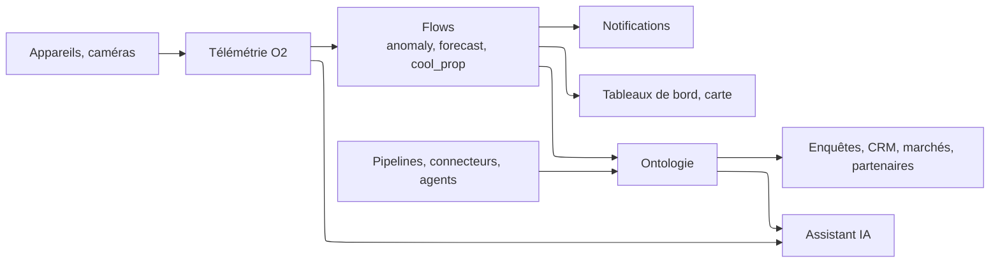

# Cas d'usage — inventaire

| | |
|---|---|
| **Statut** | Inventaire tenu à jour. Il sert de matière à la section « Cas d'usage » du site public et de liste de démos à capturer. |
| **Règle** | Le site public montre seulement un cas **codé**. |

## 1. Résumé

Cette page liste les cas d'usage de PneX par famille, avec leur état et le doc qui les décrit. Les familles du haut viennent des appareils et de la télémétrie. Les familles du bas viennent de l'ontologie et de la collecte. L'état est vérifié dans le code. Le détail de chaque cas vit dans le doc lié.

## 2. Vue d'ensemble

## 3. Inventaire

État : **Codé** = faisable avec les briques livrées. **En partie** = une partie codée, le reste proposé. **Proposé** = PRD seulement.

| Famille | Exemples de cas | État | Doc |
|---|---|---|---|
| Énergie | Suivi par circuit, talon nocturne anormal, délestage, chauffage selon présence, autoconsommation solaire, prévision de consommation | Codé | `edge.md`, `flow-engine.md`, `viz.md` |
| Maintenance conditionnelle | Maintenance augmentée (vedette du site : notification, visite 360°, question à l'assistant), dérive avec date de franchissement, changement de régime, compteur d'heures, courts-cycles, vibrations | Codé | `flow-engine.md` (nœuds `anomaly`, `forecast`), `viz.md`, `ai-assistant.md` |
| Maintenance comparée | Machine qui diffère de ses sœurs, durée de vie résiduelle apprise | Proposé | `roadmap.md` |
| GMAO, pièces | Pièce et documentation d'un appareil, ordres de travail | En partie | `parts-docs.md`, `ontology.md` annexe C |
| Froid, CVC | Chaîne du froid, dégivrage, diagnostic frigorifique (surchauffe, sous-refroidissement), psychrométrie, qualité d'air | Codé | `flow-engine.md` (nœud `cool_prop`), `viz.md` |
| Régulation | Thermostat et PID castés sur la carte | En partie : côté serveur seulement, aucun firmware n'exécute les cartes | `firmware.md` |
| Eau | Fuite au sol avec coupure, fuite lente, niveau de cuve, pression réseau, pompe de relevage | Codé | `edge.md`, `flow-engine.md` |
| Sécurité, sûreté | Présence hors horaires, vidéo sur événement, travailleur isolé, fumée et gaz (pas un dispositif certifié), positions GPS | Codé | `vision.md`, `edge.md`, `viz.md` |
| Agriculture | Serre, arrosage selon le sol et la météo, ruches, gel prévu | Codé | `flow-engine.md`, `edge.md` |
| Bâtiment, commerce | Occupation de salles, carte multi-sites, visite virtuelle, vitrines réfrigérées d'un réseau | Codé | `viz.md`, `media.md` |
| Industrie | Supervision légère d'une ligne, TRS, fuites d'air comprimé, contrôle visuel, envoi vers un SI | Codé | `viz.md`, `vision.md`, `flow-engine.md` |
| Makers | Station météo, domotique sans cloud, petit écran local, fermentation, flash depuis le navigateur | Codé | `firmware.md`, `edge.md` |
| Enquêtes | Dossier sur frise, carte, graphe, vues Histoire et Argent | Codé | `cases.md` |
| Médias | Bibliothèque, transcription, relecture, empreintes vocales | Codé | `media.md` |
| CRM, prospection | Comptes suivis, signaux commerciaux | Codé | `crm.md` |
| Sites des organisations | Trouver et faire valider le site web d'une organisation | Codé | `web-presence.md` |
| Réseau de partenaires | Contrôle d'un réseau d'organismes habilités, preuves datées | Codé | `partners.md` |
| Boîtes mail | Relève IMAP, envoi SMTP, pièces jointes | En partie | `mail.md` |
| Marchés | Recherche et décision d'investissement, sources primaires | En partie | `markets-research.md` |
| Marché du travail | Tension par territoire et métier | En partie | `labor-market.md` |
| Due diligence | Fusion, acquisition, solvabilité sur documents déposés | Proposé | `due-diligence.md` |
| Recherche juridique | Jurisprudence et pratique composables | Proposé | `legal-research.md` |
| Chaîne logicielle | Quoi tourne où, issu de quoi, avec quel risque | Proposé | `software-delivery.md` |

## 4. Reste à faire

- Démo vedette à capturer (scénario `pnex-website/scripts/capture`) : série de roulement qui chauffe sur 3 semaines injectée dans O2, nœuds `forecast` et `pnex_notify`, visite annotée, question à l'assistant.
