# Vision : caméras, modèles, annotations, Vision Lab

## 1. Résumé

Ce document décrit la chaîne vision de PneX dans son état actuel. Une caméra envoie des images au serveur. Le serveur les montre en direct, les enregistre en segments et les passe aux flows. Des nœuds de flow détectent, suivent et décrivent les objets, puis écrivent des événements dans OpenObserve. Les calques d'annotations posent des repères vivants sur un média visuel. Le Vision Lab permet de créer un détecteur sans Python.

La bibliothèque, l'ingestion, les flux, la transcription et la relecture d'un média sont dans `media.md`. Ce document y renvoie et ne les répète pas.

Règle de frontière (P6, D128) : aucun nœud vision ne commande un actionneur. Un nœud vision décrit, compte et alerte. Seul un flow déployé par un humain peut relier une détection à `device_write`.

## 2. Concepts

- **Caméra device** : device qui annonce la capacité `camera` (carte de référence AI-Thinker ESP32-CAM). Une ligne `device_cameras` porte ses réglages.
- **Flux vidéo** : un `media_streams` avec une piste `video` (caméra IP, fichier rejoué). Il publie sur le bus caméra comme un device (D175, `media.md` §3.4).
- **Image** (frame) : un JPEG publié sur le bus caméra Valkey. Un message de flow porte seulement sa référence `frame_key`, jamais les octets.
- **CameraHub** : service du backend qui garde la dernière image de chaque caméra et la diffuse.
- **Demande de capture** : condition qui ouvre l'uplink d'une caméra (`continuous`, live ouvert ou flow déployé).
- **Segment** : morceau d'enregistrement MJPEG-AVI de 60 s par défaut, ligne `video_segments` + blob dans `MediaStore`.
- **Modèle** : détecteur ONNX du registre. Les octets sont un média `kind=model` (D21). La ligne `ml_models` porte la spécification d'inférence.
- **Détection** : un libellé, un score (0–1) et une boîte `[x, y, largeur, hauteur]`.
- **Calque de détection** : boîtes d'un nœud `vision_detect` stockées dans le stream O2 `camera_detections`, sans pixels.
- **Événement** : document JSON écrit par `event_log` dans un stream O2 `ev_<nom>`.
- **Calque d'annotations** : ensemble versionné d'items ancrés sur un média visuel (photo, plan, panorama, splat, visite). Table `annotation_layers`.
- **Item** : un repère d'un calque d'annotations, avec une géométrie et une cible.
- **Projet Lab** : un détecteur à fabriquer, avec ses classes, ses images et ses versions figées.
- **Version figée** : copie en lecture seule des images annotées d'un projet, de leurs boîtes et du split.
- **Source Lab** : le lot d'où vient une image (import, enregistrement, vidéo). Le split se fait par source.

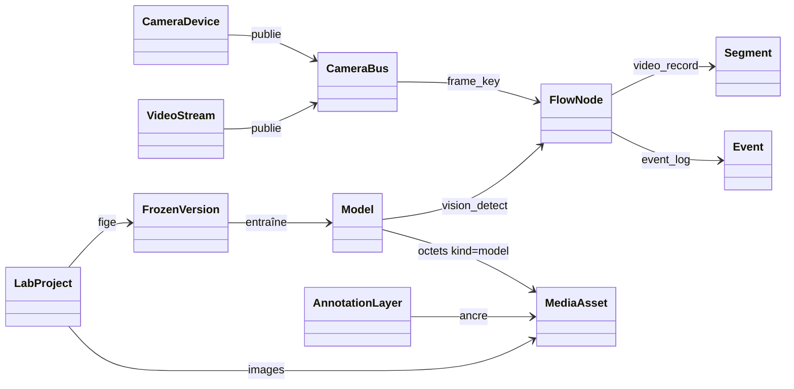

## 3. Fonctionnement

### 3.1 Uplink, live et demande de capture (D73–D77, D102)

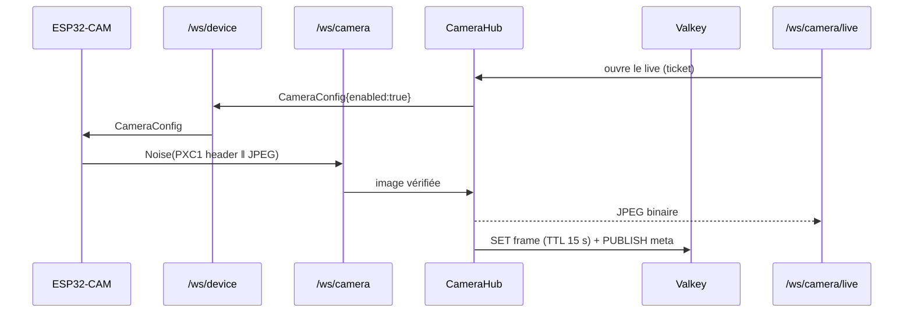

Le device a deux WebSockets. `/ws/device` porte le contrôle (réglages, acks, OTA, pins). `/ws/camera` porte seulement les images, en montée. Les deux utilisent le même jeton (D154) et le même lien Noise (D156). Un registre `CAMERA_SESSIONS` et un claim Valkey refusent un clone (fermeture 4003).

Chaque image a un en-tête `PXC1` de 16 octets (magic, `seq`, `uptime_ms`, `width`, `height`), puis le JPEG. Le serveur vérifie le début `FF D8`. Il refuse une image de plus de 512 Kio (`PNEX_CAMERA_MAX_FRAME_BYTES`). Il jette les images au-delà du fps configuré + 50 %. L'heure de référence est celle du serveur.

Le CameraHub garde la dernière image et un `broadcast` de capacité 4. Un viewer lent perd des images. L'ingestion ne ralentit jamais. Sans Valkey, le live fonctionne et les nœuds caméra signalent `camera_bus_unavailable`.

Le live navigateur ouvre `/ws/camera/live` avec un ticket à usage unique de `POST /api/v1/ws-ticket`. Il reçoit d'abord la dernière image, puis chaque image en JPEG brut. Le module JS `pnexViewers.camera` pose chaque image sur un ``. Il n'y a aucun polling.

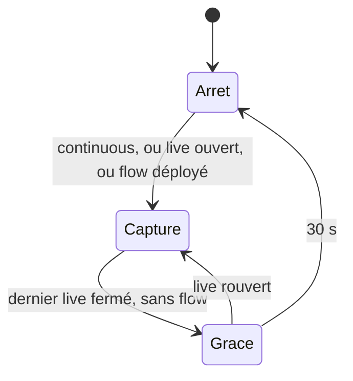

`device_cameras` porte `framesize` (QVGA à UXGA), `quality` (10–63), `fps` (1–25), `capture_mode`, `vflip` et `hmirror`. `on_demand` est le défaut. Le serveur pousse `ServerMsg::CameraConfig` après l'announce, à chaque PATCH et à chaque changement de demande. Le device répond `Ack`. Un `camera_source` d'un flow déployé garde l'uplink ouvert (D102). Le serveur recalcule cette demande au boot et à chaque deploy, stop ou suppression.

Le firmware `generic_esp32cam` utilise le module `pnex_camera` de la lib PneX, avec la table de partitions `min_spiffs.csv`. Le profil board expose seulement GPIO4 (LED flash) et GPIO33 (LED rouge). Le build est décrit dans `firmware.md` §3.3, ses variables dans `firmware.md` §3.4.

### 3.2 Enregistrement (D78, D79, D105)

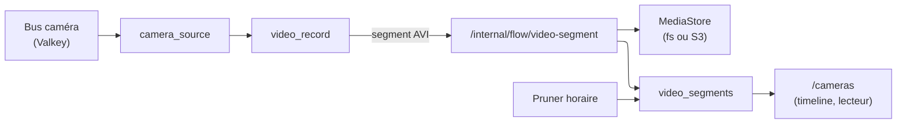

Sans nœud `video_record`, rien n'est stocké. Le live et la vision fonctionnent sans écriture.

`video_record` accumule les images dans un segment AVI MJPEG, écrit en Rust pur, sans transcodage. Il écrit le segment quand une limite est atteinte : `segment_secs` (60), `max_segment_mb` (32) ou `gap_secs` sans image (10). Il a aussi `max_fps`, `retention_days` (0 = sans limite) et `stream`. Le backend écrit le blob et la ligne. Le runtime ne détient aucun secret de stockage. La clé de stockage est `org_{org}/video/{device}/{yyyy}/{mm}/{dd}/{segment}.avi`.

`video_segments` porte `device_registry_id` ou `stream_id` (exactement un), `flow_id`, `node_id`, `stream`, les bornes, les compteurs, `storage_key` et `expires_at`. Le pruner supprime le blob puis la ligne quand `expires_at` est passé. Les octets ne sont jamais en base.

Une caméra a un seul enregistreur dans l'org (D105). La sauvegarde refuse deux enregistreurs dans un flow (`video_record_duplicate`). Le deploy refuse un second flow enregistreur (`camera-already-recorded`). Le redeploy du propriétaire passe.

L'API présente les segments comme un enregistrement continu : timeline du jour, export d'une plage en un seul AVI (256 Mo de source au plus), suppression d'une plage. La page `/cameras` est une table CRUD. Les actions Direct, Enregistrements et Réglages s'ouvrent en modale. Le lecteur enchaîne les segments (×1 à ×8) et superpose les calques de détection cochés (tolérance ±750 ms).

### 3.3 Flux vidéo IP et fichier (D175, D206)

Une caméra IP n'est pas un device. C'est un flux dont `tracks` contient `video` (`media.md` §3.4). Son superviseur publie des JPEG (≤ 1 280 px, 1–5 fps) au format du bus caméra, sous `pnex:media:v1:{org}:{slug}:cam`. `camera_source` choisit sa source (`source: device | stream`). Le deploy refuse un slug inconnu (`camera-stream-unknown`). Les nœuds aval lisent seulement une clé de leur org (SEC-26). La demande de capture ne s'applique pas à un flux. Les calques de détection restent réservés aux devices.

Un fichier de la médiathèque peut aussi être une source (D206). Le flux `media_asset` rejoue le fichier une fois, à vitesse normale, comme un direct. Le flux se désactive à la fin. L'analyse rapide d'un fichier audio est décrite par `media.md` §3.3.

### 3.4 Registre de modèles (D81, D82, D100, D101, D104)

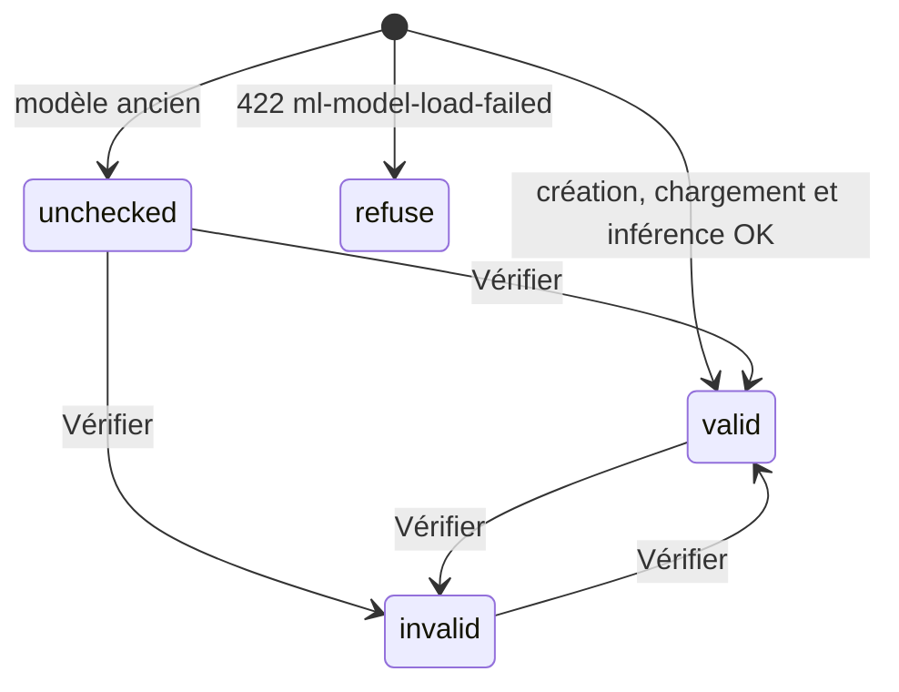

Un modèle est un ONNX de la médiathèque (`kind=model`, versionné). `ml_models` porte `task` (`detection`), `family` (`yolox`), la taille d'entrée, `labels`, `score_threshold` et `nms_iou`. Les modèles de référence sont YOLOX (Apache-2.0). YOLOv8 et YOLOv11 (AGPL) sont exclus.

La crate `pnex-vision` (tract + `image`, pur Rust) fait l'inférence. L'endpoint de test, le Lab et le nœud `vision_detect` l'utilisent. L'inférence tourne sur le serveur.

À l'enregistrement, `pnex_vision::inspect` lit l'entrée et la sortie déclarées. `validate` charge le modèle et exécute une inférence sur une image neutre. L'utilisateur ne saisit jamais ce que le fichier impose :

- une taille fixe du fichier remplace la saisie, et l'UI verrouille le champ ;
- un nombre de labels différent du nombre de classes donne l'erreur de champ `labels` ;
- un échec de chargement donne 422 `ml-model-load-failed` avec le diagnostic tract.

`ml_models` garde `check_status`, `check_error`, `infer_ms` et `checked_at`. La page `/models` affiche le statut, le temps d'inférence et le débit soutenable (≈ 1000 / `infer_ms` images/s). Le deploy refuse un `vision_detect` qui pointe un modèle `invalid` ou supprimé (`vision-model-invalid`).

Le test live (D104) prend la dernière image d'une caméra et exécute le modèle avec un plancher de score de 0,05. Il renvoie l'image, toutes les détections, l'état de la caméra et des avertissements (`camera-offline`, `camera-frame-stale`, `image-too-dark`, `inference-slower-than-camera`…). Le modal affiche en pointillés les boîtes sous le seuil. Un curseur peut appliquer un nouveau seuil au modèle.

### 3.5 Nœuds vision de flow (D83, D103, D192–D197)

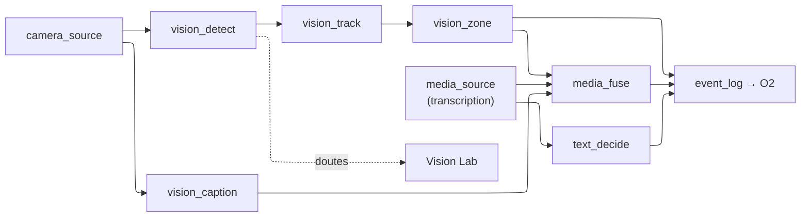

| Nœud | Rôle | Points clés |
|---|---|---|
| `camera_source` | Source d'images, sans inject | `SUBSCRIBE` au canal de la caméra ou du flux ; `max_fps` échantillonne |
| `vision_detect` (D83) | Détections d'un modèle du registre | Octets tirés par `/internal/flow/ml-model/{id}`, cache par sha256 ; filtres `labels`, `min_score` ; `emit: always \| on_detection` ; `record_layer` → `camera_detections` ; `review_project` → file « à revoir » |
| `vision_track` (D192) | Identifiant stable par objet | ByteTrack simplifié en Rust ; événements `appear` / `disappear` |
| `vision_zone` (D193) | Entrée et sortie de zone | Polygones 0–1 sur l'image ; `min_dwell_secs` ; `count` = occupation |
| `vision_caption` (D195) | Légende par le LLM de l'org | Envoie `frame_key` au backend ; au plus une légende par `min_interval_secs` |
| `media_fuse` (D196) | Description sourcée par fenêtre | Fenêtre de 30 s ; une phrase sans source vérifiable est rejetée |
| `text_decide` (D197) | Décision typée calibrée (Laya) | Questions `choice` et `score` ; inférence dans le backend |
| `event_log` (D84) | Événement JSON vers O2 | Stream `ev_<nom>` de l'org |

`vision_track` associe les détections en deux passes : scores forts sur tous les suivis, puis scores faibles sur les suivis restants. L'association est gloutonne par IoU, par classe. Un suivi devient confirmé après `min_hits`. Il disparaît après `lost_after_secs`. Un balayage d'horloge de 1 s émet les disparitions quand la scène est vide. Les défauts visent 1 fps : `high_score` 0,5, `min_iou` 0,2, `min_hits` 2, `lost_after_secs` 3.

`vision_zone` teste un point d'ancrage du cadre (bas-centre par défaut, ou centre). Un nœud porte 1 à 16 zones de 3 à 32 sommets. Une entrée est émise après `min_dwell_secs` de présence. Seule une entrée émise peut sortir. L'éditeur de zones utilise la vue live de la caméra et ne stocke aucune image.

`vision_caption` et `media_fuse` appellent le fournisseur LLM par défaut de l'org (D119). La clé ne quitte jamais le backend (R6). L'appel sort par le client filtré (R8). Câbler `vision_caption` est le choix explicite d'envoyer l'image au fournisseur. Le prompt de `media_fuse` impose une hiérarchie : détections = faits, parole = fiable, légendes = indicatives. Les textes passent comme données délimitées, sans outil. Les deux nœuds partagent un plafond de 2000 appels par org et par jour UTC (`settings.ai.flow_daily_calls`), au-delà 429 `flow-ai-quota`. Toute sortie porte `ai_generated: true` et reste dans PneX (D194).

`text_decide` exécute le checkpoint multilingue de Laya (mmBERT-base, révision épinglée `7b928d82`) par la crate `pnex-decide` (tract). Il ne génère aucun texte. L'admin installe le bundle (`task laya:bundle`, `PNEX_DECIDE_MODEL_DIR`). Sans bundle, la route répond 503 `decide-unavailable`. Le checkpoint n'est pas calibré, et l'UI le dit.

Les nœuds caméra et vision publient un statut de santé (D103) : chargement, prêt, erreur, absence d'image, plus un battement de 10 s avec des compteurs. L'éditeur montre un badge sous le nœud, aussi en mode run. Le dernier statut se lit par `GET /api/v1/flows/{id}/node-status`.

### 3.6 Événements (D84, D85, D86)

`event_log` écrit `payload` et son contexte (`flow`, `node`, `device`, `level`, `ts`) dans le stream O2 `ev_<nom>` de l'org (défaut `ev_events`). La page `/events` cherche en plein texte, par niveau et par période. La rétention est celle d'O2 (D72). Les événements ne vont jamais dans Postgres.

Chaîne type (D85) : `camera_source` (1 fps) → `vision_detect` (person, ≥ 0,6, `on_detection`) → `event_log` + `pnex_notify`. L'anti-spam des notifications s'applique. Le journal des notifications est aussi dans O2 (D86, `notifications.md`).

### 3.7 Calques d'annotations (D55–D60, D128, D131, D147, D219)

Une annotation est toujours ancrée sur un média visuel (D219, `design-system.md` §7). Les détections caméra et l'étiquetage du Vision Lab ne sont pas des annotations.

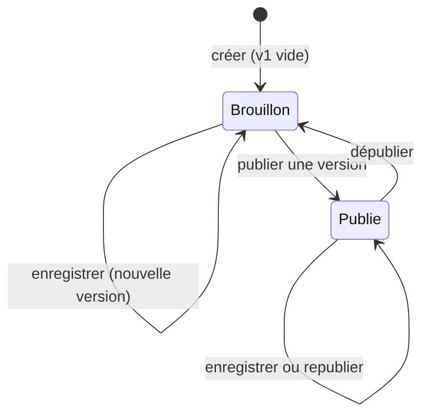

Un calque porte un média (`media_asset_id`) ou une visite (`tour_id`), exclusivement à la création. Ses items s'ancrent toujours sur un média par UUID (D55). Le lien entre visite et calque reste implicite : le viewer compose au rendu. Le schéma des visites ne change pas.

Les versions sont en ajout seul (D56). Enregistrer = PATCH avec `expected_version_number`, sinon 409. Publier = pointer `published_version_id` sur une version. Dépublier = remettre le pointeur à NULL. Les viewers lisent seulement la version publiée.

Une cible est faible (D57) : le device est un slug, la pin un gpio. La résolution se fait à la lecture, en lot. Un device disparu donne `dead: true`, jamais une erreur.

| `kind` | Cible | Rendu |
|---|---|---|
| `device`, `status` | `device_id` | Libellé, état de connexion |
| `pin` | `device_id`, `pin_gpio` | Dernière valeur (poll 15 s, D31) |
| `note` | `text` | Texte |
| `control` (D128, D131) | `control_id`, ou `kind` qui déclare une source | Carte de contrôle ; l'écriture porte `via = annotation:{layer_id}` |
| `reading` (D129) | `SourceRef` + `display` (`stat`, `line`, `gauge`, `indicator`) | Mini-graphe ; jamais `line` sur une valeur mémoire |

Les géométries sont `equirect` (yaw, pitch) pour un panorama, `flat` (x, y dans [0, 1]) pour une photo ou un plan, et `splat` (x, y, z monde) pour un splat (D147). `validate_annotation_doc` contrôle les bornes, les doublons, la couleur et l'accord entre kind et cible. Le backend vérifie le média et son kind.

L'édition vit seulement dans Data > Annotations (`/annotations`, D147). Le Studio, la carte et les dashboards montrent les annotations en lecture. La bibliothèque montre le média brut, sans annotations. Le viewer de lecture unique est `AnnotatedMediaView`. Il bascule entre trois états : Masquer, Pastilles, Cartes. Les items `control` et `reading` s'affichent en cartes ancrées à côté de leur marqueur.

Le contexte de lecture est séparé. `GET /api/v1/media/{id}/annotations` renvoie les calques du média. Avec `?tour={id}`, il renvoie seulement les calques de cette visite. Le partage public n'affiche aucune annotation.

Pièges verrouillés :

- un marqueur ou une carte ne porte jamais `.pnex-hotspot`, sinon le drag de navigation se décale ;
- le viewer applique les annotations après le montage (`setAnnotations`), jamais par un remontage ;
- les globals du pont JS (`__pnexAnnot*`) transportent une chaîne JSON brute avec un `seq` croissant ;
- le conteneur d'overlay est `pointer-events: none`, la carte `auto` ;
- sur un splat, il n'y a pas de test d'occlusion, et `.ksplat` / `.spz` n'ont pas de viewer.

### 3.8 Vision Lab (D198–D205)

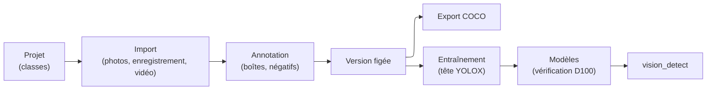

Un projet a des classes positionnelles (D198). Une boîte référence l'index de sa classe. On peut renommer une classe ou en ajouter à la fin. On peut retirer seulement les dernières classes, et seulement sans boîte (409 `lab-class-in-use`). Les images sont des médias de la bibliothèque, jamais copiés. Une image porte au plus 200 boîtes normalisées 0–1, ou la marque « sans objet ». L'enregistrement est optimiste (409 `lab-annotations-conflict`).

Le split se fait par source, jamais image par image. Deux images presque identiques d'une même vidéo restent du même côté. Un hachage FNV-1a stable met ≈ 20 % des sources en validation. L'utilisateur peut forcer une image. Les avertissements sont indicatifs : moins de 20 images par classe, moins de 5 images de validation, aucun négatif.

Imports :

- **Photos** : sélection multiple dans la bibliothèque. Un import = une source.
- **Enregistrement** (D202) : une image toutes les N s d'une caméra enregistrée, sans décodage. Bornes : 1 h, 200 images, 0,5–600 s.
- **Vidéo** (D203) : MP4 ou MOV de la bibliothèque, décodé par le décodeur confiné de `media.md`. Mêmes bornes, fichier ≤ 512 Mo. Un `moov` en fin de fichier est remis en tête en mémoire. Toutes les images d'une vidéo partagent la source `video-<asset>`.

Chaque image tirée d'une vidéo ou d'un enregistrement garde sa position `frame_ms`. Trois aides proposent des boîtes sans rien écrire :

- **Pré-annotation** (D201) : un modèle du registre propose des boîtes. Un libellé égal à un nom de classe prend cette classe.
- **Interpolation** (D203) : boîtes déplacées en ligne droite entre l'image annotée précédente et la suivante de la même source.
- **Propagation** (D205) : pré-annotation, puis chaque proposition prend la classe de la boîte la plus recouvrante (IoU ≥ 0,3) de l'image annotée précédente.

Une version figée (D199) fige les images annotées, leurs boîtes, le split et la version média de chaque image. L'export COCO (D200) produit un zip (≤ 3000 images).

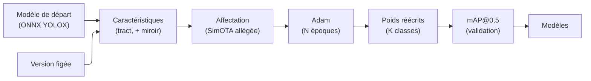

L'entraînement (D204) ne réapprend que la tête d'un modèle YOLOX déjà enregistré. Le corps du réseau reste figé. Les caractéristiques sont calculées une fois par image, ce qui rend le calcul possible sur CPU. L'ONNX produit passe la vérification D100 et entre dans Modèles avec les classes du projet comme labels. Le serveur exécute un entraînement à la fois, les suivants attendent. Un battement toutes les 10 s prouve la vie. Sans battement depuis 60 s, le run passe `lab-train-interrupted`. L'utilisateur peut annuler. L'époque par défaut est 30, au plus 300.

**Attention :** l'entraînement de la tête seule est moins précis qu'un entraînement complet pour des objets très éloignés de COCO. Compenser par des images variées et plus d'époques.

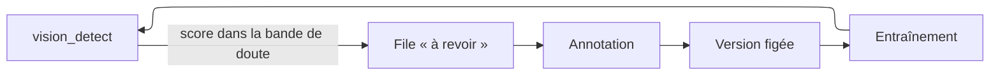

La file « à revoir » (D205) reçoit une image de production quand un score tombe dans la bande `review_min`–`review_max` (0,25–0,6). Le nœud envoie au plus une image par caméra toutes les `review_every_secs` (60 s), par référence, à `/internal/flow/lab-review`. Le backend relit l'image sur le bus et l'ajoute avec les propositions du modèle. Un projet garde au plus 500 images en attente (429 `lab-review-full`). Une image quitte la file dès qu'elle a des boîtes ou la marque « sans objet ».

Le guidage de diversité signale ce qui manque pour généraliser : `lab-warn-class-sources` (< 3 sources), `lab-warn-class-same-size`, `lab-warn-class-same-place`, `lab-warn-light-uniform` (luminance `luma` mesurée à l'import).

### 3.9 Rapports écrits par un flow (D207–D210)

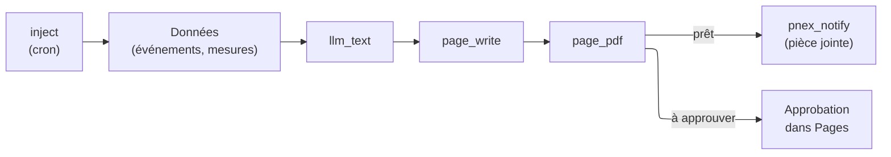

Un rapport est une page (`pages.md`), écrite par un flow et exportée en PDF. Il n'y a pas de studio de rapports. Chaque nœud ne fait qu'une chose et sert ailleurs.

- `llm_text` (D208) envoie une consigne et des données au LLM de l'org, comme données délimitées. Il compte dans le plafond de 2000 appels par jour.
- `page_write` (D209) écrit du Markdown dans une page et crée une version nommée « écrite par un flow ».
- `page_pdf` (D209) rend une version en PDF A4 (crate `pnex-pdf` : krilla + harfrust, police DejaVu Sans) et le range dans la médiathèque.
- `pnex_notify` joint le PDF par `attach_field`. Seul le canal SMTP joint le fichier.

Une version qui contient du texte IA doit être approuvée par un humain avant l'envoi (D210). L'utilisateur peut décocher « Approbation requise ». Le PDF porte alors « non relu ». Le runtime lit par `/internal/flow/media/{id}` seulement les PDF exportés par `page_pdf` de la même org.

### 3.10 Nœuds prédictifs (`anomaly`, `forecast`)

Ces nœuds de télémétrie viennent du même pilier ML (crate `pnex-node-predict`, contrat `pnex_core::predictive`, augurs). Chaque `msg.topic` est une série numérique. La fenêtre glissante (64 séries au plus par nœud) est persistée dans Valkey (`pnex:series:v1:{org}:{flow}:{node}:{topic}`, TTL 30 j). Un redéploiement garde donc l'historique.

- `anomaly` : méthodes `robust_z` (défaut), `forecast_band` ou `changepoint` (BOCPD maison). Port 0 = détail, port 1 = booléen pour une notification.
- `forecast` : méthodes `ets` ou `linear`. Avec un seuil, le nœud donne le délai de franchissement. Ports : détail, booléen, secondes avant franchissement.

## 4. Exigences

1. Les octets d'une image ne doivent jamais traverser le JSON du moteur de flows. Un message porte `frame_key`.
2. Un nœud de flow doit lire seulement une clé de bus de son org.
3. Sans nœud `video_record`, le serveur ne doit rien stocker.
4. Une caméra doit avoir au plus un enregistreur déployé dans l'org.
5. Les octets vidéo ne doivent jamais être en base.
6. Les événements doivent aller dans O2, jamais dans Postgres.
7. Le registre doit refuser un modèle qui ne charge pas ou ne s'exécute pas.
8. Le deploy doit refuser un `vision_detect` qui pointe un modèle `invalid` ou supprimé.
9. Aucun nœud vision ne doit émettre de commande vers un device (D128).
10. Les appels LLM des nœuds doivent utiliser le fournisseur de l'org, par le client filtré R8.
11. Une phrase de `media_fuse` sans source de la fenêtre doit être rejetée.
12. Une sortie IA doit porter `ai_generated: true` et ne doit pas sortir de PneX sans version approuvée, sauf choix explicite (D210).
13. Une annotation doit être ancrée sur un média visuel.
14. Un viewer d'annotations doit lire seulement la version publiée.
15. Le split du Lab doit se faire par source.
16. Un modèle entraîné doit passer la vérification D100 avant d'entrer au registre.
17. Toute écriture (Lab, calques, modèles) doit passer par `OrgContext`. Un lecteur reçoit 403 (R2).
18. Le Lab et la vision ne doivent dépendre d'aucun Python.

## 5. Décisions

| Dn | Titre | Décidé |
|---|---|---|
| D55 | Domaine autonome, ancre = média | Les items s'ancrent sur `media_asset_id`, jamais sur une scène ni une visite. Pas de duplication de calques. |
| D56 | Versions en ajout seul, activation = publication | `published_version_id` est un pointeur. Pas de restauration, pas de `is_active`. |
| D57 | Cibles faibles, résolues à la lecture | Slug et gpio ; référence morte = `dead: true`. |
| D58 | Rendu en overlay non bloquant | Hotspots pannellum à classes disjointes, valeurs live en poll 15 s, partage public sans annotations. |
| D59 | Édition dans la visite | Remplacée par D147 : édition dans Data > Annotations seulement. |
| D60 | Portes ouvertes | Toutes fermées : inputs (D128), splat (D147), page `/annotations`, labels (`KIND_ANNOTATION_LAYER`). Overlay de la bibliothèque écarté. |
| D73 | Canal vidéo dédié `/ws/camera` | Uplink binaire, même jeton que `/ws/device` ; lien Noise depuis D156. |
| D74 | CameraHub + bus Valkey | Live en mémoire ; image en `SET` TTL 15 s + `PUBLISH` des métadonnées. |
| D75 | Live navigateur `/ws/camera/live` | JPEG binaire poussé, ticket à usage unique, aucun polling. |
| D76 | Demande de capture | `continuous` ou `on_demand` ; grâce de 30 s. |
| D77 | Firmware `generic_esp32cam` | AI-Thinker ESP32-CAM, module `pnex_camera`, `min_spiffs.csv`. |
| D78 | Enregistrement dans le flow | `camera_source` + `video_record`, segments MJPEG-AVI écrits par le backend. |
| D79 | `video_segments` + rétention | Pruner horaire sur `expires_at`. |
| D80 | Page `/cameras` | Table CRUD, live, réglages, enregistrements. |
| D81 | Registre = média `kind=model` + `ml_models` | YOLOX Apache-2.0 ; AGPL exclu. |
| D82 | Inférence par `pnex-vision` (tract) | Sur le serveur ; Burn reste un challenger non mesuré. |
| D83 | Nœud `vision_detect` | Filtres, `emit`, cache par sha256. L'option `snapshot` n'est pas codée. |
| D84 | Événements JSON → O2 | Nœud `event_log`, page `/events`. |
| D85 | Détections → événements → notifications | Chaîne type avec anti-spam. |
| D86 | Journal des notifications → O2 | Détail dans `notifications.md`. |
| D100 | Modèle vérifié à l'enregistrement | `inspect` + `validate`, taille imposée par le fichier, `check_status`. |
| D101 | Limites affichées et garde de deploy | Débit soutenable, `vision-model-invalid`. |
| D102 | Un flow déployé réveille la caméra | Demande = `continuous` ∨ live ∨ flow. |
| D103 | Statuts des nœuds caméra et vision | Santé visible en mode run. |
| D104 | Test live sur `/models` | Dernière image, plancher 0,05, avertissements machine. |
| D105 | Un enregistreur par caméra, N calques de détection | Calques en O2 `camera_detections`, cadres seuls. |
| D147 | Mini-dashboards, splat, édition centralisée | Édition dans Data > Annotations, cartes ancrées, contextes de lecture séparés. |
| D192 | `vision_track` | ByteTrack simplifié, glouton, en Rust. |
| D193 | `vision_zone` | Polygones 0–1, ancrage bas-centre, `count`. |
| D194 | Sorties IA en usage interne | Autorisées dans PneX, marquées IA, jamais publiées dehors. |
| D195 | `vision_caption` | Référence d'image, LLM de l'org, `min_interval_secs`. |
| D196 | `media_fuse` | Fenêtre sourcée, plafond commun de 2000 appels par jour. |
| D197 | `text_decide` (Laya) | tract suffit ; checkpoint multilingue épinglé ; inférence dans le backend. |
| D198 | Projets et annotation du Lab | Classes positionnelles, split par source, concurrence optimiste. |
| D199 | Versions figées | `lab_dataset_versions` en ajout seul, version média figée. |
| D200 | Export COCO | Zip en mémoire ; l'entraînement Python prévu ici est remplacé par D204. |
| D201 | Pré-annotation | Propositions sans écriture. |
| D202 | Images d'un enregistrement | Une image toutes les N s, sans décodage. |
| D203 | Vidéos et interpolation | Décodeur confiné, `frame_ms`, interpolation linéaire. |
| D204 | Entraînement sans Python | Tête YOLOX réapprise en Rust, dans le process API. |
| D205 | Boucle d'amélioration | File « à revoir », propagation, guidage de diversité. |
| D206 | Fichier comme source de flux | Flux `media_asset` rejoué à vitesse normale. |
| D207 | Rapports = pages + nœuds génériques | Pas de studio ; D173 rouverte étroitement. |
| D208 | `llm_text` | Consigne + données délimitées, sans outil. |
| D209 | `page_write` et `page_pdf` | Version nommée, PDF krilla, pièce jointe SMTP. |
| D210 | Approbation par défaut | Un texte IA part après approbation, sinon « non relu ». |
| D211 | Analyse d'un fichier | Remplacée par les analyses de `media.md` §3.3 (D212–D215). |

Questions Q1–Q15 du Media & Vision Studio, tranchées le 2026-10-13 :

- « poste » = poste de travail (zones + classes du Lab), pas la pose humaine ;
- tract reste le seul runtime ; `ort` seulement si un bench chiffré le justifie ;
- aucun VLM livré ni imposé ;
- détection → `device_write` régie par D128, sans porte de deploy propre à la vision ;
- `text_decide` en production : précision ≥ 80 % sur le jeu de l'org et ECE ≤ 0,10 après calibration ; INT8 obligatoire sur Pi.

## 6. Interfaces

### 6.1 Routes

| Route | Effet |
|---|---|
| `GET /ws/camera` | Uplink caméra du device (Noise, binaire) |
| `GET /ws/camera/live?ticket=&device=` | Live navigateur |
| `GET /api/v1/cameras` · `PATCH /api/v1/cameras/{device}/settings` | Caméras et réglages |
| `GET /api/v1/cameras/segments[/{id}[/content]]` · `DELETE …/segments/{id}` | Segments |
| `GET\|DELETE /api/v1/cameras/{device}/recordings` · `…/export` · `…/layers` · `…/annotations` | Enregistrement continu et calques |
| `GET\|POST /api/v1/ml/models` · `GET /api/v1/ml/models/inspect` · `GET\|PATCH\|DELETE …/{id}` | Registre de modèles |
| `POST /api/v1/ml/models/{id}/test` · `…/check` · `…/test-live` | Tests et vérification |
| `GET /api/v1/events` · `GET /api/v1/events/streams` | Événements O2 |
| `/api/v1/annotation-layers` (`GET`, `POST`, `GET\|PATCH\|DELETE /{id}`, `/versions[/{n}]`, `/publish`, `/unpublish`) | Calques d'annotations |
| `GET /api/v1/media/{id}/annotations[?tour=]` | Lecture des calques publiés |
| `/api/v1/lab/projects[/{id}]`, `/images`, `/stats`, `/import-recording`, `/import-video`, `/versions`, `/runs` | Projets du Lab |
| `/api/v1/lab/images/{id}` (`DELETE`, `/annotations`, `/suggest`, `/interpolate`, `/propagate`) | Images du Lab |
| `/api/v1/lab/versions/{id}/export` · `/train` · `POST /api/v1/lab/runs/{id}/cancel` | Versions et entraînement |
| `/internal/flow/video-segment`, `/video-annotations`, `/ml-model/{id}[/content]`, `/lab-review`, `/ai/{caption,fuse,decide,text}`, `/page-write`, `/page-pdf`, `/media/{id}` | Routes internes du runtime (jeton de service + fencing D106) |

Pages du front : `/cameras`, `/models`, `/events`, `/annotations`, `/lab`, `/lab/:id`.

### 6.2 Données

| Donnée | Lieu |
|---|---|
| `device_cameras`, `video_segments`, `ml_models` | Postgres |
| `annotation_layers`, `annotation_layer_versions` (doc `pnex_core::AnnotationDoc`) | Postgres |
| `lab_projects`, `lab_images`, `lab_dataset_versions`, `lab_training_runs` | Postgres |
| `doc_version_exports`, colonnes IA de `doc_versions` | Postgres |
| Blobs de segments, modèles, images du Lab, PDF | `MediaStore` (fs ou S3) |
| Images : `pnex:cam:v1:{org}:{device}:f:{seq}` (TTL 15 s) + canal `pnex:cam:v1:{org}:{device}` | Valkey |
| Images d'un flux : `pnex:media:v1:{org}:{slug}:cam[:f:{seq}]` | Valkey |
| `ev_<nom>`, `camera_detections` | OpenObserve |

### 6.3 Configuration

| Variable | Rôle |
|---|---|
| `PNEX_CAMERA_MAX_FRAME_BYTES` | Taille max d'une image (512 Kio) |
| `VALKEY_URL`, `PNEX_FLOW_RUNTIME_TOKEN` | Bus caméra et jeton du runtime ; sans eux, les nœuds caméra échouent au deploy |
| `PNEX_DECIDE_MODEL_DIR` (`settings.decide.model_dir`) | Bundle Laya de `text_decide` |
| `settings.ai.flow_daily_calls` | Plafond quotidien d'appels IA des nœuds (2000) |

Tests : `cargo test -p pnex-backend --test ws_camera --test ml_models --test events --test lab --test annotation_layers`. Les tests avec un vrai YOLOX lisent `PNEX_VISION_TEST_DIR`. Les tests du runtime `camera_record`, `vision_detect`, `vision_zone` et `vision_ai` demandent Valkey.

## 7. Reste à faire

- Option `snapshot` de `vision_detect` (image annotée écrite en média) : non codée.
- Essai de `vision_track`, `vision_zone`, `vision_caption` et `media_fuse` sur une caméra réelle et avec un vrai fournisseur LLM.
- `text_decide` : POC de calibration et de fine-tuning sur ~200 fenêtres réelles, mesure sur Pi 5.
- INT8 : tract exécute les opérateurs quantifiés, mais un gain demande une quantification statique avec calibration. À décider par Shan après une mesure sur Pi 5.
- Calque de zones sur les enregistrements de `/cameras` : à décider par Shan.
- Rétention du stream `camera_detections` : elle suit O2 (D72), pas celle des segments. Choix à confirmer par Shan.
- `vision_track` : l'appariement glouton peut échanger des identifiants dans une foule. Le hongrois reste à évaluer si le cas arrive.
- Nœuds prédictifs : anomalie multi-séries (« quelle pompe sur 10 dérive »).
- Hors périmètre : reconnaissance faciale, identification de personnes, pose humaine, segmentation d'instances, inférence sur l'ESP32.
