# Visualisation : carte, tableaux de bord, contrôles, agrégats, parcours de visite

## 1. Résumé

Ce document décrit les surfaces de visualisation de PneX dans leur état actuel. La carte montre les sites (POI) de l'org, leurs devices et leurs positions GPS. Les tableaux de bord composent des widgets au format PC ou mobile. Les contrôles d'org portent les commandes posées sur une surface. Les calculs sur des objets donnent des nombres et des répartitions à ces widgets. Le Studio crée des parcours de visite en panoramas 360.

Règle de frontière (D123, D128) : **une surface lit, un flow agit.** Une surface n'envoie jamais de commande à un device. Seul un flow déployé par un humain agit sur un device. L'assistant n'agit jamais physiquement : il n'écrit aucune valeur de contrôle (D143).

Documents liés, non répétés ici :

- `design-system.md` : lexique (§7), mode sombre (§3), coquille d'éditeur ;
- `geo-layers.md` : couches géographiques et fournisseurs géo (fond de carte, geocoding) ;
- `vision.md` §3.7 : calques d'annotations, qui sont aussi des surfaces ;
- `app-builder.md` : écrans d'application, construits sur le moteur des tableaux de bord.

## 2. Concepts

- **Site** (POI, table `map_pins`) : un lieu de la carte, avec un emoji, un libellé et une localisation libre. À l'écran : « Site / repère ».
- **Placement** (`device_placements`) : le rattachement d'un device à un site. Un device a au plus un placement.
- **Position GPS** (`device_positions`) : la dernière position connue d'un device.
- **Tableau de bord** (`dashboards`) : document versionné de widgets, au format `desktop` ou `mobile`.
- **Widget** : un élément d'un tableau de bord. Il lit une ou plusieurs sources et peut piloter un contrôle.
- **Source** (`SourceRef`) : liaison de lecture d'un widget. Elle vise une série de télémétrie, une clé de mémoire d'org, une propriété d'objet ou un calcul sur des objets.
- **Surface** : tout ce que l'utilisateur regarde et manipule : tableau de bord, calque d'annotations, écran d'application.
- **Contrôle** (contrôle d'org, `controls`) : une valeur commandée par un humain, partagée par toutes les surfaces. Il n'est jamais lié à un pin.
- **Carte maison** (`home_card`) : un widget composé de plusieurs contrôles et sources nommés par rôle.
- **Modèle de widget** (`viz_widget_library`) : un widget enregistré dans la bibliothèque de l'org, copié quand on le pose.
- **Calcul sur des objets** : un compte, une somme ou une répartition sur les objets d'une requête d'ontologie (D579).
- **Parcours** (`tours`) : une visite faite d'étages, de scènes panoramiques et de liens entre scènes.
- **Scène** : un panorama 360 posé sur le plan d'un étage du parcours.

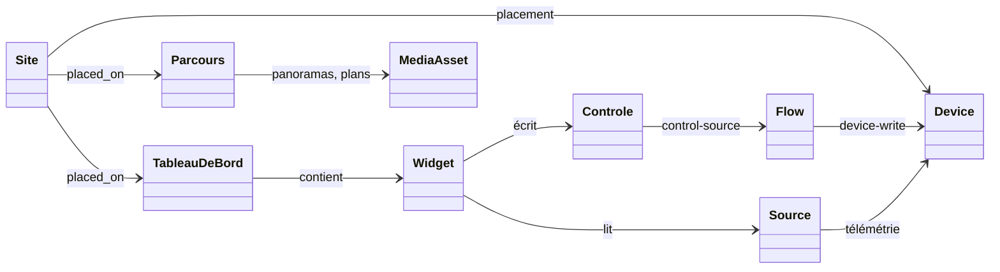

## 3. Fonctionnement

### 3.1 Carte et sites (D27, D35–D39, D42, D43)

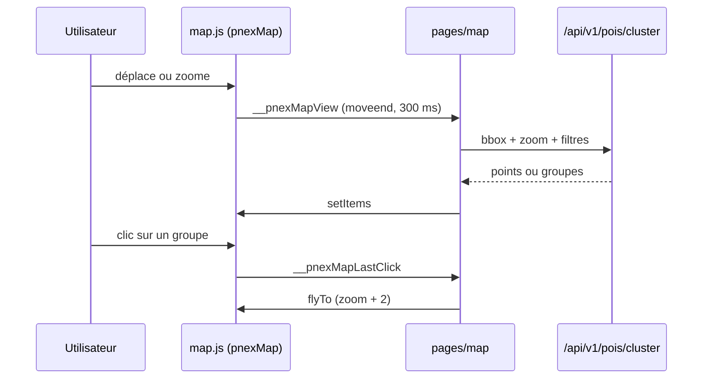

Le site est l'objet primaire de la carte (D35). Il n'y a ni bâtiment ni étage en base. La carte utilise maplibre-gl 6.x dans un bundle esbuild (`js/map.js`). Le fond de carte vient du fournisseur géo par défaut de l'org (`geo-layers.md`). Chaque élément est un marqueur HTML, pour garder l'emoji en couleur.

Le serveur groupe les sites (D37). Avec 200 sites ou moins dans la vue, il rend chaque point. Au-delà, il rend des groupes numérotés, 500 au plus. La page `/map` a une barre latérale de recherche et de filtres, un bouton d'ajout et un tiroir de détail. La page `/sites` montre le même arbre sans carte.

Un site porte plusieurs devices (D43). Attacher un device déjà placé répond 409 avec son site actuel. L'utilisateur confirme, puis l'UI déplace le placement. Détacher supprime le placement. Les médias, les tableaux de bord et les parcours s'attachent par une arête `placed_on` de la couche d'organisation (D42, `resource_edges`).

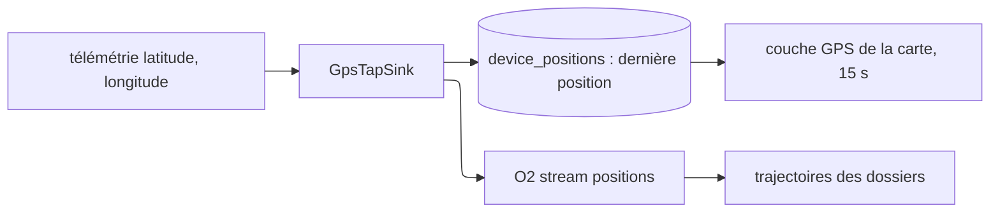

La position GPS suit une convention de télémétrie (D38) : `latitude` et `longitude` en degrés WGS84, plus des `gps_*` facultatifs. Le tap ne bloque jamais la télémétrie. Une file pleine perd la position.

### 3.2 Tableaux de bord (D24, D31, D34, D40, D41, D123, D124)

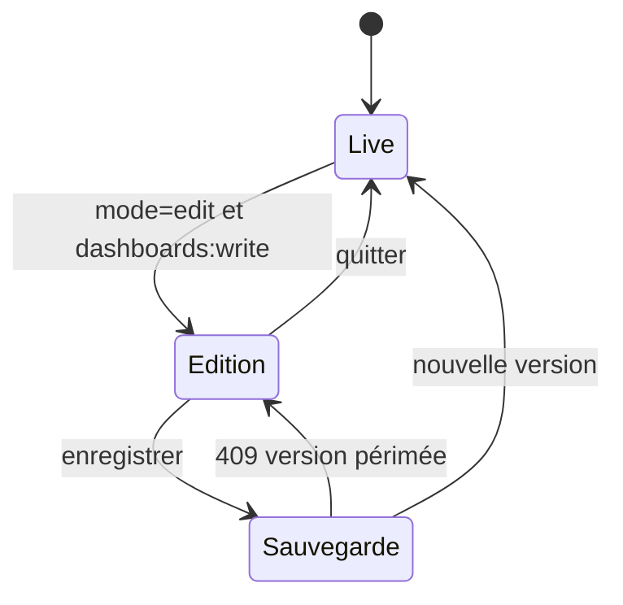

Un tableau de bord est un document versionné en ajout seul (D24). Enregistrer envoie `expected_version_number`. Une version périmée donne 409. La nouvelle version est tout de suite visible. Restaurer une version déplace le pointeur `current_version_number` vers elle.

En mode live, la page lit les valeurs toutes les 15 s par `POST /api/v1/telemetry/series/query` (D31). Le serveur ne stocke jamais les séries. Un élément indisponible rend `available:false` et seul son widget passe en gris. En mode édition, la lecture s'arrête et l'aperçu reste figé (D34). Un membre sans `dashboards:write` reste en live.

Le format est fixé à la création (D123, D132). Le format `desktop` est un canevas libre en pixels, avec des traits visuels entre widgets (D40). Le format `mobile` empile des cartes en sections, sur 2 colonnes (D124). Il ignore `x/y/w/h` et refuse les traits (`mobile_wires_forbidden`). Changer le format au save donne `format_immutable`.

La bibliothèque de widgets est propre à l'org et n'a pas de versions (D41). Poser un modèle copie le widget. Modifier ou supprimer le modèle ne change aucun tableau de bord.

Un tableau de bord peut aussi être un écran d'application (`app_id`, D507) ou la vue d'un type d'objet (`object_type`, D187).

### 3.3 Contrôles et frontière physique (D125–D133)

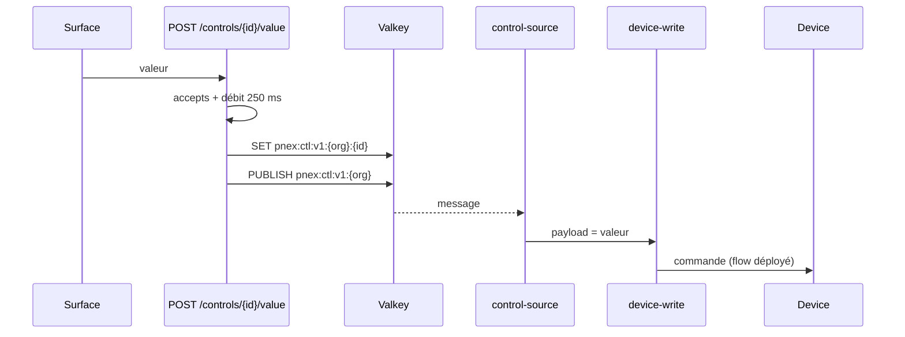

Écrire un contrôle stocke et publie une valeur (D126). Le serveur ne touche jamais un device. La valeur n'a pas de TTL : la dernière commande persiste. Chaque écriture va au stream O2 `ev_controls` : qui, quand, quelle valeur, depuis quelle surface (`via`). Deux écritures sur un contrôle à moins de 250 ms donnent 429 `control-rate-limited`. Un curseur écrit au relâchement.

Le nœud `pnex-control-source` (D127, D133) s'abonne au canal de l'org. Il a un port de sortie par contrôle et aucune entrée. Avec `emit_on_start`, il relit les valeurs courantes au démarrage. Un nœud sans contrôle s'enregistre en brouillon, mais son deploy est refusé (`control_source_empty`). Le deploy refuse aussi un contrôle inconnu (`control-unknown`).

Huit types de contrôle existent : `switch`, `slider`, `button`, `number`, `select`, `stepper`, `command`, `color` (D125, D137). `ControlSpec::accepts` est la seule validation, partagée entre le navigateur et le serveur. La valeur reste un nombre. Une option de `select` ou `command` ajoute sa clé dans `msg.control.option`.

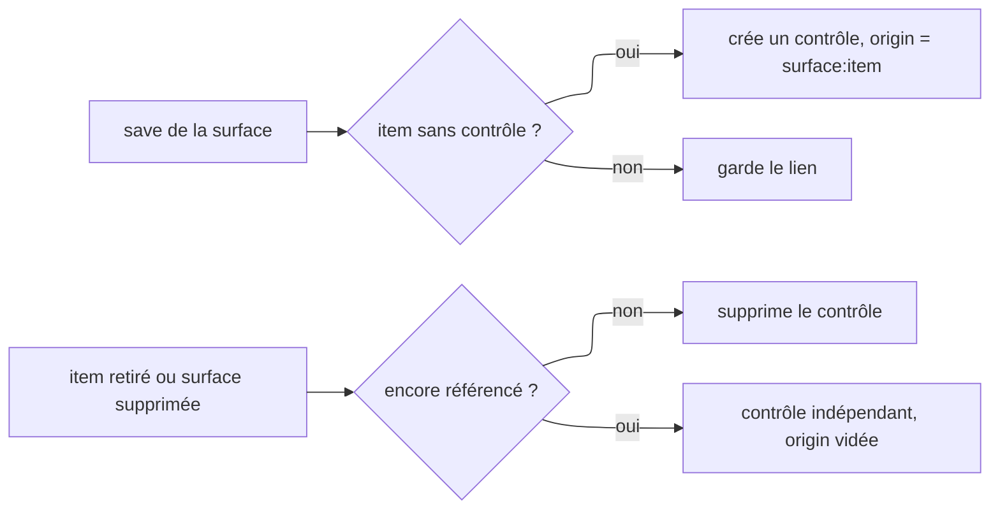

La surface déclare et le serveur enregistre (D131). Dans la transaction du save, chaque widget de contrôle reçoit son contrôle. Sa clé est stable (`dash-<8 hex>.w-0001`, `annot-<8 hex>.<item>`). Lier un contrôle existant reste possible, pour partager un état entre surfaces. Un flow déployé qui écoute un contrôle empêche sa suppression (409 `control-in-use`). Un contrôle qu'aucun flow déployé n'écoute porte le badge « sans effet ».

Une carte de contrôle peut lire une source d'état (`source[0]`, rôle `state`). Elle montre alors l'état réel sous la valeur commandée (D129).

**Frontière physique.** Aucune surface ne référence l'API de commande device, d'OTA ou de flash. Aucun service de surface ne référence le bus device. Deux gardes bloquantes le vérifient :

- `crates/pnex-frontend/src/surface_guard.rs` (surfaces, éditeurs, cartes maison) ;
- `crates/pnex-backend/tests/surface_device_guard.rs` (services de surface).

L'action manuelle d'un pin depuis la page Pins (D17) reste un outil de prototypage, hors surfaces. L'assistant peut lire et modifier un tableau de bord par `services::dashboards`. Il ne peut pas retirer, relier ou renommer un widget dont le contrôle alimente un flow déployé (`ai-flow-running`, D144).

### 3.4 Tableaux de bord maison (D134–D141)

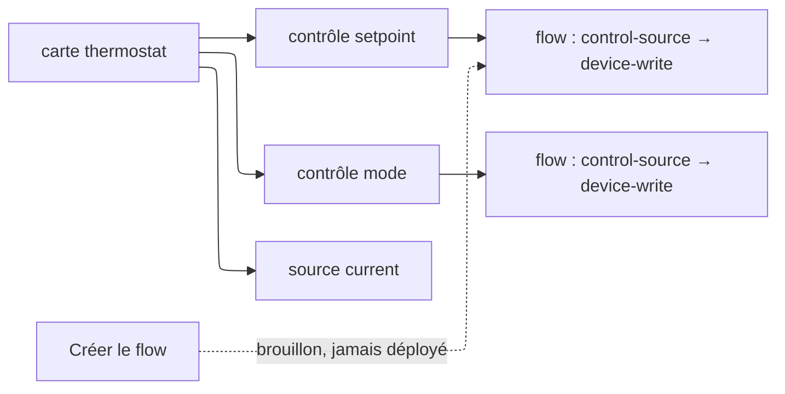

Une carte maison est un widget `home_card` (D138). Elle déclare des rôles de contrôle et de source. Le save crée un contrôle par rôle actif (clé `…w-0001.setpoint`, libellé « Titre · rôle »). Un rôle optionnel est actif quand son domaine est déclaré. Le catalogue a 18 cartes (`pnex_core::home`) : éclairage, climat, ouvrants, sécurité, énergie, environnement, scènes, appareils, horloge, météo.

Les règles d'état sont communes (D135). Une règle `states` associe une valeur à une couleur, une icône et un libellé. Une valeur plus vieille que `stale_after_s` grise la carte. La palette range les widgets par groupe (D134). Les icônes maison sont des dessins originaux de PneX (D136).

Le format mobile a des pages, 12 au plus (D139). Une section peut être une pièce : elle affiche une moyenne de température, le nombre de lumières allumées, la puissance totale et un bouton « Tout éteindre ». Ce bouton demande une confirmation, puis écrit la valeur « off » de chaque contrôle `power` de la pièce. Une section « pastilles » montre des résumés courts. Un bouton détail ouvre la carte et la courbe 24 h de ses sources. La grille a 2, 4 ou 6 colonnes selon la largeur. `visible_when` masque une carte selon une règle d'état.

Les accélérateurs (D141) proposent des modèles de tableaux de bord : Maison, Énergie, Sécurité, Jardin et piscine. Une source d'un modèle peut rester non configurée (`SourceRef::is_unset`) : la carte affiche « À configurer ». « Depuis un device » propose une carte selon le pin ou la métrique. « Créer le flow » crée un brouillon `control-source` → `device-write`. Il ne le déploie jamais.

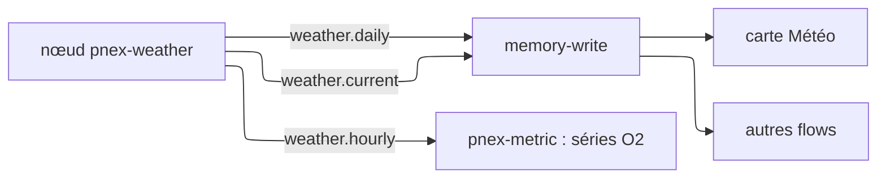

La météo est une donnée d'org (D140). Le nœud `pnex-weather` est une source temporisée, à 10 min au moins. Le serveur construit l'URL du fournisseur à partir d'une liste blanche (R8). MET Norway est le fournisseur par défaut. Open-Meteo est proposé avec sa mention de licence. `pnex-metric` écrit une série par champ numérique d'un objet.

### 3.5 Calculs sur des objets (D579–D588)

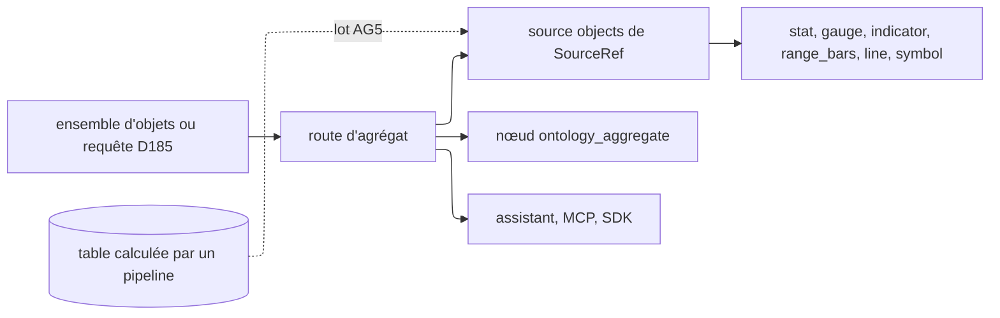

Le calcul vit dans la couche d'ontologie. L'affichage reste dans les widgets existants. `POST /api/v1/ontology/aggregate/query` prend la requête D185 plus `group_by`, `metrics` et `limit` (D579). Le SQL réutilise le plan de `query::run` : mêmes filtres et mêmes masques.

Les métriques forment une liste fermée (D580) : `count`, `count_distinct`, `sum`, `avg`, `min`, `max`, plus un `where` et un ratio. Un ratio sur un dénominateur nul rend une valeur absente. Une somme de monnaie garde une valeur par devise. Un widget à valeur unique affiche « plusieurs devises ».

La répartition se fait par propriété, par période UTC ou par lien, 2 sauts au plus (D581). Un objet sans valeur forme le groupe `key = null`. Un objet lié à deux cibles compte dans les deux groupes. La somme des groupes peut donc dépasser le total.

**Danger :** un calcul peut révéler une valeur masquée. La route refuse donc toute propriété ou tout lien que l'appelant ne peut pas lire (403 `access-denied`, D582). De très petits groupes peuvent encore identifier une personne.

Un widget lit le calcul par `SourceRef.objects` (D583). Dans un écran d'application, `object_set` nomme un ensemble de l'application. Dans un tableau de bord, `query` porte une requête. Dans la vue d'un type, `$object` vaut l'objet affiché. Le save valide le type, les propriétés et les liens. `object_count` a disparu : `stat` avec `count` le remplace (D584).

Chaque requête tourne dans une transaction en lecture seule, avec un délai de 5 s (D586). Un dépassement rend 503 `ontology-aggregate-timeout`. Le widget a son propre minuteur, 60 s par défaut, 10 s au plus court. Il n'y a pas de cache. Le MCP, l'assistant (`aggregate_objects`) et le nœud de flow `ontology_aggregate` utilisent le même service (D587).

### 3.6 Studio : parcours de visite (S1–S15)

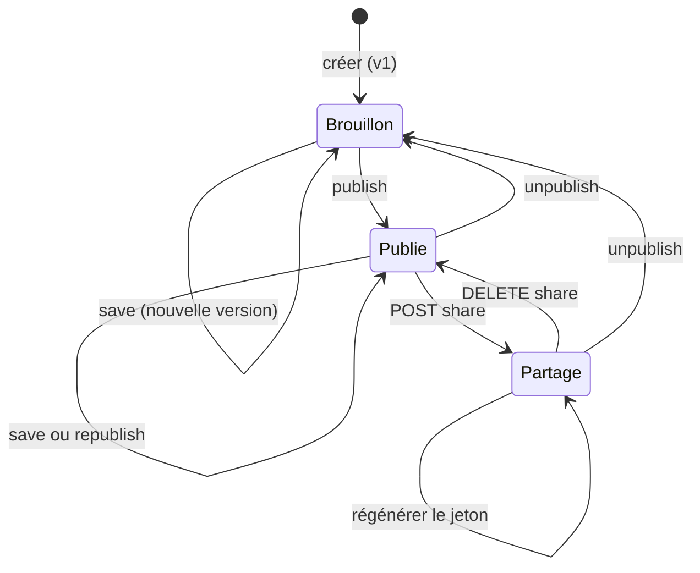

Un parcours est un document versionné en ajout seul (S3). La version courante est la dernière. Il n'y a pas de route de restauration : l'éditeur charge une ancienne version, puis l'enregistre. Publier pose un pointeur `published_version_id` sur une version (S4). Le partage public demande une version publiée (409 `not_published`). Le jeton a 122 bits (S5). Seul un membre avec `tours:write` voit le jeton (S14).

Le document `TourDoc` porte les étages, les scènes et les liens (S6). Le seul mode est `panorama` (S2). Un plan d'étage est un média `floorplan` (S9). Une scène référence un média `panorama`, jamais une copie (S7). La validation a deux niveaux (S8) : `validate_tour_doc` vérifie la structure, `validate_doc_assets` vérifie chaque média dans l'org.

L'éditeur (`components/tour_editor/`) lie chaque nouvelle scène à la plus proche du même étage (S15). Le lien est une paire aller-retour. L'angle vient du plan. Le pitch vaut ±30° entre deux niveaux. Le viewer montre des flèches bleues (marche) ou violettes (escalier).

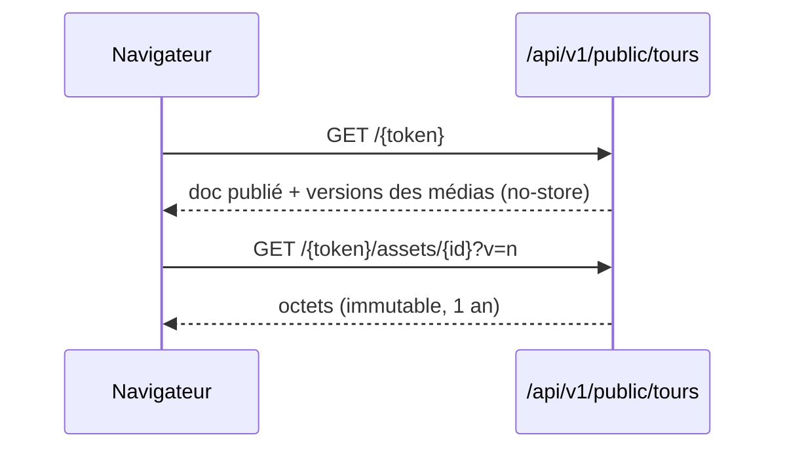

La route publique n'a pas d'authentification (S10). Elle sert un média seulement s'il figure dans le document publié et dans l'org du parcours. Un jeton inconnu donne un 404 uniforme. Le document n'est jamais en cache, les octets versionnés le sont (S11). Le viewer étend `viewers.js` et monte une seule scène pannellum à la fois (S12, S13).

## 4. Exigences

1. Une surface ne doit jamais appeler l'API de commande device, d'OTA ou de flash.
2. Un service de surface ne doit jamais référencer le bus device.
3. Écrire un contrôle ne doit faire que stocker, publier et journaliser une valeur.
4. Seul un flow déployé par un humain doit agir sur un device.
5. L'assistant ne doit écrire aucune valeur de contrôle.
6. L'assistant ne doit pas modifier un widget couplé à un flow déployé, sauf sa position et sa taille.
7. « Créer le flow » ne doit jamais déployer le flow créé.
8. Un membre sans `controls:operate` doit voir les contrôles désactivés, et l'API doit répondre 403.
9. Un enregistrement avec une version périmée doit répondre 409.
10. Le format d'un tableau de bord ne doit pas changer après sa création.
11. Une cible ou un média absent doit désactiver l'élément au rendu, jamais provoquer de panic.
12. Un widget ne doit jamais lancer de calcul sur une Table.
13. Un calcul sur des objets ne doit jamais grouper, filtrer ni compter sur une donnée que l'appelant ne peut pas lire.
14. Un calcul ne doit jamais additionner deux devises.
15. Le partage public d'un parcours ne doit servir que les médias du document publié.
16. Les règles d'état et les libellés doivent s'afficher en texte, jamais en HTML (R11).

## 5. Décisions

Carte et documents :

- **D22, D23** : réutilisation de `sites` et table `viz_links`. Abrogées par D35, puis par D42.
- **D24** : documents composites versionnés en ajout seul, 409 sur version périmée. Les lignes simples n'ont pas de versions.
- **D25** : plan d'étage = média `floorplan`. Suspendue pour la carte, reprise par le Studio (S9).
- **D26** : liens dans un registre unique, cible morte tolérée au rendu. Remplacée par D42 (`resource_edges`).
- **D27** : carte maplibre-gl en bundle IIFE `window.pnexMap`. Aujourd'hui maplibre-gl 6.x, fond de carte du fournisseur géo de l'org.
- **D28** : maquette 3D three.js. Non livrée (§7).
- **D29** : éditeur de diagrammes en SVG Dioxus. Non livré.
- **D30** : graphiques en SVG maison (`components/charts/`).
- **D31** : valeurs live par lecture REST groupée toutes les 15 s, séries jamais stockées.
- **D32** : navigation par GlobalSignals (`state/viz.rs`) et routes à paramètres de requête.
- **D33** : migration unique du domaine. Sans objet depuis la migration de base D120.
- **D34** : modes live et édition, lecture suspendue en édition.
- **D35** : le site (POI) est l'objet primaire, sans bâtiment ni étage.
- **D36** : un device = un seul site. Remplacée par D43.
- **D37** : groupement des sites par le serveur.
- **D38** : convention GPS et dernière position par device.
- **D39** : attachements de médias et de tableaux de bord à un site. Portés par D42.
- **D40** : canevas libre en pixels et traits visuels.
- **D41** : bibliothèque de widgets par org, copiée à la pose.
- **D42, D43** : couche d'organisation et placements multi-devices, dans `docs/inventory.md`.

Surfaces et contrôles :

- **D123** : format choisi à la création, définitif.
- **D124** : format mobile en sections de cartes.
- **D125** : contrôles d'org, jamais liés à un pin.
- **D126** : écrire un contrôle = stocker et publier, jamais commander un device.
- **D127** : nœud `pnex-control-source`.
- **D128** : une surface est une entrée de flow, jamais un chemin d'actionnement.
- **D129** : liaisons de lecture communes à toutes les surfaces.
- **D131** : la surface déclare, le serveur crée le contrôle au save.
- **D132** : modale de création avec le choix du format.
- **D133** : `control-source` comme catalogue des sources, sans entrée.

Maison :

- **D134** : palette des widgets par groupe.
- **D135** : règles d'état et péremption communes.
- **D136** : icônes maison originales.
- **D137** : contrôles `select`, `stepper`, `command`, `color`.
- **D138** : cartes composées par rôles.
- **D139** : mobile avec pages, pièces, pastilles, détail et visibilité.
- **D140** : nœud `pnex-weather` et carte Météo.
- **D141** : accélérateurs : modèles, « Depuis un device », « Créer le flow ».

Calculs sur des objets :

- **D579** : l'agrégat est une opération de la requête d'ontologie.
- **D580** : métriques en liste fermée, ratio, jamais de mélange de devises.
- **D581** : répartition par propriété, date ou lien.
- **D582** : refus de tout calcul sur ce que l'appelant ne peut pas lire.
- **D583** : `SourceRef.objects` (ensemble nommé ou requête).
- **D584** : les widgets existants lisent la source, `object_count` retiré.
- **D585** : un contrat, deux sources. Un widget ne lance jamais de calcul sur une Table.
- **D586** : délai de 5 s, minuteur propre, pas de cache.
- **D587** : MCP, assistant, flows et SDK par la même route.
- **D588** : le pack `crm` ne livre que des données d'écran.

Studio :

- **S1** : domaine autonome, étages dans le document.
- **S2** : mode panorama seul.
- **S3** : versions en ajout seul, la dernière est courante.
- **S4** : publication par pointeur.
- **S5** : partage public par jeton.
- **S6** : étages, scènes et liens dans `tour_versions.doc`.
- **S7** : médias référencés, jamais copiés.
- **S8** : validation structurelle puis en base.
- **S9** : plan d'étage = média `floorplan`.
- **S10** : route publique sans authentification.
- **S11** : document sans cache, octets immuables.
- **S12** : viewer dans `viewers.js`.
- **S13** : une scène montée à la fois.
- **S14** : jeton visible des seuls membres qui écrivent.
- **S15** : liens automatiques et flèches orientées.

## 6. Interfaces

### 6.1 Routes

| Domaine | Routes | Permission |
|---|---|---|
| Sites | `GET\|POST /api/v1/pois`, `GET\|PATCH\|DELETE /api/v1/pois/{id}`, `GET /api/v1/pois/cluster` | `pois:*` |
| Placements | `POST /api/v1/pois/{id}/devices`, `PATCH\|DELETE /api/v1/pois/placements/{id}` | `pois:*` |
| Positions | `GET /api/v1/device-positions` | `device-positions:read` |
| Tableaux de bord | `GET\|POST /api/v1/dashboards`, `GET\|PATCH\|DELETE /{id}`, `GET /{id}/versions[/{n}]`, `POST /{id}/versions/{n}/restore` | `dashboards:*` |
| Bibliothèque | `GET\|POST /api/v1/viz/widgets`, `GET\|PATCH\|DELETE /{id}` | `viz:*` |
| Télémétrie | `POST /api/v1/telemetry/series/query`, `POST /api/v1/telemetry/aggregate/query` | `telemetry:read` |
| Contrôles | `GET\|POST /api/v1/controls`, `GET\|PATCH\|DELETE /{id}`, `GET /values?ids=`, `POST /{id}/value` | `controls:*`, `controls:operate` |
| Calculs | `POST /api/v1/ontology/aggregate/query`, `POST /api/v1/apps/{id}/object-sets/{name}/aggregate/query` | `ontology:read` |
| Parcours | `GET\|POST /api/v1/tours`, `GET\|PATCH\|DELETE /{id}`, `GET /{id}/versions[/{n}]`, `POST /{id}/publish`, `POST /{id}/unpublish`, `POST\|DELETE /{id}/share` | `tours:*` |
| Public | `GET /api/v1/public/tours/{token}`, `GET /{token}/assets/{asset_id}?v=n` | aucune |

Contrats manuels : `docs/contracts/viz.http`, `docs/contracts/tours.http`. Le contrat public reste `docs/contracts/openapi.json`. Au MCP, `controls_write_value` est exclu (action physique), comme toute suppression.

### 6.2 Pages

| Route | Contenu |
|---|---|
| `/map`, `/sites` | carte et arbre des sites |
| `/dashboards?:id&:mode` | liste, vue live, éditeur (`mode=edit`) |
| `/controls` | contrôles de l'org, colonne « Déclaré par » |
| `/studio` | parcours et éditeur |
| `/share/:token` | viewer public, hors coquille, sans login |

### 6.3 Données

| Table | Contenu |
|---|---|
| `map_pins` | site : `label`, `emoji`, `latitude`/`longitude`, `location_detail`, `mode`/`x`/`y` gardés pour de futurs plans |
| `device_placements` | `device_registry_id` UNIQUE, `pin_id`, `location_detail` |
| `device_positions` | dernière position, `source` = `telemetry\|manual` |
| `dashboards`, `dashboard_versions` | `layout` JSON (`DashboardLayout`), `current_version_number` |
| `viz_widget_library` | modèles de widgets de l'org |
| `controls` | `key`, `label`, `kind`, `spec`, `origin` |
| `tours`, `tour_versions` | `mode`, `share_token`, `published_version_id`, `doc` (`TourDoc`) |

Clé Valkey d'un contrôle : `pnex:ctl:v1:{org}:{control_id}`, canal `pnex:ctl:v1:{org}`. Types partagés : `pnex_core::viz`, `pnex_core::ui_control`, `pnex_core::home`, `pnex_core::weather`, `pnex_core::tour`, `pnex_core::ontology::aggregate`.

Forme d'une source de calcul (D583) :

```json
{"metric": "", "device_id": "", "window": "1h",
 "objects": {"object_set": "open_opportunities", "group_by": [{"property": "stage"}],
             "metrics": [{"key": "total", "op": "sum", "property": "amount"}], "show": "total"}}
```

## 7. Reste à faire

1. Maquette 3D d'un parcours (`tours.mode = maquette`, D28).
2. Préchargement des panoramas d'un parcours.
3. Vue initiale d'une scène posée en regardant le panorama (aujourd'hui : champs numériques).
4. Export hors ligne d'un parcours : non planifié.
5. Plans d'étage sur la carte, sans hiérarchie (D25 suspendue).
6. Présence d'un device (D108) pour griser une carte : pas encore branchée, seule la péremption grise.
7. Compteur par jour, semaine ou mois calendaires : la carte compte sur la fenêtre glissante de sa source.
8. Fiche détail à l'appui long : remplacée par un bouton, à confirmer.
9. Restaurer une version de tableau de bord ne recrée pas les contrôles libérés entre-temps. La carte affiche « Contrôle supprimé » jusqu'au prochain save.
10. Panneau de calcul : un ratio, plusieurs métriques ou deux sauts s'écrivent seulement dans un pack.
11. Aperçu d'un site (`DashboardLive`) : pas de choix d'objet, donc pas de calcul sur `$object`.
12. Lecture d'une table calculée par un widget (D585, lot AG5) : attend OP1.2 et D575.
13. Seuil minimal de taille de groupe d'un calcul : à décider avec OP3.
14. REP-2, choix de Shan : code PIN pour une serrure ou une alarme, vérifié côté serveur. En attendant : confirmation simple.
15. REP-3, idée de Shan : carte des liaisons surface → contrôle → flow → device, avec l'auteur de chaque flow.
16. Rôle « opérateur » et droits par contrôle : hors périmètre, choix de Shan.
17. Lexique, choix de Shan : « Contrôle » nomme un contrôle d'org et la vérification d'un pipeline (D576, `design-system.md` §7).
18. Studio : le plan d'un étage sans dimensions déclarées s'étire à 2000 × 1000 par défaut (`tour_editor/canvas.rs`). Lire les dimensions de l'image reste à faire.
