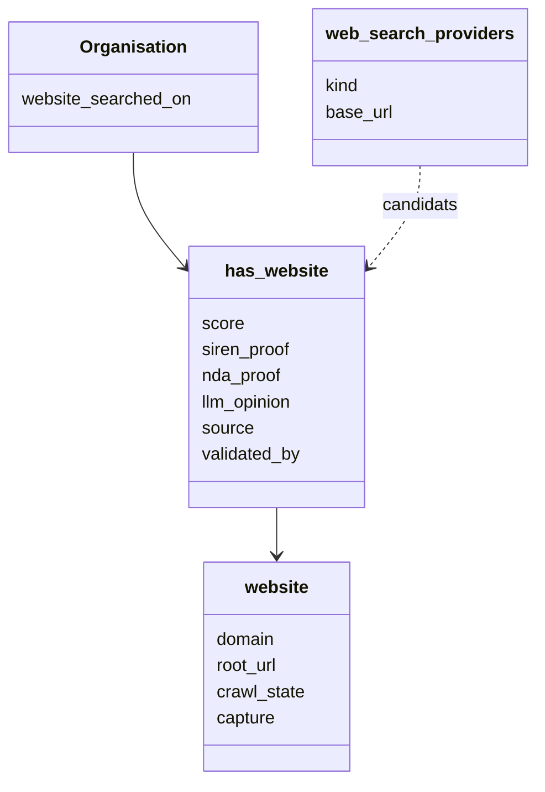
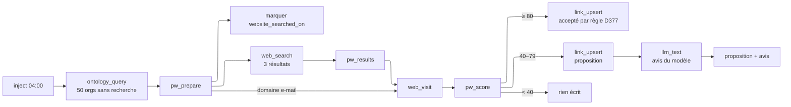
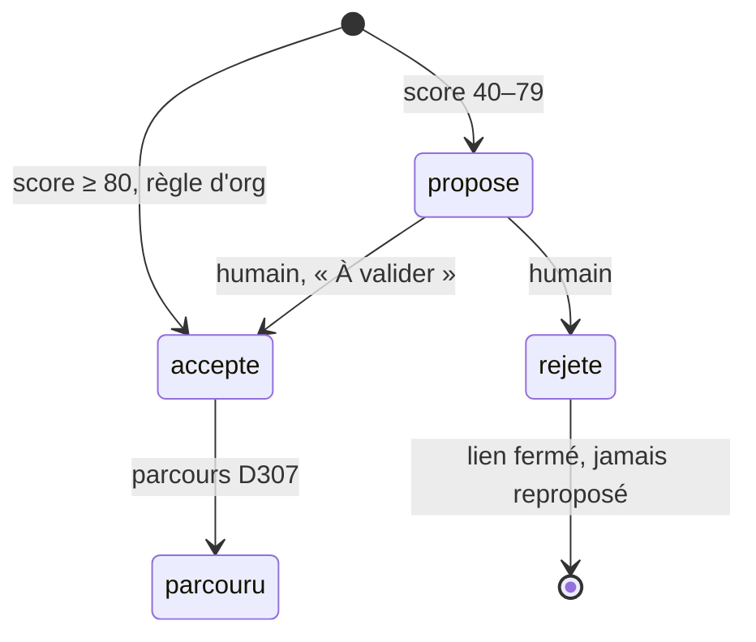
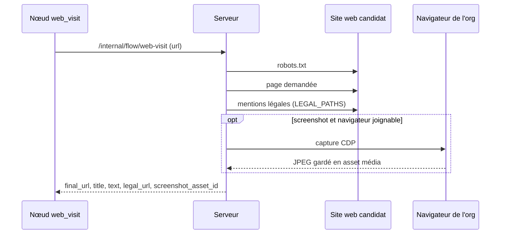

# Présence web des organisations (D359–D366)

| | |
|---|---|
| **Statut** | **Codé** : lots W0 à W4. Fournisseurs de recherche web, nœuds `web_search` et `web_visit`, options `skip_closed` et `keep_best` de `link_upsert`, pack `web_presence` 3.0.1 et son flow d'identification. Questions Q-W1 à Q-W4 tranchées par Shan le 2026-10-22. |
| **Renvois** | `partners.md` (D301–D316, D307 parcours), `pipelines.md` (D344 imports à étapes), `proposals.md` (D375–D377), `browser-agents.md` (D254), `agents.md` (D323–D328), `geo-layers.md` (modèle des fournisseurs), `security.md` (R1, R2, R4, R8, R11–R13, R16) |

## 1. Résumé

Une organisation a souvent un site web, mais aucune source ouverte ne le donne. PneX trouve des candidats par le domaine des e-mails connus, puis par un fournisseur de recherche web de l'org. Il visite chaque candidat une fois et calcule un score sur ce que le site dit de lui-même. Un score fort écrit le lien, un score moyen devient une proposition pour un humain. Seul un site accepté peut ensuite être parcouru chaque semaine (D307).

## 2. Concepts

| Terme | Définition |
|---|---|
| **Site web** | Objet `website`, de clé `domain`. |
| **Lien de site** | Lien `has_website` (organisation → site web), avec ses preuves et sa provenance. |
| **Candidat** | Domaine qui peut être le site web d'une organisation. Sa `source` est `email`, `search` ou `manual`. |
| **Fournisseur de recherche web** | Service externe que l'org branche pour chercher sur le web (D360). Il est propre à l'org. |
| **Visite** | Au plus 3 requêtes sur l'origine d'un candidat, pour l'identifier (D364). Ce n'est pas un parcours. |
| **Parcours** | Collecte récurrente d'un site web accepté (D307, `partners.md`). |
| **Score** | Note de 0 à 100 calculée sur le texte du site web visité. |

## 3. Fonctionnement

### 3.1 Flow d'identification (D365)

Le pack livre le flow « Web presence · find websites » en brouillon. L'humain le déploie (D144).

Le score est déterministe : SIREN trouvé 60, NDA trouvé 30, candidat issu du domaine e-mail 30, nom de l'organisation 10. Les seuils 80 et 40 sont des réglages du pack (`confirm_threshold`, `propose_threshold`, D368). Le domaine e-mail exclut une liste fermée de webmails.

Le modèle de l'org répond `YES`, `NO` ou `MAYBE` et une phrase. Sa réponse devient la preuve de la proposition : +10 sur `YES` (79 au plus), −20 sur `NO`. Sans fournisseur d'IA, la proposition reste sans avis. Le flow emploie `llm_text`, parce que le modèle de `text_decide` n'est pas installé partout. Le modèle lit le texte du site web, jamais la capture.

### 3.2 Vie d'un candidat

Un rejet ferme le lien avec ses attributs (D362). Ensuite `skip_closed` renvoie ce lien fermé, sans en ouvrir un autre. Avec `keep_best: score`, un message de score plus bas ne réécrit jamais un lien ouvert.

### 3.3 Visite d'un candidat (D364)

Le client est celui du parcours D307 : identifié, sortie gardée (R8), pas de redirection hors origine. Le serveur tient un plancher de 2 s par hôte. Sans `robots.txt`, tout est permis. Le navigateur est celui de l'org par défaut, sinon celui de la plateforme (`PNEX_BROWSER_URL`). Sans navigateur, la visite se fait sans capture.

## 4. Exigences

1. Un site web non accepté peut être visité, jamais parcouru.
2. Une visite doit faire 3 requêtes au plus sur l'origine du candidat.
3. Une URL candidate privée, en IP littérale ou hors http(s) doit être refusée (R8).
4. Le texte d'un site web inconnu doit passer au modèle comme donnée, jamais comme instruction.
5. La capture d'un site web ne doit jamais être rendue sur l'origine de l'app (R11–R13).
6. Un candidat rejeté ne doit jamais revenir.
7. `validated_by` doit porter le nom affiché, jamais l'e-mail ni un identifiant (R4).
8. La clé d'un fournisseur doit rester au coffre et ne jamais revenir dans une réponse (R4, R16).
9. L'org de chaque appel doit venir du nœud déployé ou du principal (R1).
10. Une org doit avoir au plus 500 recherches et 1 000 visites par jour, sauf réglage (`settings.web_search.daily_calls`, `settings.web_visit.daily_calls`).
11. L'assistant ne doit lancer ni recherche ni visite.
12. Un flow qui contient le nœud retiré `ingest` doit être refusé au déploiement avec `flow-node-retired`.

## 5. Décisions

### D359 — Retrait du nœud `ingest`

Le kind `ingest`, sa route interne et son panneau sont retirés. Les étapes vivent dans les `steps:` d'un import (D344). Au déploiement, `pnex_core::flow::retired_nodes` refuse avec `flow-node-retired` (`args` : `node`, `kind`, `instead`). En lecture, `pnex_core::flow::read_graph` écarte un nœud retiré dans `unreadable_nodes`, jamais de 500. Une montée de pack supprime les flows qu'il ne livre plus, s'ils n'ont jamais été modifiés ni déployés (`drop_unshipped_flows`). D317 et D322 sont retirées.

### D360 — Fournisseur de recherche web

Table `web_search_providers`, au modèle de `geo_providers` : `kind` en liste fermée, `base_url` gardée par `egress::check_url`, clé au coffre (`web_search/<nom>/key`). Le fournisseur est propre à l'org (Q-W1, D119). Les `kind` codés sont `serper` et `searxng` (Q-W2). Un nouveau `kind` est un module, sans toucher au nœud ni à la table. L'org répond des conditions du service qu'elle branche.

### D361 — Nœud `web_search`

Entrée `msg.payload.query` (≤ 400 caractères). Sortie `payload.results = [{url, title, snippet, rank, domain}]`. Le nœud n'écrit rien. Il passe par `/internal/flow/web-search` et lit sa config dans la version déployée.

### D362 — `link_upsert` : rejet durable et fermeture motivée

`skip_closed` renvoie le lien fermé d'une paire au lieu d'en ouvrir un autre. Avec `close`, les attributs du message sont écrits avant la fermeture, en deux écritures successives.

### D363 — Pack générique `web_presence`

Le pack `web_presence` requiert `companies`. Il reprend `website` et `has_website` de `quali_watch` par `hands_over`, sans déplacer de donnée. `quali_watch` et `prospecting_b2b` le requièrent.

### D364 — Visite ponctuelle d'un candidat (amende D254 et D307)

Un site web non déclaré peut être visité pour l'identifier (§3.3), jamais parcouru.

### D365 — Flow d'identification livré par le pack

Flow du §3.1, livré non déployé. Depuis D375, un score moyen est une proposition.

### D366 — Validation humaine

La validation se fait dans la boîte « À valider » des propositions (D375–D376). La section « Sites à valider » et l'attribut `has_website.status` ont été retirés.

Questions tranchées le 2026-10-22 :

- **Q-W1** : fournisseur propre à l'org.
- **Q-W2** : premiers `kind` `serper` et `searxng`, liste ouverte.
- **Q-W3** : validation humaine, `validated_by` = nom affiché (aujourd'hui par les propositions).
- **Q-W4** : la capture est un asset média `photo` de l'org (`metadata.source = web_visit`), son id va dans `website.capture`.

## 6. Interfaces

| Route | Effet | Permission |
|---|---|---|
| `GET /api/v1/web-search/providers` | Liste des fournisseurs | `web-search:read` (lecteur) |
| `POST /api/v1/web-search/providers` | Crée un fournisseur | `web-search:write` (admin) |
| `PUT /api/v1/web-search/providers/{id}` | Modifie | `web-search:write` |
| `DELETE /api/v1/web-search/providers/{id}` | Supprime | `web-search:delete` |
| `POST /api/v1/web-search/providers/{id}/test` | Teste la clé et l'adresse | `web-search:test` |
| `POST /internal/flow/web-search` | Appel du nœud `web_search` | interne, org du nœud |
| `POST /internal/flow/web-visit` | Appel du nœud `web_visit` | interne, org du nœud |

MCP : la liste est exposée. Écriture, suppression et test sont `EXCLUDED` (secret, destructif, sortant).

| `kind` | Clé | Adresse | Appel |
|---|---|---|---|
| `serper` | obligatoire | par défaut | `POST /search` (`q`, `gl`, `hl`, `num`) |
| `searxng` | facultative (Bearer) | obligatoire | `GET /search?format=json`. Une instance privée demande `PNEX_EGRESS_ALLOW_HOSTS`. |

Code : `pnex_core::web_search`, `pnex_core::web_visit`, `crates/pnex-backend/src/services/web_search.rs`, `crates/pnex-backend/src/services/web_visit.rs`, `crates/pnex-backend/packs/web_presence.yaml`. Tests : `tests/web_visit.rs`, `tests/partner_watch.rs` (`web_presence_takes_websites_over`).

## 7. Reste à faire

- `address_proof` : la fonction `pw_score` l'écrit toujours à `false`. La comparaison de l'adresse aux établissements SIRENE n'est pas codée.
- Parcours D307 : le filtre « seul un site web accepté part au parcours » n'est pas vérifié dans le code. Les sites web déclarés hors de ce flow restent parcourus.
- `vision_detect` et `vision_caption` lisent seulement une image de caméra ou de média (`frame_key_in_org`). Lire une capture de visite demande une clé d'image d'objet.
- Import des captures d'un parcours dans Vision Lab, pour apprendre les logos réglementés.
- Règles de conformité du parcours hebdomadaire (texte d'abord).
