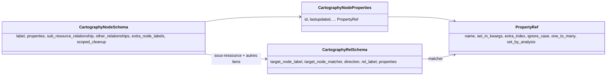
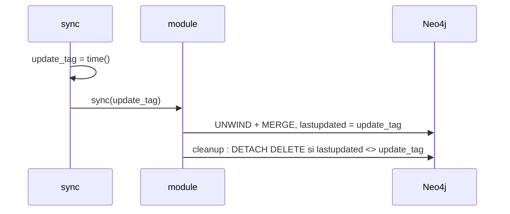

# Benchmark — Cartography (graphe d'actifs de sécurité) et BloodHound CE (chemins d'attaque)

**Date :** 2026-11-24 · **Pour :** `docs/architecture/it-operations.md` (D1003, D1004, D1009, IT2, IT5) et `docs/architecture/software-delivery.md` (SD4, SD6).

Méthode : lecture des dépôts clonés en `--depth 1` dans `~/Documents/shan-perso/bench/`. Rien n'a été installé, construit ni lancé. Les références `chemin:ligne` renvoient aux commits ci-dessous. Les chemins Cartography partent de `cartography/` (le paquet Python), sauf mention contraire.

## 1. Identité

| Champ | Cartography | BloodHound CE |
|---|---|---|
| Dépôt | `github.com/cartography-cncf/cartography` | `github.com/SpecterOps/BloodHound` |
| Commit étudié | `adae46d2` (2026-11-23), release `0.145.0` du 2026-11-19 | `659e3caf` (2026-11-23) |
| Licence | Apache-2.0 (`LICENSE`, confirmé par l'API GitHub) | Apache-2.0 (`LICENSE`, confirmé par l'API GitHub) |
| Stack | Python ≥ 3.11, pilote `neo4j>=6.0.0` (`pyproject.toml:47`), Neo4j seul | Go (API, analyse), React (UI), PostgreSQL pour l'applicatif, graphe dans Neo4j ou PostgreSQL via la bibliothèque DAWGS (`go.mod:67`) |
| Statut | Projet CNCF Sandbox (`README.md:185`), né chez Lyft en 2019 | Produit communautaire d'un éditeur, version Enterprise payante à côté |
| Activité | 4 200 étoiles, 616 forks, push quotidien, une release par semaine environ, 84 modules d'ingestion | 3 600 étoiles, push quotidien |

Cartography est une collection de modules d'ingestion (`intel/`) et un moteur de requêtes généré depuis un modèle déclaratif. Il n'a pas d'UI propre : on lit Neo4j avec Cypher.

## 2. Modèle de données déclaratif

Un type de nœud est une classe Python figée. Le moteur génère la requête d'écriture et la requête de nettoyage depuis cette classe. Aucun Cypher n'est écrit à la main pour l'ingestion.

| Élément | Rôle | Référence |
|---|---|---|
| `CartographyNodeSchema` | Un type de nœud : label, propriétés, liens, labels en plus | `models/core/nodes.py:176` |
| `CartographyNodeProperties` | `id` et `lastupdated` obligatoires. `firstseen` est réservé, posé par le moteur | `models/core/nodes.py:15`, `:48-49` |
| `PropertyRef` | Lie un champ du dict source à une propriété. Options : index, casse, liste d'ids (`one_to_many`), propriété réservée à l'analyse (`set_by_analysis`) | `models/core/common.py:1`, `:38` |
| `CartographyRelSchema` | Un lien : label cible, matcher sur des propriétés de la cible, sens, nom | `models/core/relationships.py:265` |
| Sous-ressource | Lien vers le « locataire » (compte AWS, projet GCP, org Okta). Il borne le nettoyage | `models/core/nodes.py:216` |
| `scoped_cleanup` | `True` par défaut : on ne nettoie que dans le locataire synchronisé | `models/core/nodes.py:266` |
| MatchLink | Lien entre deux nœuds déjà présents, écrit par un autre module. Il porte `_sub_resource_label` et `_sub_resource_id` pour son nettoyage | `models/core/relationships.py:233`, `models/aws/ec2/instances.py:262-287` |

Exemple : `EC2InstanceSchema` (`models/aws/ec2/instances.py:242`). Il pose le label `AWSEC2Instance`, le label d'ontologie `ComputeInstance`, la sous-ressource `AWSAccount` et quatre liens (réservation, profil d'instance, cluster EKS, rôle assumé). La propriété `exposed_internet_type` est marquée `set_by_analysis` (`:75`). L'ingestion ne l'écrase donc jamais.

Le lien vers la cible se fait par **matcher de propriétés**, pas par id interne. Exemple : un conteneur Kubernetes trouve son image ECR par `digest = status_image_sha` (`models/kubernetes/containers.py:276`). Si la cible n'existe pas encore, le lien n'est pas créé. L'ordre des modules compte donc.

Chaque lien porte `_module_name` et `_module_version` (`graph/querybuilder.py:928-929`). C'est leur seule provenance.

## 3. Synchronisation et nettoyage

- **Update tag.** Un entier par run, `int(time.time())` par défaut (`sync.py:563-565`). Toute écriture pose `lastupdated = update_tag`.
- **Écriture.** `UNWIND $DictList AS item MERGE (i:Label {id: ...}) ON CREATE SET i.firstseen = timestamp()` (`graph/querybuilder.py:1325-1327`). Les autres propriétés sont écrasées à chaque run.
- **Nettoyage.** Tout nœud ou lien du locataire avec `lastupdated <> $UPDATE_TAG` est supprimé par `DETACH DELETE`, en lots (`graph/cleanupbuilder.py:301-305`, `:356-382`).
- **Ce qui reste.** `firstseen` et `lastupdated` seulement. Aucune valeur passée, aucun lien passé, aucune date de fin. Le graphe montre « sa croyance de l'état actuel du monde ». Les mainteneurs refusent la rétention : « very large rewrite » (issue [#1015](https://github.com/cartography-cncf/cartography/issues/1015)).
- **Dérive.** `driftdetect/` lance des requêtes Cypher fixes, sérialise le résultat en JSON sur disque, puis compare deux fichiers (`driftdetect/detect_deviations.py:19`). C'est le seul substitut à l'historique. Il ne voit que ce que la requête choisie retourne.
- **Garde contre le sync partiel.** Un module qui échoue en partie doit sauter son chargement **et** son nettoyage. Sinon il efface des actifs réels. Le module Kubernetes le fait (`intel/kubernetes/workloads.py:34-38`, `:291-330`). Ce n'est pas garanti par le moteur : chaque module le code à la main.

## 4. Couche canonique (ontologie)

Cartography a une couche « ontology » en deux mécanismes.

1. **Labels sémantiques.** 43 labels transverses (`ComputeInstance`, `ComputePod`, `Image`, `CVE`, `UserAccount`, `Secret`, `LoadBalancer`, `CodeRepository`…) dans `models/ontology/labels.py`. Un type fournisseur les ajoute par `extra_node_labels`. Les champs normalisés sont copiés en propriétés `_ont_<champ>` sur le nœud fournisseur.
2. **Nœuds canoniques.** `User`, `Device`, `PublicIP`, `Package` sont de vrais nœuds. Le module `intel/ontology/users.py` lit les comptes des sources choisies (`source_of_truth`, réglage `ontology_users_source`), crée un `User` par e-mail normalisé, puis le relie par `HAS_ACCOUNT` (`models/ontology/user.py:50-58`).

Le mapping par source est déclaratif : `OntologyFieldMapping` (`models/ontology/mapping/specs.py:7`) avec `required`, `special_handling` (`invert_boolean`, `mapping`, `coalesce`, `normalize_hostname`) et `eligible_for_source`. Un compte sans e-mail ne crée pas de `User`.

La clé d'identité d'un `User` est l'e-mail. Pas de score, pas de preuve, pas de proposition. Deux comptes avec deux e-mails restent deux personnes.

## 5. Modules utiles à PneX

| Domaine | Ce que Cartography relie | Référence |
|---|---|---|
| Kubernetes | Cluster, namespace, pod, conteneur, Deployment/StatefulSet/DaemonSet/Job, service, ingress, Gateway API, RBAC, secrets (métadonnées seules, jamais la valeur), NetworkPolicy | `models/kubernetes/*.py`, `models/kubernetes/secrets.py:18-51` |
| Conteneur → image | `HAS_IMAGE` par digest d'exécution (`status_image_sha`) vers ECR, GitLab, GCP Artifact Registry | `models/kubernetes/containers.py:276-330` |
| Forges | GitHub (dépôts, environnements, workflows, actions, dépendances, alertes Dependabot, protections de branche, PAT), GitLab (projets, runners, variables CI, images), Bitbucket | `models/github/`, `models/gitlab/` |
| IAM cloud | AWS : rôles, politiques, instructions. Liens dérivés `CAN_READ`, `CAN_WRITE`, `CAN_QUERY` calculés depuis une liste de permissions en YAML | `data/permission_relationships.yaml:1-30` |
| Identités | Okta, Entra (`intel/entra`, `models/microsoft/entra`), Google Workspace, Keycloak, Duo, JumpCloud | `models/okta/`, `models/microsoft/` |
| Vulnérabilités | Trivy (rapports JSON lus dans un object store) : `TrivyImageFinding -[:AFFECTS]-> Image` par `_ont_digest`. Syft : paquets et `DEPENDS_ON`. CVE enrichies (KEV, EPSS) | `models/trivy/findings.py:211`, `models/cve_metadata/cve_metadata.py:93`, `intel/trivy/__init__.py:328` |
| EDR | CrowdStrike : hôte, vulnérabilité Spotlight, `HAS_CVE` | `models/crowdstrike/spotlight.py:98-187` |
| Données marquées | Sentra : magasin de données `CONTAINS` classe de donnée, `MONITORS` un bucket S3 ou une base RDS | `models/sentra/data_store.py:190-266` |

Le pivot entre la chaîne logicielle et l'exécution est le **digest d'image**. C'est le même pivot que SD3 et D1009.

## 6. Règles d'exposition et combinaisons toxiques

Deux couches distinctes.

**Jobs d'analyse (écrivent dans le graphe).** Un `AnalysisJob` déclare des `AnalysisStatement` : une clause `match`, puis des effets (`SetProperty`, `AddToSet`, `AddRelationship`). Le moteur génère aussi leur nettoyage (`graph/analysisbuilder.py:161`, `:193`). Exemple : `K8S_SERVICE_ASSET_EXPOSURE` (`analysis/kubernetes/analysis.py:9-85`) propage `exposed_internet = true` de proche en proche : load balancer public → service → pod → conteneur. L'exposition devient une propriété dénormalisée.

**Règles (lisent le graphe).** Le format est `Rule` → `Fact` → `Finding` (`rules/spec/model.py:977`, `:1057`, `:1098`).

| Champ de `Fact` | Rôle |
|---|---|
| `cypher_query` | Retourne une ligne par écart |
| `cypher_visual_query` | Même chemin, `RETURN *`, pour l'affichage |
| `cypher_count_query` | Nombre total d'actifs évalués (taux de conformité) |
| `asset_label`, `asset_id_field` | Ancre `(label, id)` de l'actif touché. Validée à la construction |
| `identity_fields` | Identité stable d'un écart entre deux runs. Obligatoire |
| `maturity` | `experimental` ou `stable` |

Une `Rule` regroupe des `Fact` par fournisseur, avec `tags` (STRIDE), `frameworks` (ISO 27001, SOC 2, CIS, NIST AI RMF) et une version. Exemple : `compute_instance_exposed` (`rules/data/rules/compute_instance_exposed.py:402`) réunit AWS, Azure, GCP et Scaleway. Le fait GCP (`:10`) suit IP publique → NIC → sous-réseau → VPC → pare-feu → plage `0.0.0.0/0`, sur sept ports d'administration.

Combinaison toxique typique : `workload_identity_admin_capabilities.py:17-60`. Elle cherche une instance EC2 → profil → rôle → politique `Allow` sur `iam:Create*`, moins les `Deny`. Le mot « toxic » n'apparaît pas dans le dépôt. Aucune règle ne croise encore CVE, exposition Internet et environnement. La faille et l'exposition existent, la jointure reste à écrire par l'utilisateur.

Les règles disent leurs limites dans leur description (règles de refus ignorées, `target_tags` non pris en compte). Le fichier finit par des `TODO` qui listent les données manquantes par contrôle (`compute_instance_exposed.py` en fin de fichier).

## 7. BloodHound : chemins d'attaque et extension OpenGraph

**Modèle.** Des genres de nœuds (`User`, `Computer`, `Group`, `AZUser`, `CertTemplate`…) et des genres de liens. `schemas/valid_edges.json` liste, pour chaque couple (source, cible), les liens **ingérés** et les liens **post-traités**. Le post-traitement dérive des liens après l'ingestion (`Owns`, chaînes ADCS) : `packages/go/analysis/ad/owns.go:44`, `packages/go/analysis/ad/adcs.go:40`.

**Chemins.** La recherche de chemin est un « all shortest paths » entre deux nœuds, filtré par critère (`cmd/api/src/queries/graph.go:259-285`). Un genre de lien porte `is_traversable` (`cmd/api/src/model/graphschema.go:278`). Seuls les liens traversables comptent comme pas d'attaque. Le classement par impact et par exposition des « Attack Path Findings » n'est pas dans le dépôt CE : il relève de l'édition Enterprise.

**Zones.** Les « privilege zones » (ex. Tier Zero) partent de sélecteurs Cypher (`seeds`), puis s'étendent aux parents et enfants (`packages/go/analysis/agt.go:137`, `:290`, `:474`). Un chemin qui entre dans une zone est un chemin critique.

**OpenGraph.** Un fichier de schéma (`schemas/open_graph/dog-park-schema.json`) déclare une extension :

| Bloc | Contenu |
|---|---|
| `schema` | Nom, version, `namespace` (préfixe de tous les genres) |
| `node_kinds` | Nom, icône, couleur, fiches Markdown avec gabarit |
| `relationship_kinds` | Nom, description, `is_traversable` |
| `environments` | Genre racine d'un environnement et genres de principaux |
| `relationship_findings` | Un lien vers un environnement devient un constat, avec remédiation |
| `queries` | Requêtes Cypher nommées et classées |
| `pz_rules` | Zones protégées par sélecteur Cypher |

Les données (`schemas/open_graph/dog_park.json`) sont des nœuds avec plusieurs `kinds` et des liens dont chaque extrémité se trouve par `match_by: id` ou par propriété. Le stockage du graphe peut être PostgreSQL (DAWGS, pilote `pg`). La configuration livrée reste Neo4j (`examples/docker-compose/bloodhound.config.json:8`).

## 8. Pièges et limites

- **Historique perdu par conception.** Un nœud absent d'un run est supprimé. On ne peut pas répondre « cette faille tournait-elle en production le 3 ? ». Les utilisateurs bricolent une rétention de 7 jours dans le JSON de nettoyage ([#1015](https://github.com/cartography-cncf/cartography/issues/1015)).
- **Nettoyage destructeur sur sync partiel.** Une liste qui échoue sur une région ou une org efface des actifs réels : Cloud Run ([#2658](https://github.com/cartography-cncf/cartography/issues/2658)), GitHub multi-org ([#839](https://github.com/cartography-cncf/cartography/issues/839)), conflit entre modules GitHub et Semgrep ([#3035](https://github.com/cartography-cncf/cartography/issues/3035)).
- **Un seul update tag pour tous les locataires.** Deux locataires synchronisés avec deux tags s'effacent l'un l'autre ([#1015](https://github.com/cartography-cncf/cartography/issues/1015)).
- **Coût Neo4j.** Nettoyage en OOM de transaction ([#2396](https://github.com/cartography-cncf/cartography/issues/2396)). Index réécrit à chaque run à cause de `lastupdated` ([#3103](https://github.com/cartography-cncf/cartography/issues/3103)).
- **Lien par propriété = ordre des modules.** Le lien vers une cible absente est perdu en silence jusqu'au run suivant.
- **Identité par e-mail seul.** Pas de résolution prouvée ni de proposition (§4).
- **BloodHound, OpenGraph lent.** 240 000 liens en 11 h ([#2415](https://github.com/SpecterOps/BloodHound/issues/2415)). Requêtes multi-sauts lentes sur PostgreSQL ([#1969](https://github.com/SpecterOps/BloodHound/issues/1969)).
- **BloodHound, fusion inter-sources.** Un lien OpenGraph ne s'accroche pas à un nœud d'une autre source : doublon ou erreur ([#3003](https://github.com/SpecterOps/BloodHound/issues/3003)).

## 9. À reprendre pour PneX / à écarter

### À reprendre

| Quoi | Pourquoi | Où dans PneX |
|---|---|---|
| Labels sémantiques transverses (`ComputeInstance`, `Image`, `UserAccount`) posés en plus du type fournisseur | Une règle d'exposition écrite une fois sert tous les fournisseurs | D1003 : le pack `it_topology` déclare des types génériques (`host`, `workload`, `identity`). Les lecteurs IT2 mappent leurs objets vers eux, sans type par fournisseur |
| Mapping de champs déclaratif avec `required` et transformations nommées | Un lecteur se règle sans code. Un objet sans clé d'identité n'est pas créé | IT2 et SD4 : mapping du lecteur `kubernetes` dans le pack, comme le mapping d'import OP2 |
| Digest d'image comme pivot conteneur → artefact → faille | C'est la seule clé stable entre exécution et chaîne logicielle | D1009, SD6 : lien `runs` d'une `workload` vers `artifact` par digest d'exécution, jamais par tag |
| Garde contre le sync partiel : un échec de liste saute toute écriture et toute clôture | Évite de clore des liens réels sur une erreur 403 ou 5xx | D1004, IT2 : le lecteur ne clôt un lien (`valid_to`) que si la liste de sa portée est complète. Exigence à ajouter |
| Clôture bornée à la portée (`scoped_cleanup`, sous-ressource) | Deux clusters ou deux comptes ne se clôturent pas l'un l'autre | IT2 : portée = (connecteur, cluster). Un run ne clôt que les liens de sa portée |
| `Fact` avec ancre `(label, id)`, `identity_fields`, requête de comptage | Un constat a une identité stable entre runs, donc une date d'ouverture et de fermeture | D1009, IT5 : une requête nommée OP5 d'exposition déclare son actif ancre et sa clé d'identité. L'objet `exposure` en hérite |
| Propriété réservée à l'analyse (`set_by_analysis`) | L'ingestion n'écrase jamais un calcul | D1009 : l'exposition reste un objet ou un lien inféré, distinct des liens affirmés par la source (D998) |
| `is_traversable` sur un genre de lien (BloodHound) | Le calcul de chemin ne suit que les liens qui portent un risque | D1009 : drapeau de type de lien, au même niveau que `propagates_failure`. Exemples : `exposes`, `has_access_to`, `runs` |
| Environnement déclaré dans l'extension (BloodHound `environments`) | Le classement par environnement fait partie du modèle, pas de la requête | D1009 : lien `member_of_env` daté, déjà prévu |
| Zones protégées par sélecteur (BloodHound `pz_rules`) | Une donnée marquée ou une identité à privilèges devient une cible de chemin | D1009 : cible = objet portant un marquage D188, sélecteur dans la règle |
| Permissions cloud dérivées en liens (`CAN_READ`, `CAN_WRITE`) depuis une table de permissions | Une identité à privilèges devient un lien lisible, pas une politique brute | IT5 : lien inféré `has_access_to` avec une table de permissions dans le pack |
| Limites et `TODO` écrits dans chaque règle | L'utilisateur sait ce que la règle ne voit pas | IT5 : champ « limites » de la requête nommée, affiché avec le résultat |

### À écarter

| Quoi | Pourquoi |
|---|---|
| Neo4j comme stockage | PneX garde PostgreSQL seul. Les requêtes de chemin vont par CTE récursive bornée. BloodHound montre que le multi-saut sur PostgreSQL demande des index et une profondeur bornée ([#1969](https://github.com/SpecterOps/BloodHound/issues/1969)) |
| Supprimer ce qui n'est pas revu (`DETACH DELETE` sur `lastupdated`) | Contraire à D862 et D1004. PneX clôt le lien (`valid_to`) et garde le passé. « Cette faille tournait-elle en production le 3 ? » doit rester répondu |
| Un update tag global par run | PneX date chaque lien. Le curseur est par source et par portée (D1002) |
| Drift par comparaison de fichiers JSON | Une dérive est un lien daté dans le graphe (D853, D1004) |
| Exposition dénormalisée en propriété (`exposed_internet = true`) | Perd le chemin et sa date. PneX garde le chemin comme preuve (D1009) |
| Identité canonique par e-mail seul | PneX résout par règle déterministe puis par proposition prouvée (D856) |
| Règles et lecteurs codés en Python dans le cœur | Python seulement en déploiement séparé (D553). Les règles restent des requêtes nommées OP5 en données |
| Copier du code ou des fichiers de règles | Apache-2.0 permet la lecture et l'inspiration. Aucun copier-coller, PneX réécrit en Rust |

## Reste à faire

- Mesurer une CTE récursive PostgreSQL sur un graphe de démo IT0 (profondeur 6, 100 000 liens) avant IT5.
- Ajouter à D1004 l'exigence « pas de clôture sur liste incomplète ».
- Décider avec Shan si `is_traversable` devient un attribut des types de lien de l'ontologie, à côté de `propagates_failure`.
