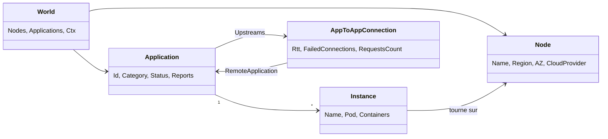
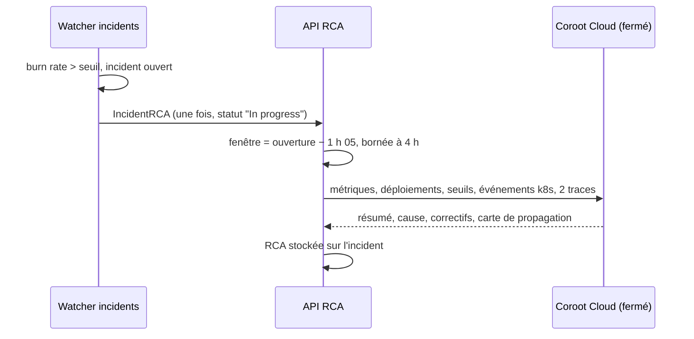

# Benchmark — Coroot (carte des services, inspections, cause racine)

**Date :** 2026-11-24 · **Pour :** `docs/architecture/it-operations.md` (D1001–D1012, lots IT0–IT7).

Méthode : lecture du dépôt cloné en `--depth 1` dans `~/Documents/shan-perso/bench/coroot`. Rien n'a été construit ni lancé. Les références `chemin:ligne` renvoient au commit ci-dessous. Coroot dit « application » pour ce que PneX appelle un actif de couche `application`.

## 1. Identité

| Champ | Valeur |
|---|---|
| Dépôt | `github.com/coroot/coroot`, docs `docs.coroot.com` |
| Commit étudié | `6927e8f7` (2026-11-19), release `v1.29.4` du 2026-11-18 |
| Licence | Apache-2.0 pour tout le dépôt (`LICENSE`, `README.md:128`). Agent eBPF `coroot-node-agent` : Apache-2.0 aussi |
| Partie fermée | La cause racine (RCA) et l'explication par LLM. Elles ne sont pas dans le dépôt. Elles tournent dans Coroot Cloud ou Coroot Enterprise |
| Stack | Go 1.25 (`go.mod`), front Vue 2, métriques dans Prometheus ou ClickHouse, logs et traces dans ClickHouse |
| Activité | environ 8 000 étoiles, 125 tickets ouverts, une release par semaine environ |

La RCA est un appel HTTP vers `https://cloud.coroot.com/api/integration/rca` (`cloud/api.go:21`, `cloud/rca.go:34-49`). L'édition communautaire envoie un paquet msgpack compressé et reçoit un rapport. Le code qui parcourt le graphe et classe les hypothèses n'est donc pas lisible. La section 5 décrit ce que le dépôt montre : l'entrée, la sortie et la documentation.

## 2. Modèle de topologie

Coroot ne stocke pas de topologie. À chaque requête, le `constructor` recalcule un `World` depuis le cache de métriques, pour la fenêtre demandée (`constructor/constructor.go:61`). Rejouer une date passée revient à recalculer le `World` sur cette fenêtre.

| Objet | Rôle | Référence |
|---|---|---|
| `World` | Graphe complet d'une fenêtre de temps | `model/world.go:18-36` |
| `Application` | Nœud du graphe. Porte `Upstreams` et `Downstreams`, les SLI, les incidents, les déploiements | `model/application.go:30-75` |
| `Instance` | Pod, processus systemd ou base cloud. Porte ses connexions au niveau instance | `model/instance.go:52-92` |
| `Node` | Hôte, avec fournisseur cloud, région, zone | `model/node.go:66-96` |
| `Connection` | Lien instance → instance, avec IP et port réels | `model/connection.go:70-96` |
| `AppToAppConnection` | Lien application → application, agrégé des connexions | `model/connection.go:49-68` |

Une arête n'a qu'un sens : le client vers le serveur (`Upstreams`). Le même objet est rangé deux fois, dans `app.Upstreams` et `dest.Downstreams` (`constructor/connections.go:47-55`). Chaque arête porte des séries : RTT, connexions réussies et échouées, retransmissions TCP, requêtes L7 par protocole et par statut. Une arête n'existe que si du trafic l'a fait apparaître. Coroot ne connaît donc pas une dépendance silencieuse.

Le lien instance → nœud vient de l'agent. Il n'y a pas de couche réseau (commutateur, lien, VLAN). Le réseau existe seulement comme attribut d'une arête (RTT, échecs TCP).

## 3. Identification des applications

L'identifiant est un quadruplet `cluster:namespace:kind:name` (`model/application_id.go:20-25`). Les règles, dans l'ordre :

1. **Kubernetes** : le propriétaire du pod (`created_by_kind`, `kube_pod_owner`) donne l'application (`constructor/k8s.go:153-207`). Un `ReplicaSet` à suffixe hexadécimal devient son `Deployment`. Un `Job` à suffixe numérique devient son `CronJob` (`model/application_id.go:28-40`).
2. **Autres orchestrateurs** : le chemin du cgroup donne l'application. Nomad, ECS, Docker Swarm ont chacun leur forme (`constructor/containers.go:91-113`).
3. **Hors orchestrateur** : le nom du service systemd ou du conteneur, sans `.service` ni `.slice` (`constructor/containers.go:114-120`).
4. **Applications personnalisées** : un réglage du projet regroupe des instances par motif glob (`model/custom_application.go:3-5`, `db/project.go:118-125`). Le motif s'applique au nom d'instance, et le premier qui correspond gagne.
5. **Services externes** : une destination sans instance connue devient une application `ExternalService`. Son nom vient du Service Kubernetes, sinon du FQDN résolu par DNS, sinon du port (`constructor/containers.go:610-656`).
6. **Catégories** : des motifs glob rangent les applications en `control-plane`, `monitoring` ou catégorie libre (`model/application_category.go:32-80`). Une catégorie sert au filtrage et au routage des notifications.

Certaines sortes n'ont jamais d'alerte : `Job`, `CronJob`, `StaticPods`, jobs GitLab, workflows Argo (`model/application.go:474-481`).

## 4. Inspections

Un `Audit` passe chaque application dans 19 auditeurs fixes : SLO, instances, CPU, mémoire, stockage, GPU, réseau, DNS, cinq bases, quatre runtimes, logs, déploiements (`auditor/auditor.go:44-69`). Le catalogue compte 58 contrôles (`model/check.go:63`).

Un contrôle a un type. Le type dit comment il passe en alerte (`model/check.go:786-818`) :

| Type | Passe en `WARNING` si | Exemple |
|---|---|---|
| `ValueBased` | valeur > seuil | latence Redis > 5 ms |
| `EventBased` | compteur > seuil | redémarrages > 1 |
| `ItemBased` | au moins un élément listé | services amont injoignables |
| `Manual` | l'auditeur l'a déclenché | cas particuliers |

Seuils par défaut notables (`model/check.go:130-480`) :

| Contrôle | Seuil |
|---|---|
| Disponibilité et latence SLO | 99 % |
| CPU nœud et conteneur | 80 % |
| Fuite mémoire | +10 % par heure |
| RTT dans le cluster / vers l'externe / entre clusters | 10 ms / 200 ms / 100 ms |
| Connectivité, connexions TCP échouées, OOM | 0 |
| Instances disponibles | 75 % des instances voulues |
| Déploiement bloqué | 180 s |
| Lag de réplication Postgres et MongoDB | 30 s |

Un seuil se règle par projet, puis par application (`model/check.go:894-925`). Il peut aussi venir d'une annotation Kubernetes (`model/check.go:822`).

Propagation du statut. Les niveaux sont `UNKNOWN < OK < INFO < WARNING < CRITICAL` (`model/status.go:7-13`). Le statut d'un rapport est le pire de ses contrôles. Le statut de l'application est le pire de six rapports seulement : SLO, instances, Postgres, MySQL, Redis, MongoDB (`auditor/auditor.go:79-90`). Un CPU saturé ne rend donc pas l'application rouge. Il reste visible dans son rapport. Un contrôle ordinaire ne monte jamais au-dessus de `WARNING`. Seul le SLO donne `CRITICAL`.

Aucun statut ne se propage le long des arêtes. La carte affiche deux statuts côte à côte : celui de l'application voisine et celui du lien (`api/views/application/application.go:136-182`). Le lien est `CRITICAL` si le RTT a disparu ou si des connexions échouent (`model/connection.go:123-135`).

## 5. Cause racine

**Déclencheur : le SLO, rien d'autre.** Un incident naît par application, quand le taux de consommation du budget d'erreur dépasse un seuil sur deux fenêtres à la fois (`watchers/incidents.go:246-278`). Deux règles fixes (`model/alert.go:18-21`) :

| Fenêtre longue | Fenêtre courte | Seuil de consommation | Gravité |
|---|---|---|---|
| 1 h | 5 min | 14,4 | `CRITICAL` |
| 6 h | 15 min | 6 | `CRITICAL` |

Un incident se ferme quand le statut redevient `OK` (`watchers/incidents.go:111-119`). Il garde le pourcentage de requêtes touchées depuis son ouverture (`watchers/incidents.go:48-63`). Un incident appartient à une seule application. Coroot ne regroupe pas deux applications dans un incident.

**Entrée envoyée** (`cloud/rca.go:15-31`, `api/rca.go:96-160`) :

- l'application visée et la fenêtre de temps,
- toutes les métriques du cache sur cette fenêtre, pas seulement celles de l'application,
- les seuils des contrôles, les déploiements, les catégories, les applications personnalisées,
- au plus 1 000 événements Kubernetes,
- une trace en erreur et une trace lente qui violent le SLO.

**Fenêtre** : de l'ouverture moins 1 h 05 jusqu'à la fermeture. Le début avance après la fin d'un incident précédent de la même application. La durée est bornée à 4 h (`api/rca.go:266-286`, `api/api.go:42`). Ce début correspond à la sortie de la base de référence : la période d'avant sert de comparaison.

**Un run par incident** : `IncidentRCA` sort tout de suite si la RCA est déjà `OK` (`api/rca.go:162-166`). Elle pose `In progress` avant l'appel. Elle est sautée si les crédits sont épuisés ou si l'enquête auto est coupée (`cloud/rca.go:51-73`). La RCA multi-cluster n'existe pas (`api/rca.go:53-58`).

**Sortie** (`model/application_incident.go:24-62`) : un résumé court, une cause, des correctifs immédiats, une analyse détaillée, des graphiques de preuve, et une `PropagationMap`. La carte liste des applications avec leurs amonts, leurs avals, un statut et des « issues » par application et par lien.

**Algorithme** (d'après `docs/docs/ai/overview.md`, le code est fermé) :

1. partir de l'application touchée et suivre le graphe des dépendances vers l'amont,
2. à chaque nœud, comparer la télémétrie à l'anomalie du SLI (corrélation dans le temps), avec des algorithmes de ML et sans LLM,
3. retenir les causes les plus probables, avec les logs et signaux qui soutiennent chaque hypothèse,
4. sur le bouton « Explain with AI », envoyer **les seules conclusions** au LLM, jamais la télémétrie brute.

Le LLM rédige le résumé, les chemins de propagation et les correctifs. La doc le dit : le LLM n'est pas bon pour trouver la cause, il est bon pour l'expliquer. C'est exactement D1007.

## 6. Réseau → application

Coroot ne voit pas d'objet réseau. Il voit le réseau depuis le client, par l'eBPF de chaque nœud :

- **RTT** : mesuré par connexion, agrégé par arête, classé en trois contrôles selon la destination (même cluster, autre cluster, externe) (`auditor/network.go:38-59`).
- **Connectivité perdue** : le RTT avait des valeurs puis n'en a plus en fin de fenêtre (`model/connection.go:109-114`). L'application cliente reçoit l'item, pas le réseau.
- **Connexions TCP échouées** : dernier point > 0 (`model/connection.go:116-121`).
- **Retransmissions TCP** : un graphique, pas de contrôle.
- **DNS** : latence, erreurs serveur, `NXDOMAIN`, par application cliente (`auditor/dns.go:31-190`).
- **Nœud** : un nœud tombé marque ses instances « down (node down) » (`auditor/instances.go:102`, `auditor/instances.go:142`, `model/node.go:186-188`). Le CPU du nœud entre dans le rapport CPU de chaque application hébergée (`auditor/cpu.go:85-108`).
- **Réplication** : un défaut de lien entre pairs d'une même base devient une cause de son rapport (`auditor/network.go:90-107`).

Le principe : le défaut réseau s'attribue à l'arête client → serveur, donc à l'application cliente. Un lien physique commun à vingt arêtes n'est jamais nommé. La RCA fermée doit déduire le facteur commun en comparant les arêtes.

## 7. Déploiements et changements

Un déploiement vient des ReplicaSets. Coroot suit les durées de vie des pods de chaque ReplicaSet dans le temps (`watchers/deployments.go:178-290`). Un nouveau ReplicaSet actif ouvre un déploiement. La version affichée est le hash du ReplicaSet plus les images des conteneurs (`model/application_deployment.go:56-66`). Seules quatre sortes sont suivies, dont `Deployment` (`watchers/deployments.go:170-176`).

Chaque déploiement garde un instantané de métriques : requêtes, erreurs, histogramme de latence, CPU, mémoire, OOM, redémarrages, erreurs de log (`model/application_deployment.go:72-87`). L'instantané couvre 20 min, 10 min après le début (`model/application_deployment.go:16-19`). Le résumé compare deux versions consécutives (`model/application_deployment.go:172-260`) :

- SLO sous l'objectif : `CRITICAL`,
- CPU par requête ou mémoire : écart signalé au-delà de 5 %, avec son coût mensuel,
- OOM : toujours signalé.

Autres événements datés : bascule de primaire, déploiement, instance tombée ou revenue, changement de schéma de base (`model/application_event.go:13-17`). Ils apparaissent en annotations sur tous les graphiques d'inspection (`auditor/auditor.go:123-151`). Flux et Argo CD sont lus pour les changements GitOps (`model/flux.go`, `model/argocd.go`).

## 8. Pièges et limites

Dans le code :

- **Topologie par trafic seulement** : une dépendance sans trafic dans la fenêtre n'existe pas. Une panne qui arrête le trafic efface l'arête en fin de fenêtre (`model/connection.go:105-107`).
- **Pas de couche réseau ni de couche métier** : `Node` est la couche la plus basse, `Application` la plus haute.
- **Un incident = une application** : vingt services qui tombent ensemble donnent vingt incidents et vingt RCA payantes.
- **Seuils globaux, fixes** : pas de seuil appris, sauf ce que fait la RCA fermée.
- **Exposition minimale** : le seul risque de sécurité est une base écoutant sur une IP publique ou derrière un LoadBalancer public (`api/views/overview/risks.go:205-270`, `utils/ip.go:24-26`).
- **RCA hors ligne impossible** : la RCA de l'édition libre part vers un service tiers, avec toutes les métriques de la fenêtre.

Tickets GitHub :

- Même IP:port derrière un ingress ou un LB partagé : services fusionnés (https://github.com/coroot/coroot/issues/795).
- Un service externe qui change d'IP devient un nouveau service (https://github.com/coroot/coroot/issues/113).
- Deux FQDN du même proxy : mauvaise application, mauvais SLO, fausses alertes (https://github.com/coroot/coroot/issues/233).
- Carte fausse après le redéploiement d'un pod (https://github.com/coroot/coroot/issues/536).
- Pod d'opérateur qui garde l'ancien nœud après replanification (https://github.com/coroot/coroot/issues/1052).
- Domaines externes impossibles à regrouper en une application (https://github.com/coroot/coroot/issues/691).
- Application personnalisée sans namespace (https://github.com/coroot/coroot/issues/802).
- Enterprise : RCA tentée vers un LLM non configuré (https://github.com/coroot/coroot/issues/647).
- Requêtes PromQL trop grosses pour VictoriaMetrics (https://github.com/coroot/coroot/issues/768).
- Agent eBPF gourmand en mémoire (https://github.com/coroot/coroot/issues/913).

## 9. À reprendre pour PneX / à écarter

À reprendre :

| Quoi | Pourquoi | Où dans PneX |
|---|---|---|
| Le LLM reçoit les conclusions, jamais la télémétrie brute | Coroot l'écrit noir sur blanc. Moins de coût, pas de fuite | D1007, IT6. Réponse par défaut à Q-IT7 : extrait marqué |
| Une RCA par incident, état « en cours » posé avant l'appel, sortie si déjà faite | Évite les doublons quand le watcher repasse | D1010, IT6 |
| Fenêtre d'enquête : ouverture − 1 h 05, coupée à la fin de l'incident précédent, bornée à 4 h | La période d'avant sert de base. La borne protège le coût | D1006, IT4 et IT6 |
| Sortie structurée : résumé, cause, correctifs, analyse, carte de propagation avec statut par nœud et par lien | La carte se dessine sans relire le texte du LLM | D1011, IT4 et IT6 |
| Statut sur le nœud et statut sur le lien, séparés | Un lien réseau en panne se voit même si les deux bouts sont sains | D1011, IT0 |
| Identité d'application en quadruplet, `ReplicaSet` → `Deployment` par suffixe | Règle simple et stable pour le lecteur `kubernetes` | D1003, D1004, IT2 |
| Regroupement par motif glob sur le nom d'instance | Couvre les hôtes hors orchestrateur sans catalogue | D1005, IT3 |
| Contrôle typé `value`, `event`, `item`, avec seuil par défaut réglable par org puis par actif | Un format unique pour les règles de signal | D1005, IT3 |
| Burn rate sur deux fenêtres (1 h et 5 min, 6 h et 15 min) | Méthode connue, peu de faux positifs | IT3 : règle de signal pour les sources de métriques |
| Déploiement = changement de version daté, avec instantané avant et après | Un changement est le premier suspect | D1004, IT2, commun avec `software-delivery.md` |
| Événements datés en annotations sur toutes les séries | Le lien changement → symptôme se voit sans enquête | D1011, IT4 |
| Risques de disponibilité : une instance, un nœud, une zone, que du spot, base non répliquée | Requêtes de chemin simples sur la topologie | D1009, IT5 : règles OP5 à côté de l'exposition |
| Outils MCP par intention, du moins cher au plus cher, réponses tronquées avec indice | Bon modèle pour les outils du run d'enquête | D1007, IT6 |

À écarter :

| Quoi | Pourquoi | Où |
|---|---|---|
| Agent eBPF, découverte par trafic | Hors périmètre. PneX lit les outils existants | D1012 |
| Topologie recalculée des métriques à chaque requête | PneX a une topologie déclarée et datée. Elle connaît les dépendances silencieuses | D1004, D179 |
| Incident par application | Contraire à la topologie d'abord. Vingt incidents pour une panne | D1006, IT4 |
| Attribuer le défaut réseau au seul client | PneX a la couche `network`. La cause probable doit nommer le lien commun | D1006, D1008, IT4 |
| Statut d'application limité à six rapports | Règle opaque pour l'utilisateur. Chez PneX, un signal rattaché compte | D1005 |
| RCA envoyée à un service tiers avec toutes les métriques | Contraire à D119 et à R8. Le calcul reste dans PneX | D1007, IT6 |
| Identité par IP:port ou FQDN seul | Tickets 795, 113, 233. Il faut une provenance et un rattachement par règle | D1004, D1005 |

À mesurer dans IT7 : Coroot annonce « plus de 80 % des problèmes trouvés » (`README.md:72`) sans protocole publié. PneX doit publier son jeu d'incidents étiquetés et sa précision.
