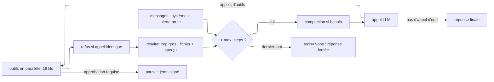
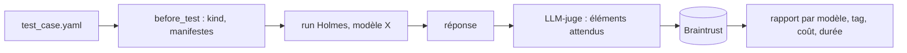

# Benchmark — HolmesGPT (agent d'enquête sur incident)

**Date :** 2026-11-24 · **Pour :** `docs/architecture/it-operations.md` (IT1, IT6, IT7, D1007, D1010) et `docs/architecture/agents.md` §3.11, §3.19 (D1031–D1034).

Méthode : lecture du dépôt cloné en `--depth 1` dans `~/Documents/shan-perso/bench/holmesgpt`. Rien n'a été installé, construit ni lancé. Les références `chemin:ligne` renvoient au commit ci-dessous. HolmesGPT dit « toolset » pour un groupe d'outils et « skill » pour un runbook.

## 1. Identité

| Champ | Valeur |
|---|---|
| Dépôt | `github.com/HolmesGPT/holmesgpt`, docs `holmesgpt.dev` |
| Statut | CNCF Sandbox, porté par Robusta |
| Commit étudié | `75ce939e` (2026-11-22), release `0.47.0` du 2026-11-22 |
| Licence | Apache-2.0, confirmée (`LICENSE`, API GitHub) |
| Stack | Python, Poetry, LiteLLM pour tous les fournisseurs, Typer (CLI), FastAPI (`server.py`), chart Helm, opérateur K8s |
| Activité | environ 4 000 étoiles, 600 forks, 164 tickets ouverts, push le 2026-11-24. Créé le 2024-05-30 |

Le cœur est ouvert. Une partie dépend de la plateforme Robusta (Supabase) : skills distants, instructions globales, conversations. Le ticket #2070 demande d'ouvrir ces instructions en dehors de Supabase.

## 2. Boucle d'enquête

- **Boucle** : `holmes/core/tool_calling_llm.py:1299` (`while i < max_steps`). `max_steps` vaut 100 par défaut (`holmes/config.py:113`).
- **Arrêt** : la boucle s'arrête quand le modèle répond sans appel d'outil (`tool_calling_llm.py:1496`). Au dernier tour, les outils sont retirés (`tool_calling_llm.py:1306`, `tools = None if i == max_steps`). Le modèle doit donc conclure. Il n'y a pas d'échec sec à `max_steps`.
- **Réponse vide** : un texte de repli cite le `finish_reason` (`tool_calling_llm.py:246`, `:1510`).
- **Détection de boucle** : un appel avec le même outil et les mêmes paramètres est refusé dès la deuxième fois (`holmes/core/safeguards.py:24`, appelé en `tool_calling_llm.py:1069`). Le refus est un résultat d'outil en erreur, pas un arrêt du run. Le commentaire du code dit que ce garde suppose un agent en lecture seule.
- **Après compaction** : la liste des appels vus est remise à zéro, sauf les appels dont la sortie a débordé (`tool_calling_llm.py:1355`, ticket interne ROB-1519). Sinon le modèle relit la même sortie et compacte en boucle.
- **Parallélisme** : tous les appels d'un tour tournent dans un pool de 16 fils (`tool_calling_llm.py:1551`).
- **Pause humaine** : un outil peut exiger une approbation (motif glob `approval_required_tools`, `holmes/core/tools.py:480`). Le run s'arrête et rend un jeton signé lié à `{id, nom, hash des arguments}` (`holmes/utils/approval_tokens.py:76`). La reprise rejoue la décision (`_execute_tool_decisions`, `tool_calling_llm.py:361`). Sans canal d'approbation, l'appel devient une erreur qui dit « rien n'a été exécuté ni mis en attente » (`tool_calling_llm.py:1618`).
- **Température** : `1e-8` par défaut, désactivable pour les modèles qui la refusent (`holmes/common/env_vars.py:78`).
- **Traces** : un span `gen_ai.chat` par appel LLM, attributs OTel GenAI (`tool_calling_llm.py:1367`). Le ticket #2663 montre que les tokens par span sont des cumuls, donc le coût est surestimé dans Langfuse.

## 3. Toolsets

Deux formats coexistent :

- **YAML** : un toolset déclare `description`, `tags`, `prerequisites` et des `tools` avec un `script` bash rendu par Jinja (`holmes/plugins/toolsets/kubernetes.yaml`). Chaque paramètre passe par `shlex.quote` (`holmes/core/tools.py:163`). Le commentaire de sécurité du fichier YAML exige l'affectation à une variable avant tout usage entre guillemets.
- **Python** : une classe `Toolset` avec des `Tool` typés (Elasticsearch, Prometheus, Datadog, Grafana). Les instructions LLM du toolset sont un gabarit Jinja à côté (`*_instructions.jinja2`).

Prérequis (`holmes/core/tools.py:776-830`, contrôle en `:1057`) :

| Genre | Exemple | Coût |
|---|---|---|
| `StaticPrerequisite` | toolset désactivé par configuration | instantané |
| `env` | variable d'environnement présente | instantané |
| `callable` | requête test (`_cluster/health` pour Elasticsearch, `elasticsearch.py:125`) | réseau |
| `command` | `kubectl version --client`, sortie attendue facultative | processus |

Les contrôles sont triés du moins cher au plus cher (`tools.py:795`). Un délai d'expiration peut marquer le toolset `FAILED` en parallèle. Le statut vaut `enabled`, `disabled` ou `failed`. Le prompt système liste les toolsets désactivés et en échec, avec l'erreur et le lien de configuration (`holmes/plugins/prompts/_toolsets_instructions.jinja2`). Le modèle peut donc dire « il manque l'intégration X » au lieu d'inventer.

Toolsets utiles pour PneX (`holmes/plugins/toolsets/`, `docs/data-sources/builtin-toolsets/`) : `kubernetes/core`, `kubernetes/logs`, `prometheus`, `elasticsearch/data` et `elasticsearch/cluster` (OpenSearch compris), `grafana/loki`, `grafana/tempo`, `grafana/dashboards`, `datadog` (logs, métriques, traces), `newrelic`, `coralogix`, `victorialogs`, bases SQL, `kafka`, `rabbitmq`, `argocd`, `helm`. Splunk passe par le serveur MCP de Splunk (`splunk-mcp.md`), pas par un toolset natif. OpenObserve n'existe pas (ticket #1055, ouvert depuis 2025-10-13). Il y a aussi un toolset `http` générique avec liste blanche d'adresses, et des serveurs MCP distants.

## 4. Lecteurs de logs

- **Pas de langage commun** : chaque backend expose sa langue native au LLM. Elasticsearch reçoit du Query DSL brut écrit par le modèle (`elasticsearch.py:436`). Loki reçoit du LogQL brut (`grafana/loki/toolset_grafana_loki.py:131`). Datadog reçoit sa syntaxe de recherche. La seule interface partagée est `fetch_pod_logs` pour les logs de pod (`logging_utils/logging_api.py:124`).
- **Aide à la requête** : le gabarit d'instructions de chaque toolset explique la syntaxe. Exemple : Loki impose des jokers sur les noms de pod et 4 h par défaut (`grafana/loki/instructions.jinja2`). Elasticsearch fournit `elasticsearch_mappings` pour découvrir les champs avant la recherche.
- **Limites** : Elasticsearch renvoie 100 documents par défaut (`elasticsearch.py:531`). Loki envoie `maxLines` = 100 par défaut. Les logs de pod lisent 7 jours et 100 lignes par défaut (`logging_api.py:22-24`). Datadog refuse une réponse au-delà de `max_response_size` (`toolset_datadog_general.py:464`). Prometheus refuse une série trop grosse et dit combien de séries et de points elle contenait (`prometheus.py:829`).
- **Troncature des logs** : `truncate_logs` coupe le **début** et garde les lignes récentes (`logging_api.py:54`). La coupe tombe sur une fin de ligne (`:97`). Un préfixe dit que des lignes ont été coupées.
- **Débordement général** : un résultat d'outil ne peut pas dépasser 15 % du contexte, plafonné à 25 000 tokens (`env_vars.py:137-143`, `holmes/core/llm.py:578`). Au-delà, le résultat complet va dans un fichier. Le modèle reçoit le chemin, un aperçu et l'ordre de le filtrer avec `cat | jq` ou `grep` (`holmes/core/tools_utils/tool_context_window_limiter.py:33`). Sans disque, le résultat est remplacé par « réduis ta requête ».
- **Compaction** : avant chaque appel LLM, si l'historique dépasse un seuil, le LLM le résume (`holmes/core/truncation/input_context_window_limiter.py:85`). Détail dans `docs/reference/context-management.md`.
- **Résumé par petit modèle** : un transformer `llm_summarize` peut résumer une sortie kubectl longue (`holmes/core/transformers/llm_summarize.py:24`). Le code le déconseille maintenant au profit du fichier.

## 5. Runbooks

- **Format** : depuis 0.26.0, un runbook est un « skill ». C'est un dossier avec un `SKILL.md`, un en-tête YAML (`name`, `description`) et un corps Markdown : but, étapes, synthèse, remédiation (`holmes/plugins/skills/README.md`). L'ancien `catalog.json` (`description`, `link`, `update_date`) est abandonné (`docs/reference/skills.md:470`).
- **Correspondance** : il n'y a aucune règle. Le catalogue (nom et description) est injecté dans le prompt utilisateur (`holmes/plugins/prompts/base_user_prompt.jinja2`). Le LLM décide seul s'il « correspond clairement » et appelle `fetch_skill` (`holmes/plugins/toolsets/skills/skills_fetcher.py`).
- **Priorité** : skills distants Robusta, puis skills de l'utilisateur, puis skills livrés. Le dossier `builtin/` est vide à ce commit.
- **Limite** : `holmes investigate alertmanager` passe `skills=None` (`holmes/main.py:175`). Le mode alerte en ligne de commande ne voit donc aucun runbook. La note de comparaison de modèles dit qu'opus-4.6 « tire parfois des runbooks non liés malgré la consigne » (`docs/development/evaluations/model-comparison-summary-20260315.md`).

## 6. Prompts et contexte injecté

- **Système** : `holmes/plugins/prompts/generic_ask.jinja2`. Il contient des blocs activables : multi-cluster, RBAC par namespace, skills, TodoWrite, consignes d'enquête, impact, Kubernetes, erreurs de droits, style.
- **Bloc « Impact and blast radius »** : c'est le meilleur morceau. Une entité n'est « affectée » que si une preuve propre à elle existe (événement, statut, ligne de log). L'inférence n'élargit jamais l'impact. Une coïncidence de temps n'est pas une cause. Le rapport classe chaque entité en quatre groupes : affectée (avec le jeton de preuve cité), vérifiée saine, changée pour une autre raison, non vérifiée.
- **Faits et hypothèses** : le prompt exige de séparer les faits observés des hypothèses (« possible », « probable »). Il demande aussi de signaler une donnée d'un autre cluster au lieu de la renommer.
- **Contexte** : date UTC et horodatage courant, catalogue de skills, toolsets actifs avec leurs instructions, toolsets en échec avec l'erreur (`base_user_prompt.jinja2`, `_toolsets_instructions.jinja2`).
- **Alerte** : l'objet brut de la source est collé tel quel dans le prompt utilisateur (`holmes/main.py:182`, `issue.raw`). Il n'est ni balisé ni nettoyé.
- **Planification** : un outil TodoWrite (`toolsets/investigator/`) impose une liste de tâches et une relecture « cinq pourquoi » avant la réponse.

## 7. Évaluation

- **Jeu** : environ 300 cas dans `tests/llm/fixtures/test_ask_holmes/` (293 dossiers), plus `compaction` et `test_holmes_checks`. Un cas déclare `user_prompt`, `expected_output` (liste d'éléments), `tags` (`easy`, `regression`, `logs`, `kubernetes`), `before_test`, `after_test`, `toolsets`, `mocked_date`, `conversation_history` (`docs/development/evaluations/adding-evals.md:80`).
- **Pas de mock** : les sorties d'outils simulées ont été retirées. `tests/llm/utils/test_toolset.py:38` dit « Always runs tools live (no mocking) ». Chaque cas monte un vrai cluster et de vraies données. `test_results.py:35` garde un champ `mock_data_failure` marqué obsolète.
- **Juge** : un LLM classifieur (`autoevals`) répond A (tous les éléments présents) ou B (`tests/llm/utils/classifiers.py:167`). Le score est binaire. Un mode `loose` compare à une réponse attendue globale. Le modèle juge est réglé à part (`CLASSIFIER_MODEL`).
- **Comparaison de modèles** : `MODEL=a,b,c` joue chaque cas sur chaque modèle, `ITERATIONS=10` répète pour mesurer la variance. Le rapport donne le taux de réussite par modèle et par tag, le coût moyen et la latence P50/P95 (`fast-benchmark-results.md`). Un run hebdomadaire tourne le dimanche avec 10 itérations.
- **Commandes refusées** : `tests/llm/utils/denied_commands.py` extrait les commandes bash refusées d'un run et les affiche dans le rapport.
- **Faiblesses connues** : le juge ne note pas l'efficacité. Deux trajectoires correctes, l'une de 5 appels et l'autre de 30 avec répétitions, ont le même score (ticket #2419). Une panne d'infrastructure de test devient un faux échec du modèle (ticket #2426, cas Loki). Le classement de mars 2026 repose sur 16 cas.

## 8. Sécurité

- **Lecture seule par RBAC** : le chart Helm donne `get`, `list`, `watch` (`helm/holmes/templates/holmesgpt-service-account.yaml`). Les secrets Kubernetes sont exclus. La lecture seule vient des droits du compte, pas du code.
- **Bash** : liste d'autorisation par préfixe, avec composition analysée (pipes, `&&`), argument dangereux refusé ou soumis à approbation (`holmes/plugins/toolsets/bash/validation.py`). Blocage codé en dur limité à `sudo` et `su` (`bash/common/config.py:9`). La liste de refus par défaut est vide (`bash/common/default_lists.py:81`).
- **Injection shell** : `shlex.quote` sur chaque paramètre, et rejet des valeurs de `request_context` qui contiennent des caractères de shell (`tools.py:163-175`).
- **Écritures** : elles existent (MCP `kubernetes-remediation`, bash étendu). Elles passent par l'approbation humaine, avec un jeton signé lié aux arguments.
- **Masquage** : seulement les en-têtes HTTP dans les logs (`datadog_api.py:262`) et `request_context` (`tools.py:346`). Aucun masquage du contenu envoyé au LLM.
- **Injection de prompt** : rien de structurel. Le ticket #2001 demandait de baliser chaque résultat d'outil comme donnée non fiable. Il est fermé le 2026-05-13 sans code correspondant à ce commit.

## 9. Pièges et limites

- **Une alerte, une enquête, sans regroupement** : `investigate alertmanager` boucle sur chaque alerte (`holmes/main.py:544`). Cinquante alertes liées donnent cinquante runs et cinquante coûts.
- **La cause vient du LLM seul** : aucune topologie calculée. Le modèle parcourt les objets lui-même (« walk the ownership chain »). L'impact dépend de sa discipline, d'où le long bloc de prompt sur l'impact.
- **Requêtes de logs écrites par le LLM** : Query DSL et LogQL bruts, sans validation. Le résultat dépend de la connaissance du schéma par le modèle.
- **Définitions d'outils trop lourdes** : tous les outils actifs partent à chaque tour (tickets #2107 et #576).
- **Retour vers la source** : un commentaire texte sur PagerDuty, Opsgenie, Jira ou GitHub, seulement avec `--update` (`holmes/plugins/sources/pagerduty/__init__.py:139`). Pas de champ structuré. PagerDuty ne lit que les 25 premiers incidents (#2743).
- **Bugs d'options** : `checks` ignore `mode: alert` (#2771), `investigate github` ignore sa configuration (#2735), `opsgenie --documents` n'est pas utilisé (#2733), le pas Prometheus `500ms` est lu comme 500 minutes (#2749).
- **Sortie structurée** : un `response_format` strict à chaque tour supprime tous les appels d'outils sur certains modèles (#2317).

URLs : `https://github.com/HolmesGPT/holmesgpt/issues/<n>` pour chaque numéro cité.

## 10. À reprendre pour PneX / à écarter

| Quoi | Pourquoi | Où dans PneX |
|---|---|---|
| Dernier tour sans outils : le modèle doit conclure | Un run d'enquête rend toujours une explication, même partielle, au lieu d'un échec `max_steps` | §3.11, `ai::agent::run_loop`, IT6 |
| Appel identique refusé comme résultat d'outil, pas comme échec | Le modèle change d'approche. PneX échoue au 3ᵉ appel identique (`agent-loop-detected`). Garder l'échec en filet, ajouter le refus doux au 2ᵉ | §3.11 |
| Garder les appels « débordants » dans le garde après compaction | Évite la boucle relire → compacter → relire | §3.11, si PneX compacte un jour |
| Résultat trop gros : stocker, renvoyer un pointeur et un aperçu, plafond en % du contexte | Le run garde la donnée sans saturer le contexte. Le pointeur devient un artefact du run, pas un fichier local | §3.11, IT1 (lecteurs) |
| Troncature des logs par la fin, coupe sur la ligne, marqueur explicite | Les lignes récentes comptent le plus. Le marqueur dit au modèle qu'il manque des données | IT1, D1002 |
| Statut des lecteurs `enabled` / `disabled` / `failed` avec l'erreur, injecté dans le prompt | Le run dit « source X non configurée » au lieu d'inventer. Prérequis triés du moins cher au plus cher | IT1, IT6 |
| Bloc « impact » : preuve par entité, quatre groupes, jeton de preuve cité | Correspond à D1008. Les quatre groupes deviennent la forme de sortie du run, chaque ligne liée à une observation | IT6, D1007, D1008 |
| Faits et hypothèses séparés dans la sortie | Rend la proposition vérifiable dans « À valider » | IT6, D833 |
| Approbation liée au hash des arguments | Même idée que `expected_version`. Une décision ne vaut que pour l'appel exact | §3.12, D1034 |
| Cas d'évaluation : prompt, éléments attendus, tags, date figée, toolsets | Format simple qui tient dans une Table (entrée, attendu) | D1033, IT7 |
| Comparaison par modèle : réussite par tag, coût, P50/P95, N itérations | Mesure la variance, pas un seul tirage. Donne le critère d'activation par défaut | D1033, IT7 |
| Liste des appels refusés dans le rapport d'évaluation | Montre où l'agent bute sur la porte. Équivalent PneX : propositions refusées par run | D1033, D833 |
| **Écarter** : cause racine par LLM seul, sans topologie | Contraire à D1006 et D1007. Le graphe calcule le chemin, le LLM l'explique | IT6, D1007 |
| **Écarter** : un run par alerte | Contraire à D1010. Le regroupement en incident vient d'abord, puis un run par incident | IT4, D1010 |
| **Écarter** : requêtes de logs brutes écrites par le LLM | Le lecteur PneX porte la requête de l'org (D1002). Le run choisit seulement la fenêtre et les filtres | IT1, D1002 |
| **Écarter** : alerte brute collée dans le prompt sans balise | PneX balise déjà l'entrée comme donnée (§3.11). Garder ce balisage pour chaque sortie d'outil (refus de #2001 chez eux) | §3.11, Q-IT7 |
| **Écarter** : évaluation uniquement en direct sur cluster | Coûteuse et fragile (#2426). PneX doit aussi rejouer des sorties d'outils enregistrées pour IT7 | D1033 |
| **Écarter** : juge binaire seul | Ajouter l'efficacité (#2419) : nombre d'appels, répétitions, tokens, déjà dans la trace D1031 | D1031, D1033 |
| **Écarter** : runbook choisi par le LLM sur sa description | PneX épingle les compétences sur l'agent. Si une règle d'incident doit choisir un runbook, c'est une règle, pas le LLM | §3.2, D1005 |
| **Écarter** : écriture vers la source en commentaire libre | PneX propose une action par la porte (D850, D838) | IT6 |
