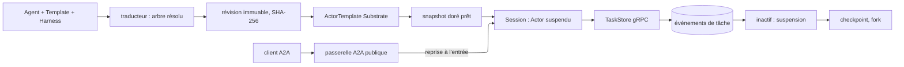

# Benchmark — kagent (agents comme ressources Kubernetes)

**Date :** 2026-11-24 · **Pour :** `docs/architecture/agents.md` §3.3, §3.5, §3.6, §3.11, §3.12, §3.19 (D1031–D1034).

Méthode : lecture du dépôt cloné en `--depth 1` dans `~/Documents/shan-perso/bench/kagent`. Rien n'a été installé, construit ni lancé. Les références `chemin:ligne` renvoient au commit ci-dessous. Les docs du dépôt (`docs/architecture/*.md`) ont été croisées avec le code. kagent dit « Actor » pour le processus d'un agent et « Session » pour une conversation.

## 1. Identité

| Champ | Valeur |
|---|---|
| Dépôt | `github.com/kagent-dev/kagent`, docs `kagent.dev` |
| Porteur | Solo.io à l'origine, communauté kagent |
| Statut CNCF | Sandbox, accepté le 2025-05-22 (`cncf/landscape`, `landscape.yml`). Demande d'incubation ouverte : `https://github.com/cncf/toc/issues/1978` |
| Commit étudié | `e8cd1533` (2026-11-23). Releases `v1.0.1` (2026-11-12) et `v0.10.7` (2026-11-23, ancienne ligne maintenue) |
| Licence | Apache-2.0, confirmée (`LICENSE`, API GitHub) |
| Stack | Contrôleur Go (controller-runtime, krt), PostgreSQL, gRPC + A2A + MCP, UI web. ADK Go et Python. Harnais natifs Claude Code et Codex (`go/harness`) |
| Exécution | Agent Substrate (`go.ate.dev/substrate v1.1.0-alpha1`, `go/go.mod:58`), projet CNCF Sandbox séparé : micro-VM ou gVisor, suspension et reprise en moins d'une seconde |
| Activité | environ 4 500 étoiles, 940 forks, 289 tickets ouverts, push le 2026-11-23. Créé le 2025-01-21 |

La ligne 1.x est une réécriture. Les anciennes ressources (`ToolServer`, `Memory`, `SandboxAgent`) ont disparu. La v1 dépend de Substrate pour tout le cycle de vie.

## 2. Modèle déclaratif

Kubernetes porte la configuration voulue. PostgreSQL porte l'état d'exécution : révisions compilées, sessions, tâches A2A, checkpoints (`docs/architecture/README.md`, tableau « Resource ownership »).

| Ressource (`api.kagent.dev/v1alpha3`) | Rôle | Réf. |
|---|---|---|
| `Agent` | relie un comportement (`template.inline` ou `template.ref`) à un `harnessRef`. Choisit ses `egressPolicyRefs` | `go/api/v1alpha3/agent_types.go:46` |
| `AgentTemplate` | modèle, prompt système, schéma de sortie, outils (MCP ou sous-agent), compétences, plugins | `agenttemplate_types.go:180` |
| `Harness` | moteur (`kagent`, `codex`, `claude`, `byo`), image, env, politique Substrate, compaction, mémoire | `harness_types.go:144` |
| `ModelConfig` | fournisseur et modèle. Une seule auth parmi `apiKeySecret`, `actorJwt`, `tokenPassthrough` | `modelconfig_types.go:575` |
| `RemoteMCPServer` | serveur MCP distant, en-têtes depuis un Secret, JWT d'acteur, namespaces autorisés | `remotemcpserver_types.go:38` |
| `EgressPolicy` | origines HTTP(S) en plus, avec en-tête de crédential | `egresspolicy_types.go:15` |
| `SandboxTemplate` | image d'un bac à sable autonome, sans agent | `sandboxtemplate_types.go:24` |

Ce qui n'est pas une ressource Kubernetes : `Session`, `Sandbox`, `ScheduledRun`, checkpoint. Ils vivent en base et passent par gRPC.

## 3. Exécution

- **Compilation** : `Compiler.CompileAgent` résout l'arbre de templates et appelle le compilateur du harnais (`go/core/internal/translator/compiler.go:101`). La révision a pour identité le SHA-256 de l'entrée compilée (`translator/revision.go:26`). Les noms de Secret entrent dans l'identité. Les valeurs n'y entrent pas.
- **Échec** : une édition ratée garde la dernière révision réussie pour les nouvelles sessions. Les sessions existantes restent épinglées (`runtime-and-lifecycle.md`, « Creation and state »).
- **Session** : un Actor créé suspendu. Substrate le reprend à la requête suivante et le suspend quand il est inactif. Une session expire après 7 jours sans tâche (`config.sessions.idleTtl`).
- **Concurrence** : une opération de cycle de vie porte un UUID et un « executor claim » en base. Un claim mort expire après 2 min. Aucun travail réseau ne tient une transaction.
- **Harnais natifs** : Claude Code et Codex tournent dans l'Actor. Un adaptateur traduit leurs événements en tâches A2A (`go/harness/README.md`). L'ID de continuation natif reste un état privé de l'Actor.
- **Persistance** : `session_task_event` est le journal append-only. `session_task` est une vue rejouable. Un checkpoint lie une coupure d'historique à un tag de snapshot Substrate. Un fork copie l'historique jusqu'à la coupure (`persistence-checkpoints-and-forks.md`).
- **Mémoire** : pgvector, résumé LLM tous les 5 tours, TTL 15 jours, prolongé si l'entrée sert 10 fois. Dimension codée en dur à 768 (`design/EP-1256-memory.md`, « Limitations »).

## 4. Outils MCP et A2A

- **Outils intégrés** : le chart déploie `kagent-tools`, un serveur MCP séparé (Kubernetes, Helm, Istio, Argo Rollouts, Prometheus, Grafana, Cilium). Il est publié comme un `RemoteMCPServer` (`helm/kagent/values.yaml:782`).
- **Liaison** : `MCPToolBinding` choisit un serveur, une liste d'outils (50 au plus) et `requireApproval` (`agenttemplate_types.go:54`). Un harnais qui ne sait pas filtrer expose tout le serveur et émet un avertissement.
- **Découverte** : le contrôleur range les outils découverts dans le statut du `RemoteMCPServer` (`remotemcpserver_types.go:100`).
- **Identité vers l'aval** : `actorJwt` fait injecter par la passerelle un JWT de l'Actor, borné à des audiences, valable 5 à 60 min (`actor_jwt_types.go:7`). L'audience `kagent-runtime` est réservée. Le service aval résout l'agent par `ResolveAgentIdentity` (`docs/architecture/agent-identity-lookup.md`).
- **`tokenPassthrough`** : le jeton de l'appelant A2A part vers le serveur MCP. La découverte n'a pas de jeton, donc elle doit être coupée par label.
- **kagent comme serveur MCP** : `/mcp` liste et invoque les sessions, crée des checkpoints et des forks, pilote les bacs autonomes. Il implémente l'extension MCP Tasks sur la même tâche A2A (`docs/architecture/mcp.md`).
- **A2A** : chaque agent a une Agent Card et un point A2A public. Deux formes de sous-agent (`a2a-subagents.md`) :
  - un template « Shared » compilé dans le même Actor, donc sans isolation réseau propre.
  - un agent A2A distant appelé comme un outil, avec reprise d'un `input-required` de l'enfant.
- **Délégation** : la délégation publique entre sessions (`subAgent.agentRef`) est reportée (`agenttemplate_types.go:88`, ticket #3642).
- **Extensions A2A versionnées** : HITL (`kagent.dev/extensions/hitl/v1`) et usage de tokens (`usage/v1`). Push vers un webhook à l'attente d'entrée ou à la fin, signé par JWT (`a2a-push-notifications.md`).

## 5. Contrôle

- **Approbation** : un appel d'outil sous `requireApproval` met la tâche A2A en `input-required`. La passerelle persiste l'événement et met l'Actor au repos à cette frontière exacte. Le client répond sur la même tâche avec une décision par `call_id`. Le serveur refuse une réponse incomplète, dupliquée ou périmée (`human-in-the-loop.md`).
- **Refus** : le modèle reçoit « Tool call was rejected by user. Reason: … ». Il peut donc reformuler et redemander.
- **Claude Code** : l'adaptateur passe `--permission-prompt-tool` vers un serveur MCP interne d'approbation (`go/harness/claude/internal/adapter/adapter.go:128`). Les permissions natives du harnais deviennent la même pause A2A.
- **`ask_user`** : outil intégré des ADK, actif par défaut. On peut le couper pour toute l'installation, pas par agent.
- **Secrets** : la clé du modèle et les en-têtes MCP ne sont jamais dans l'Actor. Le SDK reçoit un placeholder inerte. La passerelle egress de Substrate lit le Secret Kubernetes et remplace l'en-tête à la sortie, pour la seule destination prévue (`credential-injection.md`, `translator/credentials.go:100`). Une rotation passe sans redémarrage, avec un cache de 5 min.
- **Coût de cette injection** : c'est un proxy HTTPS qui déchiffre. Chaque Actor reçoit une CA (`/run/kagent/egress/trust-bundle.pem`). Un client BYO doit respecter ce bundle.
- **Egress** : liste blanche par origine (schéma, nom DNS, port). Un joker remplace un seul label. Les IP littérales sont refusées. Une redirection vers une autre origine est bloquée (`egress-policies.md`).
- **Multi-tenancy** : la frontière est le namespace. Une référence entre namespaces exige `allowedNamespaces` sur la cible (`cross-namespace-references.md`).
- **Autorisation** : EP-1270 définit des portées (`ALL`, `NONE`, `ANY_OF` sur namespace et nom) appliquées avant tri, total et pagination (`go/api/authorization/scope.go`). Le moteur de politique est externe. **L'installation OSS par défaut autorise tout** (`design/EP-1270-scoped-authorization.md`, « Default OSS behavior »).
- **Partage** : une session se partage par `session_share`. Une suppression révoque les partages dans la même transaction.

## 6. Traces et évaluation

- **Contrat de télémétrie** : un registre OpenTelemetry Weaver (`telemetry/registry`) fixe chaque attribut `kagent.*` et `a2a.*` et les attributs GenAI repris. Les constantes Go et Python en sont générées. Un changement de contrat se voit en revue (`docs/architecture/telemetry.md`).
- **Contenu** : messages, arguments et résultats d'outil seulement sur opt-in de capture, avec des drapeaux `kagent.capture.*_truncated`.
- **Harnais natifs** : le runtime lit les événements de Claude Code et de Codex et produit lui-même les spans d'inférence et d'outil. Les compteurs de tokens incluent cache et raisonnement (`telemetry-contract.md`).
- **Angles morts** : la doc tient une section « Blind spots » qui dit ce que chaque runtime n'émet pas encore.
- **Évaluation** : aucune dans le dépôt. Le retour 👍/👎 a été retiré. Le ticket #3682 demande de le rétablir.

## 7. Déclencheurs

- **ScheduledRun** : cron à 5 champs, fuseau obligatoire (`Local` refusé), prompt de 32 Kio au plus, `paused`, délai d'exécution de 15 min par défaut, file comprise (`proto/kagent/api/v1/scheduled_runs.proto:26`, `go/api/scheduledrun/schedule.go:36`).
- **Réservation** : un planificateur élu réserve les échéances par `FOR UPDATE SKIP LOCKED`. **Une échéance en retard de plus de 30 s est sautée**, sans rattrapage (`go/core/internal/database/scheduled_runs.go:245`).
- **Envoi** : un claim durable empêche un double envoi après un résultat incertain (`controller/scheduledrun/controller.go:36`).
- **Délégation durable** : l'envoi automatique tourne sous une identité du plan de contrôle. Retirer les droits du créateur n'arrête pas la planification (EP-1270, « Scheduled execution is durable delegation »).
- **Autres entrées** : un appel A2A, un appel MCP, l'UI, la CLI. Aucun déclencheur sur événement (alerte, changement de donnée).

## 8. Pièges et limites

- **Substrate obligatoire** : sans lui, rien ne tourne. Il impose une CA de MITM, des noms DNS complets pour chaque service et aucune IP littérale (`runtime-and-lifecycle.md`).
- **Doc en retard sur le code** : `human-in-the-loop.md` dit que l'API ne permet pas d'approbation par outil MCP. Or `requireApproval` existe et les trois harnais l'appliquent (`translator/claude/mcp.go:81`, `translator/codex/mcp.go:73`).
- **Sous-agents Shared** : ils partagent l'Actor et donc tout l'egress du parent.
- **Autorisation ouverte par défaut** : sans intégration externe, tout utilisateur authentifié voit et modifie tout.
- **Fuites et oracles** : le runtime Python garde tous les en-têtes entrants, `Authorization` compris, dans l'état de session (#3658). Une recherche A2A par ID révèle l'existence de la ressource d'un autre (#3787).
- **Fiabilité des harnais** : un long tour Claude perd la réponse finale sur un JSON tronqué (#3759). Le flush de télémétrie échoue sur 25 % des tours à cause du checkpoint (#3758). Les harnais ne valident pas pareil une réponse `ask_user` (#3657).
- **Planification** : un run dont le prompt n'a pas été accepté reste `RUNNING` jusqu'à son délai et n'est pas renvoyé (#3727).
- **Adaptateurs de modèle** : erreurs de format Bedrock, Ollama et Gemini (#3717, #3701, #3710).
- **Identité vers le modèle** : pas encore d'identité d'agent fiable pour les appels sortants au modèle (#3740).

URLs : `https://github.com/kagent-dev/kagent/issues/<n>` pour chaque numéro cité.

## 9. À reprendre pour PneX / à écarter

| Quoi | Pourquoi | Où dans PneX |
|---|---|---|
| Secret remplacé à la sortie : placeholder dans le bac, vraie valeur posée par un proxy pour une seule destination | Supprime « l'agent peut lire ses secrets, donc il peut les divulguer ». PneX le fait déjà pour la clé LLM (D385). Candidat pour les jetons d'API des runs, quand un cas réel justifie le proxy par nom | §3.5 (D705, D731), composant du runner |
| Permission native du harnais routée vers la pause d'approbation (`--permission-prompt-tool`) | Un harnais tiers garde sa boucle mais une personne décide ses actions risquées. La porte ne couvre aujourd'hui que l'agent interne | §3.12, niveau `hosted`, question ouverte |
| Refus renvoyé au modèle avec sa raison, sur le même run | Le modèle reformule au lieu d'échouer. S'accorde avec la reprise sur décision humaine | §3.12, D1034 |
| Décision liée à chaque `call_id`, réponse incomplète ou périmée refusée | Même idée que `expected_version` : une décision vaut pour un appel exact | §3.12, D1034 |
| Jeton de run à audiences, avec lookup d'identité pour un service aval | Un MCP de l'org vérifie quel agent et quel run l'appellent sans recevoir d'autre secret | §3.6, token `pnagr_` |
| Révision = SHA-256 de la fiche compilée, références de secret comprises, valeurs exclues | Prouve qu'un run a tourné sur une fiche exacte. Une édition ratée ne casse pas le dernier état valide | §3.2, `agent_versions` |
| Registre de télémétrie qui génère les constantes, capture de contenu sur opt-in avec drapeau de troncature | Les noms GenAI restent stables entre moteurs. Le contenu suit D709 | §3.19, D1031, D1032 |
| Spans d'inférence produits depuis les événements du harnais | Le run `sandbox` reçoit un arbre sans instrumenter le harnais. La passerelle LLM fournit déjà les appels | §3.19, D1031 |
| Section « angles morts » par moteur | Dit honnêtement ce que chaque moteur ne trace pas encore | §3.19 |
| Règles de planification : fuseau explicite, `Local` refusé, échéance manquée tracée | PneX planifie par flow `inject`. Vérifier qu'une échéance sautée laisse une trace, pas un silence | §3.11, flows |
| Autorisation appliquée avant tri, total et pagination | Un total ou un 404 ne doit pas révéler une ressource d'une autre org. Ajouter ce cas aux tests R1 | `security.md` R1, R2 |

À écarter :

| Quoi | Pourquoi |
|---|---|
| CRDs Kubernetes comme source de vérité des agents | PneX garde la fiche versionnée en PostgreSQL et l'agent comme compte de service IAM. Un CRD lie l'agent à un cluster, échappe à l'IAM de l'org et contredit D386 (PneX ne tient aucun kubeconfig) |
| Dépendance à Substrate et CA de MITM dans chaque bac | Lourd à installer chez l'exploitant. Le runner PneX tient déjà pod et micro-VM avec `NetworkPolicy` et nftables |
| Session longue avec Actor suspendu et repris | PneX garde un bac par run, détruit à la fin (D712). La reprise vient de D1034, pas d'un snapshot de VM |
| Mémoire résumée par LLM, élaguée par popularité | Non traçable. Dans PneX, la mémoire durable est l'ontologie et les compétences versionnées |
| Sous-agent compilé dans le même processus | Pas d'isolation de droits ni d'egress. Dans PneX, la délégation est un flow entre runs distincts |
| Autorisation ouverte par défaut | Contraire au modèle de menace PneX (frontière = org, R1, R2) |
| A2A comme protocole principal | PneX expose MCP généré depuis OpenAPI et chaîne les runs par flows. A2A reste une piste si un client externe le demande |
