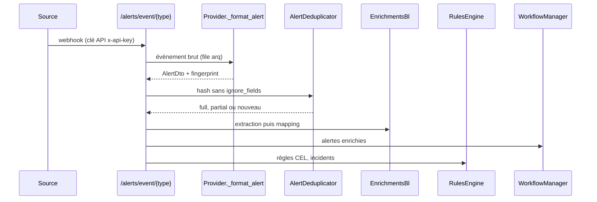
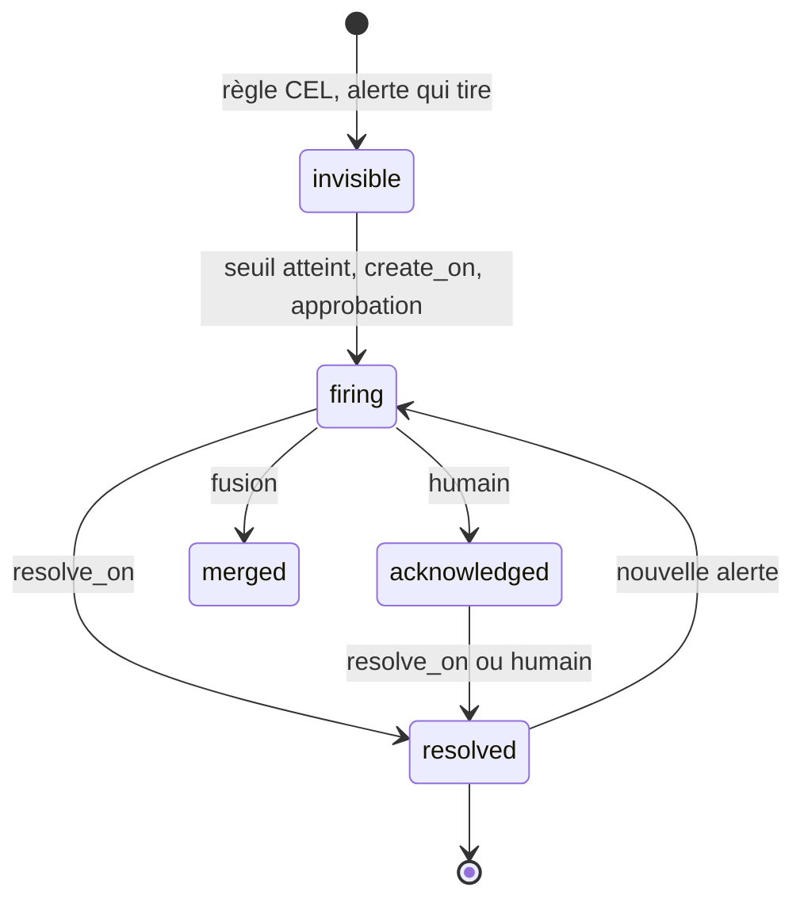

# Benchmark — Keep (gestion d'alertes AIOps)

**Date :** 2026-11-24 · **Pour :** `docs/architecture/it-operations.md` (D1001–D1012, lots IT0–IT7).

Méthode : lecture du dépôt cloné en `--depth 1` dans `~/Documents/shan-perso/bench/keep`. Rien n'a été installé, construit ni lancé. Les références `chemin:ligne` renvoient au commit ci-dessous. Les tickets viennent de `gh search issues`.

## 1. Identité

| | |
|---|---|
| Dépôt | `https://github.com/keephq/keep` |
| Commit étudié | `60aa8e05` (2026-11-22), version `0.55.0` |
| Licence | MIT hors `ee/`. `ee/` est sous licence commerciale (`ee/LICENSE`). GitHub affiche `NOASSERTION` à cause de ce double régime. |
| Contenu de `ee/` | Seulement `ee/identitymanager/` (Auth0, Azure AD, Keycloak). Tout le reste étudié ici est MIT. |
| Stack | Python 3.11+, FastAPI, SQLModel, `arq` (Redis) pour les tâches, `celpy` pour CEL, `openai==1.37.1`. UI Next.js 15, React 19, `@xyflow/react` + `dagre` pour la topologie. 132 fournisseurs dans `keep/providers/`. |
| Activité | 12 558 étoiles, 707 tickets ouverts. Release `v0.55.0` le 2026-11-03. 80 commits depuis le 2026-05-24, presque tous des correctifs. Les auteurs sont surtout externes. Un cofondateur fusionne encore. |

- Le dépôt ne mentionne pas le rachat par Elastic. Je n'ai pas vérifié la date du rachat.
- Le projet vit en mode maintenance : correctifs, auth OIDC, mises à jour de dépendances. Aucune nouvelle capacité de corrélation depuis six mois.

## 2. Fournisseurs

Un fournisseur est une classe Python qui hérite de `BaseProvider` (`keep/providers/base/base_provider.py:47`). Elle déclare ses champs d'auth en dataclass, ses scopes et ses méthodes.

- **Push** : `POST /alerts/event/{provider_type}` (`keep/api/routes/alerts.py:685`). L'auth est une clé API Keep avec le scope `write:alert`. Il n'y a pas de signature HMAC par source.
- **Pull** : `_get_alerts()` (`base_provider.py:603`). `pull_data_from_providers` (`keep/api/routes/preset.py:50`) le lance quand un utilisateur lit les presets d'alertes. Ce n'est pas un ordonnanceur.
- Intervalle de pull par défaut : 10 080 minutes, donc une fois par semaine (`keep/api/consts.py:9`). `last_pull_time` s'écrit avant le pull, même en cas d'échec (`preset.py:108`).
- Le pull n'a pas de curseur. Chaque fournisseur relit une fenêtre fixe (Grafana : 7 jours, `grafana_provider.py:1206`).
- **Normalisation** : `format_alert()` (`base_provider.py:429`) appelle `_format_alert()` du fournisseur, pose `providerId` et `providerType`, puis applique la règle de dédoublonnage de l'org. `AlertDto` (`keep/api/models/alert.py:75`) porte `name`, `status`, `severity`, `service`, `environment`, `source[]`, `labels`, `lastReceived`, `fingerprint`, et accepte tout champ en plus.
- **Requête** : `_query()` sert aux étapes de workflow. C'est le seul accès aux stores de logs. Il n'existe pas de lecteur de logs autonome.
- **Topologie** : `BaseTopologyProvider.pull_topology()` (`base_provider.py:928`). Huit fournisseurs l'implémentent (Grafana, Datadog, PagerDuty, ServiceNow, ArgoCD, FluxCD, Cilium).
- **Santé** : `ProviderHealthMixin` (`base_provider.py:1004`) mesure la couverture de topologie, les règles d'alerte et les alertes bruyantes.

## 3. Lecteurs utiles à PneX

**Splunk** (`splunk_provider/splunk_provider.py`)
- Auth : jeton API, port 8089. `verify=false` bascule aussi le schéma en `http` (`:276`).
- Pas de lecture ni de pull. Seulement un webhook entrant.
- `setup_webhook` réécrit **toutes** les recherches sauvegardées pour ajouter l'action webhook (`:311`). La clé API Keep passe dans l'URL.
- Empreinte : `exception`, `logger`, `service`, sinon `name` (`:370`). `lastReceived` vaut l'heure de réception, pas l'heure de l'événement.

**Elasticsearch** (`elastic_provider/elastic_provider.py`)
- Auth : clé API ou login, `host` ou `cloud_id`.
- `_query` : SQL (`client.sql.query`) sans index, ou `_search` avec index (`:220`). La méthode s'appelle `_run_eql_query`, mais elle n'exécute pas d'EQL (`:261`).
- `size` vaut 10 par défaut. Pas de PIT, pas de `search_after`, pas de curseur SQL.

**OpenSearch** (`opensearchserverless_provider/`)
- Seulement OpenSearch Serverless sur AWS (SigV4, service `aoss`).
- `_query` envoie un `_search` brut (`:248`). Pas de pagination. `_notify` écrit des documents.

**Loki** (`grafana_loki_provider/grafana_loki_provider.py`)
- Auth : aucune, Basic **ou** `X-Scope-OrgID` (`:122`). Les deux ensemble sont impossibles. Un Loki multi-tenant derrière Basic ne marche pas.
- `query` et `query_range` (`:166`). Pas de découpage, pas de reprise, pas de timeout HTTP.

**Grafana** (`grafana_provider/grafana_provider.py`)
- Auth : jeton de service. Pull = règles + historique d'état sur 7 jours (`:1192`).
- `setup_webhook` crée un point de contact et réécrit la politique de notification racine (`:537`), avec `verify=False`.
- Topologie : requête PromQL sur `traces_service_graph_request_total` par `(client, server)` via `/api/ds/query` (`:1606`). Le graphe vient des métriques de service graph de Tempo.

**Prometheus / Alertmanager** (`prometheus_provider/prometheus_provider.py`)
- Pull : `GET /api/v1/alerts` (`:153`). Push : récepteur webhook d'Alertmanager.
- Empreinte : celle d'Alertmanager (`FINGERPRINT_FIELDS = ["fingerprint"]`). Les labels deviennent des attributs de l'alerte.
- `lastReceived` = maintenant. Pas de timeout HTTP.

**Kubernetes** (`kubernetes_provider/kubernetes_provider.py`)
- Auth : jeton bearer, ou compte de service in-cluster.
- `_query` : 14 commandes de lecture (pods, events, nodes, services, ingresses…) (`:143`). Les listes n'utilisent ni `continue` ni watch.
- Le même fournisseur porte des écritures : redémarrage, cordon, drain, scale (`:743`–`:1042`).

**GitHub, GitLab**
- GitHub : derniers commits et releases d'un dépôt (`github_provider.py:59`), via PyGithub. Sert à enrichir une alerte.
- GitLab : création de ticket seulement (`gitlab_provider.py:146`). Les pipelines sont dans d'autres fournisseurs.

**NetBox** (`netbox_provider/netbox_provider.py`)
- Webhook seulement. Chaque changement NetBox devient une « alerte » (`:46`).
- La doc intégrée demande de désactiver la vérification SSL (`:24`).
- Aucune lecture de l'inventaire. Le ticket #3931 (topologie physique depuis NetBox) est ouvert depuis mars 2025.

**OpenObserve** (`openobserve_provider/openobserve_provider.py`)
- Webhook seulement. `setup_webhook` crée un modèle et une destination, puis ajoute la destination à **toutes** les alertes de l'org (`:326`).

## 4. Dédoublonnage et empreintes

- L'empreinte dit « même alerte ». Le fournisseur la calcule. Sans champs, l'empreinte vaut `name` (`base_provider.py:541`).
- Une règle de l'org peut remplacer les champs d'empreinte par source (`apply_custom_deduplication_rule`, `base_provider.py:493`). Si aucun champ n'existe sur l'alerte, toutes les alertes partagent la même empreinte. Keep écrit seulement un avertissement.
- Le hash dit « même contenu ». Keep retire les `ignore_fields`, puis calcule SHA-256 du JSON trié (`alert_deduplicator.py:45`).
- **Dédoublonnage complet** : même empreinte, même hash. Keep ne garde pas l'alerte. Il met à jour `lastReceived` et écrit un audit (`process_event_task.py:171`).
- **Dédoublonnage partiel** : même empreinte, hash différent. Keep garde l'alerte comme nouvel état de la même alerte.
- Règle par défaut : `full_deduplication=True`, `ignore_fields=["lastReceived"]` (`alert_deduplicator.py:260`).
- Chaque décision écrit un événement `full`, `partial` ou `none`. L'UI affiche un taux de dédoublonnage par règle.
- Piège : Grafana hache `json.dumps(labels)` sans tri des clés (`grafana_provider.py:364`). Deux ordres de labels donnent deux empreintes.
- Ticket #6849 : ignorer un champ imbriqué absent fait tomber l'alerte. Ticket #2312 : impossible d'aligner les empreintes entre outils.

## 5. Enrichissement et rattachement

Deux étages, avant et après le formatage.

- **Règle d'extraction** : regex à groupes nommés sur un attribut, filtrée par une condition CEL (`enrichments_bl.py:132`). Elle peut tourner avant le formatage (`pre=True`). Les groupes deviennent des attributs.
- **Règle de mapping** (`keep/api/models/db/mapping.py:9`) : `matchers` est une liste de listes. AND dans une liste, OR entre les listes. `priority` ordonne les règles.
  - Type `csv` : les lignes d'un CSV en JSON. Une ligne correspond si chaque attribut est égal, vaut `*`, ou passe `re.search` (`enrichments_bl.py:556`). Les autres colonnes enrichissent l'alerte.
  - Type `topology` : égalité sur les colonnes de `TopologyService`, puis `.first()` (`keep/api/core/db.py:5050`). Le service trouvé copie ses champs (équipe, dépôt, application) dans l'alerte.
- Chaque essai écrit un événement d'enrichissement `SUCCESS` ou `SKIPPED` par règle (`enrichments_bl.py:928`).
- L'enrichissement est stocké par empreinte. Il survit aux nouvelles occurrences, sauf s'il est marqué `dispose_on_new_alert`.

Comparaison avec D1005 :

| Keep | PneX (D1005) |
|---|---|
| Le mapping ajoute des colonnes à l'alerte | Le rattachement donne un actif, donc un nœud du graphe |
| `re.search` non ancré : `api` correspond à `api-gateway` | Correspondance exacte ou ancrée |
| Topologie : `.first()` si plusieurs services correspondent | Une ambiguïté se compte et se montre |
| Alerte sans service connu : ignorée par la topologie, log `debug` (`topology_processor.py:159`) | Exigence 5 : compteur des non rattachés |
| Extraction regex avant rattachement | Idée à garder : extraire `host`, `pod` d'un message avant la règle |

## 6. Corrélation

**Règles CEL** (`keep/rulesengine/rulesengine.py:73`, modèle `keep/api/models/db/rule.py:33`).

- `definition_cel` : expression CEL. Les sous-règles sont les groupes séparés par `||`.
- `grouping_criteria` : chemins d'attributs. Leurs valeurs forment `rule_fingerprint`, la clé de l'incident (`rulesengine.py:566`).
- `timeframe` : fenêtre glissante. Un incident expire si sa **dernière** alerte est plus vieille que la fenêtre (`db.py:2408`). Un incident résolu ou fusionné expire aussi.
- `threshold` : nombre d'alertes avant que l'incident soit visible.
- `create_on` : `any` (une sous-règle suffit) ou `all` (toutes les sous-règles doivent avoir une alerte qui tire).
- `resolve_on` : `first_resolved`, `last_resolved`, `all_resolved` ou `never`.
- `require_approve` : l'incident reste invisible jusqu'à une validation humaine.
- `multi_level` : un incident par valeur d'une propriété de liste. Un seul critère est admis.
- Un incident naît seulement si l'alerte tire (ticket #3418).
- Le moteur parcourt toutes les règles pour chaque alerte. Le code le note comme limite d'échelle (`rule.py:26`).
- Fenêtres de maintenance (CEL) : appliquées avant le dédoublonnage (`process_event_task.py:396`).

**Corrélation par topologie** (`keep/topologies/topology_processor.py`).

- Elle est désactivée par défaut (`KEEP_TOPOLOGY_PROCESSOR`, `:44`). Elle tourne toutes les 10 secondes.
- Elle regroupe par **application** seulement (`:145`) : une application avec au moins un service en alerte reçoit un incident.
- Les arêtes de dépendance ne servent pas. `_check_topology_for_incidents` est vide (`:218`).
- `look_back_window` (15 min) est déclarée mais jamais lue (`:61`). Le processeur lit les 1 000 dernières alertes.
- Ticket #6731 : réimporter la topologie crée des incidents en double.

**Corrélation par IA** (`keep/api/bl/ai_suggestion_bl.py`).

- Entrée : au plus 50 alertes (`:240`). Chaque alerte part en JSON complet, toute la topologie aussi (`:352`).
- Sortie : schéma JSON strict. Incidents avec indices d'alertes (base 1), raisonnement, sévérité, actions, score de confiance et son explication.
- La réponse est mise en cache par la liste des empreintes. L'humain valide, avec un retour enregistré (`commit_incidents`).
- Le résumé d'incident par LLM dépend de `EE_ENABLED`. La tâche `process_summary_generation` n'est pas dans le dépôt (`incidents_bl.py:224`).

## 7. Topologie

- Modèle : `TopologyService`, `TopologyServiceDependency` (avec `protocol`), `TopologyApplication` (`keep/api/models/db/topology.py`). Un service porte `service`, `environment`, `ip_address`, `mac_address`, `namespace`, `manufacturer`, `team`, `repository`.
- Une seule couche plate : tout est un « service ». Pas de site, de baie, de lien ni d'hôte.
- Import : chaque pull **efface** les services et dépendances du fournisseur, puis les réécrit (`process_topology_task.py:45`). Il n'y a ni historique ni date.
- Saisie manuelle possible (`is_manual`). Une application regroupe des services à la main.
- Usage : enrichissement par mapping `topology`, incidents par application, contexte de l'IA, vue graphe dans l'UI.
- Faille ouverte #6881 : `TopologyServiceDependency` n'a pas de `tenant_id`. Un tenant peut modifier ou supprimer une arête d'un autre tenant par son identifiant.

## 8. Workflows et cycle de vie d'un incident

- Format YAML : `triggers`, `steps` (lecture via `_query`), `actions` (écriture via `_notify`). 113 exemples dans `examples/workflows/`.
- Déclencheurs : `manual`, `interval`, `alert` (CEL ou anciens filtres), `incident` (`created`, `updated`, `deleted`).
- Lire un store de logs passe par un workflow : `interval` + étape `elastic` + action `keep` qui crée des alertes (`examples/workflows/create_alerts_from_elastic.yml`). La fenêtre est dans la requête. Il n'y a pas de curseur.
- Ordonnanceur : 20 workers, détection des exécutions trop longues, collisions réessayées (`keep/workflowmanager/workflowscheduler.py`).
- Piège : les anciens filtres deviennent du CEL par concaténation de chaînes (`workflowmanager.py:180`). Une valeur avec un guillemet casse l'expression.
- États d'incident : `firing`, `acknowledged`, `resolved`, `merged`, `deleted` (`keep/api/models/db/incident.py:51`).

## 9. Pièges et limites

- Écriture vers la source à l'installation : Splunk, Grafana, OpenObserve modifient la configuration du client (§3).
- `verify=False` codé en dur dans Grafana, conseillé dans la doc NetBox.
- Pas de timeout HTTP dans Loki, Prometheus, OpenObserve.
- Pull hebdomadaire déclenché par une lecture d'UI, sans curseur. Tickets #4749 (fuseau de `last_pull_time`), #6971 (pull en échec).
- Horodatage de réception à la place de l'heure de l'événement (Prometheus, Splunk).
- Topologie sans historique, sans couches, rattachée par nom de service seulement.
- Corrélation topologique par application, sans parcours des dépendances.
- Faille inter-tenant sur les arêtes : https://github.com/keephq/keep/issues/6881
- Topologie physique demandée, pas faite : https://github.com/keephq/keep/issues/3931
- Doublons d'incidents après réimport : https://github.com/keephq/keep/issues/6731
- `create_on: all` bloqué si le CEL contient `null` : https://github.com/keephq/keep/issues/6694
- Champ ignoré absent = alerte perdue : https://github.com/keephq/keep/issues/6849
- Dédoublonnage cassé pour les fournisseurs liés : https://github.com/keephq/keep/issues/5251

## 10. À reprendre pour PneX, à écarter

**À reprendre**

| Quoi | Pourquoi | Où |
|---|---|---|
| Deux niveaux : empreinte (même signal) et hash sans champs ignorés (même contenu) | Une ligne par état réel. Un doublon complet met seulement à jour la date de dernière vue. | IT3, Table des signaux |
| Champs d'empreinte réglables par source, JSON trié, compteur si aucun champ trouvé | Évite l'empreinte unique silencieuse et le piège de Grafana | IT1, réglage du lecteur (D1002) |
| Compteur `full` / `partial` / `none` par règle | Montre le bruit retiré, source par source | IT3, IT7 |
| Extraction regex avant rattachement, sous condition | Tire `host`, `pod`, `service.name` d'un message brut | IT3, D1005 |
| Forme des matchers : OR de listes AND, joker `*`, priorité | Simple à écrire, couvre `(service AND region) OR pod` | D1005, règle du pack |
| Trace par règle et par signal (`SUCCESS`, `SKIPPED`) | Explique pourquoi un signal n'a pas d'actif | IT3, exigence 5 |
| `threshold`, `resolve_on`, `require_approve` sur la règle d'incident | `require_approve` = proposition D367. `resolve_on` manque au doc. | IT4, D1006 |
| Pas d'incident sur un signal déjà résolu | Évite les incidents fantômes après une reprise | IT4 |
| Fenêtre de maintenance avant le regroupement | Absente de `it-operations.md`. À ajouter en Reste à faire. | IT4 |
| Topologie découverte par `traces_service_graph_request_total` par `(client, server)` | Source peu coûteuse de liens `depends_on` découverts | IT2, D1004 |
| Santé du lecteur : part des signaux sur un actif connu, signaux bruyants | Mesure le taux de rattachement demandé à IT3 | IT3, IT7 |
| Sortie IA en schéma strict avec score et explication, validée par un humain avec retour | Forme utile pour les propositions du run d'enquête | IT6, D1007 |

**À écarter**

| Quoi | Pourquoi | Où PneX fait autrement |
|---|---|---|
| `setup_webhook` qui réécrit les recherches Splunk, les alertes OpenObserve, la politique Grafana | Écriture vers la source, sans accord | D1001, exigence 1 : PneX donne la config à coller, ou passe par D563 |
| Clé API dans l'URL du webhook, pas de signature | Fuite dans les logs du client | Webhook signé D795 |
| Pull lancé par une page d'UI, hebdomadaire, sans curseur, date écrite avant succès | Perte et relecture de données | IT1 : planifié, borné, curseur avancé après succès |
| Heure de réception à la place de l'heure de l'événement | Fausse la fenêtre de temps | Garder les deux dates (bitemporel) |
| Topologie effacée puis réécrite à chaque import | Pas de rejeu à une date passée | D179, exigence 11 |
| Une seule couche « service », rattachement par nom | Ne voit ni lien réseau ni hôte | D1003, couches `physical` → `business` |
| Regroupement par application, arêtes ignorées | Pas de cause probable ni d'impact | D1006, D1008, liens `propagates_failure` |
| Alertes hors topologie ignorées en `debug` | Perte silencieuse | Exigence 5 |
| Mapping `re.search` non ancré, `.first()` sur ambiguïté | Rattachement faux sans trace | D1005 : exact ou ancré, ambiguïté comptée |
| IA qui regroupe 50 alertes JSON brutes + toute la topologie | Le LLM décide, et reçoit des données personnelles | D1007, exigence 10, Q-IT7 : chemin calculé, extraits marqués |
| CEL construit par concaténation de valeurs | Injection d'expression | Paramètres liés, jamais de concaténation |
| Arêtes sans `tenant_id` (#6881) | Faille inter-org | R1 : chaque ligne porte son org |
| Lecture et actions (drain, scale) dans le même connecteur Kubernetes | Un jeton de lecture devient un jeton d'action | Exigence 2 : lecteur en lecture seule, action à part (D563) |
| NetBox lu comme flux d'« alertes » | Ne donne pas d'inventaire | IT2 : lire sites, équipements, câbles, interfaces par l'API |
| Lecteurs Elasticsearch, Loki, OpenSearch | `size=10`, pas de PIT, pas de découpage, pas de timeout | Le tableau « Lire sur place » de `it-operations.md` reste la référence |

Constat d'ensemble : Keep est bon sur le cycle de vie de l'alerte (empreinte, dédoublonnage, enrichissement, règles CEL). Il est faible sur la topologie et la lecture de logs, qui sont le cœur de D1001–D1008. PneX peut reprendre le premier sans dette. Le second n'a rien à copier.
