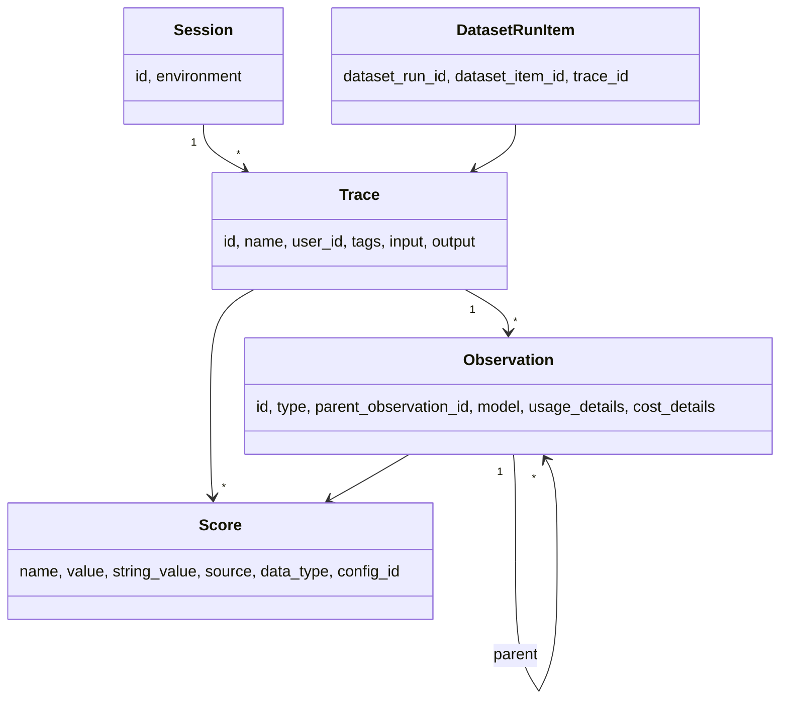
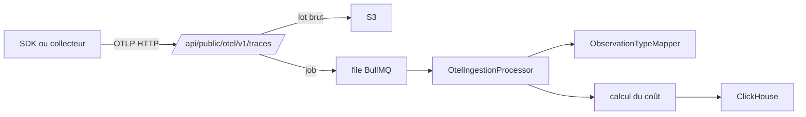
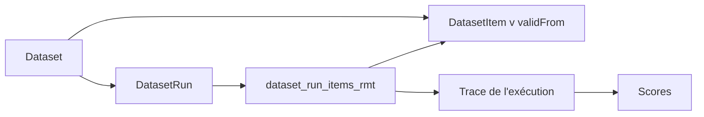

# Benchmark — Langfuse (traces LLM, évaluations, jeux de test)

**Date :** 2026-11-24 · **Pour :** `docs/architecture/agents.md` §3.6 (D709) et §3.19 (D1031–D1034).

Méthode : lecture du dépôt cloné en `--depth 1` dans `~/Documents/shan-perso/bench/langfuse`. Rien n'a été installé, construit ni lancé. Les références `chemin:ligne` renvoient au commit ci-dessous. Le mot « dataset » désigne ici l'objet Langfuse. Dans PneX, l'objet équivalent est une Table.

## 1. Identité

| Champ | Valeur |
|---|---|
| Dépôt | `github.com/langfuse/langfuse`, docs `langfuse.com/docs` |
| Commit étudié | `e9bbbb91` (2026-11-24), version `4.84.0` (`web/package.json:3`) |
| Licence | MIT, sauf `ee/`, `web/src/ee/`, `worker/src/ee/`, `packages/shared/src/server/ee/` (licence Enterprise, `LICENSE:3-6`, `ee/LICENSE`) |
| Détenteur | ClickHouse, Inc. depuis 2026 (`LICENSE:1`) |
| Stack | TypeScript (Next.js `web`, BullMQ `worker`), PostgreSQL (Prisma), ClickHouse, Redis, S3. Rust pour `packages/native` (napi) et `ai-gateway` (MIT) |
| Activité | environ 37 800 étoiles, 1 207 tickets ouverts, une release tous les 2 à 4 jours (v4.82 à v4.84 du 17 au 23 novembre) |

Ce qui est sous MIT : traces, ingestion OTel, datasets, expériences, évaluateurs (LLM-juge, code, « decision model »), scores, files d'annotation, prompts, labels protégés, table de prix.

Ce qui est sous `ee/` : rétention des données (`worker/src/ee/dataRetention/`), masquage à l'ingestion (`packages/shared/src/server/ee/ingestionMasking/`), journal d'audit, SSO multi-tenant, stockage média externe, FIPS, facturation.

## 2. Modèle des traces

Deux époques coexistent. Le modèle v3 a trois tables ClickHouse : `traces`, `observations`, `scores`. Le modèle v4 ajoute une table large `events_full` (une ligne par span) avec la projection `events_core`.

- `traces` : `packages/shared/clickhouse/migrations/canonical/0001_traces.up.sql:1-32`. Moteur `ReplacingMergeTree(event_ts, is_deleted)`. Les mises à jour sont des réinsertions.
- `observations` : `0002_observations.up.sql:1-45`. Colonnes clés : `type`, `parent_observation_id`, `provided_usage_details` et `usage_details`, `provided_cost_details` et `cost_details`, `prompt_name`, `prompt_version`.
- `events_full` : `0039_create_events_full.up.sql:3-98`. Une ligne porte le span, la trace dénormalisée (`trace_name`, `session_id`), le modèle, l'usage, les outils (`tool_calls`, `tool_call_names`), l'expérience (`experiment_id`, `experiment_item_id`, `experiment_item_expected_output`) et la source d'instrumentation (`service_name`, `scope_name`, `telemetry_sdk_*`).
- Types d'observation (10) : `SPAN`, `GENERATION`, `EVENT`, `EMBEDDING`, `AGENT`, `TOOL`, `CHAIN`, `RETRIEVER`, `GUARDRAIL`, `EVALUATOR` (`packages/shared/src/server/otel/ObservationTypeMapper.ts:216-233`).
- Session : un simple regroupement de traces par `session_id` (`packages/shared/prisma/schema.prisma:706-719`). Seuls `bookmarked` et `public` vivent dans PostgreSQL.
- Environnement : chaque ligne porte `environment`. Les traces internes de Langfuse (exécutions d'évaluateurs) ont leurs propres environnements réservés.
- Compétences : depuis la migration `0053_add_skill_observation_references.up.sql`, un span note les compétences disponibles (`skills_available`) et les fichiers chargés (`skills_resource_loaded`), avec l'id et la version.

## 3. Ingestion OTel

- La route accepte OTLP protobuf et JSON (`web/src/pages/api/public/otel/v1/traces/index.ts`). Le lot brut va d'abord dans S3, puis un job le traite (`web/src/server/otel/processOtelIngestion.ts:274-277`). L'écriture est donc asynchrone et rejouable.
- Le type vient d'une chaîne de mappeurs à priorité (`ObservationTypeMapper.ts`). L'ordre est :
  1. `langfuse.observation.type` (`:216`).
  2. `openinference.span.kind` (`:236`).
  3. `gen_ai.operation.name` (`:263`) : `chat`, `text_completion`, `generate_content` → `GENERATION`. `embeddings` → `EMBEDDING`. `invoke_agent`, `create_agent` → `AGENT`. `execute_tool` → `TOOL`.
  4. Genkit, Vercel AI SDK, puis `gen_ai.tool.name` ou `gen_ai.tool.call.id` → `TOOL` (`:406-420`).
- Version GenAI suivie : semconv v1.37+. Le code lit l'événement `gen_ai.client.inference.operation.details` (`OtelIngestionProcessor.ts:2138-2141`), `gen_ai.input.messages`, `gen_ai.output.messages` et `gen_ai.system_instructions` (`:2466-2475`). Les anciens `gen_ai.prompt.*` et `gen_ai.completion.*` restent lus.
- Usage : tout attribut `gen_ai.usage.*` (sauf `gen_ai.usage.cost`) et `llm.token_count.*` devient une clé de `usage_details` (`OtelIngestionProcessor.ts:3346-3372`). Le dictionnaire est ouvert : `input`, `output`, `input_cached_tokens`, `output_reasoning`, etc.
- Modèle : `gen_ai.request.model` puis `gen_ai.response.model` (`:3057-3059`). Paramètres : `gen_ai.request.temperature`, `gen_ai.request.max_tokens`, `gen_ai.request.service_tier`.
- Session : `langfuse.session.id`, `session.id`, puis `gen_ai.conversation.id` (`:2793-2806`). Utilisateur : `user.id`.
- Attributs propres : préfixe `langfuse.*` pour la trace, l'observation, l'expérience et l'évaluateur (`packages/shared/src/server/otel/attributes.ts:3-61`).
- Le décodage OTLP lourd passe dans un module Rust natif (`packages/native/src/otel*.rs`, environ 7 200 lignes, MIT).

## 4. Jeux de test et expériences

- `Dataset` (`schema.prisma:834-864`) : nom unique par projet, `inputSchema` et `expectedOutputSchema` optionnels en JSON Schema.
- `DatasetItem` (`:866-893`) : `input`, `expectedOutput`, `metadata`, lien optionnel vers la trace source (`sourceTraceId`, `sourceObservationId`). Chaque item est versionné en bitemporel simple (`validFrom`, `validTo`, `isDeleted`). Une modification crée une ligne.
- `DatasetRuns` (`:900-917`) : une exécution nommée, unique par dataset. Ce nom tient lieu de version testée.
- `dataset_run_items_rmt` (`0024_dataset_run_items.up.sql:1-36`) : lie run, item et trace. La table copie l'entrée et l'attendu de l'item au moment du run. Un run reste donc lisible après une modification de l'item.
- Trois façons de lancer une expérience :
  - le SDK exécute la tâche chez l'utilisateur et envoie les traces avec les attributs `langfuse.experiment.*`.
  - l'UI exécute un prompt versionné sur chaque item (`worker/src/features/experiments/experimentServiceClickhouse.ts:96-283`). La version du dataset est fixée par `validFrom`.
  - l'UI appelle un webhook signé (`remoteExperimentUrl`, `schema.prisma:839-850`).
- Comparaison : la page `DatasetComparePage.tsx` met plusieurs runs côte à côte, item par item, avec un run de référence (`baseline`, `:161-166`). Les cellules agrègent les scores par run.

## 5. Évaluateurs

- Modèle actuel : `Evaluator` (`schema.prisma:1274-1297`) avec des `EvaluatorVersion` immuables (`:1299-1327`). Une `EvaluationRule` (`:1396-1423`) dit sur quoi tourner : `targetObject`, `filter`, `sampling`, `delay`, `timeScope` (`NEW`, `EXISTING`). Une table d'association relie règles et évaluateurs, avec un `variableMapping` par association (`:1443-1461`). L'ancien `JobConfiguration` (`:1368-1394`) reste en place.
- Quatre types (`EvalTemplateType`, `:1329-1334`) : `LLM_AS_JUDGE`, `CODE`, `DECISION_MODEL`, `FACET`.
- LLM-juge :
  - le gabarit est un texte avec des `{{variables}}` et une `outputDefinition` (`packages/shared/src/features/evals/outputDefinition.ts`). La sortie est NUMERIC, BOOLEAN ou CATEGORICAL, avec un `reasoning`.
  - l'appel utilise une sortie structurée. Le `reasoning` devient le commentaire du score (`worker/src/features/evaluation/evalService.ts:1246-1281`).
  - le mapping lie chaque variable à un objet (`trace`, un type d'observation nommé, `dataset_item`), une colonne (`input`, `output`, `metadata`) et un `jsonSelector` (`packages/shared/src/features/evals/types.ts:181-202`).
- Échantillonnage déterministe : SHA-256 de l'id de la cible, comparé au taux (`worker/src/features/evaluation/deterministicSampling.ts:7-30`). La même trace reçoit toujours la même décision.
- Dédoublonnage : l'id d'exécution dérive de (projet, règle, trace, item, observation). Deux producteurs concurrents ne paient pas deux fois l'appel LLM (`evalService.ts:280-300`).
- Garde anti-boucle : un évaluateur ne s'exécute jamais sur une trace d'un environnement interne, donc jamais sur la trace d'un autre évaluateur (`evalService.ts:370-395`).
- Coût : chaque exécution produit sa propre trace (`executionTraceId`, `evalService.ts:1084-1157`) dans l'environnement interne `LLMJudge`. Le coût du juge se lit donc comme toute autre génération.
- Blocage : un évaluateur passe à `blockedAt` avec un motif machine (`EvaluatorBlockReason`, `schema.prisma:1357-1366`) : clé invalide, crédit épuisé, modèle absent. Il ne réessaie pas en boucle.
- Évaluateur code : TypeScript ou Python, exécuté par un « dispatcher ». Le dispatcher local s'appelle `insecure-local` et utilise `vm` de Node (`packages/shared/src/server/evals/localCodeEvalDispatcher.ts:13`). La production passe par AWS Lambda.
- « Decision model » : une liste de 50 questions au plus, chacune `choice`, `score` ou `noul`, chacune avec son nom de score (`packages/shared/src/features/evals/decisionModel.ts:4-20`).
- Annotation humaine : `AnnotationQueue` (`schema.prisma:752-771`) porte une liste de `scoreConfigIds`. Un `AnnotationQueueItem` vise une trace, une observation ou une session, avec un verrou (`lockedAt`, `lockedByUserId`) et un statut `PENDING` ou `COMPLETED` (`:773-808`). Des assignations nomment les annotateurs.

## 6. Scores

- Une ligne par score dans ClickHouse (`0003_scores.up.sql:1-33`). Cible : trace, observation, session (`0012_add_session_id_column_scores.up.sql`) ou run de dataset (`0017_add_run_id_column_scores.up.sql`).
- Sources (`packages/shared/src/domain/scores.ts:5-22`) : `API`, `EVAL`, `ANNOTATION`. Une API publique ne peut pas écrire `EVAL`.
- Types (`scores.ts:54-60`) : `NUMERIC`, `CATEGORICAL`, `BOOLEAN`, `TEXT` (500 caractères au plus), `CORRECTION` (une sortie corrigée par un humain, nom fixe `output`).
- `ScoreConfig` (`schema.prisma:721-743`) : nom, type, bornes `minValue` et `maxValue`, catégories, archivage. Un score `ANNOTATION` exige une configuration (`scores.ts:24-41`).
- Agrégation : par nom de score et par run, à la lecture. La requête prend la moyenne des valeurs numériques et la liste des valeurs pour CATEGORICAL (`packages/shared/src/server/repositories/dataset-run-items.ts:344-375`).

## 7. Contenu et confidentialité

- Par défaut, Langfuse stocke l'entrée et la sortie complètes de chaque span (`input`, `output` en ZSTD). C'est l'inverse de D709.
- Masquage côté client (MIT) : les SDK acceptent une fonction `mask` avant l'envoi.
- Masquage côté serveur (ee) : un appel HTTP externe par lot avant l'écriture (`LANGFUSE_INGESTION_MASKING_CALLBACK_URL`). Le mode `failClosed` jette l'événement si le masquage échoue (`packages/shared/src/server/ee/ingestionMasking/types.ts:4-30`).
- Rétention (ee) : `Project.retentionDays` (`schema.prisma:166`). Un job efface traces, observations, scores, événements, médias S3 et fichiers d'ingestion bruts (`worker/src/ee/dataRetention/handleDataRetentionProcessingJob.ts:1-73`).
- Ce qui peut être coupé : le contenu (côté SDK), les médias (bucket non configuré). La sortie brute OTLP va toujours dans S3 avant le traitement.

## 8. Pièges et limites

- Le coût calculé dépend d'une table de 199 modèles maintenue à la main (`worker/src/constants/default-model-prices.json`). Les clés d'usage sont libres, donc les doubles comptes arrivent :
  - jetons en cache comptés deux fois : https://github.com/langfuse/langfuse/issues/10592
  - jetons dupliqués quand une génération est parente d'autres générations : https://github.com/langfuse/langfuse/issues/7549
  - widget « Cost By Type » doublé par la clé `total` : https://github.com/langfuse/langfuse/issues/18731
  - coût de session à 0 quand le coût est calculé : https://github.com/langfuse/langfuse/issues/15109
  - écart avec la facture Google : https://github.com/langfuse/langfuse/issues/13792
- Le masquage côté client ne couvre pas tout. Les spans `gen_ai.*` de l'AI SDK échappent au `mask` JS : https://github.com/langfuse/langfuse/issues/18796. Les médias partaient avant le masquage en Python : https://github.com/langfuse/langfuse/issues/16102
- La rétention efface un média encore utilisé par une trace récente : https://github.com/langfuse/langfuse/issues/17837. Ses mutations ClickHouse bloquaient les insertions : https://github.com/langfuse/langfuse/issues/17862
- Les évaluateurs ne tournaient pas sur les runs passés ou les items existants : https://github.com/langfuse/langfuse/issues/6961, https://github.com/langfuse/langfuse/issues/6576
- L'écrivain ClickHouse perdait des lignes après ses essais au lieu d'utiliser la file d'erreurs : https://github.com/langfuse/langfuse/issues/15730
- L'historique des déplacements de labels de prompt n'existait pas hors Enterprise : https://github.com/langfuse/langfuse/issues/16007
- Dette visible dans le schéma : `Prompt.isActive` déprécié mais présent (`schema.prisma:1008`), `JobConfiguration` et `EvaluationRule` coexistent, deux modèles de traces (v3 et `events_full`) coexistent.
- Exploitation lourde : PostgreSQL, ClickHouse, Redis, S3, web, worker. Un ingénieur doit tenir ClickHouse (tables système qui grossissent : https://github.com/langfuse/langfuse/issues/13123).

## 9. À reprendre pour PneX / à écarter

Prompts et labels : `Prompt` (`schema.prisma:994-1021`) porte `version` et `labels`. Le label `latest` suit la dernière version, `production` est celui que lit le client (`packages/shared/src/features/prompts/constants.ts:1-2`). `PromptProtectedLabels` (`:1043-1053`) réserve un label aux rôles qui ont `promptProtectedLabels:CUD`. Les `Skill` Langfuse (`:1055-1118`) reprennent le même schéma de versions et de labels, avec des fichiers dédoublonnés par SHA-256.

### À reprendre

| Quoi | Pourquoi | Où dans PneX |
|---|---|---|
| Liste fermée de types d'étape alignée sur `gen_ai.operation.name` (`chat`, `execute_tool`, `invoke_agent`) plus `guardrail` et `evaluator` | Un collecteur tiers comprend la trace sans traduction | D1031, moteur `internal_llm` : type de chaque étape. `guardrail` = passage de la porte de validation |
| Usage en dictionnaire ouvert (`input`, `output`, `input_cached_tokens`, `output_reasoning`) au lieu de deux colonnes | Les fournisseurs ajoutent des catégories de jetons. Les issues montrent le coût de deux colonnes figées | D709, événement `agent_llm_calls` et étapes D1031 |
| Prix par modèle avec motif, date de début et paliers conditionnels (`service_tier`) | Le coût d'un run se recalcule à la lecture. Pas de coût figé faux | passerelle LLM §3.6, table de prix par org. Coût fourni par le fournisseur prioritaire sur le coût calculé |
| Copie de l'entrée et de l'attendu dans la ligne de résultat d'une campagne | Un cas modifié ne fausse pas une campagne passée | D1033 : la ligne de résultat garde la version de la Table (transaction de Table) et non seulement l'id du cas |
| Échantillonnage par SHA-256 de l'id de la cible | Décision stable, rejouable, sans état | évaluateurs D1033 en continu sur les runs réels, si ce mode est retenu |
| Id d'exécution dérivé de (règle, cible) | Pas de double appel LLM-juge, pas de score en double | D1033 : clé unique (campagne, cas, évaluateur) en base |
| Garde anti-boucle : un juge ne juge jamais un run d'évaluation | Évite la boucle coûteuse run → juge → run | D1033 : le run du LLM-juge porte une marque `evaluation`, filtrée par tout déclencheur |
| Évaluateur bloqué avec un motif machine (clé invalide, crédit épuisé) | Un juge en panne ne brûle pas de quota | D1033 : code machine dans `err_codes`, état visible dans l'UI |
| Run du juge = un run comme un autre, avec sa trace et son coût | Le coût de l'évaluation se lit au même endroit | D1031 + D1033, LLM-juge = agent interne comme le validateur (D836) |
| Sortie du juge structurée : score typé + `reasoning` en commentaire | Le score se compare. Le raisonnement s'audite | D1033, schéma de sortie du LLM-juge |
| Types de score : NUMERIC, BOOLEAN, CATEGORICAL, plus une configuration (bornes, catégories) | La comparaison entre versions exige des scores bornés et nommés | D1033 : configuration de score par campagne |
| `CORRECTION` : sortie corrigée par l'humain, réutilisable comme attendu | La boîte « À valider » produit un cas de test gratuit | boîte « À valider » : une proposition corrigée peut devenir une ligne de la Table de cas |
| Verrou d'item d'annotation (`lockedAt`, `lockedByUserId`) | Deux humains ne notent pas le même cas | boîte « À valider » si plusieurs valideurs partagent une campagne |
| Comparaison de runs côte à côte avec une référence | La vue qui sert vraiment à décider d'une activation | page de campagne D1033 : version active = référence, brouillon = candidat |
| Label protégé réservé à un droit | Seul un rôle habilité passe une version en production | activation de compétence : permission IAM dédiée (nom à choisir) et campagne réussie en option |
| Masquage `failClosed` | Si le filtre échoue, rien ne part | D1032 : si l'org active le contenu dans l'export, un échec de filtrage bloque l'export |
| Compétences chargées notées sur l'étape (id, version, fichier) | On sait quelle version a produit quel résultat | D1031 : attribut de l'étape, version de compétence active |

### À écarter

- **Un produit séparé de gestion des prompts** (SDK qui tire `production`, cache client, dépendances entre prompts). PneX garde les compétences versionnées (brouillon, active) dans son propre registre. Aucun client externe ne tire un prompt.
- **Le contenu complet par défaut.** Langfuse stocke entrée et sortie de chaque span. PneX garde D709 : empreintes seulement, contenu jamais exporté sans réglage explicite de l'org (D1032).
- **ClickHouse, Redis et S3 en plus.** PneX a PostgreSQL et O2. Les traces D1031 vont dans O2 ou PostgreSQL, sans nouvelle base.
- **L'évaluateur code en `vm` Node ou en Lambda.** PneX a déjà ses fonctions JS et Starlark sandboxées : elles sont l'évaluateur « règle ».
- **Le masquage par webhook externe.** Il envoie le contenu hors de la plateforme pour le masquer. PneX ne garde pas le contenu, donc il n'a rien à masquer.
- **La table de prix de 199 modèles maintenue en dur.** PneX garde une table courte par fournisseur configuré, réglable par l'org.
- **Les chaînes de mappeurs pour 8 frameworks tiers** (Vercel, Genkit, Flue, OpenInference). PneX n'ingère que ses propres runs. Il émet en GenAI semconv, il n'a pas à tout lire.
- **Le webhook « remote experiment ».** Une campagne PneX joue un agent interne, pas un service distant.
- **Les deux générations de schéma** (v3 et `events_full`). Choisir une seule forme d'étape dès D1031.
