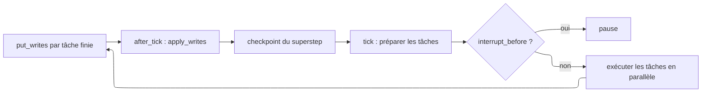
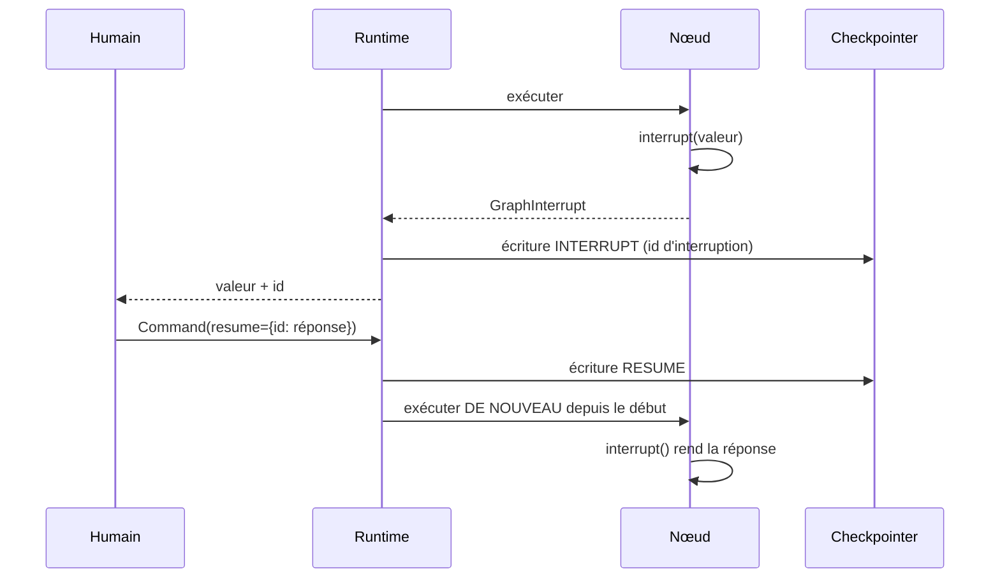

# Benchmark — LangGraph et deepagents (exécution durable d'agents)

**Date :** 2026-11-24 · **Pour :** `docs/architecture/agents.md` §3.19 (D1031, D1033, D1034).

Méthode : lecture des dépôts clonés en `--depth 1` dans `~/Documents/shan-perso/bench/`. Rien n'a été installé, construit ni lancé. Les références `chemin:ligne` partent de `libs/` et renvoient aux commits ci-dessous.

## 1. Identité

| Dépôt | Rôle | Commit étudié | Licence |
|---|---|---|---|
| `github.com/langchain-ai/langgraph` | Runtime de graphes : état, checkpoints, interruptions, store | `b4fe40f8` (2026-11-24, `langgraph` 1.2.24) | MIT (confirmée : `LICENSE` et API GitHub) |
| `github.com/langchain-ai/deepagents` | Harnais d'agent au-dessus de LangChain `create_agent()` | `b04f2ef7` (2026-11-24, `deepagents` 0.7.41) | MIT (confirmée) |

- Docs : https://docs.langchain.com/oss/python/langgraph/overview et https://docs.langchain.com/oss/python/deepagents/overview.
- Activité : 45 000 étoiles et 488 tickets ouverts pour LangGraph. 31 500 étoiles et 244 tickets ouverts pour deepagents. Les deux dépôts ont reçu des commits le 2026-11-24.
- Stack : Python 3.10+. Le checkpointer PostgreSQL est un paquet séparé (`checkpoint-postgres`). Un harnais de conformité des checkpointers existe (`checkpoint-conformance`).
- deepagents n'ajoute pas de runtime. Il assemble des middlewares LangChain sur le runtime LangGraph (`deepagents/libs/ARCHITECTURE.md`).

## 2. Modèle d'exécution

LangGraph suit le modèle Pregel (Bulk Synchronous Parallel). Un run est une suite de **supersteps**. Dans un superstep, toutes les tâches prêtes s'exécutent en parallèle. Elles lisent un instantané figé des channels. Leurs écritures s'appliquent ensemble à la fin du superstep.

- `tick()` prépare les tâches et teste la limite de pas (`langgraph/langgraph/pregel/_loop.py:670`). Il réapplique les écritures en attente d'un run précédent (`_loop.py:691`).
- Une tâche est prête si un channel qu'elle écoute a une version plus récente que celle qu'elle a vue (`versions_seen`). La préparation est dans `prepare_next_tasks` (`pregel/_algo.py:350`).
- L'identifiant d'une tâche est déterministe : hash de l'id du checkpoint, du namespace, du pas, du nom du nœud et de ses déclencheurs (`_algo.py:617`). Une reprise retrouve donc la même tâche.
- `apply_writes` trie les tâches par chemin avant d'appliquer leurs écritures (`_algo.py:235`). L'ordre ne dépend donc pas de l'ordre de fin des tâches.
- Un **channel** est une case d'état versionnée (`langgraph/langgraph/channels/base.py:19`). `LastValue` garde la dernière valeur. `BinaryOperatorAggregate` applique un **reducer** à chaque écriture (`channels/binop.py:66`), par exemple `operator.add` pour une liste de messages. `DeltaChannel` (`channels/delta.py`) stocke des deltas pour qu'un long historique ne soit pas recopié à chaque checkpoint.
- `Send` lance un nœud avec un état propre au superstep suivant (`types.py:748`). C'est le map-reduce de LangGraph.
- Politiques par nœud : `RetryPolicy` (`types.py:428`), `TimeoutPolicy` avec `run_timeout` et `idle_timeout` relancé par heartbeat (`types.py:462`), `CachePolicy` avec clé et TTL (`types.py:531`).
- `default_retry_on` ne relance pas les erreurs de programmation (`ValueError`, `TypeError`…). Il relance les erreurs de connexion et les HTTP 5xx (`langgraph/langgraph/_internal/_retry.py:1`).
- Un nœud peut avoir un `error_handler` (`langgraph/langgraph/graph/state.py:109`). Une demande d'arrêt coopératif (`drain`) arrête le run avant le superstep suivant (`_loop.py:706`).

## 3. Checkpoints et reprise

Un checkpoint est l'état complet à la frontière d'un superstep. Il contient `v`, `id`, `ts`, `channel_values`, `channel_versions`, `versions_seen` et `updated_channels` (`checkpoint/langgraph/checkpoint/base/__init__.py:96`). L'id est un UUID v6, donc trié dans le temps (`base/__init__.py:883`). Chaque checkpoint porte une métadonnée `source` : `input`, `loop`, `update` ou `fork` (`base/__init__.py:39`).

Schéma PostgreSQL (`checkpoint-postgres/langgraph/checkpoint/postgres/base.py:46`) :

| Table | Clé primaire | Contenu |
|---|---|---|
| `checkpoints` | `thread_id, checkpoint_ns, checkpoint_id` | `parent_checkpoint_id`, `checkpoint` JSONB sans les grosses valeurs, `metadata` JSONB |
| `checkpoint_blobs` | `thread_id, checkpoint_ns, channel, version` | une valeur de channel sérialisée, `BYTEA`, partagée entre checkpoints |
| `checkpoint_writes` | `thread_id, checkpoint_ns, checkpoint_id, task_id, idx` | une écriture en attente d'une tâche, `channel`, `blob`, `task_path` |

- Une valeur de channel est stockée une fois par version (`checkpoint_blobs`). Un checkpoint référence les versions. La lecture recolle les blobs par `jsonb_each_text(channel_versions)` (`postgres/base.py:96`).
- `checkpoint_ns` sépare les sous-graphes dans le même thread.
- **Pending writes** : quand une tâche finit, ses écritures partent tout de suite dans `checkpoint_writes`, avant la fin du superstep (`pregel/_loop.py:483`). Elles sont liées au checkpoint d'avant le superstep.
- **Idempotence** : une écriture normale s'insère avec `ON CONFLICT … DO NOTHING`. Une écriture spéciale (`ERROR`, `INTERRUPT`, `RESUME`, `SCHEDULED`) a un `idx` négatif et s'insère avec `DO UPDATE` (`postgres/base.py:152`, `:161`, `postgres/__init__.py:352`, `base/__init__.py:824`). Un rejeu de la même tâche ne crée donc pas de doublon.
- **Reprise après panne** : le run recharge le dernier checkpoint et ses pending writes. Une tâche qui a des écritures de succès les reçoit et ne s'exécute pas (`_loop.py:853`). Une tâche sans écriture s'exécute de nouveau.
- **Nœud interrompu à mi-chemin** (processus tué) : il n'a rien écrit. Il repart **du début**. Ses effets de bord déjà faits se rejouent. La garantie est « au moins une fois » par nœud. LangGraph ne fournit pas de bail : rien n'empêche deux workers de reprendre le même thread. La plateforme payante gère ce point hors du dépôt.
- Durabilité (`types.py:99`) : `sync` écrit avant le superstep suivant. `async` écrit pendant le superstep suivant. `exit` écrit seulement à la sortie du run. Avec `exit`, une panne perd tout le run.
- Rétention : `prune(strategy="keep_latest")` existe dans l'interface (`base/__init__.py:398`) et dans le saver PostgreSQL (`postgres/__init__.py:409`). Le saver « shallow » qui garde un seul checkpoint est déprécié (`postgres/shallow.py:193`).

## 4. Pause humaine

- `interrupt()` lève `GraphInterrupt` (`types.py:913`, corps `:1023-1048`). La première fois, le nœud s'arrête. À la reprise, le nœud repart du début et `interrupt()` rend la valeur de reprise.
- Plusieurs `interrupt()` dans un nœud sont appariés par leur **ordre d'appel** (`scratchpad.interrupt_counter()`, `types.py:1031`).
- L'id d'une interruption est le hash du namespace de la tâche et du nombre de réponses déjà reçues (`types.py:583`). `Command(resume={id: valeur})` vise une interruption précise. Le mode strict refuse un id inconnu ou déjà consommé (`UnknownInterruptError`, `_loop.py:1064`).
- `interrupt_before` et `interrupt_after` sont des points d'arrêt statiques sur des nœuds (`_loop.py:697`).
- Pièges :
  - Tout le code avant `interrupt()` s'exécute deux fois, effets de bord compris.
  - Un `try/except Exception` autour de `interrupt()` avale la pause.
  - Changer l'ordre ou le nombre des `interrupt()` entre deux versions du code décale les réponses.
  - Une valeur de reprise périmée peut répondre à une interruption suivante (#8837).

## 5. Retour en arrière et branches

- `get_state_history()` liste les checkpoints d'un thread (`pregel/main.py:1529`). Les checkpoints forment un arbre par `parent_checkpoint_id`.
- **Time travel** : un `invoke(None, config)` avec un `checkpoint_id` ancien rejoue depuis ce checkpoint. Le runtime retire les écritures `RESUME`, donc les interruptions se redéclenchent (`_loop.py:976-1000`). Les nouveaux checkpoints deviennent des enfants de l'ancien : c'est une branche. L'historique d'origine reste intact.
- **Fork** : `update_state(config, values, as_node)` crée un checkpoint `source=update`, comme si `as_node` avait écrit ces valeurs (`main.py:2636`). `as_node="__copy__"` copie un checkpoint en `source=fork` (`main.py:1885`).
- Un rejeu relance les nœuds, donc refait les appels au modèle. Le résultat n'est pas le même (température, état externe changé).

## 6. Mémoire longue

- Le **store** est séparé des threads. Un item a un `namespace` (tuple de chaînes), une `key` et une `value` JSON (`checkpoint/langgraph/store/base/__init__.py:708`).
- PostgreSQL : table `store(prefix, key, value jsonb, expires_at, ttl_minutes)` (`checkpoint-postgres/langgraph/store/postgres/base.py:66`). Le namespace devient un `prefix` texte indexé en `text_pattern_ops`.
- Recherche : `search(namespace_prefix, query, filter, limit)` (`store/base/__init__.py:784`). Avec un index configuré, les champs choisis vont dans `store_vectors` (pgvector, `store/postgres/base.py:106`).
- TTL par item, rafraîchi à la lecture si `refresh_ttl` (`store/base/__init__.py:194`).
- Le store n'a ni schéma, ni droits par item, ni historique. Le cloisonnement repose sur le namespace choisi par le code (par exemple `(user_id, "memories")`).

## 7. deepagents

Le harnais est une pile de middlewares autour de la boucle « modèle → outils » de LangChain (`deepagents/graph.py:395`).

- **Planification** : l'outil `write_todos` (`TodoListMiddleware`) n'est plus dans la pile par défaut. Il reste seulement dans les profils Codex et Nemotron (`profiles/harness/_openai_codex.py:77`).
- **Sous-agents** : l'outil `task(subagent_type, description)` lance un sous-agent avec un contexte neuf. Les messages, les todos et les skills du parent ne passent pas (`middleware/subagents.py:447`). Le parent reçoit **seulement le dernier message texte** du sous-agent, en `ToolMessage` (`subagents.py:860-880`). Le namespace des checkpoints du sous-agent va dans `artifact`, invisible du modèle. Des sous-agents asynchrones distants existent (`middleware/async_subagents.py`).
- **Système de fichiers virtuel** : outils `ls`, `read_file`, `write_file`, `edit_file`, `grep` sur un backend choisi (état du thread, store, disque, sandbox) (`middleware/filesystem.py`, `backends/`).
- **Déchargement du contexte** : un résultat d'outil au-delà de 20 000 tokens (estimés à 4 caractères par token) est écrit dans `/large_tool_results/` (`filesystem.py:1981`, `:2257`). Le modèle reçoit le chemin et un aperçu. Il relit la suite par `read_file` ou `grep`.
- **Résumé** : à 85 % de la fenêtre de contexte, le middleware résume l'ancien historique et garde 10 % récents (`middleware/summarization.py:34`). L'historique complet est déchargé en Markdown dans `/conversation_history/{session_id}.md`. Un outil `compact_conversation` laisse l'agent déclencher le résumé.
- **Skills** : chaque skill est un dossier avec un `SKILL.md` à frontmatter YAML (`middleware/skills.py`). Le prompt contient seulement le nom, la description et le chemin. L'agent lit le fichier complet par `read_file` quand il en a besoin (divulgation progressive). Les sources se superposent, la dernière gagne.
- **Rubrique** : `RubricMiddleware` appelle un sous-agent correcteur quand l'agent veut finir. Un verdict `needs_revision` relance la boucle, jusqu'à `max_iterations` (`middleware/rubric.py:2`).
- **Pause humaine** : `HumanInTheLoopMiddleware` (LangChain) met un `interrupt()` avant les outils listés dans `interrupt_on` (`graph.py:192`).
- Limite de récursion par défaut : 9 999 pas (`graph.py:1039`).

## 8. Pièges et limites

Code :
- Reprise d'un nœud depuis le début : tout effet de bord non idempotent se rejoue (§3, §4).
- Sérialisation d'objets Python (msgpack, pickle en repli). Les types se perdent au rechargement : https://github.com/langchain-ai/langgraph/issues/9480 et https://github.com/langchain-ai/langgraph/issues/9343.
- Pas de bail ni de verrou de thread dans le dépôt open source.
- La complexité de reprise est forte : `_first()` combine reprise, rejeu, time travel et sous-graphes (`_loop.py:943`). `pregel/main.py` fait 4 585 lignes.

Tickets GitHub :
- Course dans `PregelLoop.put_writes()`, perte silencieuse de checkpoint (ouvert) : https://github.com/langchain-ai/langgraph/issues/8115
- `durability="exit"` et approbations parallèles : un appel approuvé est redemandé et s'exécute deux fois (ouvert) : https://github.com/langchain-ai/langgraph/issues/9676
- `durability="exit"` : un nœud fini pendant l'échec d'un voisin perd ses écritures et se rejoue (ouvert) : https://github.com/langchain-ai/langgraph/issues/9397
- Valeur de reprise consommée et redistribuée à une interruption suivante (ouvert) : https://github.com/langchain-ai/langgraph/issues/8837
- Time travel vers une interruption : le `Command(update=…)` de l'ancienne branche est réappliqué : https://github.com/langchain-ai/langgraph/issues/9491
- `durability="sync"` : ordre des écritures non garanti, état incohérent après panne (corrigé) : https://github.com/langchain-ai/langgraph/issues/8234
- Saver shallow asynchrone : écrase un checkpoint plus récent après annulation (corrigé) : https://github.com/langchain-ai/langgraph/issues/8810
- `prune(keep_latest)` échoue avec `DeltaChannel` (ouvert) : https://github.com/langchain-ai/langgraph/issues/9438
- Cache de nœud : des `Send` identiques relancent le nœud (ouvert) : https://github.com/langchain-ai/langgraph/issues/9581
- `InMemorySaver` fuit la mémoire (ouvert) : https://github.com/langchain-ai/langgraph/issues/9547
- deepagents : un résumé peut ne rien contenir : https://github.com/langchain-ai/deepagents/issues/6470 et https://github.com/langchain-ai/deepagents/issues/7834
- deepagents : deux sous-agents parallèles éditent des fichiers, une seule édition survit : https://github.com/langchain-ai/deepagents/issues/7835
- deepagents : l'outil `task` perd la consommation de tokens du sous-agent : https://github.com/langchain-ai/deepagents/issues/6556

## 9. À reprendre pour PneX, à écarter

Rappel PneX : le moteur `internal_llm` est la boucle d'outils de l'assistant, avec `max_steps` (20 par défaut) et une détection de boucle (même outil et mêmes arguments 3 fois). Une écriture devient une proposition `tool_call` qui passe la porte de validation (humain, autonome, validateur, chaîne). Une écriture porte `expected_version`. Aujourd'hui, un backend tué rejoue le run depuis le début après l'expiration du bail. D1034 prévoit l'état après chaque étape, la reprise à la dernière étape et la pause humaine en proposition en attente. Le modèle OpenHands (observation « interrompu » pour l'outil coupé, bail contre la double reprise) est déjà noté.

### À reprendre

| Quoi | Pourquoi | Où dans PneX |
|---|---|---|
| Id d'appel d'outil déterministe : hash de (run, étape, rang de l'appel) | Une reprise retrouve le même appel. Une proposition n'est jamais créée deux fois. C'est la clé d'idempotence de LangGraph (`_algo.py:617`). | D1034 : id du `tool_call` et contrainte unique sur la table des propositions. |
| Résultat d'outil enregistré dès sa fin, avant la fin de l'étape, avec insertion « si absent » | Une étape avec plusieurs appels d'outils ne relance pas les appels déjà finis après une panne. | D1034 : une ligne par appel fini, liée à l'étape. La reprise relit ces lignes. Un appel sans ligne reçoit l'observation « interrompu » (modèle OpenHands), il n'est pas relancé. |
| Frontière d'étape = point de reprise unique | LangGraph ne reprend qu'aux frontières de superstep. C'est simple à raisonner. | D1034 : l'étape « appel au modèle + appels d'outils » est l'unité. Pas de reprise au milieu d'un appel au modèle. |
| Arbre d'états : `parent` et `source` (entrée, boucle, humain, copie) sur chaque état enregistré | Le même enregistrement sert à la reprise, à la trace et au rejeu. | D1034 pour l'état. D1031 lit le même arbre pour la trace. |
| Rejouer une version depuis l'étape N d'un run passé, dans un nouveau run enfant | Une évaluation teste une nouvelle version sur un cas réel sans repartir de zéro. L'original reste intact. | D1033 : un cas de la Table peut pointer un état d'étape. Le rejeu n'exécute aucune écriture : les propositions vont en mode validateur. |
| Réponse humaine qui nomme l'interruption, refus d'un id inconnu ou déjà traité | Une décision périmée ne réveille jamais un autre run ni une autre pause (#8837). | D1034 : la décision cite l'id de la proposition. Le réveil vérifie qu'elle est encore en attente. |
| Arrêt coopératif (`drain`) : finir l'étape en cours, enregistrer, rendre le bail | Un déploiement Kubernetes ne coupe pas une étape en plein milieu. | Arrêt du backend : signal → plus de nouvelle étape → bail libéré. |
| Relance seulement des erreurs passagères (connexion, 5xx), jamais des erreurs de logique | Une relance d'erreur de logique coûte des tokens sans rien changer. | Passerelle LLM et outils de lecture. Pas pour un outil d'écriture. |
| Délai par étape en deux parties : plafond absolu et délai d'inactivité relancé par la progression | Un appel au modèle en streaming lent mais vivant n'est pas tué. Un appel bloqué l'est. | Spec d'agent, à côté de `max_steps`. |
| Gros résultat d'outil déchargé en artefact du run, avec un aperçu et une référence pour la suite | Le contexte reste petit. Le LLM lit la suite seulement s'il en a besoin. | Moteur `internal_llm` : un seuil en tokens. Les lectures d'ontologie paginées existent déjà. |
| Sous-agent : contexte neuf, le parent reçoit le seul message final | Le contexte du parent ne gonfle pas. Le run enfant garde sa propre trace. | Runs enfants (chaînes). Compter les tokens de l'enfant dans le parent (#6556). |
| Skill en divulgation progressive : nom et description dans le prompt, corps lu à la demande | Le prompt reste court avec beaucoup de skills. | Skills versionnés : outil de lecture d'un skill par son nom. |
| Résumé du contexte qui garde le journal complet et cite ce qui a été résumé | La trace et l'évaluation voient ce que le LLM a vu. Un résumé vide est un échec, pas un succès. | Moteur `internal_llm`, D1031. Vérifier que le résumé n'est pas vide. |
| Correcteur avant la fin (rubrique) | Le run se corrige avant de rendre un résultat faux. | D1033 : l'évaluateur LLM d'une campagne peut aussi servir de correcteur en run, borné en itérations. |
| Valeurs lourdes stockées une fois par version, l'état référence les versions | Un long run ne recopie pas tout son historique à chaque étape. | D1034 : messages en lignes ajoutées, l'état d'étape garde un curseur. |

### À écarter

- **Reprise d'un nœud depuis son début** pour une pause humaine. PneX ne rejoue jamais un appel au modèle déjà fait. La pause est une proposition en attente à la frontière d'étape.
- **Graphe Pregel, channels et reducers génériques.** Un agent PneX est une boucle. Les graphes de données sont des flows. Un second moteur de graphes ferait double emploi.
- **Sérialisation d'objets arbitraires** (msgpack, pickle). PneX garde un état JSON typé et versionné, désérialisé par `serde`.
- **Durabilité `async` et `exit`.** Les tickets #9397 et #9676 montrent des écritures rejouées. PneX enregistre chaque étape avant la suivante.
- **Checkpointer en mémoire** et saver « shallow ». Une seule implémentation, sur PostgreSQL.
- **Store clé-valeur à namespace libre** pour la mémoire longue. Dans PneX, la mémoire longue est l'ontologie, avec ses droits, son historique et ses marquages. Un store parallèle contournerait l'IAM.
- **Système de fichiers virtuel** comme espace de travail de l'agent. PneX n'est pas un agent de code. Seul le déchargement des gros résultats en artefact est utile.
- **`write_todos` comme outil par défaut.** deepagents l'a retiré de sa pile par défaut. Ne pas le construire sans un besoin mesuré.
- **Limite de 9 999 pas.** PneX garde `max_steps` bas et la détection de boucle.
- **Sous-agents distants par protocole externe.** Un run enfant PneX reste dans le backend, sous le même IAM.

## Reste à faire

- Vérifier dans la doc payante de LangGraph comment le serveur gère le bail d'un thread (absent du dépôt open source).
- Écrire dans `agents.md` §3.19 l'exigence « id d'appel déterministe + insertion si absent » si Shan la retient pour D1034.
