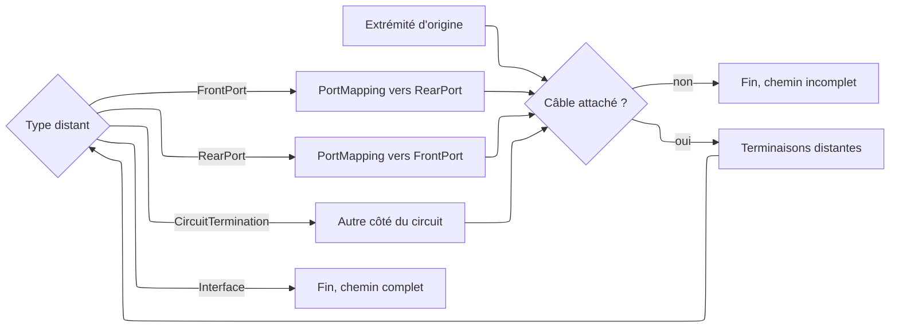

# Benchmark — NetBox et Nautobot (inventaire réseau, source de vérité)

**Date :** 2026-11-24 · **Pour :** `docs/architecture/it-operations.md` (D1002 `network_inventory`, D1003 pack `it_topology`, D1004, lot IT2, Q-IT2, Q-IT3).

Méthode : lecture des dépôts clonés en `--depth 1` dans `~/Documents/shan-perso/bench/netbox` et `~/Documents/shan-perso/bench/nautobot`. Rien n'a été installé, construit ni lancé. Les références `chemin:ligne` partent de `netbox/` ou de `nautobot/` dans chaque dépôt. Les tickets viennent de `gh search issues`. PneX lit ces outils. Il ne les remplace pas.

## 1. Identité

| | NetBox | Nautobot |
|---|---|---|
| Dépôt | `https://github.com/netbox-community/netbox` | `https://github.com/nautobot/nautobot` |
| Commit étudié | `112a6282` (2026-11-24), version `4.7.5` Community | `115cb277` (2026-11-23), version `3.2.11a0` |
| Licence | Apache-2.0 (fichier `LICENSE` lu) | Apache-2.0 (fichier `LICENSE` lu) |
| Stack | Python, Django 6.1, DRF, Strawberry GraphQL, PostgreSQL, Redis + RQ | Python, Django, DRF, Graphene, PostgreSQL ou MySQL, Celery |
| Activité | 21 933 étoiles, 270 tickets ouverts | 1 645 étoiles, 1 051 tickets ouverts |
| Identifiants | Entiers croissants | UUID |

Parts commerciales :
- NetBox Labs vend NetBox Cloud, NetBox Enterprise, Discovery, Assurance et Observability (`docs/index.md:6`).
- L'agent de découverte Orb (`netboxlabs/orb-agent`, Go) est sous Apache-2.0.
- Diode, le service d'ingestion qui écrit dans NetBox, est sous « NetBox Limited Use License 1.0 ». Ce n'est pas une licence libre. Seuls ses protobufs sont sous Apache-2.0.
- Nautobot est porté par Network to Code. Les apps SSoT et Device Onboarding sont sous Apache-2.0.

## 2. Modèle physique (DCIM)

NetBox range le physique en arbre de lieux, puis en équipements et composants.

- **Lieux** : `Region` et `SiteGroup` (arbres), `Site` (`dcim/models/sites.py:170`), `Location` imbriquée dans un site (`sites.py:301`).
- **Baie** : `Rack` (`dcim/models/racks.py:286`), avec un `RackType` en gabarit.
- **Équipement** : `Device` (`dcim/models/devices.py:531`). Champs utiles : `device_type`, `role`, `platform`, `serial`, `asset_tag`, `site`, `location`, `rack`, `position`, `status`, `primary_ip4`, `primary_ip6`, `oob_ip`, `cluster`, `virtual_chassis`.
- **Gabarit** : `DeviceType` (`devices.py:66`) et `Manufacturer`. Le gabarit crée les composants à l'installation.
- **Composants câblables** : `Interface` (`dcim/models/device_components.py:998`), `FrontPort` (`:1543`), `RearPort` (`:1591`), ports console et alimentation.
- **Brassage** : `PortMapping` (`:1502`) relie un couple (port avant, position) à un couple (port arrière, position) du même équipement. C'est le panneau de brassage.
- **Câble** : `Cable` (`dcim/models/cables.py:96`) a un `status`, un `type`, un `profile` et une longueur. Ses extrémités sont des `CableTermination` (`:647`), côté `A` ou `B`, plusieurs par côté.
- **Interface** : `lag`, `parent`, `bridge`, `mgmt_only`, `enabled`, `vrf`, `untagged_vlan`, `tagged_vlans`, `wireless_link`.
- **Faux câble** : `mark_connected` (`device_components.py:209`) dit « connecté » sans objet câble.

Nautobot remplace `Region`, `Site` et `Location` par un seul `Location` typé par un `LocationType` arborescent (`dcim/models/locations.py:25`). Son modèle de câble ajoute des voies (`CableLane`, `dcim/models/cables.py:90`).

## 3. Chemin de câble et extrémité connectée

NetBox précalcule un `CablePath` (`cables.py:846`) pour chaque extrémité. Le champ `path` est une liste d'étapes. Une étape est une liste de nœuds `(type, id)`. L'ordre est toujours : terminaison, câble, terminaison. `_nodes` aplatit les nœuds, avec un index GIN pour retrouver les chemins qui passent par un objet.

L'algorithme `CablePath.from_origin` (`cables.py:986`) :
- Il part d'une ou plusieurs terminaisons du même parent.
- Il suit le câble vers le côté opposé, par `CableTermination` ou par le profil du câble (`dcim/cable_profiles.py`).
- Un port avant mène au port arrière par `PortMapping`. Un port arrière à plusieurs positions dépile la position mémorisée. Sinon le chemin est `is_split` (`cables.py:1219`).
- Une pile de positions (`position_stack`) garde la voie suivie dans un câble multibrin.
- Un circuit saute à la terminaison opposée (`A` vers `Z`). Il s'arrête sur un `ProviderNetwork` ou un site.
- `is_active` est faux si un câble du chemin n'a pas le statut `connected`. `is_complete` est vrai si le chemin finit sur une extrémité.

Le recalcul part des signaux Django : création de câble (`dcim/signals.py:264`), suppression (`:302`), changement de brassage (`:311`). `PathEndpoint.connected_endpoints` (`device_components.py:430`) rend seulement la dernière étape du chemin. `trace()` (`:355`) enchaîne les chemins à travers les ports `bridge`. L'API expose `connected_endpoints`, `connected_endpoints_type`, `connected_endpoints_reachable` et la route `/api/dcim/interfaces/{id}/trace/` (`dcim/api/views.py:61`).

Nautobot garde le modèle de NetBox 2.x : un `CablePath` avec `origin` et `destination` explicites (`dcim/models/cables.py:1426`, `from_origin` à `:1540`).

## 4. Modèle réseau (IPAM, VLAN, VRF) et virtualisation

- **Préfixe** : `Prefix` (`ipam/models/ip.py:216`) porte `prefix`, `vrf`, `vlan`, `status`, `role`, `is_pool`. Sa portée est générique (`scope_type`, `dcim/models/mixins.py:61`) : région, site, groupe ou location.
- **Adresse** : `IPAddress` (`ip.py:940`) porte `address`, `vrf`, `status`, `role`, `dns_name`, `nat_inside`. Elle pointe vers une interface ou une interface de VM par un lien générique (`assigned_object`).
- **Inclusion** : aucune clé ne relie une adresse à son préfixe. NetBox calcule l'inclusion par CIDR et par VRF. `_depth` et `_children` sont des caches.
- **VLAN** : `VLAN` (`ipam/models/vlans.py:201`) porte `vid`, `group`, `site` et `qinq_svlan`. Le `VLANGroup` donne la portée.
- **VRF** : `VRF` (`ipam/models/vrfs.py:13`) porte `rd` et `enforce_unique`. Les `RouteTarget` décrivent l'import et l'export.
- **Service applicatif** : `Service` (`ipam/models/services.py:157`) = protocole et ports sur un équipement ou une VM.
- **Cluster** : `Cluster` (`virtualization/models/clusters.py:47`) a un type (VMware, Proxmox, Kubernetes…) et une portée de site. Un `Device` y adhère par `Device.cluster`.
- **VM** : `VirtualMachine` (`virtualization/models/virtualmachines.py:101`) porte `cluster`, `device` (hôte fixé), `site`, `status`, `primary_ip4`. Ses `VMInterface` portent des adresses.
- **Circuits** : `Provider`, `ProviderNetwork` (`circuits/models/providers.py:92`), `Circuit` (`circuits/models/circuits.py:48`) et `CircuitTermination` (`:264`). Un circuit entre dans le traçage de câble.

## 5. Historique des changements

NetBox écrit un `ObjectChange` (`core/models/change_logging.py:20`) à chaque écriture d'un modèle journalisé :
- `time`, `user_name`, `request_id`, `action` (`create`, `update`, `delete`), objet changé, objet lié, `message`.
- `prechange_data` et `postchange_data` (`:89`, `:95`) gardent l'objet entier sérialisé, avec champs personnalisés et étiquettes.
- `request_id` regroupe les changements d'une même requête.
- L'API `/api/core/object-changes/` filtre par `time_after`, `time_before`, type, objet et requête (`core/filtersets.py:214`).

Ce qu'on peut rejouer à une date passée :
- L'état d'un objet journalisé, en prenant le dernier `postchange_data` avant la date.
- Rien au-delà de la rétention. `CHANGELOG_RETENTION` vaut 90 jours par défaut (`netbox/config/parameters.py:180`). La purge efface tout ce qui est plus vieux (`core/jobs.py:125`). L'option `CHANGELOG_RETAIN_CREATE_LAST_UPDATE` garde seulement la création et la dernière mise à jour.
- Pas le chemin de câble. `CablePath` n'est pas journalisé (`cables.py:846`, `models.Model`). Un chemin passé se recalcule à partir des câbles, des terminaisons et des brassages rejoués.
- Aucune requête « état au » n'existe dans l'API.

Nautobot stocke seulement l'état après (`object_data_v2`). Le « avant » se déduit du changement précédent (`extras/models/change_logging.py:202`). Sa rétention vaut aussi 90 jours (`core/settings.py:887`).

## 6. Lecture par API et webhooks

Ce dont un lecteur PneX a besoin :

| Point | NetBox | Nautobot |
|---|---|---|
| Pagination | `offset`/`limit`, ou curseur `start=<id>` trié par `id` sans `count` (`netbox/api/pagination.py:11`) | `offset`/`limit` seulement (`core/api/pagination.py:7`) |
| Taille de page | 50 par défaut, 1 000 au plus (`MAX_PAGE_SIZE`) | Même logique, `MAX_PAGE_SIZE` |
| Forme réduite | `brief=1`, `fields=a,b`, `omit=c` (`netbox/api/viewsets/__init__.py:162`) | `depth=0..10` (`core/api/views.py:232`) |
| Filtre incrémental | `last_updated__gte` sur tout modèle (`netbox/filtersets.py:311`) | `last_updated__gte` |
| Jeton | v1 `Token <clé>` en clair, v2 `Bearer nbt_<clé>.<secret>` haché HMAC avec un poivre (`users/models/tokens.py:28`) | `Token <clé>`, clé de 40 caractères stockée en clair (`users/models.py:278`) |
| Restrictions de jeton | `expires`, `write_enabled`, `allowed_ips` | `expires`, `write_enabled` |
| Limite de débit | Aucune dans le code | Aucune dans le code |
| GraphQL | `/graphql/`, 10 alias au plus, profondeur non bornée par défaut (`netbox/settings.py:151`) | `/api/graphql/`, requêtes sauvegardées |

Webhooks (règles d'événement) :
- Signature `X-Hook-Signature` = HMAC-SHA512 en hexadécimal du corps (`extras/webhooks.py:35`, `:119`). Nautobot fait pareil (`extras/utils.py:489`).
- La signature ne couvre ni horodatage ni nonce. Un rejeu reste possible.
- Le corps porte `event`, `timestamp`, `object_type`, `data`, `snapshots` (`prechange`, `postchange`), `object_change_ids` et un extrait de la requête (`request.id`, utilisateur).
- Pas de nouvel essai par défaut : `RQ_RETRY_MAX = 0` (`netbox/settings.py:208`). Un webhook perdu est perdu.

Conséquences pour le lecteur :
- Le chargement initial lit chaque liste avec `start=` et `limit=1000`, en `fields=` minimal.
- Le suivi lit `/api/core/object-changes/` avec un curseur sur `id`. C'est la seule façon de voir les suppressions.
- Un lecteur arrêté plus de 90 jours doit refaire un chargement complet.
- Le webhook sert de réveil. Le lecteur relit ensuite par l'API.

## 7. Nautobot : ce qu'il ajoute

- **Relations** : `Relationship` (`extras/models/relationships.py:636`) crée un lien typé entre deux types quelconques, sans code. Types : un-un, un-plusieurs, plusieurs-plusieurs, symétriques. Filtres par côté, côté obligatoire. C'est proche d'un type de lien de l'ontologie PneX.
- **Statut** : `Status` (`extras/models/statuses.py:20`) est un objet partagé, attaché à des types de contenu. L'org choisit ses statuts.
- **Groupes dynamiques** : `DynamicGroup` (`extras/models/groups.py:42`) = filtre enregistré, statique ou composé, avec un cache des membres. C'est une requête nommée.
- **Jobs** : `Job` (`extras/models/jobs.py:105`) = code Python lancé à la main, à l'horaire, sur un bouton (`JobButton`, `:1339`) ou sur un changement (`JobHook`, `:453`). Il a un mode `dryrun` et une approbation.
- **Sources Git** : `GitRepository` (`extras/models/datasources.py:53`) synchronise un dépôt. Il fournit jobs, contextes de configuration, requêtes GraphQL, gabarits d'export et règles de conformité (`extras/datasources/git.py:1126`).
- **SSoT** : l'app `nautobot-app-ssot` construit des jobs de synchronisation sur la librairie DiffSync. Un adaptateur charge la source, un autre la cible, puis DiffSync calcule le diff et l'applique. Intégrations : ServiceNow, Infoblox, IP Fabric, vSphere, Meraki, LibreNMS, SolarWinds, Device42…

## 8. Découverte

- Le cœur libre de NetBox ne découvre rien. Il est déclaratif.
- Orb agent (Apache-2.0) offre `network_discovery`, `device_discovery`, `snmp_discovery` et `gnmi_discovery`. Il pousse ses résultats vers Diode, sous licence non libre, puis vers NetBox.
- Nautobot Device Onboarding (Apache-2.0) interroge un équipement en SSH et crée l'équipement et ses interfaces.
- Aucun des deux cœurs ne compare le découvert au déclaré. Les produits Assurance de NetBox Labs font cette comparaison, en commercial.

## 9. Pièges et limites

- **Sens de l'impact absent** : un câble relie deux interfaces sans notion d'amont. NetBox ne dit pas quel côté dépend de l'autre.
- **Chemins coupés** : un chemin marqué `is_split` ne donne pas d'extrémité connectée. Cas réels : brins duplex sur deux câbles (https://github.com/netbox-community/netbox/issues/22947), ports multi-positions (https://github.com/netbox-community/netbox/issues/21960), câbles éclatés (https://github.com/netbox-community/netbox/issues/15948).
- **Chemin périmé** : une édition en masse a fait disparaître des traces (https://github.com/netbox-community/netbox/issues/23072). Le recalcul en tâche de fond est encore ouvert (https://github.com/netbox-community/netbox/issues/22596).
- **Événement manquant** : brancher le parent d'une interface canalisée ne lance pas de règle d'événement (https://github.com/netbox-community/netbox/issues/23642).
- **Coût des listes** : `brief` et GraphQL ont eu des requêtes N+1 (https://github.com/netbox-community/netbox/issues/21402, https://github.com/netbox-community/netbox/issues/22551).
- **Rétention** : 90 jours par défaut, une politique plus fine est demandée chez Nautobot (https://github.com/nautobot/nautobot/issues/2865).
- **Secret de webhook** : exposé en clair dans une version passée (https://github.com/netbox-community/netbox/issues/22814).
- **Jeton v1 et jeton Nautobot** : stockés en clair côté serveur. Préférer un jeton v2 en lecture seule, avec `allowed_ips` et `expires`.
- **Statut `planned`** : un câble ou un équipement prévu est déclaré mais pas encore réel.
- **Volume** : un commutateur de 48 ports crée 48 interfaces, souvent vides.

## 10. À reprendre pour PneX / à écarter

Correspondance proposée NetBox → pack `it_topology` (D1003) :

| NetBox | Type PneX | Identité | Remarque |
|---|---|---|---|
| `Site` | `site` | `nb:<instance>:site:<id>`, nom | `Region` et `Location` deviennent des propriétés |
| `Rack` | `rack` | nom + site | |
| `Device` (rôle réseau) | `network_device` | nom, `serial` | Règle par `role` et réglable par org |
| `Device` (rôle serveur) | `host` | nom, `serial`, FQDN | Même règle |
| `Interface`, `VMInterface` | `interface` | équipement + nom | Seulement si câblée, adressée ou porteuse d'un LAG |
| `CablePath` complet | `network_link` | couple d'extrémités | Liste des câbles et `is_active` en propriétés |
| `Circuit` | `network_link` | `cid` + fournisseur | Genre `wan` |
| `Cable` | `cable` | id NetBox, `label` | Seulement si la couche `physical` est demandée |
| `FrontPort`, `RearPort`, `PortMapping` | aucun | | Absorbés par le `network_link` |
| `Prefix` | `subnet` | CIDR + VRF | VRF en propriété |
| `VLAN` | `vlan` | `vid` + groupe | |
| `IPAddress` | `ip_address` | adresse + VRF | Seulement si assignée |
| `Cluster` | `cluster` | nom + type | Partagé avec `software_delivery` (Q-IT4) |
| `VirtualMachine` | `vm` | nom + cluster | |
| `Service` | `endpoint` | hôte + protocole + port | À confirmer : `endpoint` est une URL aujourd'hui |
| Champs perso, étiquettes | propriétés | | Préfixe `nb_`, étiquettes PneX (D218) |

Liens proposés :

| Lien PneX | Source → cible | `propagates_failure` | Origine NetBox |
|---|---|---|---|
| `hosted_on` | `interface` → `network_device` ou `host` | oui | `Interface.device` |
| `hosted_on` | `ip_address` → `interface` | oui | `IPAddress.assigned_object` |
| `connected_to` | `network_link` → `interface` (deux liens) | oui | Fin de `CablePath` |
| `runs_on` | `vm` → `cluster` | oui | `VirtualMachine.cluster` |
| `runs_on` | `vm` → `host` | oui | `VirtualMachine.device` |
| `member_of` | `host` → `cluster` | non | `Device.cluster` |
| `located_in` | `rack` → `site`, équipement → `rack` | non | `Device.rack`, `Rack.site` |
| `in_subnet` | `ip_address` → `subnet` | non | Calcul CIDR + VRF |
| `carried_by` | `subnet` → `vlan` | non | `Prefix.vlan` |

À reprendre :
- **Lire le chemin calculé, pas le refaire** : lire `connected_endpoints` et `/trace/`. Pourquoi : l'algorithme gère brassages, profils et circuits, avec beaucoup de cas limites. Où : lecteur `network_inventory` (D1002), lot IT2.
- **Deux lectures et un curseur** : chargement par `start=`, suivi par `object-changes` avec curseur sur `id`. Pourquoi : `last_updated` ne voit pas les suppressions. Où : D1002, curseur par source.
- **Réveil par webhook** : accepter `X-Hook-Signature` en HMAC-SHA512, puis relire par l'API. Pourquoi : D795 attend SHA256, le corps n'a pas d'horodatage et NetBox ne réessaie pas. Où : `connector_inbox` (D795), à étendre.
- **Dates des liens** : `valid_from` = `time` de l'`ObjectChange` de création. Le reste de l'historique se rejoue au premier import, dans la limite de rétention. Où : D179, D184 (provenance = instance + id + `request_id`).
- **Statut en propriété** : `planned`, `decommissioning` et `offline` ne sont pas des écarts. Où : D1004.
- **Écart déclaré/découvert** : comparer le voisin LLDP lu par l'agent edge avec `connected_endpoints`. Un écart est un fait daté. Où : D1004, Q-IT3. Pourquoi : c'est la valeur que le cœur libre de NetBox n'offre pas.
- **Sens de l'impact par règle** : orienter `connected_to` par le rang du rôle (cœur > distribution > accès > serveur), réglable par org. Pourquoi : NetBox ne donne pas l'amont. C'est une déduction, donc un flow et pas le pipeline (D998). Où : D1005, D1006.
- **Modèle de Nautobot** : `Relationship` et `DynamicGroup` confirment les types de lien de l'ontologie et les requêtes nommées OP5. Rien à ajouter.
- **Q-IT2** : réponse proposée « les deux ». Un lecteur NetBox et Nautobot, et un import CSV avec les mêmes colonnes que l'export NetBox. Les deux produits ont la même forme d'API, donc un seul genre `network_inventory` avec deux variantes.
- **Q-IT3** : réponse proposée « plus tard ». LLDP et SNMP en lecture par l'agent edge, sans écriture vers NetBox. Orb agent montre l'ensemble utile : LLDP, SNMP, gNMI.

À écarter :
- **Devenir un éditeur DCIM** : pas de baie dessinée, pas de gabarit d'équipement, pas de saisie de câbles. NetBox reste la source déclarée.
- **Écrire vers NetBox** : pas de modèle Diode ni SSoT en écriture. Pourquoi : D1012 et D797 (pas d'écriture retour). Diode n'est pas libre.
- **Importer chaque composant** : pas de ports vides, pas de ports avant et arrière, pas de ports console ni d'alimentation au premier lot. Pourquoi : volume sans valeur d'impact. L'alimentation (`PowerFeed`) peut revenir plus tard comme cause d'impact.
- **Jobs Python et sources Git de Nautobot** : PneX a déjà ses flows, ses pipelines et ses fonctions Starlark (D553, D934).
- **GraphQL au premier lot** : l'API REST suffit et sa pagination par curseur est plus sûre. GraphQL n'a pas de borne de profondeur par défaut.
- **Copier le journal** : ne pas stocker les `prechange_data` bruts. Garder seulement les liens et propriétés datés (D1001, minimisation).
