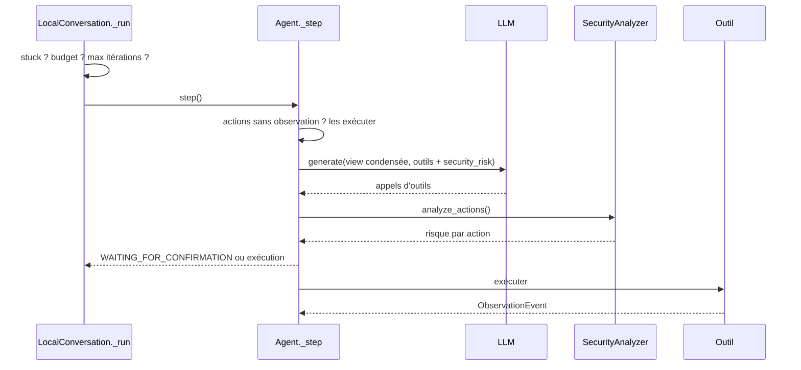
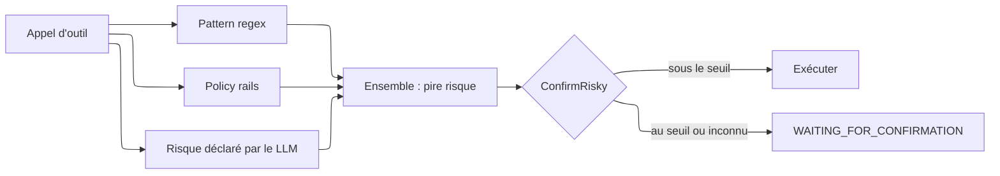

# Benchmark — OpenHands (agents de code, SDK et automatisations)

**Date :** 2026-11-24 · **Pour :** `docs/architecture/agents.md` (moteurs d'agents, harnais, évaluation).

Méthode : lecture des dépôts clonés en `--depth 1` dans `~/Documents/shan-perso/bench/`. Rien n'a été installé, construit ni lancé. Les références `chemin:ligne` renvoient aux commits ci-dessous.

## 1. Identité

| Dépôt | Rôle | Commit étudié | Licence |
|---|---|---|---|
| `github.com/OpenHands/OpenHands` | « Agent Canvas » : UI React/TypeScript, lanceur npm, chart Helm | `d5dcd45d` | MIT |
| `github.com/OpenHands/software-agent-sdk` | Cœur : SDK Python, outils, `agent-server` FastAPI, espaces de travail | `af85e224` (v1.63.1) | MIT |
| `github.com/OpenHands/automation` | Service d'automatisations : cron, webhooks, historique des runs | `19c4ea68` (v1.35.1, bêta) | MIT |
| `github.com/OpenHands/benchmarks` | Harnais d'évaluation V1 | `60b3548c` | MIT |

- Le cœur a quitté le dépôt principal. Le dépôt principal ne contient plus que l'UI. Il n'a plus de dossier `enterprise/` à ce commit. Les quatre dépôts sont sous MIT.
- Le registre des extensions (`OpenHands/extensions`, MIT) porte les skills, les plugins et le catalogue d'automatisations.
- Stack : Python 3.12+, Pydantic, LiteLLM (`litellm>=1.108.3,<1.109`), FastAPI, PostgreSQL pour les automatisations, React pour l'UI.
- Activité : environ 94 000 étoiles sur le dépôt principal, commits quotidiens sur les quatre dépôts le 2026-11-24, 830 tickets ouverts sur le SDK.
- Position : l'UI lance l'agent OpenHands ou un harnais tiers (Claude Code, Codex, Gemini CLI, OpenCode) par le protocole ACP.

## 2. Boucle d'agent

Le contrôleur V0 (`agent_controller.py`) n'existe plus. La boucle tient en deux méthodes.

- `openhands-sdk/.../conversation/impl/local_conversation.py:2670` : la boucle `_run`. Elle teste la pause, puis les hooks `Stop`, puis le détecteur de blocage, puis appelle `agent.step()`.
- `local_conversation.py:2777` et `:2785` : après chaque pas, le budget en dollars, puis le nombre d'itérations (défaut 500, `:295`). Le dépassement donne un `ConversationErrorEvent` codé (`MaxBudgetReached`, `MaxIterationsReached`), pas une exception.
- `openhands-sdk/.../agent/agent.py:859` : `_step`. Le pas exécute d'abord les actions sans observation (`:867`). C'est le mécanisme de la confirmation implicite.
- `agent.py:951` : chaque appel LLM ajoute un paramètre `security_risk` à tous les outils. Le modèle déclare lui-même le risque de chaque appel.
- Événements (`sdk/event/`) : `ActionEvent`, `ObservationEvent`, `AgentErrorEvent`, `UserRejectObservation`, `MessageEvent`, `Condensation`, `SecurityAnalysisEvent`, `HookExecutionEvent`, `PauseEvent`, `ConversationErrorEvent`. Un `Event` est un modèle Pydantic à union discriminée.
- Un `FinishTool` termine le tour. Les appels après `finish` dans la même réponse sont jetés (`agent.py:268`).
- Erreurs LLM : un appel de fonction mal formé redevient un message utilisateur. Un refus du filtre de contenu donne une relance. Un historique refusé déclenche une condensation (`agent.py:960–1030`).

## 3. État et reprise

- Stockage : un fichier JSON par événement, `events/event-{idx:05d}-{event_id}.json`, plus `base_state.json` (`sdk/conversation/persistence_const.py`). `EventLog` verrouille l'écriture par `flock` (`sdk/conversation/event_store.py:45`). Le verrou ne tient pas sur NFS (docstring).
- `ConversationState.create` (`sdk/conversation/state.py:625`) reprend une conversation depuis le disque. L'agent fourni doit avoir les mêmes outils que l'agent persisté.
- Les événements forment un arbre (`parent_id`). `fork()` et `navigate_to()` (`local_conversation.py:965`, `:1129`) créent une branche ou déplacent la tête.
- Reprise après crash (`openhands-agent-server/.../event_service.py:1578`) : un statut `RUNNING` au chargement passe à `ERROR`. Pour l'action en cours, le serveur **n'exécute pas l'outil une deuxième fois**. Il écrit un `AgentErrorEvent` « restart occurred while this tool was in progress », non relançable, puis le LLM décide.
- Bail d'exécution (`agent_server/conversation_lease.py`) : un fichier `owner_lease.json` avec un TTL de 45 s empêche deux serveurs de reprendre la même conversation.
- Condensation non destructive : un événement `Condensation` liste les `forgotten_event_ids` et un résumé (`sdk/event/condenser.py:11`). Le journal reste complet. Seule la vue envoyée au LLM change.

## 4. Bac à sable

- Modèle : le `agent-server` tourne **dans** le bac à sable. Le client (UI, automatisation) lui parle en HTTP et WebSocket. La boucle d'agent vit donc à côté des outils, pas dans le serveur central.
- Backends (`openhands-workspace/openhands/workspace/`) : `docker`, `apptainer`, `cloud`, `remote_api`, `agent_sandbox`. Le mode `LocalWorkspace` n'isole rien.
- Kubernetes : `agent_sandbox` réclame un pod dans un `SandboxWarmPool` de `kubernetes-sigs/agent-sandbox`. Le démarrage tombe sous la seconde. Le pod peut se suspendre. gVisor ou Kata s'activent par `runtimeClass`.
- Réseau : `DockerWorkspace` a un champ `network` optionnel (`docker/workspace.py:119`). Par défaut le conteneur a accès à internet. Aucun pare-feu de sortie n'est fourni.
- Secrets : un `SecretRegistry` par conversation (`sdk/conversation/secret_registry.py`). Un secret est statique ou `LookupSecret` (lu sur une URL). L'outil terminal exporte un secret **seulement si la commande le nomme** (`secret_registry.py:219`, appel `openhands-tools/.../terminal/impl.py:375`). Les sorties sont masquées avant écriture d'événement.
- Le serveur protège ses routes par `SESSION_API_KEY`, transmis au conteneur par variable d'environnement.

## 5. Consignes et compétences

- Format : `SKILL.md` (standard AgentSkills, nom = dossier) ou fichier Markdown à front matter (`sdk/skills/skill.py:181`).
- Déclencheurs déduits du front matter (`skill.py:550–632`) :
  - `paths:` donne un `PathTrigger` : la règle s'injecte quand l'agent touche un fichier qui correspond.
  - `triggers:` donne un `KeywordTrigger` : le contenu s'injecte quand un mot apparaît dans le message.
  - `inputs:` donne un `TaskTrigger` avec `/nom`.
  - Sans déclencheur, le contenu est toujours actif (`<REPO_CONTEXT>`).
- Un skill `SKILL.md` apparaît dans `<available_skills>` (nom, description, chemin). L'agent lit le fichier quand il en a besoin (divulgation progressive). Un outil intégré `invoke_skill` existe (`sdk/tool/builtins/invoke_skill.py`).
- Fichiers tiers lus tels quels : `AGENTS.md`, `CLAUDE.md`, `.cursorrules` (`sdk/skills/utils.py:351`), aussi dans les sous-dossiers.
- Source : chemin local ou dépôt git avec `ref` (branche, tag, commit) mis en cache (`sdk/skills/fetch.py`). Le registre public se met à jour par `git pull`, sauf s'il est épinglé (`utils.py:630`).
- Un skill peut apporter un `.mcp.json` (serveurs MCP) et des ressources (`scripts/`, `references/`).
- Sous-agents définis en Markdown : front matter avec outils, skills, MCP, `max_iteration_per_run`, `max_budget_per_run`, hooks (`sdk/subagent/schema.py:140–166`).

## 6. Contrôle

- Politiques (`sdk/security/confirmation_policy.py`) : `AlwaysConfirm`, `NeverConfirm`, `ConfirmRisky` (`:43`, seuil et `confirm_unknown`).
- Analyseurs (`sdk/security/`) :
  - `PatternSecurityAnalyzer` : signatures regex, sans réseau.
  - `PolicyRailSecurityAnalyzer` : règles composées sur l'AST du shell (téléchargement puis exécution, `curl | sh`).
  - `LLMSecurityAnalyzer` : reprend le risque déclaré par le modèle.
  - Analyseurs externes (`grayswan`, `toolshield`).
  - `EnsembleSecurityAnalyzer` (`ensemble.py:22`) : prend le pire risque concret.
- Un `SecurityAnalysisEvent` enregistre le verdict de chaque action, avant la décision (`agent.py:1334`).
- Hooks (`sdk/hooks/types.py:9`) : `PreToolUse`, `PostToolUse`, `UserPromptSubmit`, `SessionStart`, `Stop`. Décision `allow` ou `deny`. Un hook `Stop` peut refuser la fin et renvoyer une consigne (`local_conversation.py:2702–2730`).
- Détecteur de blocage (`sdk/conversation/stuck_detector.py:133`), fenêtre de 20 événements depuis le dernier message humain :
  - même action et même observation 4 fois,
  - même action et même erreur 3 fois (relance unique avant l'arrêt, `:367`),
  - 3 messages de l'agent sans action,
  - motif alterné A-B 6 fois,
  - boucle d'erreurs de fenêtre de contexte.
  - Statut `STUCK`. Une reprise ouvre une nouvelle fenêtre (`mark_resumed`).
- Budgets : `max_iteration_per_run` (500), `max_budget_per_run` en dollars (coût LiteLLM cumulé), délai de démarrage des serveurs MCP.
- Critique et but : un `critic` évalue la fin et peut relancer (`sdk/critic/base.py:20`, `IterativeRefinementConfig`). La boucle `/goal` (`sdk/conversation/goal/controller.py`) fait juger l'objectif par un LLM après chaque run, avec un plafond de tours.

## 7. Déclencheurs

- API : REST et WebSocket du `agent-server`, SDK Python et TypeScript.
- Automatisations (`OpenHands/automation`) :
  - Une automatisation porte un cron ou un déclencheur d'événement.
  - Un run passe par `PENDING`, `RUNNING`, puis `COMPLETED`, `FAILED`, `CANCELLED` ou `SKIPPED` (`automation/models.py:42`).
  - Le dispatcher prend les runs par `FOR UPDATE SKIP LOCKED` (`dispatcher.py:602`). Il ne bloque pas : le code dans le bac à sable rappelle `/v1/runs/{id}/complete`.
  - Un watchdog applique `timeout_at` (`watchdog.py`). Il interroge le backend avant de déclarer l'échec. Il prolonge le délai si une commande tourne encore, jusqu'à un plafond dur.
  - Webhooks signés HMAC-SHA256, puis filtre JMESPath sur la charge (`trigger_matcher.py`, `filter_eval.py`). Une table de déduplication limite le rejeu.
  - Phase en cours : le run publie un texte court (« Cloning repositories ») sur `AUTOMATION_PHASE_URL` (`docs/run-phase-reporting.md`). Seule la dernière phase reste. Un échec de publication ne fait jamais échouer le run.
  - Un hook de preset impose l'appel de `finish` à la fin d'un run (`presets/finish_tool_hook.py`).
- Resolver : le module `openhands/resolver` de V0 a disparu. « Ticket vers PR » est maintenant une automatisation du catalogue (`extensions/automations/catalog/github-issue-to-pr`). Un cron toutes les 15 min cherche les tickets avec une étiquette. Il soumet un tour idempotent par ticket.

## 8. Évaluation

- Dépôt séparé `OpenHands/benchmarks`. Il épingle le SDK en sous-module git. Une version d'agent = un SHA du SDK.
- Les images d'évaluation portent le tag `{IMAGE}:{SDK_SHA}-{TAG}`. Comparer deux versions revient à lancer le même banc sur deux SHA.
- Bancs : SWE-Bench (et Pro, multilingue, multimodal), GAIA, Commit0, OpenAgentSafety, Terminal-Bench, SkillsBench, et d'autres.
- `evaluation.py:466` : la sortie `output.jsonl` se relit au démarrage. Un processus tombé reprend où il s'est arrêté.
- `iterative.py:118` : N tentatives par cas, puis agrégation de la dernière tentative réussie selon un `critic`.
- `failure_classifier.py` : classe chaque échec en `RESOURCE` ou `NON_RESOURCE`. Seul le premier augmente CPU et mémoire au nouvel essai.
- `report_costs.py` : coût par cas et par campagne.
- Traces : spans Laminar avec les attributs `gen_ai.input.messages` et `gen_ai.output.messages` (`sdk/observability/laminar.py`).

## 9. Pièges et limites

- Confirmation contournable : tout message utilisateur approuve les actions en attente au `run()` suivant. https://github.com/OpenHands/software-agent-sdk/issues/5092
- Pause annulée par un simple message. https://github.com/OpenHands/software-agent-sdk/issues/6010
- Fail-open : un `settings.json` corrompu donne `NeverConfirm`. https://github.com/OpenHands/software-agent-sdk/issues/6370
- Fail-open des sous-agents sans `confirmation_handler`. https://github.com/OpenHands/software-agent-sdk/issues/6999
- Harnais ACP : `request_permission` approuve tout (`sdk/agent/acp_agent.py:1791`). La confirmation OpenHands ne couvre pas un harnais tiers.
- Le risque vient en partie du LLM lui-même. Un texte injecté peut faire déclarer `LOW`. Seuls les analyseurs déterministes résistent.
- Secrets : un secret tourné fuit en clair après `update_secrets()`. https://github.com/OpenHands/software-agent-sdk/issues/7002 Clés d'API loguées par `APIRemoteWorkspace` (corrigé). https://github.com/OpenHands/software-agent-sdk/issues/2629
- Persistance : `base_state.json` réécrit tout l'historique de métriques à chaque événement (O(N²)). https://github.com/OpenHands/software-agent-sdk/issues/6432
- Coût compté deux fois après reprise. https://github.com/OpenHands/software-agent-sdk/issues/6487 Le budget n'est pas imposé côté serveur. https://github.com/OpenHands/software-agent-sdk/issues/5561
- Condensation : un résumé vide à la limite de sortie fait oublier l'historique. https://github.com/OpenHands/software-agent-sdk/issues/6957 Les identifiants exacts (hash, id) se perdent au résumé. https://github.com/OpenHands/software-agent-sdk/issues/6995
- Un appel d'outil jeté après `finish` s'exécute au tour suivant. https://github.com/OpenHands/software-agent-sdk/issues/6289
- La relance du détecteur de blocage était écrite comme un message humain. https://github.com/OpenHands/software-agent-sdk/issues/3883
- Automatisations : une commande détachée attend son délai complet. https://github.com/OpenHands/automation/issues/471
- Taille : 220 000 lignes Python dans le SDK. `local_conversation.py` fait 3 983 lignes, `acp_agent.py` 5 158. La complexité vient surtout de la concurrence (verrous, messages pendant un run).

## 10. À reprendre pour PneX, à écarter

Rappel PneX : agent = compte de service IAM avec spec versionnée. Quatre moteurs (pod ou Firecracker chez un runner client avec le harnais de l'org, boucle LLM interne au backend, navigateur serveur, extension Chrome). Harnais choisi par l'org (D750). Skills versionnés livrés en fichiers. Secrets par run. Passerelle LLM plafonnée. Porte de validation par outil d'écriture. Flows qui lancent des runs (`agent_run`).

### À reprendre

| Quoi | Pourquoi | Où dans PneX |
|---|---|---|
| Après un crash, écrire une erreur « outil interrompu, non terminé » pour l'action en cours, sans la relancer | Un outil d'écriture n'est pas idempotent. Le LLM relit l'état et décide. | Reprise au pas du moteur interne (prévue). Une ligne d'exigence dans `agents.md`. |
| Bail d'exécution avec TTL sur un run | Deux workers ne reprennent jamais le même run. | Table des runs du backend : colonne de bail, ou `FOR UPDATE SKIP LOCKED` déjà employé ailleurs. |
| Condensation = événement qui liste les ids oubliés et le résumé, journal intact | La trace reste complète et rejouable. L'éval voit ce que le LLM a vu. | Traces de run en arbre (prévues), moteur interne. |
| Détecteur de blocage à 4 motifs, avec une relance unique avant l'arrêt | PneX détecte seulement « même outil + mêmes args 3 fois ». Les motifs erreur répétée, monologue et alternance A-B manquent. | Détection de boucle du moteur interne. Seuils dans la spec d'agent. |
| La relance du système porte une source « système », jamais « humain » | L'éval et l'audit distinguent l'humain du moteur (ticket #3883). | Événements de run. |
| Fin de run explicite par un outil `finish`, plus un hook qui refuse une fin sans `finish` | Un run lancé par un flow doit finir avec un résultat structuré, pas par épuisement. | Moteur interne. Sortie du nœud `agent_run`. |
| Sous-agent avec ses propres plafonds d'itérations et de coût | Un agent délégué ne vide pas le budget du parent. | Spec d'agent versionnée, passerelle LLM. |
| Secret exporté seulement si la commande le nomme, sortie masquée | Moins de secrets en mémoire du processus. Masquage systématique des traces. | Engine bac à sable : injection par run. Masquage côté collecte des logs. |
| Analyseurs déterministes (regex, AST du shell) combinés au pire risque | Ils résistent à l'injection de prompt, à la différence du risque déclaré par le LLM. | Porte de validation : un étage déterministe avant l'agent validateur. |
| Verdict de sécurité écrit comme un événement avant la décision | L'audit relit pourquoi une action est passée ou attend. | Trace de run, porte de validation. |
| Phase courante d'un run : un texte court, la dernière seulement, jamais bloquant | L'UI montre ce que fait un run long sans ouvrir les logs. | Runs du moteur bac à sable (harnais tiers) : URL de phase injectée par run. |
| Watchdog qui interroge le backend avant de déclarer un timeout, avec plafond dur | Moins de faux échecs sur les runs longs. | Supervision des runs chez le runner client. |
| Campagne d'éval liée à une version exacte de l'agent (SHA ou version de spec), reprise sur fichier de sortie | Comparer deux versions = même Table de cas, deux versions. | Campagnes d'éval (prévues) : clé (version de spec, version de skill, modèle). |
| N tentatives par cas, agrégation par un évaluateur | Mesure la variance, pas seulement la moyenne. | Campagnes d'éval : champ « tentatives ». |
| Classer un échec d'éval en « ressource » ou « autre » | On relance avec plus de ressources seulement quand cela aide. | Campagnes d'éval sur le moteur bac à sable. |
| Déclencheur de skill par chemin touché | Une règle s'injecte quand l'agent touche un domaine, sans charger tout le contexte. | Skills versionnés : champ `paths` (ou type d'objet de l'ontologie touché). |
| Lire `AGENTS.md` du dépôt cible comme consigne permanente | Standard partagé par les harnais tiers. | Moteur bac à sable : rien à coder si le harnais le lit déjà. |

### À écarter

| Quoi | Pourquoi |
|---|---|
| Faire de PneX un agent de code générique (éditeur de fichiers, terminal, VS Code) | Hors périmètre. Le harnais de l'org fait ce travail (D750). |
| Boucle d'agent dans le bac à sable pour le moteur interne | La boucle interne de PneX vit au backend avec le registre d'outils et l'IAM. Le modèle `agent-server` sert seulement les harnais tiers. |
| Risque déclaré par le LLM comme seul critère | Contournable par injection. Garder la porte de validation et un étage déterministe. |
| Toute action en attente approuvée par n'importe quel message | Faille connue (#5092). Chez PneX, une approbation doit être un geste explicite sur une action précise. |
| Configuration de sécurité qui échoue en mode ouvert | Faille connue (#6370, #6999). Une config illisible doit refuser. |
| Approuver toutes les permissions d'un harnais tiers (ACP) | Le contrôle passe alors seulement par le bac à sable. Chez PneX, garder le réseau fermé et les secrets par run comme frontière. |
| Un fichier JSON par événement plus `base_state.json` réécrit à chaque événement | PneX a PostgreSQL. Un journal d'événements en table suffit, sans O(N²). |
| Filtre JMESPath et webhooks par source | Les flows PneX (`ontology_trigger`, `dataset_trigger`, nœud `agent_run`) couvrent déjà le déclenchement. |
| Budget en dollars calculé côté client | Le budget doit vivre dans la passerelle LLM du serveur (ticket #5561 chez eux). PneX l'a déjà. |

## Reste à faire

- Lire `OpenHands/extensions` (skills et plugins publics) si PneX veut aligner son format de skill sur AgentSkills.
- Vérifier le bac à sable Kubernetes `kubernetes-sigs/agent-sandbox` (pool chaud, suspension) pour le moteur pod chez le runner client.
